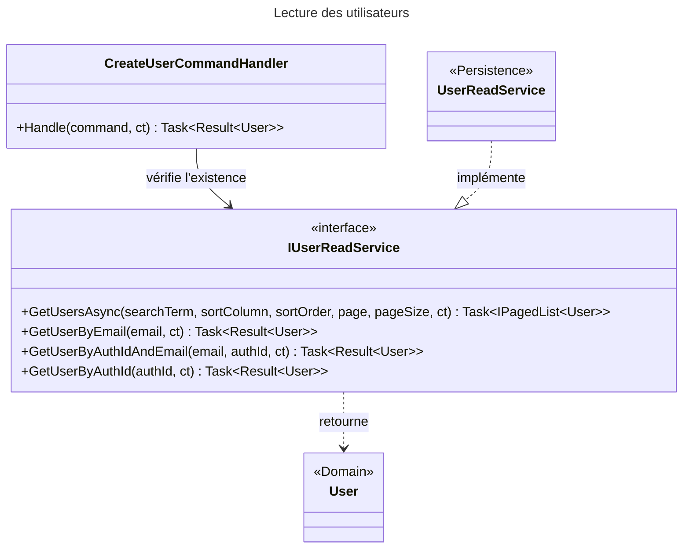

# C4 Code Level : Application.Users

## Vue d'ensemble

- **Nom** : Application.Users : contrat de lecture des utilisateurs
- **Description** : Interface de lecture des utilisateurs (recherche paginée, recherche par e-mail, par identifiant d'authentification, ou par les deux). Son implémentation réside dans `Persistence/Queries/UserReadService.cs`.
- **Emplacement** : [Application/Users/](../Application/Users/) (fichier [IUserReadService.cs](../Application/Users/IUserReadService.cs) ; sous-répertoire [Create/](../Application/Users/Create/) documenté à part)
- **Langage** : C# (.NET 10), `Task` asynchrone, `Result<T>`
- **Objectif** : Permettre aux handlers de la couche Application de lire les utilisateurs sans dépendre d'EF Core, et de tester la création d'un utilisateur (voir Users/Create).

## Éléments de code

### Interfaces

#### IUserReadService

- **Type** : interface publique (namespace `Application.Users`)
- **Signature** :

```csharp
public interface IUserReadService
{
    Task<IPagedList<User>> GetUsersAsync(
        string? searchTerm, UsersColumn? sortColumn, SortOrder? sortOrder,
        int page, int pageSize, CancellationToken cancellationToken = default);

    Task<Result<User>> GetUserByEmail(string? email, CancellationToken cancellationToken = default);

    Task<Result<User>> GetUserByAuthIdAndEmail(string? email, string? authId, CancellationToken cancellationToken = default);

    Task<Result<User>> GetUserByAuthId(string? authId, CancellationToken cancellationToken = default);
}
```

- **Description** :
  - `GetUsersAsync` : page d'utilisateurs filtrée par `searchTerm`, triée par `sortColumn` et `sortOrder` (tous deux facultatifs).
  - `GetUserByEmail` : utilisateur par e-mail. Renvoie une erreur `UsersError.BadRequest` si l'e-mail est vide, `UsersError.NotFound` s'il n'existe pas.
  - `GetUserByAuthIdAndEmail` : utilisateur qui correspond à la fois à l'e-mail et à l'identifiant d'authentification.
  - `GetUserByAuthId` : utilisateur par identifiant d'authentification.
- **Emplacement** : [IUserReadService.cs](../Application/Users/IUserReadService.cs) lignes 5-16 (`GetUsersAsync` ligne 9 ; `GetUserByEmail` ligne 11 ; `GetUserByAuthIdAndEmail` ligne 13 ; `GetUserByAuthId` ligne 15)
- **Dépendances** : `Application.Interfaces.IPagedList<T>`, `Domain.Primitives.Result<TValue>`, `Domain.Primitives.SortOrder`, `Domain.Users.User`, `Domain.Users.UsersColumn`.
- **Implémentée par** : `UserReadService` ([UserReadService.cs](../Persistence/Queries/UserReadService.cs), couche Persistence). Dans `GetUserByAuthIdAndEmail` (ligne 40), une absence renvoie `UsersError.NotFound` (ligne 52) sous forme de `Result` en échec, et non `null`.

## Dépendances

### Internes

- `Application.Interfaces` : `IPagedList<T>`.
- `Application.Users.Create` : `CreateUserCommandHandler` consomme `IUserReadService.GetUserByAuthIdAndEmail`.
- `Domain.Users` : `User`, `UsersColumn`, `UsersError` (codes d'erreur renvoyés par l'implémentation).
- `Domain.Primitives` : `Result<TValue>`, `SortOrder`.

### Externes

- `System.Threading.Tasks` et `System.Threading` (fournis par les implicit usings).
- Aucun paquet NuGet direct.

## Relations



## Notes

- **Emplacement inhabituel** : les autres interfaces de lecture (`IBookReadService`, `IStatisticsReadService`) sont dans `Application/Interfaces`. Celle-ci est dans `Application/Users`.
- **Erreurs en `Result`** : toutes les méthodes renvoient `Result<User>`, sauf `GetUsersAsync`, qui renvoie directement `IPagedList<User>`. Un appelant qui teste `is not null` sur un `Result<User>` obtient donc toujours `true` : il doit tester `IsSuccess`. Le bogue de `CreateUserCommandHandler` vient de là (voir cette documentation).
- **Jeton d'annulation** : toutes les méthodes de l'interface acceptent un `CancellationToken` optionnel (valeur par défaut `default`).
