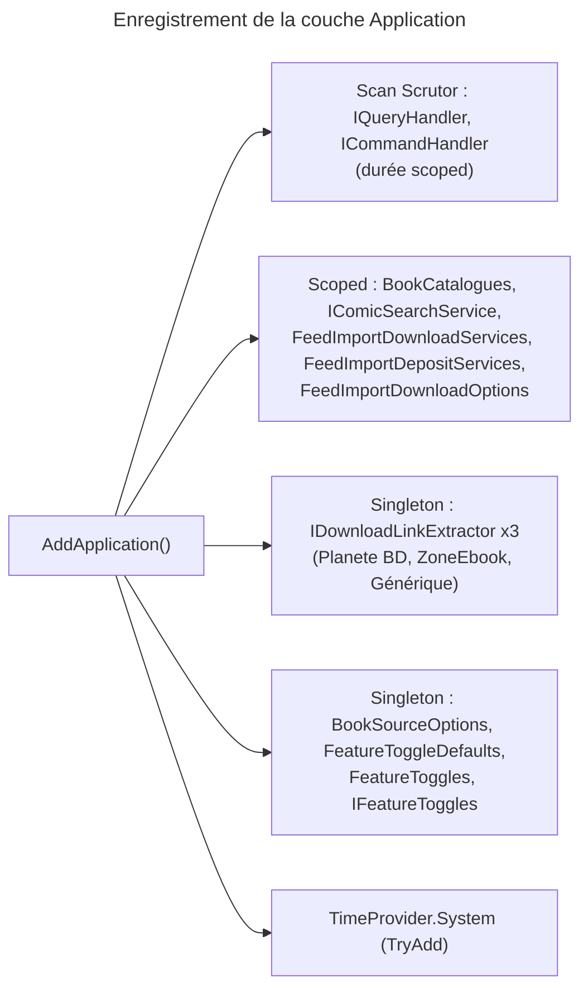

# C4 Code Level : Application (racine)

## Vue d'ensemble

- **Nom** : Application (racine) : enregistrement de la couche Application
- **Description** : Point d'entrée qui branche la couche Application dans le conteneur d'injection de dépendances. Il enregistre les handlers CQRS (par scan Scrutor) ainsi que les services de la racine : sources de métadonnées, téléchargements de flux, bascules de fonctionnalités et paramètres.
- **Emplacement** : [Application/](../Application/) (fichiers : [ApplicationDependencyInjection.cs](../Application/ApplicationDependencyInjection.cs), [Application.csproj](../Application/Application.csproj))
- **Langage** : C# (.NET 10, `Nullable` et `ImplicitUsings` activés)
- **Objectif** : Exposer `AddApplication` pour que la racine de composition (projet Web) enregistre la couche Application en une seule ligne. Les sous-répertoires sont documentés dans leurs propres fichiers `c4-code-Application-*.md`.

## Éléments de code

### Classes

#### ApplicationDependencyInjection

- **Type** : classe statique publique, espace de noms `Application`
- **Signature** :

```csharp
public static class ApplicationDependencyInjection
{
    public static IServiceCollection AddApplication(this IServiceCollection services);
}
```

- **Description** : Méthode d'extension qui enregistre tous les composants de la couche Application et retourne la collection pour permettre le chaînage.
- **Emplacement** : [ApplicationDependencyInjection.cs](../Application/ApplicationDependencyInjection.cs) lignes 13-44 (méthode lignes 15-43)
- **Enregistrements** :

| Lignes | Enregistrement | Durée de vie | Rôle |
|---|---|---|---|
| 19-23 | Scan Scrutor des classes assignables à `IQueryHandler<,>`, `ICommandHandler<>` et `ICommandHandler<,>` (`AsImplementedInterfaces`, `publicOnly: false`) | Scoped | Handlers CQRS auto-enregistrés |
| 25 | `BookCatalogues` | Scoped | Regroupe les catalogues interrogés par ISBN |
| 26 | `IComicSearchService` vers `ComicSearchService` | Scoped | Recherche de métadonnées par ISBN |
| 27 | `FeedImportDownloadServices` | Scoped | Services de téléchargement des imports de flux |
| 28 | `FeedImportDepositServices` | Scoped | Services de dépôt des fichiers importés |
| 29 | `FeedImportDownloadOptions` | Scoped | Options de téléchargement des imports |
| 32-34 | `IDownloadLinkExtractor` : `PlaneteBdLinkExtractor`, puis `ZoneEbookLinkExtractor`, puis `GenericDownloadLinkExtractor` | Singleton | Extracteurs de liens ; l'ordre d'enregistrement compte, le générique sert de repli |
| 35 | `TimeProvider.System` (`TryAddSingleton`) | Singleton | Horloge injectable, sans écraser une valeur déjà enregistrée |
| 37 | `BookSourceOptions` | Singleton | Configuration des sources de recherche par ISBN |
| 38 | `FeatureToggleDefaults` | Singleton | Valeurs de configuration des fonctionnalités |
| 39 | `FeatureToggles` | Singleton | Bascules effectives en mémoire |
| 40 | `IFeatureToggles` vers `FeatureToggles` | Singleton | Vue en lecture seule des bascules |

- **Dépendances** : voir la section Dépendances.

## Dépendances

### Internes

- `Application.Abstractions.Messaging` : interfaces de handlers scannées (voir [c4-code-Application-Abstractions-Messaging.md](c4-code-Application-Abstractions-Messaging.md)).
- `Application.ComicInfoSearch` : `BookCatalogues`, `ComicSearchService` (voir [c4-code-Application-ComicInfoSearch.md](c4-code-Application-ComicInfoSearch.md)).
- `Application.FeedImports.Analysis` : `IDownloadLinkExtractor` et `GenericDownloadLinkExtractor`.
- `Application.FeedImports.Analysis.Sites` : `PlaneteBdLinkExtractor` et `ZoneEbookLinkExtractor`.
- `Application.FeedImports.Download` : `FeedImportDownloadServices`, `FeedImportDepositServices`, `FeedImportDownloadOptions`.
- `Application.Interfaces` : `IComicSearchService`, `IFeatureToggles` (voir [c4-code-Application-Interfaces.md](c4-code-Application-Interfaces.md)).
- `Application.Settings` : `BookSourceOptions`, `FeatureToggleDefaults`, `FeatureToggles` (voir [c4-code-Application-Settings.md](c4-code-Application-Settings.md)).

### Externes

- **Scrutor** : scan d'assemblies et enregistrement automatique (`Scan`, `AddClasses`, `AsImplementedInterfaces`).
- **Microsoft.Extensions.DependencyInjection** : `IServiceCollection`, `TryAddSingleton` (namespace `Microsoft.Extensions.DependencyInjection.Extensions`).
- **System** : `TimeProvider`.
- **Paquets déclarés dans [Application.csproj](../Application/Application.csproj)** : Ardalis.GuardClauses, HtmlAgilityPack, Microsoft.Extensions.Http, Microsoft.Extensions.Logging.Abstractions, Microsoft.Extensions.Options.ConfigurationExtensions, Scrutor. Le projet référence `Domain` et rend ses internes visibles au projet `Application.UnitTests`.

## Relations



## Notes

- L'ordre d'enregistrement des `IDownloadLinkExtractor` détermine l'ordre d'essai : les extracteurs propres à un site doivent précéder l'extracteur générique.
- `AddApplication` ne configure pas les options (`IOptions<...>`) : la racine de composition doit les enregistrer, sinon la résolution de `BookSourceOptions` et `FeatureToggleDefaults` échoue au démarrage.
- Le scan `publicOnly: false` enregistre aussi les handlers internes.
