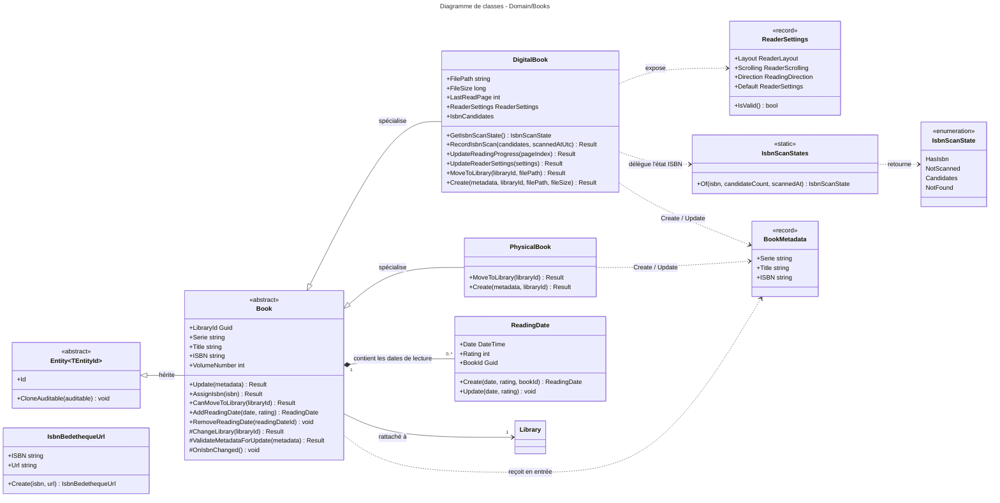

# Niveau C4 Code : Domain/Books

## 1. Vue d'ensemble

- **Nom** : Domain.Books
- **Description** : Modèle de domaine des livres de la collection : classe de base `Book` et ses deux spécialisations (`DigitalBook` pour les fichiers numériques, `PhysicalBook` pour les ouvrages papier), ainsi que les dates de lecture, les réglages du lecteur, les métadonnées et la gestion des ISBN détectés.
- **Emplacement relatif** : [Domain/Books](../Domain/Books)
- **Langage** : C# (.NET 10), modèle riche (entités avec invariants, méthodes de domaine retournant `Result`)
- **Objectif** : Garantir les règles métier d'un livre (création, mise à jour des métadonnées, déplacement entre bibliothèques, dates de lecture, progression et réglages de lecture, ISBN lus sur les pages) sans aucune dépendance vers la persistance ni l'interface.

## 2. Éléments de code

### 2.1 Classe `Book` (abstraite)

- **Signature** : `public abstract class Book : Entity<Guid>`
- **Description** : Agrégat de base d'un livre. Porte les métadonnées communes, le rattachement à une bibliothèque et la liste des dates de lecture. Les règles de mise à jour spécifiques au type passent par les hooks `ValidateMetadataForUpdate` et `OnIsbnChanged`.
- **Emplacement** : [Book.cs:6-113](../Domain/Books/Book.cs#L6-L113)
- **Membres publics** :
  - `public Guid LibraryId { get; protected set; }` (l.8)
  - `public Library? Library { get; protected set; }` (l.10)
  - `public string Serie { get; protected set; }` (l.12)
  - `public string Title { get; protected set; }` (l.14)
  - `public string? ISBN { get; protected set; }` (l.16)
  - `public int VolumeNumber { get; protected set; }` (l.18, défaut `1`)
  - `public string ImageLink { get; protected set; }` (l.20)
  - `public string Authors { get; protected set; }` (l.22)
  - `public string Publishers { get; protected set; }` (l.24)
  - `public DateOnly? PublishDate { get; protected set; }` (l.26)
  - `public int? NumberOfPages { get; protected set; }` (l.28)
  - `public IReadOnlyList<ReadingDate> ReadingDates { get; }` (l.31)
  - `public Result CanMoveToLibrary(Guid libraryId)` (l.36) : refuse `Guid.Empty` (`BooksError.BadRequest`) et le rangement dans la bibliothèque déjà courante (`BooksError.AlreadyInLibrary`). Appelée avant tout déplacement de fichier.
  - `public Result Update(BookMetadata metadata)` (l.58) : valide via `ValidateMetadataForUpdate`, copie toutes les métadonnées, puis appelle `OnIsbnChanged()`.
  - `public Result AssignIsbn(string isbn)` (l.80) : vérifie non vide et longueur `<= BookConstants.MaxIsbnLength` (sinon `BooksError.InvalidISBN`), affecte l'ISBN seul, appelle `OnIsbnChanged()`.
  - `public ReadingDate AddReadingDate(DateTime date, int rating)` (l.98) : crée une `ReadingDate` liée au livre et l'ajoute à la collection.
  - `public void RemoveReadingDate(Guid readingDateId)` (l.105) : supprime la date si elle existe, sans erreur sinon.
- **Membres protégés / virtuels** (surchargés par les sous-types) :
  - `protected Book()` (l.33) : constructeur EF Core.
  - `protected Result ChangeLibrary(Guid libraryId)` (l.46) : contrôle via `CanMoveToLibrary` puis affecte `LibraryId`.
  - `protected virtual Result ValidateMetadataForUpdate(BookMetadata metadata)` (l.92) : retourne toujours `Result.Success()` dans cette classe.
  - `protected virtual void OnIsbnChanged()` (l.94) : hook vide.
- **Dépendances** : `Entity<Guid>` (Primitives), `Library` (Libraries), `ReadingDate`, `BookMetadata`, `BooksError`, `BookConstants`, `Result` (Primitives).
- **Remarques** : `Update` valide les métadonnées avant toute affectation, donc un refus ne modifie pas l'entité. `ReadingDates` est exposé en lecture seule (`AsReadOnly`).

### 2.2 Classe `DigitalBook`

- **Signature** : `public sealed class DigitalBook : Book`
- **Description** : Livre numérique (fichier CBZ, CBR, PDF, etc.). Porte le chemin et la taille du fichier, la progression de lecture, les réglages d'affichage du lecteur et les candidats ISBN lus sur les pages.
- **Emplacement** : [DigitalBook.cs:5-132](../Domain/Books/DigitalBook.cs#L5-L132)
- **Membres publics** :
  - `public string FilePath { get; private set; }` (l.7)
  - `public long FileSize { get; private set; }` (l.9)
  - `public int LastReadPage { get; private set; }` (l.12, index 0 de la dernière page affichée)
  - `public ReaderLayout ReaderLayout { get; private set; }` (l.15)
  - `public ReaderScrolling ReaderScrolling { get; private set; }` (l.17)
  - `public ReadingDirection ReadingDirection { get; private set; }` (l.19)
  - `public ReaderSettings ReaderSettings { get; }` (l.21, projection des trois valeurs ci-dessus)
  - `public IReadOnlyList<string> IsbnCandidates { get; }` (l.25)
  - `public DateTime? IsbnScannedAt { get; private set; }` (l.28)
  - `public IsbnScanState GetIsbnScanState()` (l.32) : délègue à `IsbnScanStates.Of(ISBN, nombre de candidats, IsbnScannedAt)`.
  - `public Result RecordIsbnScan(IReadOnlyList<string> candidates, DateTime scannedAtUtc)` (l.34) : refuse une liste nulle ou contenant un élément vide (`BooksError.InvalidISBN`), remplace les candidats (doublons ordinaux supprimés) et horodate le scan.
  - `public Result UpdateReadingProgress(int pageIndex)` (l.56) : refuse un index négatif (`BooksError.BadRequest`).
  - `public Result UpdateReaderSettings(ReaderSettings settings)` (l.67) : refuse un réglage nul ou non valide (`IsValid`).
  - `public Result MoveToLibrary(Guid libraryId, string filePath)` (l.81) : refuse un chemin vide, change de bibliothèque via `ChangeLibrary`, puis enregistre le nouveau `FilePath`. Le fichier doit déjà avoir été déplacé par l'appelant.
  - `public static Result<DigitalBook> Create(BookMetadata metadata, Guid libraryId, string filePath, long fileSize)` (l.98) : valide série, titre, chemin, bibliothèque et `fileSize > 0`, génère un `Guid` v7.
- **Membres protégés / privés** :
  - `private DigitalBook()` (l.30) : constructeur EF Core.
  - `protected override void OnIsbnChanged()` (l.48) : vide `_isbnCandidates` dès qu'un ISBN est présent.
- **Dépendances** : `Book`, `ReaderSettings`, `ReaderLayout`, `ReaderScrolling`, `ReadingDirection`, `IsbnScanState`, `IsbnScanStates`, `BooksError`, `BookMetadata`, `Result`.
- **Remarques** : `UpdateReadingProgress` ne contrôle pas que l'index est inférieur au nombre de pages (le nombre de pages n'est pas connu ici). `RecordIsbnScan` ne tronque pas les valeurs.

### 2.3 Classe `PhysicalBook`

- **Signature** : `public sealed class PhysicalBook : Book`
- **Description** : Livre papier. Un ISBN est obligatoire à la création comme à la mise à jour.
- **Emplacement** : [PhysicalBook.cs:5-41](../Domain/Books/PhysicalBook.cs#L5-L41)
- **Membres publics** :
  - `public Result MoveToLibrary(Guid libraryId)` (l.9) : délègue à `ChangeLibrary`.
  - `public static Result<PhysicalBook> Create(BookMetadata metadata, Guid libraryId)` (l.11) : refuse si série, titre, ISBN ou bibliothèque sont absents ou vides.
- **Membres protégés / privés** :
  - `private PhysicalBook()` (l.7) : constructeur EF Core.
  - `protected override Result ValidateMetadataForUpdate(BookMetadata metadata)` (l.39) : refuse un ISBN vide (`BooksError.BadRequest`).
- **Dépendances** : `Book`, `BookMetadata`, `BooksError`, `Result`.
- **Remarques** : `PhysicalBook.Create` ne renseigne ni chemin de fichier ni taille (les livres papier n'ont pas de fichier). L'identifiant est généré en `Guid` v7 (l.23).

### 2.4 Classe `IsbnBedethequeUrl`

- **Signature** : `public sealed class IsbnBedethequeUrl : Entity<Guid>`
- **Description** : Association entre un ISBN et une URL de fiche Bédéthèque, mise en cache.
- **Emplacement** : [IsbnBedethequeUrl.cs:7-25](../Domain/Books/IsbnBedethequeUrl.cs#L7-L25)
- **Membres publics** :
  - `public string ISBN { get; private set; }` (l.9)
  - `public string Url { get; private set; }` (l.11)
  - `public static IsbnBedethequeUrl Create(string isbn, string url)` (l.15) : génère un `Guid` v7 et `CreatedOnUtc = DateTime.UtcNow`. Aucune validation.
- **Membres privés** : `private IsbnBedethequeUrl()` (l.13).
- **Dépendances** : `Entity<Guid>`.
- **Remarques** : Le pragma `CA1054, CA1056` (l.5 et l.26) autorise une URL stockée sous forme de `string`.

### 2.5 Classe `ReadingDate`

- **Signature** : `public class ReadingDate : Entity<Guid>`
- **Description** : Date de lecture d'un livre accompagnée d'une note.
- **Emplacement** : [ReadingDate.cs:5-30](../Domain/Books/ReadingDate.cs#L5-L30)
- **Membres publics** :
  - `public DateTime Date { get; protected set; }` (l.7)
  - `public int Rating { get; protected set; }` (l.9)
  - `public Guid BookId { get; protected set; }` (l.11)
  - `public static ReadingDate Create(DateTime date, int rating, Guid bookId)` (l.13) : génère un `Guid` v7.
  - `public void Update(DateTime date, int rating)` (l.25) : affecte directement les deux valeurs.
- **Dépendances** : `Entity<Guid>`.
- **Remarques** : Aucune validation de la note (1 à 5) dans ce répertoire. `BooksError.InvalidRating` est défini dans `BooksError` (l.12) mais n'est référencé nulle part dans `Domain/Books`.

### 2.6 Enumération `IsbnScanState` et classe statique `IsbnScanStates`

- **Signature** : `public enum IsbnScanState { HasIsbn, NotScanned, Candidates, NotFound }` et `public static class IsbnScanStates`
- **Description** : Position d'un livre dans la recherche de l'ISBN imprimé sur ses pages. `HasIsbn` : un ISBN est déjà présent. `NotScanned` : pas encore scanné. `Candidates` : plusieurs ISBN lus, l'utilisateur choisit. `NotFound` : pages lues sans ISBN.
- **Emplacement** : [IsbnScanState.cs:4-31](../Domain/Books/IsbnScanState.cs#L4-L31)
- **Membres publics** :
  - `public static IsbnScanState Of(string? isbn, int candidateCount, DateTime? scannedAt)` (l.17) : ordre de décision : ISBN renseigné, puis candidats, puis `scannedAt` nul (`NotScanned`) ou non (`NotFound`).
- **Dépendances** : aucune externe.

### 2.7 Types de réglages du lecteur : `ReaderLayout`, `ReaderScrolling`, `ReadingDirection`, `ReaderSettings`

- **Signatures** :
  - `public enum ReaderLayout { FitWidth, SinglePage, TwoPages }` (l.6-16)
  - `public enum ReaderScrolling { Continuous, PageByPage }` (l.18-25)
  - `public enum ReadingDirection { LeftToRight, RightToLeft }` (l.27-33)
  - `public sealed record ReaderSettings(ReaderLayout Layout, ReaderScrolling Scrolling, ReadingDirection Direction)` (l.35-41)
- **Membres de `ReaderSettings`** :
  - `public static ReaderSettings Default { get; }` (l.37) : `FitWidth`, `Continuous`, `LeftToRight`.
  - `public bool IsValid()` (l.39-40) : vérifie `Enum.IsDefined` pour les trois valeurs.
- **Description** : Mise en page (pleine largeur, page seule, deux pages), défilement (continu ou page par page), sens de lecture (`RightToLeft` pour les mangas). Les valeurs sont persistées sous forme numérique, l'ordre doit donc être conservé (commentaire l.3).
- **Emplacement** : [ReaderSettings.cs:3-41](../Domain/Books/ReaderSettings.cs#L3-L41)
- **Dépendances** : aucune externe.

### 2.8 Record `BookMetadata`

- **Signature** : `public sealed record BookMetadata(string Serie, string Title, string? ISBN, int VolumeNumber = 1, string ImageLink = "", string Authors = "", string Publishers = "", DateOnly? PublishDate = null, int? NumberOfPages = null)`
- **Description** : Jeu de métadonnées transmis aux méthodes `Create` et `Update`, indépendant de la persistance.
- **Emplacement** : [BookMetadata.cs:3-12](../Domain/Books/BookMetadata.cs#L3-L12)
- **Dépendances** : aucune externe.

### 2.9 Classe statique `BookConstants`

- **Signature** : `public static class BookConstants`
- **Membres publics (constantes)** :
  - `MaxSerieLength = 200` (l.5)
  - `MaxTitleLength = 200` (l.6)
  - `MaxIsbnLength = 20` (l.7)
  - `MaxImageLinkLength = 500` (l.8)
  - `MaxAuthorsLength = 200` (l.9)
  - `MaxPublishersLength = 200` (l.10)
  - `MaxFilePathLength = 500` (l.11)
- **Emplacement** : [BookConstants.cs:3-12](../Domain/Books/BookConstants.cs#L3-L12)
- **Remarques** : Seule `MaxIsbnLength` est appliquée dans ce répertoire (`Book.AssignIsbn`). Les autres longueurs sont à contrôler en amont (validateurs ou configuration EF).

### 2.10 Classe statique `BooksError`

- **Signature** : `public static class BooksError` (portée l.5-22). Chaque membre est un `public static readonly TError`.
- **Membres publics (erreurs)** :
  - `BadRequest` = `("BOK400", "Verify the request parameters.")` (l.7)
  - `NotFound` = `("BOK404", "Book not found")` (l.8)
  - `Duplicate` = `("BOK409", ...)` (l.9)
  - `ValidationError` = `("BOK504", ...)` (l.10)
  - `InvalidISBN` = `("BOK505", "The ISBN format is invalid")` (l.11)
  - `InvalidRating` = `("BOK506", "The rating must be between 1 and 5")` (l.12)
  - `DialogError` = `("BOK701", ...)` (l.13)
  - `DialogCanceled` = `("BOK702", ...)` (l.14)
  - `ScanError` = `("BOK801", ...)` (l.15)
  - `CameraError` = `("BOK802", ...)` (l.16)
  - `AlreadyInLibrary` = `("BOK410", ...)` (l.17)
  - `FileNotFound` = `("BOK411", ...)` (l.18)
  - `FileAlreadyExists` = `("BOK412", ...)` (l.19)
  - `NotDigital` = `("BOK413", ...)` (l.20)
  - `PageNotFound` = `("BOK414", ...)` (l.21)
- **Dépendances** : `TError` (Primitives).
- **Remarques** : `DialogError`, `DialogCanceled`, `ScanError`, `CameraError` concernent l'interface (dialogue, scan, caméra) et sont définies ici par convention. `NotDigital` et `FileNotFound` ne sont pas utilisées dans les règles de `Domain/Books`.

## 3. Dépendances

### 3.1 Dépendances internes

- **Vers `Domain/Primitives`** : `Entity<Guid>` (base de `Book`, `ReadingDate`, `IsbnBedethequeUrl`), `Result` / `Result<T>` (retours de toutes les méthodes de domaine), `TError` (codes d'erreur de `BooksError`).
- **Vers `Domain/Libraries`** : `Library` (propriété de navigation `Book.Library`). Dépendance réciproque : `Library` référence `Book` et `PhysicalBook` / `DigitalBook` dans `Library.CanContain`.
- **Au sein de `Domain/Books`** : tous les types du répertoire s'appuient sur `BooksError`, `BookConstants` ou `BookMetadata`.

### 3.2 Dépendances externes

- Bibliothèque BCL : `System` (`Guid`, `DateTime`, `DateOnly`, `Enum`), `System.Linq`, `System.Collections.Generic`.
- Aucune dépendance vers EF Core, ASP.NET ni MudBlazor : les constructeurs privés `protected` / `private` sont réservés à EF Core (matérialisation).
- Le type `Entity<TEntityId>` tire `Ardalis.GuardClauses` (via `Domain/Primitives`, hors périmètre de ce document).

## 4. Relations

Les relations ci-dessous concernent les types du répertoire `Domain/Books`. Les flèches sont numérotées conformément au code.

### 4.1 Relations principales (texte)

- `DigitalBook` et `PhysicalBook` héritent de `Book`. Le hook `ValidateMetadataForUpdate` impose un ISBN au livre papier, et `OnIsbnChanged` vide les candidats ISBN du livre numérique.
- `Book.CanMoveToLibrary` est appelée avant tout déplacement de fichier (règle de cohérence entre stockage et base de données).
- `DigitalBook.GetIsbnScanState` s'appuie sur `IsbnScanStates.Of` pour dériver l'état de scan.
- Les identifiants des bibliothèques, des dates de lecture et des livres sont utilisés par référence (`Guid`) dans les autres répertoires du domaine (par exemple `Domain/FeedImports` avec `MatchedBookId`).
