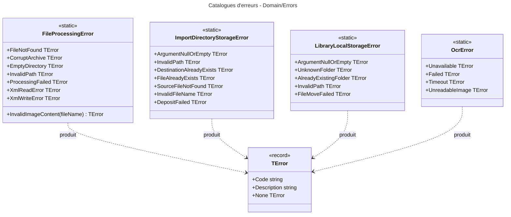

# Niveau C4 Code : Domain/Errors

## 1. Vue d'ensemble

- **Nom** : Domain.Errors
- **Description** : Catalogues transverses d'erreurs métier, regroupés par domaine technique : traitement de fichiers (archives, XML, images), stockage des dossiers de bibliothèque, dossier d'import et moteur OCR. Chaque erreur est un `TError` (code et description).
- **Emplacement relatif** : [Domain/Errors](../Domain/Errors)
- **Langage** : C# (.NET 10)
- **Objectif** : Centraliser les codes d'erreur réutilisés par plusieurs couches (traitement de fichiers, stockage, OCR) afin que les handlers retournent des `Result` cohérents, sans exceptions pour les cas connus.

## 2. Éléments de code

### 2.1 Classe statique `FileProcessingError`

- **Signature** : `public static class FileProcessingError`
- **Description** : Erreurs liées au traitement de fichiers (lecture d'archive, répertoire source, ComicInfo.xml, conversion d'image).
- **Emplacement** : [FileProcessingError.cs:5-17](../Domain/Errors/FileProcessingError.cs#L5-L17)
- **Membres publics** :
  - `public static readonly TError FileNotFound` = `("FP404", "The specified file was not found.")` (l.7)
  - `public static readonly TError CorruptArchive` = `("FP422", "The archive file is corrupt or cannot be read.")` (l.8)
  - `public static readonly TError EmptyDirectory` = `("FP400", "The source directory contains no processable files.")` (l.9)
  - `public static readonly TError InvalidPath` = `("FP401", "The specified path is invalid or does not exist.")` (l.10)
  - `public static readonly TError ProcessingFailed` = `("FP500", "File processing failed.")` (l.11)
  - `public static readonly TError XmlReadError` = `("FP501", "Failed to read the ComicInfo.xml file.")` (l.12)
  - `public static readonly TError XmlWriteError` = `("FP502", "Failed to write the ComicInfo.xml file.")` (l.13)
  - `public static TError InvalidImageContent(string fileName)` (l.15-16) : produit `("FP503", "Image '<fileName>' could not be converted: ...")`. Seul membre à paramètre.
- **Dépendances** : `TError` (Primitives).

### 2.2 Classe statique `ImportDirectoryStorageError`

- **Signature** : `public static class ImportDirectoryStorageError`
- **Description** : Erreurs du dépôt dans le dossier d'import (« À trier ») : chemins, collisions de noms, fichier source absent.
- **Emplacement** : [ImportDirectoryStorageError.cs:5-14](../Domain/Errors/ImportDirectoryStorageError.cs#L5-L14)
- **Membres publics** (tous `public static readonly TError`) :
  - `ArgumentNullOrEmpty` = `("ImportDir.ArgumentNullOrEmpty", "Directory name is null or empty.")` (l.7)
  - `InvalidPath` = `("ImportDir.InvalidPath", "The path is outside the allowed import root directory.")` (l.8)
  - `DestinationAlreadyExists` = `("ImportDir.DestinationAlreadyExists", ...)` (l.9)
  - `FileAlreadyExists` = `("ImportDir.FileAlreadyExists", ...)` (l.10)
  - `SourceFileNotFound` = `("ImportDir.SourceFileNotFound", "The file to deposit does not exist.")` (l.11)
  - `InvalidFileName` = `("ImportDir.InvalidFileName", "The file name is empty or invalid.")` (l.12)
  - `DepositFailed` = `("ImportDir.DepositFailed", "The file could not be moved into the import directory.")` (l.13)
- **Dépendances** : `TError`.

### 2.3 Classe statique `LibraryLocalStorageError`

- **Signature** : `public static class LibraryLocalStorageError`
- **Description** : Erreurs du stockage local des dossiers de bibliothèque numérique (création, suppression, déplacement de fichiers).
- **Emplacement** : [LibraryLocalStorageError.cs:5-12](../Domain/Errors/LibraryLocalStorageError.cs#L5-L12)
- **Membres publics** (tous `public static readonly TError`) :
  - `ArgumentNullOrEmpty` = `("ArgumentNullOrEmpty", "path is null.")` (l.7)
  - `UnknownFolder` = `("UnknownFolder", "The folder doesn't exist.")` (l.8)
  - `AlreadyExistingFolder` = `("AlreadyExistingFolder", "The destination directory already exists.")` (l.9)
  - `InvalidPath` = `("InvalidPath", "The path is outside the allowed root directory.")` (l.10)
  - `FileMoveFailed` = `("FileMoveFailed", "The file could not be moved.")` (l.11)
- **Dépendances** : `TError`.
- **Remarques** : Contrairement aux autres catalogues, les codes n'ont pas de préfixe de module (`ArgumentNullOrEmpty`, `InvalidPath`). `InvalidPath` existe aussi dans `ImportDirectoryStorageError` et `FileProcessingError` avec des codes différents.

### 2.4 Classe statique `OcrError`

- **Signature** : `public static class OcrError`
- **Description** : Erreurs du moteur de reconnaissance optique (OCR) lors de la lecture de l'ISBN sur les pages.
- **Emplacement** : [OcrError.cs:5-11](../Domain/Errors/OcrError.cs#L5-L11)
- **Membres publics** (tous `public static readonly TError`) :
  - `Unavailable` = `("OCR503", "The OCR engine is not available.")` (l.7)
  - `Failed` = `("OCR500", "The OCR engine failed to read the page.")` (l.8)
  - `Timeout` = `("OCR504", "The OCR engine took too long to read the page.")` (l.9)
  - `UnreadableImage` = `("OCR422", "The page image cannot be read.")` (l.10)
- **Dépendances** : `TError`.

## 3. Dépendances

### 3.1 Dépendances internes

- `Domain/Primitives` : type `TError` utilisé par les quatre classes (aucune autre dépendance).
- Aucune dépendance vers les autres sous-répertoires de `Domain`.
- Référencé par les autres répertoires du domaine : par exemple `Domain/Libraries` et `Domain/FeedImports` produisent leurs propres codes et ne réutilisent pas ces catalogues dans leurs fichiers.

### 3.2 Dépendances externes

- Aucune. Les fichiers ne contiennent que `using Domain.Primitives;` et des déclarations statiques.

## 4. Relations

Les quatre catalogues sont indépendants les uns des autres. Ils ne dépendent que du type `TError`. Ce répertoire ne contient aucune référence vers les couches supérieures : l'usage effectif de ces codes (handlers CQRS retournant `Result<T>`) relève de `Application` et n'est pas vérifié ici.
