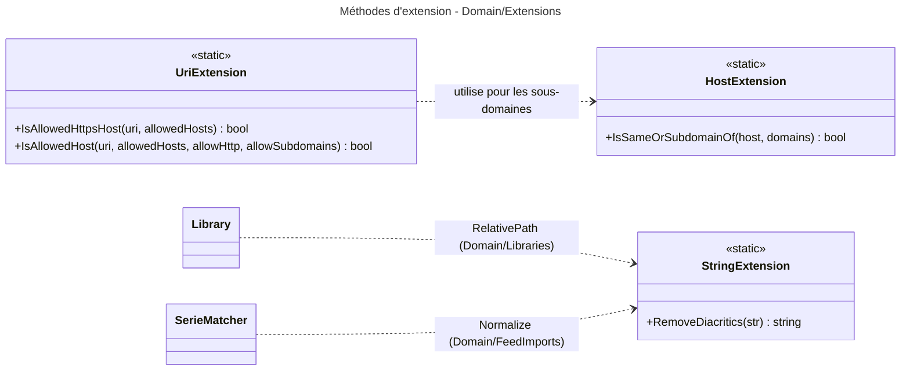

# Niveau C4 Code : Domain/Extensions

## 1. Vue d'ensemble

- **Nom** : Domain.Extensions
- **Description** : Méthodes d'extension utilitaires sans état : normalisation de texte (suppression des diacritiques), contrôle de domaines d'hôtes (sous-domaines compris) et validation d'URI HTTPS ou HTTP autorisées.
- **Emplacement relatif** : [Domain/Extensions](../Domain/Extensions)
- **Langage** : C# (.NET 10), méthodes d'extension statiques
- **Objectif** : Fournir des primitives de comparaison et de validation réutilisables par les règles de domaine (noms de dossiers de bibliothèque, séries, hôtes de téléchargement), indépendantes de la configuration régionale du système.

## 2. Éléments de code

### 2.1 Classe statique `StringExtension`

- **Signature** : `public static class StringExtension`
- **Description** : Suppression des diacritiques latins, grecs et cyrillique via une table de correspondance, sans dépendre de `string.Normalize` (qui nécessite ICU et n'est pas opérant en mode d'invariance de globalisation, par exemple dans les images « chiseled »). Le résultat sert de base aux noms de dossiers de bibliothèque.
- **Emplacement** : [StringExtension.cs:7-72](../Domain/Extensions/StringExtension.cs#L7-L72)
- **Membres publics** :
  - `public static string RemoveDiacritics(this string str)` (l.53-71) : retourne la chaîne sans marques diacritiques (`NonSpacingMark`) et remplace chaque lettre accentuée connue par sa lettre de base. Une chaîne nulle ou vide est retournée telle quelle.
- **Membres privés** :
  - `private const string Accented` (l.12-29) : caractères précomposés U+00C0 à U+1FFF.
  - `private const string Unaccented` (l.31-48) : lettres de base en correspondance positionnelle avec `Accented`.
  - `private static readonly FrozenDictionary<char, char> s_baseLetters` (l.50-51) : construit par `Zip` puis `ToFrozenDictionary`.
- **Dépendances** : `System.Collections.Frozen`, `System.Globalization` (`CharUnicodeInfo`, `UnicodeCategory`), `System.Text` (`StringBuilder`).
- **Remarques** : La correspondance est positionnelle : toute modification de `Accented` doit garder le même nombre de caractères que `Unaccented`. Les deux chaînes sont supposées de même longueur, aucune vérification n'est faite à l'exécution.

### 2.2 Classe statique `HostExtension`

- **Signature** : `public static class HostExtension`
- **Description** : Contrôle qu'un nom d'hôte appartient à une liste de domaines autorisés, soit à l'identique, soit comme sous-domaine (par exemple `cdn.1fichier.com` correspond à `1fichier.com`).
- **Emplacement** : [HostExtension.cs:3-31](../Domain/Extensions/HostExtension.cs#L3-L31)
- **Membres publics** :
  - `public static bool IsSameOrSubdomainOf(this string? host, IEnumerable<string> domains)` (l.6-30) : retourne `false` si l'hôte est vide, si la liste est nulle, ou si aucun domaine ne correspond. Compare sans tenir compte de la casse (`OrdinalIgnoreCase`). Ignore les domaines vides ou nuls et supprime les espaces et les points finaux.
- **Dépendances** : `System.Collections.Generic` (`IEnumerable<T>`), `System` (`StringComparison`).

### 2.3 Classe statique `UriExtension`

- **Signature** : `public static class UriExtension`
- **Description** : Contrôle de validité d'une `Uri` contre un ensemble d'hôtes autorisés.
- **Emplacement** : [UriExtension.cs:3-14](../Domain/Extensions/UriExtension.cs#L3-L14)
- **Membres publics** :
  - `public static bool IsAllowedHttpsHost(this Uri? uri, IReadOnlySet<string> allowedHosts)` (l.5-6) : équivaut à `IsAllowedHost(allowedHosts, allowHttp: false)`.
  - `public static bool IsAllowedHost(this Uri? uri, IReadOnlySet<string> allowedHosts, bool allowHttp, bool allowSubdomains = false)` (l.10-13) : exige une URI non nulle, de schéma `https` (ou `http` si `allowHttp`), et un hôte exactement dans `allowedHosts` ou, si `allowSubdomains`, un sous-domaine d'un de ces hôtes (via `IsSameOrSubdomainOf`).
- **Dépendances** : `System` (`Uri`, `Uri.UriSchemeHttps`), `HostExtension` (même répertoire), `IReadOnlySet<T>`.
- **Remarques** : Le commentaire l.8 indique que `allowHttp` ne doit servir qu'aux services internes atteints sur un réseau privé (exemple : Miniflux sur le réseau Docker). `allowSubdomains` est destiné aux hébergeurs de fichiers qui servent depuis `cdn.<hôte>`.

## 3. Dépendances

### 3.1 Dépendances internes

- `UriExtension` utilise `HostExtension.IsSameOrSubdomainOf` (même répertoire).
- `StringExtension.RemoveDiacritics` est consommé dans `Domain/Libraries` (`Library.RelativePath`) et `Domain/FeedImports` (`SerieMatcher.Normalize`).
- Aucune dépendance vers d'autres répertoires de `Domain` pour le code de ce répertoire.

### 3.2 Dépendances externes

- BCL .NET uniquement : `System.Collections.Frozen`, `System.Globalization`, `System.Text`, `System.Uri`, `System.Collections.Generic`.

## 4. Relations

Les flèches `Library` et `SerieMatcher` désignent des consommateurs situés dans d'autres répertoires du domaine. Elles ne sont pas des types de `Domain/Extensions`.
