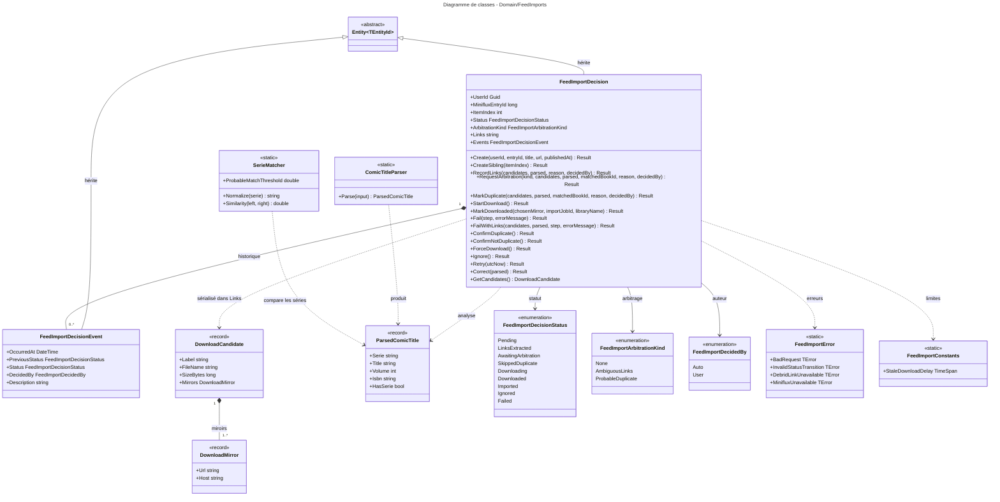
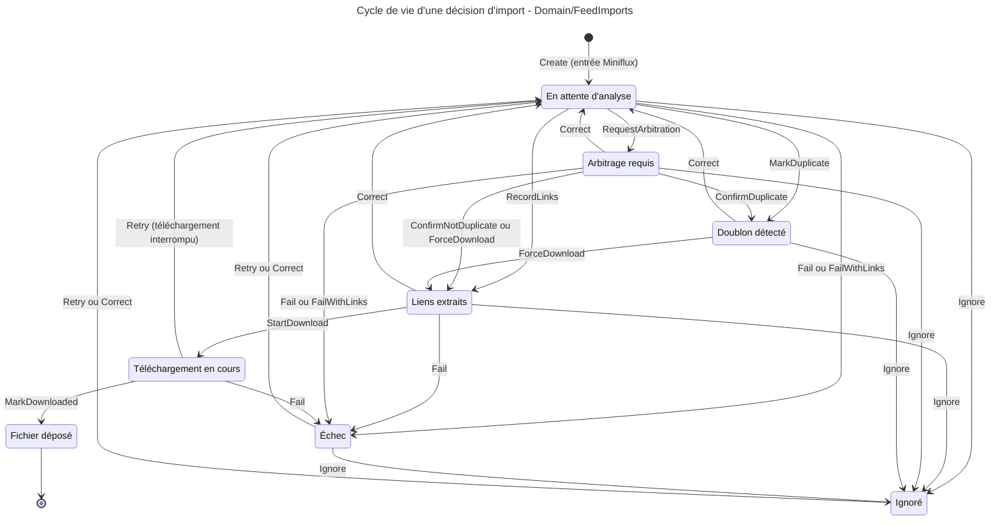

# Niveau C4 Code : Domain/FeedImports

## 1. Vue d'ensemble

- **Nom** : Domain.FeedImports
- **Description** : Modèle de domaine de l'import automatique de BD à partir d'articles enregistrés dans Miniflux. Comprend l'agrégat `FeedImportDecision` (une décision par livre trouvé dans un article, avec son cycle de vie et son historique), son événement d'historique, les candidats de téléchargement (liens et miroirs), l'analyse du titre (`ComicTitleParser`), la comparaison de séries (`SerieMatcher`) et les erreurs.
- **Emplacement relatif** : [Domain/FeedImports](../Domain/FeedImports)
- **Langage** : C# (.NET 10), expressions régulières source-générées (`GeneratedRegex`), sérialisation JSON (`System.Text.Json`)
- **Objectif** : Décider, de manière traçable et sans effet de bord, de ce qui doit être téléchargé à partir d'un article : extraction des liens, détection des doublons probables avec la bibliothèque, arbitrage utilisateur, téléchargement, échec ou ignorance. Chaque transition est historisée.

## 2. Éléments de code

### 2.1 Classe `FeedImportDecision`

- **Signature** : `public class FeedImportDecision : Entity<Guid>`
- **Description** : Agrégat central. Une décision est créée pour l'article Miniflux (`ItemIndex = 0`), puis une décision « frère » (`ItemIndex` = 1..n) par livre supplémentaire trouvé dans le même article. Toutes les transitions de statut passent par la méthode privée `Transition`, qui ajoute un `FeedImportDecisionEvent`.
- **Emplacement** : [FeedImportDecision.cs:8-483](../Domain/FeedImports/FeedImportDecision.cs#L8-L483)
- **Constante publique** :
  - `public const string CreatedReason = "Article saved from Miniflux.";` (l.10)
- **Propriétés publiques (lecture, set privé)** :
  - `Guid UserId` (l.12)
  - `long MinifluxEntryId` (l.14)
  - `int ItemIndex` (l.17) : 0 pour l'article, 1..n pour les livres supplémentaires
  - `string EntryTitle` (l.19)
  - `string EntryUrl` (l.21)
  - `DateTime? PublishedAt` (l.23)
  - `string? ParsedSerie` (l.25)
  - `string? ParsedTitle` (l.27)
  - `int? ParsedVolume` (l.29)
  - `string? Links` (l.31) : JSON de `List<DownloadCandidate>`
  - `string? ChosenMirror` (l.33)
  - `Guid? MatchedBookId` (l.35)
  - `Guid? ImportJobId` (l.37)
  - `FeedImportDecisionStatus Status` (l.39)
  - `FeedImportArbitrationKind ArbitrationKind` (l.41)
  - `string Reason` (l.43)
  - `FeedImportDecidedBy DecidedBy` (l.45)
  - `string? ErrorMessage` (l.47)
  - `string? ErrorStep` (l.49)
  - `DateTime CreatedAt` (l.51)
  - `DateTime UpdatedAt` (l.53)
  - `IReadOnlyList<FeedImportDecisionEvent> Events` (l.56, lecture seule)
- **Méthodes de création** :
  - `public static Result<FeedImportDecision> Create(Guid userId, long minifluxEntryId, string entryTitle, string entryUrl, DateTime? publishedAt)` (l.68-112) : refuse un utilisateur vide, un identifiant d'entrée `<= 0`, une URL absente, trop longue (`MaxEntryUrlLength`), non absolue ou d'un schéma autre que http/https (`FeedImportError.BadRequest`). Un titre vide est remplacé par l'URL, puis tronqué à `MaxEntryTitleLength`. Statut initial `Pending`, avec un événement initial.
  - `public Result<FeedImportDecision> CreateSibling(int itemIndex)` (l.132-166) : crée un frère avec `ItemIndex = itemIndex`. Exige `itemIndex > 0`, un parent avec `ItemIndex == 0` et un statut `Pending` (sinon `BadRequest` ou `InvalidStatusTransition`). Reprend la date de création du parent.
- **Analyse et arbitrage** :
  - `public IReadOnlyList<DownloadCandidate> GetCandidates()` (l.114-129) : désérialise `Links`. Retourne une liste vide si `Links` est vide ou en cas d'échec JSON.
  - `public Result RecordLinks(IReadOnlyList<DownloadCandidate> candidates, ParsedComicTitle parsed, string reason, FeedImportDecidedBy decidedBy)` (l.168-181) : statut vers `LinksExtracted`, réinitialise `MatchedBookId` et `ArbitrationKind`.
  - `public Result RequestArbitration(FeedImportArbitrationKind kind, IReadOnlyList<DownloadCandidate> candidates, ParsedComicTitle parsed, Guid? matchedBookId, string reason, FeedImportDecidedBy decidedBy)` (l.183-207) : `kind` doit être différent de `None` et défini. Statut vers `AwaitingArbitration`.
  - `public Result MarkDuplicate(IReadOnlyList<DownloadCandidate> candidates, ParsedComicTitle parsed, Guid matchedBookId, string reason, FeedImportDecidedBy decidedBy)` (l.209-232) : `matchedBookId` non vide. Statut vers `SkippedDuplicate`.
  - `public Result FailWithLinks(IReadOnlyList<DownloadCandidate> candidates, ParsedComicTitle parsed, string step, string errorMessage)` (l.431-447) : enregistre les liens puis passe en `Failed`, pour un lien qui ne peut pas être téléchargé automatiquement (l'utilisateur peut le faire à la main).
- **Décisions de l'utilisateur** :
  - `public Result ConfirmNotDuplicate()` (l.234-245) : `AwaitingArbitration` avec `ProbableDuplicate` vers `LinksExtracted` (décidé par l'utilisateur).
  - `public Result ConfirmDuplicate()` (l.247-259) : même condition, exige `MatchedBookId` non nul, passe en `SkippedDuplicate`.
  - `public Result Ignore()` (l.345-355) : vers `Ignored`, si `CanIgnore`.
  - `public Result ForceDownload()` (l.357-368) : vers `LinksExtracted`, si `CanForceDownload`.
  - `public Result Retry(DateTime utcNow)` (l.371-380) : vers `Pending`, si `CanRetry(utcNow)`. Les liens sont conservés.
  - `public Result Correct(ParsedComicTitle parsed)` (l.382-400) : `parsed.HasSerie` requis, puis met à jour `ParsedSerie`, `ParsedTitle`, `ParsedVolume` et repasse en `Pending`. Possible uniquement avec un seul lien (`CanCorrect`).
- **Téléchargement** :
  - `public Result StartDownload()` (l.261-270) : `LinksExtracted` vers `Downloading` (Debrid-Link).
  - `public Result NoteMirrorFailure(string host, string error)` (l.273-286) : n'altère pas le statut, ajoute un événement « Mirror <hôte> failed ».
  - `public Result MarkDownloaded(string chosenMirror, Guid importJobId, string targetLibraryName)` (l.288-305) : `Downloading` vers `Downloaded` (état final), renseigne `ChosenMirror` et `ImportJobId`.
  - `public Result Fail(string step, string errorMessage)` (l.411-428) : passe en `Failed` si le statut n'est pas final (`s_finalStatuses`), tronque `ErrorStep` et `ErrorMessage`, et réinitialise `ArbitrationKind`.
- **Droits d'action (propriétés et méthodes de lecture)** :
  - `bool CanIgnore` (l.321) : statut dans `s_ignorableStatuses` (Pending, LinksExtracted, AwaitingArbitration, SkippedDuplicate, Failed).
  - `bool CanForceDownload` (l.324-327) : un seul lien, et (`SkippedDuplicate` ou `AwaitingArbitration` avec `ProbableDuplicate`).
  - `bool CanCorrect` (l.330) : un seul lien, et statut dans `s_correctableStatuses`.
  - `bool CanRetry(DateTime utcNow)` (l.332-334) : `Failed`, `Ignored`, ou `Downloading` sans téléchargement en cours.
  - `bool CanDelete(DateTime utcNow)` (l.338) : tout sauf un téléchargement en cours. Le contrôle du job d'import lié est fait par l'appelant.
- **Membres privés** :
  - `private FeedImportDecision()` (l.66) : protected, constructeur EF Core.
  - `private static readonly` : `s_linksJsonOptions` (l.58, `JsonSerializerDefaults.Web`), `s_analyzableStatuses` (l.60-61), `s_finalStatuses` (l.63-64), `s_ignorableStatuses` (l.309-313), `s_correctableStatuses` (l.315-319).
  - `private bool IsDownloadInProgress(DateTime utcNow)` (l.340-341) : `Downloading` et `utcNow - UpdatedAt < StaleDownloadDelay` (1 heure).
  - `private bool HasSingleCandidate` (l.343) : `GetCandidates().Count == 1`.
  - `private void Reopen(string reason)` (l.402-409) : réinitialise le lien vers doublon, l'erreur, puis passe en `Pending` avec `DecidedBy = User`.
  - `private Result EnsureCanAnalyze(...)` (l.449-457) : refuse liens vides, liens sans miroir ou `parsed` nul (`BadRequest`), puis exige un statut `Pending` ou `AwaitingArbitration`.
  - `private void SetAnalysis(...)` (l.459-465) : sérialise les liens et copie série, titre et volume.
  - `private void Transition(...)` (l.467-476) : met à jour `Status`, `Reason` (tronqué à 1000), `DecidedBy`, `UpdatedAt` et ajoute l'événement.
  - `private static string Truncate(string, int)` (l.478-479) et `private static string? TruncateOrNull(string?, int)` (l.481-482).
- **Dépendances** : `Entity<Guid>`, `Result`, `FeedImportError`, `FeedImportConstants`, `FeedImportDecisionStatus`, `FeedImportArbitrationKind`, `FeedImportDecidedBy`, `FeedImportDecisionEvent`, `DownloadCandidate`, `ParsedComicTitle`, `System.Text.Json`.
- **Remarques** :
  - `CanRetry`, `CanDelete` et `CanForceDownload` dépendent de `GetCandidates()` (désérialisation JSON à chaque appel pour `HasSingleCandidate`).
  - `ParsedComicTitle.Isbn` n'est pas stocké : `SetAnalysis` ne retient que série, titre et volume.
  - `FeedImportDecisionStatus.Imported` n'est jamais utilisé par ce code.

### 2.2 Classe `FeedImportDecisionEvent`

- **Signature** : `public class FeedImportDecisionEvent : Entity<Guid>`
- **Description** : Entrée d'historique d'une décision : ancien statut, nouveau statut, auteur et description.
- **Emplacement** : [FeedImportDecisionEvent.cs:5-37](../Domain/FeedImports/FeedImportDecisionEvent.cs#L5-L37)
- **Membres publics (propriétés)** :
  - `public Guid FeedImportDecisionId { get; private set; }` (l.7)
  - `public DateTime OccurredAt { get; private set; }` (l.9)
  - `public FeedImportDecisionStatus? PreviousStatus { get; private set; }` (l.11, `null` à la création)
  - `public FeedImportDecisionStatus Status { get; private set; }` (l.13)
  - `public FeedImportDecidedBy DecidedBy { get; private set; }` (l.15)
  - `public string Description { get; private set; }` (l.17)
- **Membres protégés / internes** :
  - `protected FeedImportDecisionEvent()` (l.19) : constructeur EF Core.
  - `internal static FeedImportDecisionEvent Create(Guid feedImportDecisionId, DateTime occurredAt, FeedImportDecisionStatus? previousStatus, FeedImportDecisionStatus status, FeedImportDecidedBy decidedBy, string description)` (l.21-36) : seul l'agrégat peut créer un événement. Génère un `Guid` v7.
- **Dépendances** : `Entity<Guid>`, `FeedImportDecisionStatus`, `FeedImportDecidedBy`.

### 2.3 Records `DownloadCandidate` et `DownloadMirror`

- **Signatures** :
  - `public sealed record DownloadCandidate(string Label, string? FileName, long? SizeBytes, IReadOnlyList<DownloadMirror> Mirrors)` : un livre (un fichier) et les liens qui le servent. Les miroirs sont le même fichier hébergé sur plusieurs hôtes.
  - `public sealed record DownloadMirror(string Url, string Host)` : une URL de téléchargement et son hôte.
- **Emplacement** :
  - [DownloadCandidate.cs:4](../Domain/FeedImports/DownloadCandidate.cs#L4)
  - [DownloadMirror.cs:4](../Domain/FeedImports/DownloadMirror.cs#L4) (pragma `CA1054, CA1056` aux lignes 3 et 5, car l'URL est stockée en `string`)
- **Dépendances** : `IReadOnlyList<T>` (BCL).

### 2.4 Record `ParsedComicTitle`

- **Signature** : `public sealed record ParsedComicTitle(string? Serie, string? Title, int? Volume, string? Isbn = null)`
- **Membres publics** :
  - `public static ParsedComicTitle Empty { get; }` (l.5) : `new(null, null, null)`.
  - `public bool HasSerie => !string.IsNullOrWhiteSpace(Serie);` (l.7)
- **Emplacement** : [ParsedComicTitle.cs:3-8](../Domain/FeedImports/ParsedComicTitle.cs#L3-L8)
- **Dépendances** : aucune externe.

### 2.5 Classe statique `ComicTitleParser`

- **Signature** : `public static partial class ComicTitleParser`
- **Description** : Analyse best-effort d'un titre d'article ou d'un nom de fichier pour en extraire série, numéro de tome et titre. Exemples traités : « Blacksad - Tome 3 - Âme rouge », « Blacksad_T03_Ame_rouge.cbz », « Astérix #40 », « Tomes 1 à 5 » (plage, donc pas de tome unique).
- **Emplacement** : [ComicTitleParser.cs:8-107](../Domain/FeedImports/ComicTitleParser.cs#L8-L107)
- **Membre public** :
  - `public static ParsedComicTitle Parse(string? input)` (l.35-72) : ordre de traitement :
    1. entrée vide : `ParsedComicTitle.Empty` ;
    2. nettoyage (`Clean`) ;
    3. plage de tomes détectée : série = texte avant la plage, pas de volume ;
    4. motif « Tome N », « T03 », « #40 », « n°12 » (`VolumePattern`), à défaut motif « - 20 - » (`DashedNumberPattern`) ;
    5. sinon découpage sur le premier séparateur `" - "`, `:` ou `—` (`SeparatorPattern`).
- **Membres privés** :
  - `private static string Clean(string input)` (l.74-100) : supprime les extensions de fichier répétées (`.cbz.cbz`), remplace `_` par des espaces, remplace `.` si aucun espace, conserve les groupes entre crochets ou parenthèses qui contiennent un volume (sous la forme ` - contenu `) et supprime les autres, puis compacte les espaces.
  - `private static string? NullIfEmpty(string value)` (l.102-106).
  - Motifs `GeneratedRegex` (méthodes partielles) : `VolumeRangePattern` (l.13-14), `VolumePattern` (l.17-18), `DashedNumberPattern` (l.21-22), `BracketGroupPattern` (l.24-25), `SeparatorPattern` (l.27-28), `MultiSpacePattern` (l.30-31).
  - `private static readonly string[] s_fileExtensions` (l.10) et `char[] s_trimChars` (l.33).
- **Dépendances** : `System.Globalization` (`NumberStyles`, `CultureInfo`), `System.Text.RegularExpressions` (`GeneratedRegex`), `ParsedComicTitle`, `System.IO.Path`.
- **Remarques** : Le nom de fichier et le titre d'article passent par le même analyseur. `int.Parse` est appelé sur un groupe de 1 à 4 chiffres, sans risque d'exception.

### 2.6 Classe statique `SerieMatcher`

- **Signature** : `public static class SerieMatcher`
- **Membres publics** :
  - `public const double ProbableMatchThreshold = 0.85;` (l.9) : au-dessous, deux séries sont différentes ; à ou au-dessus (sans égalité), la correspondance est « probable ».
  - `public static string Normalize(string? serie)` (l.14-40) : passe en majuscules, retire les diacritiques (`RemoveDiacritics`), remplace la ponctuation par des espaces, supprime l'article en tête (`LE`, `LA`, `LES`, `L`, `UN`, `UNE`, `DES`, `THE`, `A`) et, s'il est en fin de chaîne, l'article final.
  - `public static double Similarity(string? left, string? right)` (l.43-58) : 1 si les formes normalisées sont égales, 0 si l'une est vide, sinon `1 - distance(Levenshtein) / longueur maximale`.
- **Membres privés** :
  - `private static readonly HashSet<string> s_leadingArticles` (l.11).
  - `private static int LevenshteinDistance(string a, string b)` (l.60-81) : distance d'édition à deux lignes.
- **Emplacement** : [SerieMatcher.cs:6-82](../Domain/FeedImports/SerieMatcher.cs#L6-L82)
- **Dépendances** : `Domain.Extensions` (`StringExtension.RemoveDiacritics`), `System.Text` (`StringBuilder`).

### 2.7 Enumérations de statut et d'arbitrage

- **`public enum FeedImportDecisionStatus`** (l.4-15) : valeurs persistées sous forme d'entier, à ajouter en fin uniquement.
  - `Pending` : article enregistré, en attente d'analyse (l.6)
  - `LinksExtracted` : liens extraits et regroupés (l.7)
  - `AwaitingArbitration` : cas ambigu à arbitrer (l.8)
  - `SkippedDuplicate` : BD déjà présente dans une bibliothèque (l.9)
  - `Downloading` : téléchargement en cours via Debrid-Link (l.10)
  - `Downloaded` : fichier déposé dans « À trier », état final (l.11)
  - `Imported` : non utilisé, conservé pour ne pas décaler les valeurs (l.12)
  - `Ignored` : ignoré par l'utilisateur (l.13)
  - `Failed` : échec, voir `ErrorStep` / `ErrorMessage` (l.14)
  - Fichier : [FeedImportDecisionStatus.cs:4-15](../Domain/FeedImports/FeedImportDecisionStatus.cs#L4-L15)
- **`public enum FeedImportArbitrationKind`** (l.4-9) : `None` (l.6), `AmbiguousLinks` (l.7, liens non regroupables avec certitude), `ProbableDuplicate` (l.8, correspondance proche mais incertaine dans une bibliothèque). Fichier : [FeedImportArbitrationKind.cs:4-9](../Domain/FeedImports/FeedImportArbitrationKind.cs#L4-L9)
- **`public enum FeedImportDecidedBy`** (l.3-7) : `Auto` (l.5), `User` (l.6). Fichier : [FeedImportDecidedBy.cs:3-7](../Domain/FeedImports/FeedImportDecidedBy.cs#L3-L7)

### 2.8 Classe statique `FeedImportConstants`

- **Signature** : `public static class FeedImportConstants` (l.3-18)
- **Membres publics** :
  - `MaxEntryTitleLength = 500` (l.5)
  - `MaxEntryUrlLength = 2000` (l.6)
  - `MaxParsedSerieLength = 200` (l.7)
  - `MaxParsedTitleLength = 300` (l.8)
  - `MaxChosenMirrorLength = 2000` (l.9)
  - `MaxReasonLength = 1000` (l.10)
  - `MaxErrorMessageLength = 2000` (l.11)
  - `MaxErrorStepLength = 100` (l.12)
  - `MaxEventDescriptionLength = 1000` (l.13)
  - `public static readonly TimeSpan StaleDownloadDelay = TimeSpan.FromHours(1);` (l.17) : un téléchargement resté en `Downloading` au-delà de ce délai est considéré interrompu.
- **Emplacement** : [FeedImportConstants.cs:3-18](../Domain/FeedImports/FeedImportConstants.cs#L3-L18)

### 2.9 Classe statique `FeedImportError`

- **Signature** : `public static class FeedImportError` (l.5-30). Chaque membre est un `public static readonly TError`.
- **Membres publics (erreurs)** :
  - `BadRequest` = `("FEED400", ...)` (l.7)
  - `Disabled` = `("FEED403", "Feed import is disabled (FeedImport:Enabled).")` (l.8)
  - `NotFound` = `("FEED404", ...)` (l.9)
  - `CategoryNotFound` = `("FEED404C", "Miniflux category not found.")` (l.10)
  - `InvalidStatusTransition` = `("FEED405", ...)` (l.11)
  - `SourceHostNotAllowed` = `("FEED403S", "Source domain not allowed.")` (l.12)
  - `PageUnavailable` = `("FEED502P", ...)` (l.13)
  - `DeleteInProgress` = `("FEED409B", ...)` (l.14)
  - `Duplicate` = `("FEED409", ...)` (l.15)
  - `DebridLinkUnavailable` = `("FEED502D", ...)` (l.16)
  - `DebridLinkUnauthorized` = `("FEED401D", ...)` (l.17, clé `DebridLink:ApiKey`)
  - `DebridLinkQuotaReached` = `("FEED429D", ...)` (l.18)
  - `DebridLinkFileUnavailable` = `("FEED410D", ...)` (l.19)
  - `DebridLinkHostQuotaReached` = `("FEED429H", ...)` (l.20)
  - `DebridLinkHostNotSupported` = `("FEED422D", ...)` (l.21)
  - `DownloadHostNotAllowed` = `("FEED403H", ...)` (l.22)
  - `DownloadHostNotSupported` = `("FEED422H", ...)` (l.23, `FeedImport:AllowedDownloadHosts`)
  - `DownloadFailed` = `("FEED502F", ...)` (l.24)
  - `FileTooLarge` = `("FEED413", ...)` (l.25, `Import:MaxFileSizeMb`)
  - `UnsupportedFileType` = `("FEED415", ...)` (l.26, `Import:SupportedExtensions`)
  - `TargetLibraryInvalid` = `("FEED409L", ...)` (l.27)
  - `MinifluxUnavailable` = `("FEED502", ...)` (l.28)
  - `MinifluxUnauthorized` = `("FEED401M", ...)` (l.29, `Miniflux:ApiKey`)
- **Dépendances** : `TError`.

## 3. Dépendances

### 3.1 Dépendances internes

- `Domain/Primitives` : `Entity<Guid>`, `Result`, `TError`.
- `Domain/Extensions` : `StringExtension.RemoveDiacritics`, utilisé par `SerieMatcher.Normalize`.
- Au sein du répertoire : `FeedImportDecision` s'appuie sur tous les autres types (événement, candidats, analyse, enums, erreurs, constantes). `ComicTitleParser` produit `ParsedComicTitle`, consommé par `FeedImportDecision`.
- Liens par identifiant seulement : `MatchedBookId` (Domain/Books), `ImportJobId` (Domain/ImportJobs), `UserId` (Domain/Users).

### 3.2 Dépendances externes

- `System.Text.Json` (`JsonSerializer`, `JsonSerializerDefaults.Web`) pour sérialiser `Links`.
- `System.Text.RegularExpressions` (`GeneratedRegex`) pour l'analyse des titres.
- `System.Globalization` (`CultureInfo`, `NumberStyles`), `System.Text` (`StringBuilder`), `System.IO.Path`, `System` (`Uri`, `TimeSpan`).
- Pas de dépendance vers les services d'appel (Miniflux, Debrid-Link) : ils sont dans les couches Application / Infrastructure.

## 4. Relations

### 4.1 Diagramme de classes

### 4.2 Cycle de vie des statuts (diagramme d'états)

Les transitions suivent les méthodes de `FeedImportDecision`. Les étiquettes reprennent le nom de la méthode qui les déclenche.

### 4.3 Points d'attention (texte)

- `Downloaded` et `Ignored` sont des états où `Fail` est refusé (`s_finalStatuses`). `Ignored` n'est un état final que pour `Fail` : il peut repasser en `Pending` via `Retry` ou `Correct`.
- `Correct`, `CanCorrect` et `CanForceDownload` ne s'appliquent qu'à une décision à un seul lien. Une décision à plusieurs liens doit d'abord être regroupée.
- Le diagramme d'états ne représente pas `NoteMirrorFailure`, qui ajoute un événement sans changer le statut.
