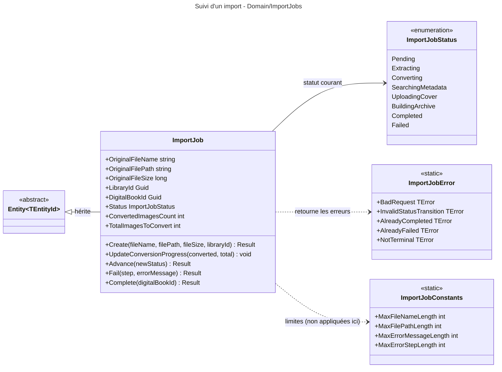

# Niveau C4 Code : Domain/ImportJobs

## 1. Vue d'ensemble

- **Nom** : Domain.ImportJobs
- **Description** : Agrégat `ImportJob` qui suit l'import d'un fichier de BD (archive ou PDF) à travers ses étapes successives : extraction, conversion des images en WebP, recherche de métadonnées, envoi de la couverture, construction de l'archive CBZ. Inclut l'énumération des statuts, les constantes de longueur et les erreurs.
- **Emplacement relatif** : [Domain/ImportJobs](../Domain/ImportJobs)
- **Langage** : C# (.NET 10)
- **Objectif** : Garantir que le traitement d'un import ne peut avancer que dans l'ordre défini, et qu'un import se termine soit en succès (`Completed`, avec le livre numérique créé), soit en échec (`Failed`), sans jamais revenir en arrière.

## 2. Éléments de code

### 2.1 Classe `ImportJob`

- **Signature** : `public class ImportJob : Entity<Guid>`
- **Description** : Suivi d'un import. Le statut progresse linéairement ; l'avancement des conversions d'images est porté par deux compteurs.
- **Emplacement** : [ImportJob.cs:5-137](../Domain/ImportJobs/ImportJob.cs#L5-L137)
- **Membres publics (propriétés)** :
  - `public string OriginalFileName { get; private set; }` (l.18, défaut `string.Empty`)
  - `public string OriginalFilePath { get; private set; }` (l.20, défaut `string.Empty`)
  - `public long OriginalFileSize { get; private set; }` (l.22)
  - `public Guid LibraryId { get; private set; }` (l.24)
  - `public Guid? DigitalBookId { get; private set; }` (l.26, renseigné à la fin)
  - `public ImportJobStatus Status { get; private set; }` (l.28)
  - `public DateTime CreatedAt { get; private set; }` (l.30)
  - `public DateTime? CompletedAt { get; private set; }` (l.32)
  - `public string? ErrorMessage { get; private set; }` (l.34)
  - `public string? ErrorStep { get; private set; }` (l.36)
  - `public int ConvertedImagesCount { get; private set; }` (l.38)
  - `public int TotalImagesToConvert { get; private set; }` (l.40)
- **Membres publics (méthodes)** :
  - `public static Result<ImportJob> Create(string originalFileName, string originalFilePath, long originalFileSize, Guid libraryId)` (l.44-70) : refuse un nom ou un chemin vide, une taille `<= 0` ou un `libraryId` vide (`ImportJobError.BadRequest`). Crée un job en statut `Pending`, avec `CreatedAt = DateTime.UtcNow` et un `Guid` v7.
  - `public void UpdateConversionProgress(int converted, int total)` (l.72-76) : affecte les deux compteurs. Aucune validation.
  - `public Result Advance(ImportJobStatus newStatus)` (l.78-100) : refuse si le job est `Completed` (`AlreadyCompleted`) ou `Failed` (`AlreadyFailed`). Accepte uniquement le statut qui suit immédiatement le statut courant dans `s_orderedStatuses` (sinon `InvalidStatusTransition`).
  - `public Result Fail(string step, string errorMessage)` (l.102-118) : refuse si déjà `Completed` ou `Failed`. Sinon passe en `Failed` et enregistre `ErrorStep` et `ErrorMessage`. Aucune validation de longueur ni de valeur vide.
  - `public Result Complete(Guid digitalBookId)` (l.120-136) : refuse si `Failed` (`AlreadyFailed`) ou si le statut n'est pas `BuildingArchive` (`InvalidStatusTransition`). Passe en `Completed`, enregistre `DigitalBookId` et `CompletedAt = DateTime.UtcNow`.
- **Membres protégés / privés** :
  - `protected ImportJob()` (l.42) : constructeur EF Core.
  - `private static readonly ImportJobStatus[] s_orderedStatuses` (l.7-16) : ordre `Pending`, `Extracting`, `Converting`, `SearchingMetadata`, `UploadingCover`, `BuildingArchive`, `Completed`.
- **Dépendances** : `Entity<Guid>`, `ImportJobStatus`, `ImportJobError`, `Result`.
- **Remarques** :
  - `Advance` n'accepte jamais `Failed` : `Failed` n'est pas dans `s_orderedStatuses`, la méthode passe par `Fail`.
  - `Advance` et `Complete` ne sont pas équivalents : `Complete` impose `BuildingArchive`, `Advance` impose le statut suivant. Le passage vers `Completed` par `Advance(Completed)` depuis `BuildingArchive` est donc possible mais n'enregistre pas `DigitalBookId`.
  - `Fail` ne tronque pas `errorMessage` alors que `ImportJobConstants.MaxErrorMessageLength` (2000) est défini : la limite n'est pas appliquée dans cet agrégat.
  - `UpdateConversionProgress` ne contrôle pas `converted <= total`.

### 2.2 Enumération `ImportJobStatus`

- **Signature** : `public enum ImportJobStatus { Pending, Extracting, Converting, SearchingMetadata, UploadingCover, BuildingArchive, Completed, Failed }`
- **Description** : Statuts du job. L'ordre de déclaration correspond à l'ordre de progression (sauf `Failed`, terminal hors séquence).
  - `Pending` : en attente de traitement (l.5)
  - `Extracting` : extraction des images de l'archive ou du PDF (l.6)
  - `Converting` : conversion des images en WebP (l.7)
  - `SearchingMetadata` : recherche de métadonnées via Bédéthèque et mise à jour du ComicInfo.xml (l.8)
  - `UploadingCover` : envoi de la couverture sur Cloudinary (l.9)
  - `BuildingArchive` : construction de l'archive CBZ finale (l.10)
  - `Completed` : import terminé avec succès (l.11)
  - `Failed` : import en échec (l.12)
- **Emplacement** : [ImportJobStatus.cs:3-13](../Domain/ImportJobs/ImportJobStatus.cs#L3-L13)
- **Remarques** : Les commentaires de l'enum sont en français. Les valeurs sont persistées.

### 2.3 Classe statique `ImportJobConstants`

- **Signature** : `public static class ImportJobConstants`
- **Membres publics (constantes)** :
  - `MaxFileNameLength = 260` (l.5)
  - `MaxFilePathLength = 500` (l.6)
  - `MaxErrorMessageLength = 2000` (l.7)
  - `MaxErrorStepLength = 100` (l.8)
- **Emplacement** : [ImportJobConstants.cs:3-9](../Domain/ImportJobs/ImportJobConstants.cs#L3-L9)
- **Remarques** : Aucune de ces constantes n'est appliquée dans `ImportJob` (voir remarque de `Fail`).

### 2.4 Classe statique `ImportJobError`

- **Signature** : `public static class ImportJobError` (l.5-17)
- **Membres publics (erreurs)** :
  - `BadRequest` = `("IMP400", "Verify the import request parameters.")` (l.7)
  - `NotFound` = `("IMP404", "Import job not found.")` (l.8)
  - `InvalidStatusTransition` = `("IMP405", "Invalid status transition.")` (l.9)
  - `AlreadyCompleted` = `("IMP409", "Import job is already completed.")` (l.10)
  - `AlreadyFailed` = `("IMP410", "Import job has already failed.")` (l.11)
  - `NotTerminal` = `("IMP412", "Only completed or failed import jobs can be deleted.")` (l.12)
  - `UnhandledException` = `("IMP500", "An unexpected error occurred during import.")` (l.13)
  - `InsufficientDiskSpace` = `("IMP507", "Insufficient disk space to process the import.")` (l.14)
  - `AlreadyQueued` = `("IMP409B", "An active import job already exists for this file.")` (l.15)
  - `DestinationFileExists` = `("IMP409C", "A file already exists at the destination path.")` (l.16)
- **Emplacement** : [ImportJobError.cs:5-17](../Domain/ImportJobs/ImportJobError.cs#L5-L17)
- **Remarques** : `NotTerminal` n'est pas levée par `ImportJob` : la règle de suppression (job terminé uniquement) est à porter par la couche appelante.

## 3. Dépendances

### 3.1 Dépendances internes

- `Domain/Primitives` : `Entity<Guid>`, `Result`, `TError`.
- `ImportJobError`, `ImportJobStatus` et `ImportJobConstants` sont utilisés par `ImportJob` (même répertoire).
- Liens inter-répertoires par identifiant seulement : `LibraryId` (Domain/Libraries) et `DigitalBookId` (Domain/Books). `FeedImportDecision.ImportJobId` (Domain/FeedImports) référence ce job par `Guid`.

### 3.2 Dépendances externes

- BCL `System` (`DateTime`, `Guid`, `Array`).

## 4. Relations

Le cycle de vie suit la séquence `Pending` vers `Extracting`, `Converting`, `SearchingMetadata`, `UploadingCover`, `BuildingArchive`, puis `Completed`. `Failed` peut être atteint depuis n'importe quel statut actif via `Fail`, mais n'est jamais un statut de départ.
