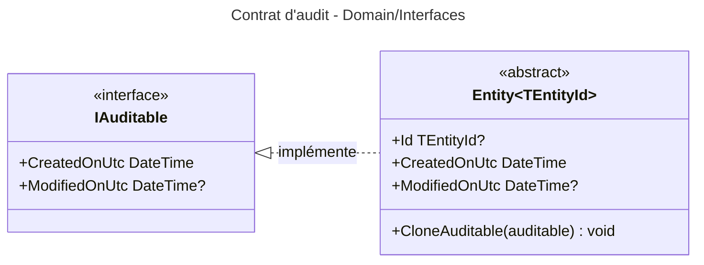

# Niveau C4 Code : Domain/Interfaces

## 1. Vue d'ensemble

- **Nom** : Domain.Interfaces
- **Description** : Contrat transverse d'audit (`IAuditable`) qui décrit les dates de création et de modification d'une entité.
- **Emplacement relatif** : [Domain/Interfaces](../Domain/Interfaces)
- **Langage** : C# (.NET 10)
- **Objectif** : Permettre à toute entité du domaine de porter ses horodatages d'audit de manière uniforme, indépendamment de la persistance.

## 2. Éléments de code

### 2.1 Interface `IAuditable`

- **Signature** : `public interface IAuditable`
- **Description** : Expose les horodatages d'audit en UTC. `CreatedOnUtc` est renseignée à la création, `ModifiedOnUtc` reste `null` tant que l'entité n'a pas été modifiée.
- **Emplacement** : [IAuditable.cs:3-8](../Domain/Interfaces/IAuditable.cs#L3-L8)
- **Membres publics** :
  - `DateTime CreatedOnUtc { get; set; }` (l.5)
  - `DateTime? ModifiedOnUtc { get; set; }` (l.7)
- **Implémentations connues** : `Entity<TEntityId>` (Domain/Primitives, l.7) implémente cette interface.
- **Dépendances** : aucune (types BCL `DateTime`).
- **Remarques** : Les setters sont publics dans l'interface. `Entity` les expose donc en `public set` (l.10-11 de `Entity.cs`), ce qui permet à la couche de persistance de les renseigner.

## 3. Dépendances

### 3.1 Dépendances internes

- Utilisée par `Domain/Primitives/Entity.cs` (`Entity<TEntityId>` implémente `IAuditable`, méthode `CloneAuditable(IAuditable)`).
- Aucune dépendance vers d'autres répertoires de `Domain`.

### 3.2 Dépendances externes

- Aucune (BCL `System` uniquement).

## 4. Relations

Toutes les entités du domaine (`Book`, `Library`, `User`, `FeedImportDecision`, `ImportJob`, `FeatureToggleOverride`) héritent de `Entity<TEntityId>` et bénéficient donc de ce contrat.
