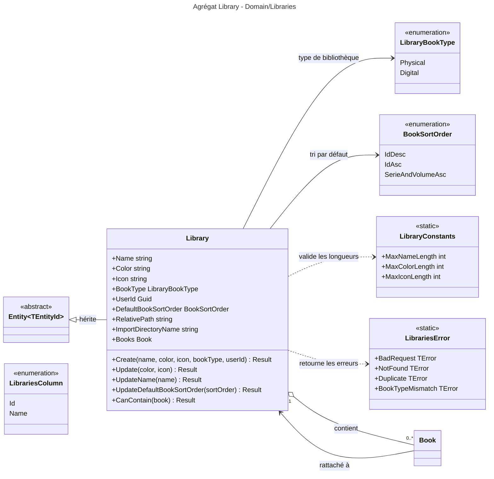

# Niveau C4 Code : Domain/Libraries

## 1. Vue d'ensemble

- **Nom** : Domain.Libraries
- **Description** : Agrégat `Library` (bibliothèque de livres appartenant à un utilisateur) avec son type (physique ou numérique), son tri par défaut et son dossier de stockage dérivé du nom. Contient aussi ses constantes de validation, ses erreurs et les énumérations de tri et de colonnes.
- **Emplacement relatif** : [Domain/Libraries](../Domain/Libraries)
- **Langage** : C# (.NET 10)
- **Objectif** : Porter les règles de création et de modification d'une bibliothèque, et vérifier qu'un livre est compatible avec son type (un livre papier ne va que dans une bibliothèque physique, un livre numérique que dans une bibliothèque numérique).

## 2. Éléments de code

### 2.1 Classe `Library`

- **Signature** : `public class Library : Entity<Guid>`
- **Description** : Agrégat racine d'une bibliothèque. Le nom de la bibliothèque est sa seule source de vérité pour le dossier de stockage (`RelativePath`, `ImportDirectoryName`).
- **Emplacement** : [Library.cs:7-131](../Domain/Libraries/Library.cs#L7-L131)
- **Membres publics** :
  - `public string Name { get; protected set; }` (l.9)
  - `public string Color { get; protected set; }` (l.11, couleur sur 7 caractères, par exemple `#RRGGBB`)
  - `public string Icon { get; protected set; }` (l.13)
  - `public LibraryBookType BookType { get; protected set; }` (l.15)
  - `public Guid UserId { get; protected set; }` (l.17)
  - `public BookSortOrder DefaultBookSortOrder { get; protected set; }` (l.19, défaut `BookSortOrder.IdDesc`)
  - `public string RelativePath { get; }` (l.21) : `Name.RemoveDiacritics().ToUpperInvariant()`
  - `public string ImportDirectoryName { get; }` (l.23) : `$"{RelativePath}_{Id}"`
  - `public IReadOnlyList<Book> Books { get; }` (l.26) : liste des livres, en lecture seule
  - `public static Result<Library> Create(string name, string color, string icon, LibraryBookType bookType, Guid userId)` (l.30-74) : contrôle, dans l'ordre, le type (`Enum.IsDefined`), le nom (non vide, `<= 200`), la couleur (non vide, `<= 7`), l'icône (non vide, `<= 100`) et `userId` (non vide). Génère un `Guid` v7. Chaque échec retourne `LibrariesError.BadRequest`.
  - `public Result Update(string color, string icon)` (l.76-92) : met à jour couleur et icône avec les mêmes contrôles de longueur.
  - `public Result UpdateName(string name)` (l.94-104) : contrôle non vide et `<= 200`.
  - `public Result UpdateDefaultBookSortOrder(BookSortOrder sortOrder)` (l.106-115) : vérifie `Enum.IsDefined`.
  - `public Result CanContain(Book book)` (l.117-130) : `Success` si (bibliothèque physique et `book is PhysicalBook`) ou (bibliothèque numérique et `book is DigitalBook`), sinon `LibrariesError.BookTypeMismatch`.
- **Membres protégés** : `protected Library()` (l.28), constructeur EF Core.
- **Dépendances** : `Entity<Guid>`, `Book`, `PhysicalBook`, `DigitalBook` (Domain/Books), `LibrariesError`, `LibraryConstants`, `LibraryBookType`, `BookSortOrder`, `RemoveDiacritics` (Domain/Extensions), `Result` (Primitives).
- **Remarques** : `Update` et `UpdateName` ne modifient rien si la validation échoue. `UpdateName` ne contrôle pas l'unicité (géré par la couche persistance / handlers). Le changement de nom ne renomme pas le dossier de stockage dans le domaine : c'est `RelativePath` qui est recalculé à partir du nouveau nom.

### 2.2 Enumération `LibraryBookType`

- **Signature** : `public enum LibraryBookType { Physical, Digital }`
- **Description** : `Physical` : la bibliothèque ne contient que des `PhysicalBook`. `Digital` : elle ne contient que des `DigitalBook` et possède un dossier de stockage (`RelativePath`).
- **Emplacement** : [LibraryBookType.cs:3-7](../Domain/Libraries/LibraryBookType.cs#L3-L7)

### 2.3 Enumération `BookSortOrder`

- **Signature** : `public enum BookSortOrder { IdDesc = 0, IdAsc = 1, SerieAndVolumeAsc = 2 }`
- **Description** : Tri par défaut des livres d'une bibliothèque. Les valeurs sont persistées : elles ne doivent pas être réordonnées.
- **Emplacement** : [BookSortOrder.cs:3-8](../Domain/Libraries/BookSortOrder.cs#L3-L8)

### 2.4 Enumération `LibrariesColumn`

- **Signature** : `public enum LibrariesColumn { Id, Name }`
- **Description** : Colonnes de tri ou de filtre disponibles pour les listes de bibliothèques.
- **Emplacement** : [LibrariesColumn.cs:3-7](../Domain/Libraries/LibrariesColumn.cs#L3-L7)

### 2.5 Classe statique `LibraryConstants`

- **Signature** : `public static class LibraryConstants`
- **Membres publics (constantes)** :
  - `MaxNameLength = 200` (l.5)
  - `MaxColorLength = 7` (l.6)
  - `MaxIconLength = 100` (l.7)
- **Emplacement** : [LibraryConstants.cs:3-8](../Domain/Libraries/LibraryConstants.cs#L3-L8)

### 2.6 Classe statique `LibrariesError`

- **Signature** : `public static class LibrariesError` (l.5-15)
- **Membres publics (erreurs)** :
  - `BadRequest` = `("LIB400", "Verify the request parameters.")` (l.7)
  - `NotFound` = `("LIB404", "Library not found")` (l.8)
  - `Duplicate` = `("LIB409", "A library is already created with this name")` (l.9)
  - `FolderNotCreated` = `("LIB501", "The library directory cannot be created")` (l.10)
  - `FolderNotDeleted` = `("LIB502", "The library directory was not deleted")` (l.11)
  - `FolderNotMoved` = `("LIB503", "The library directory was not moved")` (l.12)
  - `ValidationError` = `("LIB504", "The parameter were not validated")` (l.13)
  - `BookTypeMismatch` = `("LIB505", "Book type does not match library type")` (l.14)
- **Remarques** : `NotFound` et `Duplicate` ne sont pas levés par le domaine ; ils sont utilisés par les couches appelantes.

## 3. Dépendances

### 3.1 Dépendances internes

- `Domain/Primitives` : `Entity<Guid>`, `Result`, `TError`.
- `Domain/Books` : `Book`, `PhysicalBook`, `DigitalBook` (pour `Library.Books` et `CanContain`). Dépendance réciproque : `Book.Library` pointe vers `Library`.
- `Domain/Extensions` : `StringExtension.RemoveDiacritics` (pour `RelativePath`).

### 3.2 Dépendances externes

- `Ardalis.GuardClauses` n'est pas utilisée dans ce répertoire.
- BCL : `System` (`Guid`, `Enum`), `System.Collections.Generic`.

## 4. Relations

## Remarques complémentaires

- `CanContain` est la règle qui garantit la cohérence type de livre / type de bibliothèque, appelée par les couches supérieures avant tout rattachement.
- Le diagramme ci-dessus référence `Book` par une classe externe (`Domain/Books`) pour rendre lisible la relation.
