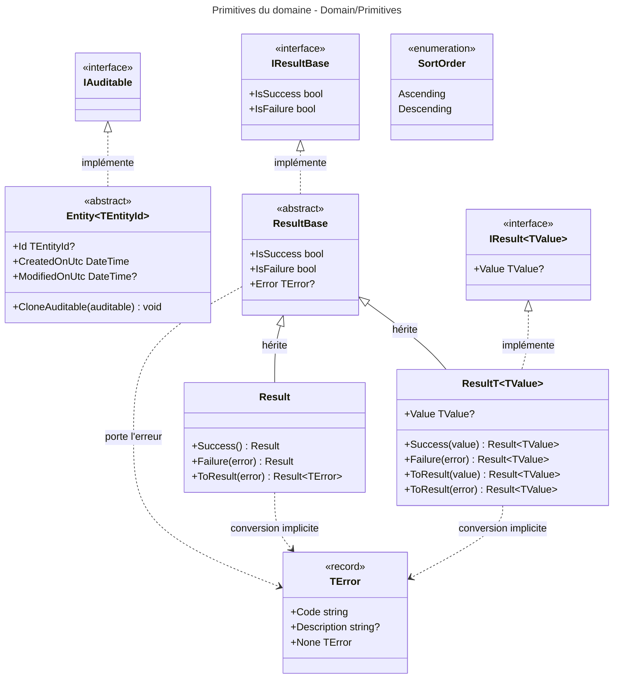

# Niveau C4 Code : Domain/Primitives

## 1. Vue d'ensemble

- **Nom** : Domain.Primitives
- **Description** : Briques de base du domaine : classe d'entité générique `Entity<TEntityId>`, type de résultat `Result` / `Result<TValue>` pour les opérations pouvant échouer sans exception, code d'erreur `TError` et énumération de tri `SortOrder`.
- **Emplacement relatif** : [Domain/Primitives](../Domain/Primitives)
- **Langage** : C# (.NET 10)
- **Objectif** : Fournir le socle commun à tous les agrégats et opérations du domaine, en s'appuyant sur le pattern « Result » plutôt que sur les exceptions pour les cas métier connus (conformément à CLAUDE.md).

## 2. Éléments de code

### 2.1 Classe abstraite `Entity<TEntityId>`

- **Signature** : `public abstract class Entity<TEntityId> : IAuditable`
- **Description** : Entité générique identifiée par `Id`, portant les horodatages d'audit et une méthode de copie des dates d'audit.
- **Emplacement** : [Entity.cs:7-21](../Domain/Primitives/Entity.cs#L7-L21)
- **Membres publics** :
  - `public TEntityId? Id { get; protected set; }` (l.9)
  - `public DateTime CreatedOnUtc { get; set; }` (l.10)
  - `public DateTime? ModifiedOnUtc { get; set; }` (l.11)
  - `public void CloneAuditable(IAuditable auditable)` (l.13-18) : `Guard.Against.Null(auditable)`, puis recopie `CreatedOnUtc` et `ModifiedOnUtc`.
- **Dépendances** : `Ardalis.GuardClauses` (`Guard.Against.Null`), `Domain/Interfaces` (`IAuditable`).
- **Remarques** : L'identifiant est nullable (`TEntityId?`) : une entité non encore persistée peut ne pas avoir d'`Id`. Le fichier contient deux lignes vides en fin de classe (l.19-20), sans effet.

### 2.2 Interfaces de résultat `IResultBase`, `IResult<out TValue>`

- **Signatures** :
  - `public interface IResultBase` (l.10-16) avec `bool IsSuccess { get; init; }` (l.12) et `bool IsFailure { get; }` (l.14)
  - `public interface IResult<out TValue> : IResultBase` (l.18-21) avec `TValue? Value { get; }` (l.20)
- **Description** : Contrats de lecture d'un résultat. `IResult<out TValue>` est covariant sur `TValue`.
- **Emplacement** : [ResultBase.cs:10-21](../Domain/Primitives/ResultBase.cs#L10-L21)
- **Dépendances** : `TError` (utilisé implicitement par `ResultBase`).

### 2.3 Classe abstraite `ResultBase`

- **Signature** : `public abstract class ResultBase : IResultBase`
- **Description** : Porte l'état commun d'un résultat : succès, échec et erreur.
- **Emplacement** : [ResultBase.cs:23-31](../Domain/Primitives/ResultBase.cs#L23-L31)
- **Membres publics** :
  - `public bool IsSuccess { get; init; }` (l.25)
  - `public bool IsFailure => !IsSuccess;` (l.27)
  - `public TError? Error { get; init; }` (l.29)
- **Dépendances** : `TError`.

### 2.4 Classe `Result`

- **Signature** : `public class Result : ResultBase`
- **Description** : Résultat d'une opération sans valeur de retour. Le constructeur est privé : on passe par `Success()` ou `Failure(...)`, ou par conversion implicite depuis un `TError`.
- **Emplacement** : [Result.cs:10-44](../Domain/Primitives/Result.cs#L10-L44)
- **Membres publics** :
  - `public static Result Success()` (l.25-28)
  - `public static Result Failure(TError error)` (l.30-33)
  - `public static implicit operator Result(TError error)` (l.35-38) : équivaut à `Failure(error)`.
  - `public static Result<TError> ToResult(TError error)` (l.40-43) : retourne `Result<TError>.Failure(error)`.
- **Membres privés** : `private Result()` (l.13-17) et `private Result(TError error)` (l.19-23).
- **Remarques** : La méthode `ToResult` retourne `Result<TError>` (un résultat dont la valeur est de type `TError`), et non `Result`. Ce typage semble non intentionnel : c'est à vérifier avant usage. `Result<TValue>.ToResult(...)` (ci-dessous) a une forme cohérente.

### 2.5 Classe générique `Result<TValue>`

- **Signature** : `public class Result<TValue> : ResultBase, IResult<TValue>`
- **Description** : Résultat portant une valeur en cas de succès, ou une erreur en cas d'échec. Les conversions implicites depuis `TValue` et depuis `TError` permettent d'écrire `return book;` ou `return BooksError.NotFound;`.
- **Emplacement** : [Result.cs:46-94](../Domain/Primitives/Result.cs#L46-L94)
- **Membres publics** :
  - `public TValue? Value { get; init; }` (l.49)
  - `public static Result<TValue> Success(TValue value)` (l.65-68)
  - `public static Result<TValue> Failure(TError error)` (l.70-73)
  - `public static implicit operator Result<TValue>(TError error)` (l.75-78)
  - `public static implicit operator Result<TValue>(TValue value)` (l.80-83)
  - `public static Result<TValue> ToResult(TValue value)` (l.85-88)
  - `public static Result<TValue> ToResult(TError error)` (l.90-93)
- **Membres privés** : `private Result(TValue value)` (l.51-56) et `private Result(TError error)` (l.58-63).
- **Dépendances** : `ResultBase`, `IResult<TValue>`, `TError`.
- **Remarques** : La conversion implicite depuis `TValue` peut être ambiguë quand `TValue` est lui-même un `TError` (cas marginal).

### 2.6 Record `TError`

- **Signature** : `public sealed record TError(string Code, string? Description = null)`
- **Description** : Code d'erreur stable (par exemple `BOK404`) accompagné d'un message lisible. Les valeurs sont définies dans les catalogues `XxxError` des autres répertoires du domaine.
- **Emplacement** : [TError.cs:3-6](../Domain/Primitives/TError.cs#L3-L6)
- **Membres publics** :
  - `public static readonly TError None` = `new(string.Empty)` (l.5) : valeur sentinelle sans code.
- **Dépendances** : aucune externe.

### 2.7 Enumération `SortOrder`

- **Signature** : `public enum SortOrder { Ascending, Descending }`
- **Description** : Sens de tri générique utilisé par les requêtes paginées.
- **Emplacement** : [SortOrder.cs:3-7](../Domain/Primitives/SortOrder.cs#L3-L7)
- **Dépendances** : aucune.

## 3. Dépendances

### 3.1 Dépendances internes

- `Entity<TEntityId>` dépend de `Domain/Interfaces` (`IAuditable`).
- `ResultBase`, `Result`, `Result<TValue>` et `Entity` sont la base de tous les autres répertoires du domaine (`Books`, `Libraries`, `Users`, `Settings`, `FeedImports`, `ImportJobs`) et des catalogues de `Domain/Errors` (qui utilisent `TError`).
- Aucune dépendance vers les répertoires métier : `Domain/Primitives` est la couche la plus basse du domaine.

### 3.2 Dépendances externes

- `Ardalis.GuardClauses` (`Guard.Against.Null` dans `Entity.CloneAuditable`).
- BCL : `System` (`DateTime`, `Guid` indirectement).

## 4. Relations

Le classement des types est : `TError` (le plus bas) et les interfaces, puis `Result` et `Entity`, puis les répertoires métier qui en dépendent. Les conversions implicites `TError` vers `Result` et `TValue` vers `Result<TValue>` permettent aux méthodes de domaine de retourner directement une erreur ou une valeur.
