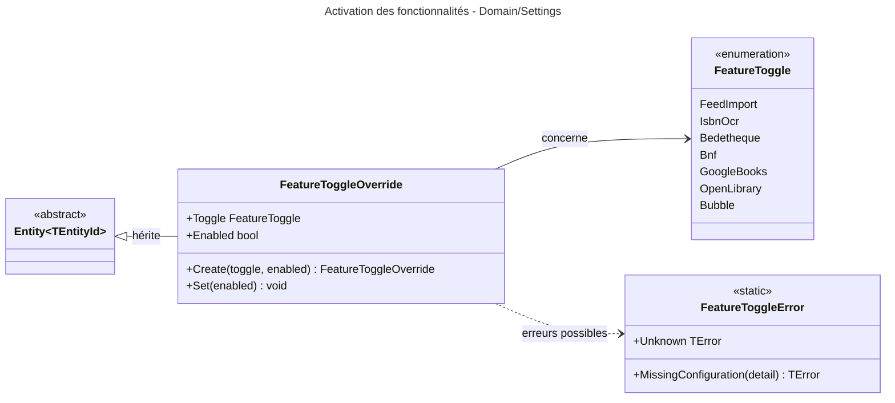

# Niveau C4 Code : Domain/Settings

## 1. Vue d'ensemble

- **Nom** : Domain.Settings
- **Description** : Activation des fonctionnalités pilotables depuis la page Paramètres de l'administrateur. Comprend l'énumération des fonctionnalités, l'entité `FeatureToggleOverride` qui stocke une valeur choisie et les erreurs associées.
- **Emplacement relatif** : [Domain/Settings](../Domain/Settings)
- **Langage** : C# (.NET 10)
- **Objectif** : Permettre de remplacer, à l'exécution, la valeur d'activation d'une fonctionnalité définie dans la configuration (`appsettings` ou variables d'environnement), jusqu'à ce que la surcharge soit supprimée.

## 2. Éléments de code

### 2.1 Enumération `FeatureToggle`

- **Signature** : `public enum FeatureToggle { FeedImport, IsbnOcr, Bedetheque, Bnf, GoogleBooks, OpenLibrary, Bubble }`
- **Description** : Fonctionnalités activables. Chaque valeur est associée à une clé de configuration :
  - `FeedImport` : clé `FeedImport:Enabled`, synchronisation Miniflux et téléchargements automatiques (l.7)
  - `IsbnOcr` : clé `IsbnOcr:Enabled`, lecture de l'ISBN sur les pages des livres importés (l.8)
  - `Bedetheque` : clé `Bedetheque:Enabled`, recherche Bédéthèque via SerpApi (l.9)
  - `Bnf` : clé `BnfCatalogue:Enabled`, recherche dans le catalogue BnF (l.10)
  - `GoogleBooks` : clé `GoogleBooks:Enabled`, recherche Google Books (l.11)
  - `OpenLibrary` : clé `OpenLibrary:Enabled`, recherche OpenLibrary (l.12)
  - `Bubble` : clé `Bubble:Enabled`, recherche Bubble (nécessite `Bubble:ApiKey`) (l.13)
- **Emplacement** : [FeatureToggle.cs:5-14](../Domain/Settings/FeatureToggle.cs#L5-L14)
- **Remarques** : Commentaire `ponytail` (l.4) : la valeur est persistée par son nom, ne jamais la renommer ; de nouvelles valeurs peuvent être ajoutées librement.

### 2.2 Classe `FeatureToggleOverride`

- **Signature** : `public sealed class FeatureToggleOverride : Entity<Guid>`
- **Description** : Surcharge persistée d'une fonctionnalité. Tant qu'elle existe, elle remplace la valeur de configuration.
- **Emplacement** : [FeatureToggleOverride.cs:7-24](../Domain/Settings/FeatureToggleOverride.cs#L7-L24)
- **Membres publics** :
  - `public FeatureToggle Toggle { get; private set; }` (l.9)
  - `public bool Enabled { get; private set; }` (l.11)
  - `public static FeatureToggleOverride Create(FeatureToggle toggle, bool enabled)` (l.15-21) : génère un `Guid` v7 et `CreatedOnUtc = DateTime.UtcNow`.
  - `public void Set(bool enabled)` (l.23) : modifie uniquement `Enabled`. Ne met pas à jour `ModifiedOnUtc`.
- **Membres privés** : `private FeatureToggleOverride()` (l.13), constructeur EF Core.
- **Dépendances** : `Entity<Guid>`, `FeatureToggle`.
- **Remarques** : `Set` ne renseigne pas `ModifiedOnUtc`, contrairement à ce que suggère `IAuditable`. Ce point est à vérifier si l'audit de modification est attendu.

### 2.3 Classe statique `FeatureToggleError`

- **Signature** : `public static class FeatureToggleError` (l.5-10)
- **Membres publics** :
  - `public static readonly TError Unknown` = `("TOGGLE404", "Unknown feature.")` (l.7)
  - `public static TError MissingConfiguration(string detail)` (l.9) : produit `("TOGGLE409", "The feature cannot be turned on: <detail>")`.
- **Dépendances** : `TError`.

## 3. Dépendances

### 3.1 Dépendances internes

- `Domain/Primitives` : `Entity<Guid>`, `TError`.
- Aucune dépendance vers les autres répertoires de `Domain`. Les usages de `FeatureToggle` (lecture de la configuration, pages Paramètres) sont situés hors du domaine et ne sont pas vérifiés ici.

### 3.2 Dépendances externes

- BCL `System` (`Guid`, `DateTime`).

## 4. Relations

La surcharge (`FeatureToggleOverride`) prime sur la configuration. En l'absence de surcharge, la valeur de la clé de configuration correspondante (voir 2.1) s'applique.
