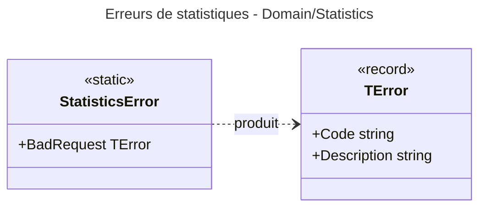

# Niveau C4 Code : Domain/Statistics

## 1. Vue d'ensemble

- **Nom** : Domain.Statistics
- **Description** : Ce répertoire ne contient qu'un catalogue d'erreurs (`StatisticsError`). Aucun agrégat ni calcul de statistiques n'est défini dans le domaine.
- **Emplacement relatif** : [Domain/Statistics](../Domain/Statistics)
- **Langage** : C# (.NET 10)
- **Objectif** : Réserver les codes d'erreur des requêtes de statistiques (paramètres invalides). Les calculs de statistiques sont vraisemblablement situés dans la couche Application (non vérifié dans ce répertoire).

## 2. Éléments de code

### 2.1 Classe statique `StatisticsError`

- **Signature** : `public static class StatisticsError` (l.5-8)
- **Membres publics** :
  - `public static readonly TError BadRequest` = `new("STA400", "Verify the request parameters.")` (l.7)
- **Emplacement** : [StatisticsError.cs:5-8](../Domain/Statistics/StatisticsError.cs#L5-L8)
- **Dépendances** : `TError` (Domain/Primitives).
- **Remarques** : Un seul code est défini. Il n'y a pas de type d'entité, de record ni de service dans ce répertoire.

## 3. Dépendances

### 3.1 Dépendances internes

- `Domain/Primitives` : `TError`.

### 3.2 Dépendances externes

- Aucune.

## 4. Relations

Le répertoire est isolé : il n'a aucune relation avec les autres répertoires de `Domain`.
