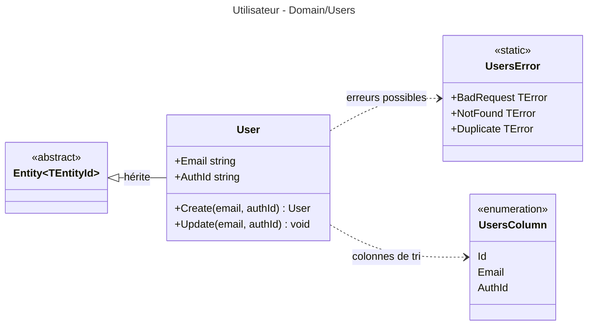

# Niveau C4 Code : Domain/Users

## 1. Vue d'ensemble

- **Nom** : Domain.Users
- **Description** : Entité `User` (utilisateur de l'application, identifié par son adresse e-mail et son identifiant d'authentification externe), son catalogue d'erreurs et l'énumération des colonnes de tri.
- **Emplacement relatif** : [Domain/Users](../Domain/Users)
- **Langage** : C# (.NET 10)
- **Objectif** : Représenter l'utilisateur dans le domaine, lié à l'identité externe (Auth0) par `AuthId`, et porter les règles de création et de mise à jour de cette identité.

## 2. Éléments de code

### 2.1 Classe `User`

- **Signature** : `public class User : Entity<Guid>`
- **Description** : Utilisateur de l'application. `AuthId` correspond à l'identifiant du fournisseur d'authentification (Auth0, selon CLAUDE.md).
- **Emplacement** : [User.cs:5-29](../Domain/Users/User.cs#L5-L29)
- **Membres publics** :
  - `public string Email { get; protected set; }` (l.8, défaut `string.Empty`)
  - `public string AuthId { get; protected set; }` (l.10, défaut `string.Empty`)
  - `public static User Create(string email, string authId)` (l.12-21) : génère un `Guid` v7 et renseigne les deux valeurs. Aucune validation.
  - `public void Update(string email, string authId)` (l.23-27) : affecte directement les deux valeurs. Aucune validation.
- **Dépendances** : `Entity<Guid>`, `Guid` (BCL).
- **Remarques** : Ni `Create` ni `Update` ne vérifient que l'e-mail ou `AuthId` sont non vides. Le constructeur implicite est public (pas de constructeur protégé déclaré). `CreatedOnUtc` n'est pas renseigné dans `Create`.

### 2.2 Classe statique `UsersError`

- **Signature** : `public static class UsersError` (l.5-10)
- **Membres publics** :
  - `BadRequest` = `("USR400", "Verify the parameter of the request")` (l.7)
  - `NotFound` = `("USR404", "User not found")` (l.8)
  - `Duplicate` = `("USR409", "A user is already created with this name ou authId")` (l.9)
- **Emplacement** : [UsersError.cs:5-10](../Domain/Users/UsersError.cs#L5-L10)
- **Dépendances** : `TError` (Domain/Primitives).
- **Remarques** : Le libellé de `Duplicate` contient « ou » en français dans un message anglais. Les erreurs ne sont pas levées par le domaine, elles sont utilisées par les couches appelantes.

### 2.3 Enumération `UsersColumn`

- **Signature** : `public enum UsersColumn { Id, Email, AuthId }`
- **Description** : Colonnes disponibles pour le tri ou le filtre des listes d'utilisateurs.
- **Emplacement** : [UsersColumn.cs:3-8](../Domain/Users/UsersColumn.cs#L3-L8)

## 3. Dépendances

### 3.1 Dépendances internes

- `Domain/Primitives` : `Entity<Guid>`, `TError`.
- Aucune dépendance vers les autres répertoires de `Domain`. Les autres agrégats n'ont pas de référence directe vers `User` : les liens se font par `Guid` (par exemple `Library.UserId`, `FeedImportDecision.UserId`).

### 3.2 Dépendances externes

- BCL `System` (`Guid`).

## 4. Relations

Les autres agrégats référencent l'utilisateur par son identifiant : `Library.UserId` (Domain/Libraries) et `FeedImportDecision.UserId` (Domain/FeedImports). Il n'existe pas de relation de navigation directe.
