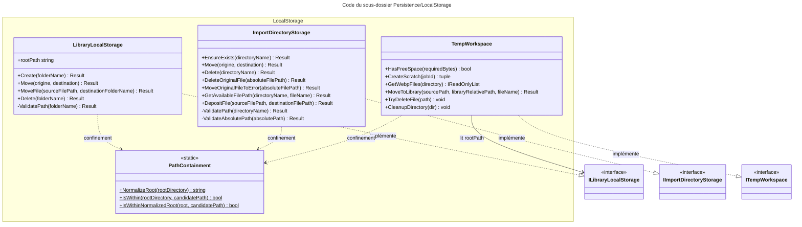

# C4 Code Level : Persistence/LocalStorage

## Vue d'ensemble

- **Nom** : Persistence.LocalStorage
- **Description** : Adaptateurs du système de fichiers local. Gèrent les dossiers de bibliothèques, le dossier d'import surveillé, l'espace de travail temporaire des jobs d'import et la garde contre les traversées de chemin.
- **Emplacement relatif** : `Persistence/LocalStorage/`
- **Langage** : C# (.NET 10)
- **Objectif** : Isoler toutes les opérations de fichiers et de dossiers de l'application derrière les interfaces de `Application` (`ILibraryLocalStorage`, `IImportDirectoryStorage`, `ITempWorkspace`), et garantir qu'aucune opération ne sort de la racine autorisée.

Fichiers couverts :

| Fichier | Type | Rôle |
| --- | --- | --- |
| [LibraryLocalStorage.cs](../Persistence/LocalStorage/LibraryLocalStorage.cs) | classe publique | Dossiers et fichiers des bibliothèques |
| [ImportDirectoryStorage.cs](../Persistence/LocalStorage/ImportDirectoryStorage.cs) | classe interne | Dossier d'import surveillé et dossier d'erreurs |
| [TempWorkspace.cs](../Persistence/LocalStorage/TempWorkspace.cs) | classe interne | Espace de travail temporaire des jobs d'import |
| [PathContainment.cs](../Persistence/LocalStorage/PathContainment.cs) | classe statique interne | Garde de confinement des chemins |

## Éléments de code

### Classes

#### `LibraryLocalStorage`

- **Signature** : `public class LibraryLocalStorage : ILibraryLocalStorage`
- **Description** : Gère la création, le déplacement et la suppression des dossiers de bibliothèque, ainsi que le déplacement de fichiers vers un dossier de bibliothèque. Les noms de dossiers sont normalisés (suppression des diacritiques) avant validation.
- **Emplacement** : [Persistence/LocalStorage/LibraryLocalStorage.cs:11-182](../Persistence/LocalStorage/LibraryLocalStorage.cs#L11-L182)
- **Champs et propriétés** :
  - `private readonly char[] _charsToTrim` (`['/', '\\']`, ligne 13)
  - `public string rootPath { get; init; }` (ligne 15) : racine des bibliothèques. Le nom en minuscules est volontaire pour l'usage existant par `TempWorkspace`.
- **Constructeur** :
  - `public LibraryLocalStorage(string rootPath)` (lignes 17-20)
- **Méthodes** :
  - `private Result ValidatePath(string folderName)` (lignes 22-40) : calcule `Path.GetFullPath(Path.Combine(rootPath, folderName))`, vérifie le confinement via `PathContainment.IsWithin`. Retourne `LibraryLocalStorageError.InvalidPath` en cas d'échec ou d'exception `ArgumentException`, `NotSupportedException`, `PathTooLongException`.
  - `public Result Create(string folderName)` (lignes 42-63) : valide le nom et crée le dossier (`Directory.CreateDirectory`). Ne normalise pas les diacritiques, contrairement aux autres méthodes.
  - `public Result Move(string originFolderName, string destinationFolderName)` (lignes 65-108) : renomme un dossier de bibliothèque après normalisation. Retourne `UnknownFolder` si l'origine n'existe pas, `AlreadyExistingFolder` si la destination existe.
  - `public Result<string> MoveFile(string sourceFilePath, string destinationFolderName)` (lignes 110-151) : déplace un fichier source vers `destinationFolderName` (dossier créé si besoin) et retourne le chemin final. Retourne `BooksError.FileNotFound` si la source est absente, `BooksError.FileAlreadyExists` si la cible existe, `LibraryLocalStorageError.FileMoveFailed` sur `IOException` ou `UnauthorizedAccessException`.
  - `public Result Delete(string folderName)` (lignes 153-180) : supprime récursivement un dossier de bibliothèque. Retourne `UnknownFolder` s'il n'existe pas.

#### `ImportDirectoryStorage`

- **Signature** : `internal sealed class ImportDirectoryStorage : IImportDirectoryStorage`
- **Description** : Gère le dossier d'import surveillé par le watcher. Dépose des fichiers de façon quasi atomique (copie vers un fichier `.part` ignoré par le watcher, puis renommage), déplace les fichiers en erreur vers un sous-dossier `errors`, et gère les noms disponibles avec suffixe `(n)`.
- **Emplacement** : [Persistence/LocalStorage/ImportDirectoryStorage.cs:8-262](../Persistence/LocalStorage/ImportDirectoryStorage.cs#L8-L262)
- **Champs** :
  - `private readonly string _rootPath` (ligne 10) : valeur de `ImportSettings.ImportDirectory`.
  - `private static readonly char[] s_charsToTrim` (ligne 11) : `['/', '\\']`.
  - `private const string PartialFileExtension = ".part"` (ligne 12).
- **Constructeur** :
  - `public ImportDirectoryStorage(IOptions<ImportSettings> settings)` (lignes 14-17)
- **Méthodes** :
  - `private Result ValidatePath(string directoryName)` (lignes 19-35) : validation d'un nom de dossier relatif à la racine d'import.
  - `private Result ValidateAbsolutePath(string absolutePath)` (lignes 37-52) : validation d'un chemin absolu.
  - `public Result EnsureExists(string directoryName)` (lignes 54-70) : crée le dossier s'il n'existe pas.
  - `public Result Move(string originDirectoryName, string destinationDirectoryName)` (lignes 72-105) : renomme un dossier de la racine d'import. Succès sans action si l'origine est absente ; `DestinationAlreadyExists` si la cible existe.
  - `public Result Delete(string directoryName)` (lignes 107-127) : supprime récursivement un dossier (sans effet s'il est absent).
  - `public Result DeleteOriginalFile(string absoluteFilePath)` (lignes 129-148) : supprime le fichier d'origine d'un job.
  - `public Result MoveOriginalFileToError(string absoluteFilePath)` (lignes 150-185) : déplace le fichier dans `<dossier>/errors/`. En cas de collision, ajoute un horodatage `yyyyMMddHHmmssfff` (UTC) au nom.
  - `public Result<string> GetAvailableFilePath(string directoryName, string fileName)` (lignes 187-218) : retourne un chemin libre dans le dossier, en ajoutant `(2)`, `(3)`... tant que le fichier ou son `.part` existe. Rejette les noms vides ou contenant des caractères invalides (`InvalidFileName`).
  - `public Result DepositFile(string sourceFilePath, string destinationFilePath)` (lignes 220-261) : `File.Move` vers `destinationFilePath + ".part"` (overwrite), puis renommage atomique vers la destination. En cas d'`IOException` ou `UnauthorizedAccessException`, supprime le `.part` et retourne `DepositFailed`.

#### `TempWorkspace`

- **Signature** : `internal sealed class TempWorkspace : ITempWorkspace`
- **Description** : Espace de travail temporaire d'un job d'import (sous-dossiers `raw` et `converted`), contrôle de l'espace disque disponible, déplacement final des fichiers vers la bibliothèque, et nettoyage (compensation).
- **Emplacement** : [Persistence/LocalStorage/TempWorkspace.cs:11-91](../Persistence/LocalStorage/TempWorkspace.cs#L11-L91)
- **Champs** : `_tempDirectory` (ligne 13, `ImportSettings.TempDirectory`), `_libraryRootPath` (ligne 14, `libraryStorage.rootPath`), `_logger` (ligne 15).
- **Constructeur** :
  - `public TempWorkspace(IOptions<ImportSettings> settings, ILibraryLocalStorage libraryStorage, ILogger<TempWorkspace> logger)` (lignes 17-22)
- **Méthodes** :
  - `public bool HasFreeSpace(long requiredBytes)` (lignes 24-36) : compare `DriveInfo.AvailableFreeSpace` du lecteur du dossier temporaire à `requiredBytes`. En cas d'`IOException` ou `UnauthorizedAccessException`, journalise un avertissement et retourne `true`.
  - `public (string TempDir, string RawDir, string ConvertedDir) CreateScratch(Guid jobId)` (lignes 38-42) : calcule les chemins `<temp>/<jobId>`, `raw` et `converted` sans les créer.
  - `public IReadOnlyList<string> GetWebpFiles(string directory)` (lignes 44-51) : liste les `*.webp` triés par ordre ordinal insensible à la casse ; liste vide si le dossier est absent.
  - `public Result<string> MoveToLibrary(string sourcePath, string libraryRelativePath, string fileName)` (lignes 53-68) : vérifie que la cible reste dans la racine des bibliothèques (sinon `ImportJobError.BadRequest`), crée le dossier, refuse si le fichier existe (`ImportJobError.DestinationFileExists`), puis `File.Move` sans écrasement et retourne le chemin final.
  - `public void TryDeleteFile(string path)` (lignes 70-78) : supprime un fichier ; journalise une erreur `Compensation failed` sur `IOException` ou `UnauthorizedAccessException`, sans relancer.
  - `public void CleanupDirectory(string dir)` (lignes 80-90) : supprime récursivement un dossier temporaire ; journalise un avertissement en cas d'échec.

#### `PathContainment`

- **Signature** : `internal static class PathContainment`
- **Description** : Garde de confinement partagée. Vérifie qu'un chemin résolu reste strictement à l'intérieur d'une racine. La racine elle-même n'est pas considérée comme « à l'intérieur ».
- **Emplacement** : [Persistence/LocalStorage/PathContainment.cs:8-24](../Persistence/LocalStorage/PathContainment.cs#L8-L24)
- **Méthodes** :
  - `public static string NormalizeRoot(string rootDirectory)` (lignes 10-13) : `Path.GetFullPath`, suppression des séparateurs finaux, ajout d'un séparateur.
  - `public static bool IsWithin(string rootDirectory, string candidatePath, StringComparison comparison = StringComparison.OrdinalIgnoreCase)` (lignes 15-16) : normalise la racine puis délègue.
  - `public static bool IsWithinNormalizedRoot(string normalizedRootWithSeparator, string candidatePath, StringComparison comparison = StringComparison.OrdinalIgnoreCase)` (lignes 22-23) : variante pour une boucle, sans renormaliser la racine.

## Dépendances

### Dépendances internes

- **Application** : interfaces implémentées (`ILibraryLocalStorage`, `IImportDirectoryStorage`, `ITempWorkspace`), `ImportSettings` (`Application.ImportJobs`), `LibraryLocalStorageError` (`Application.Libraries`).
- **Domain** : `Result`, `TError` (`Domain.Primitives`), erreurs (`Domain.Errors` : `ImportDirectoryStorageError`, `LibraryLocalStorageError`, `BooksError`), `ImportJobError` (`Domain.ImportJobs`), extension `RemoveDiacritics` (`Domain.Extensions`).
- **Persistence.LocalStorage** : `PathContainment`, utilisé par les trois classes.
- **Persistence.Services** : `ComicPageReaderService` et `ArchiveExtractorService` utilisent `PathContainment` (hors de ce dossier).

### Dépendances externes

- `Microsoft.Extensions.Options` (`IOptions<ImportSettings>`), `Microsoft.Extensions.Logging` (`ILogger<T>`).
- `Ardalis.GuardClauses` (`LibraryLocalStorage`).
- BCL : `System.IO` (`File`, `Directory`, `DriveInfo`, `Path`).

## Relations

Points d'attention :

- **Validation de chemin dupliquée** : `ValidatePath` existe presque à l'identique dans `LibraryLocalStorage` et `ImportDirectoryStorage`, avec le même `catch` sur `ArgumentException`, `NotSupportedException` et `PathTooLongException`. Une extraction commune est envisageable.
- **Incohérence de normalisation** : `LibraryLocalStorage.Create` n'applique pas `RemoveDiacritics` au nom de dossier, alors que `Move`, `MoveFile` et `Delete` l'appliquent. Un nom créé avec des diacritiques ne serait pas retrouvé par `Delete`.
- **Opérations non protégées** : `TempWorkspace.MoveToLibrary` appelle `File.Move` sans `try`, et `ImportDirectoryStorage.Move` / `Delete` appellent `Directory.Move` / `Directory.Delete` sans `try`. Une `IOException` remonte donc à l'appelant. À l'inverse, `LibraryLocalStorage.MoveFile` et `ImportDirectoryStorage.DepositFile` capturent ces exceptions.
- **Garde de confinement** : `PathContainment` refuse la racine elle-même. Les opérations destructives (`Delete`, `Move`) ne peuvent donc pas viser la racine.
- **Dépôt atomique** : `DepositFile` copie d'abord vers `.part` pour que le watcher ignore le fichier pendant la copie inter-volumes, puis renomme. Le renommage final est atomique seulement dans le même volume.
