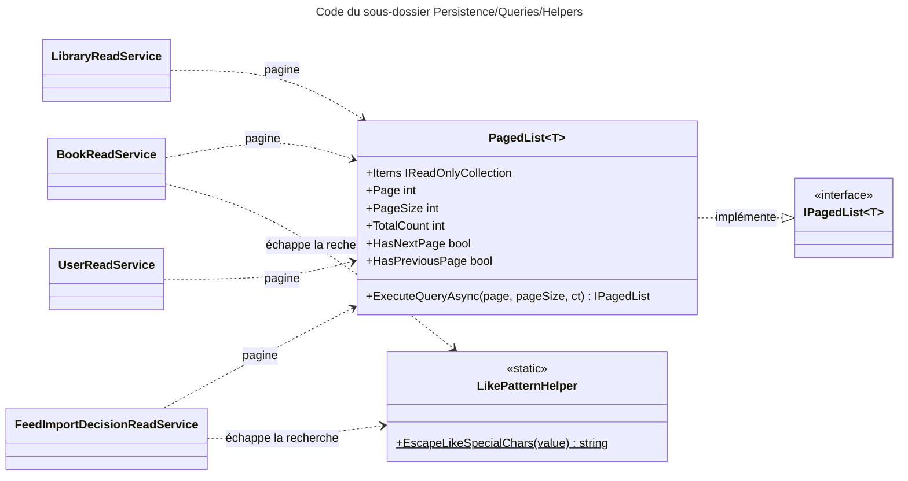

# C4 Code Level : Persistence/Queries/Helpers

## Vue d'ensemble

- **Nom** : Persistence.Queries.Helpers
- **Description** : Utilitaires partagés par les services de lecture : pagination générique adossée à `IQueryable` et échappement des motifs `LIKE` / `ILIKE`.
- **Emplacement relatif** : `Persistence/Queries/Helpers/`
- **Langage** : C# (.NET 10), EF Core 10
- **Objectif** : Fournir une pagination unique (`IPagedList<T>`) qui exécute un comptage puis une page, et garantir qu'une recherche utilisateur est traitée comme une chaîne littérale dans un motif SQL.

Fichiers couverts :

| Fichier | Visibilité | Rôle |
| --- | --- | --- |
| [PagedList.cs](../Persistence/Queries/Helpers/PagedList.cs) | publique | Pagination générique |
| [LikePatternHelper.cs](../Persistence/Queries/Helpers/LikePatternHelper.cs) | interne | Échappement des caractères spéciaux de `LIKE` |

## Éléments de code

### Classes

#### `PagedList<T>`

- **Signature** : `public class PagedList<T>(IQueryable<T> query) : IPagedList<T>`
- **Description** : Implémentation de `IPagedList<T>`. Calcule le nombre total d'éléments puis charge la page demandée. Les propriétés de pagination restent à `-1` tant que `ExecuteQueryAsync` n'a pas été appelé.
- **Emplacement** : [Persistence/Queries/Helpers/PagedList.cs:6-29](../Persistence/Queries/Helpers/PagedList.cs#L6-L29)
- **Paramètre primaire** : `query` (`IQueryable<T>`), déjà filtré et trié par l'appelant.
- **Propriétés** :
  - `public IReadOnlyCollection<T>? Items { get; private set; }` (ligne 8) : éléments de la page courante.
  - `public int Page { get; private set; } = -1;` (ligne 10)
  - `public int PageSize { get; private set; } = -1;` (ligne 12)
  - `public int TotalCount { get; private set; } = -1;` (ligne 14)
  - `public bool HasNextPage => TotalCount != -1 && Page * PageSize < TotalCount;` (ligne 16)
  - `public bool HasPreviousPage => TotalCount != -1 && Page > 1;` (ligne 18)
- **Méthodes** :
  - `public async Task<IPagedList<T>> ExecuteQueryAsync(int page, int pageSize, CancellationToken cancellationToken = default)` (lignes 20-27) : fixe `Page` et `PageSize`, calcule `TotalCount` avec `CountAsync`, puis charge `Items` avec `Skip((page - 1) * pageSize).Take(pageSize)` et `ToListAsync`. Retourne `this`.

#### `LikePatternHelper`

- **Signature** : `internal static class LikePatternHelper`
- **Description** : Échappe la chaîne saisie par l'utilisateur pour qu'elle soit interprétée littéralement dans un motif `LIKE` / `ILIKE` PostgreSQL dont le caractère d'échappement est `\`.
- **Emplacement** : [Persistence/Queries/Helpers/LikePatternHelper.cs:3-14](../Persistence/Queries/Helpers/LikePatternHelper.cs#L3-L14)
- **Méthodes** :
  - `internal static string EscapeLikeSpecialChars(string value)` (lignes 9-13) : remplace, dans cet ordre, `\` par `\\`, `%` par `\%` et `_` par `\_`, avec une comparaison ordinale. L'ordre est important : le premier remplacement doit être celui de l'antislash.

## Dépendances

### Dépendances internes

- **Application** : `IPagedList<T>` (`Application.Interfaces`), implémenté par `PagedList<T>`.
- **Persistence.Queries** : seuls consommateurs de ces utilitaires : `BookReadService`, `FeedImportDecisionReadService`, `LibraryReadService` (pour `PagedList<T>`), `UserReadService` (pour `PagedList<T>`). `LikePatternHelper` est utilisé par `BookReadService` et `FeedImportDecisionReadService`.

### Dépendances externes

- `Microsoft.EntityFrameworkCore` (`CountAsync`, `Skip`, `Take`, `ToListAsync`).
- BCL : `System.Linq` (`IQueryable<T>`), `System.StringComparison`.

## Relations

Points d'attention :

- **Valeurs invalides non vérifiées** : `ExecuteQueryAsync` n'applique aucune borne. Pour `page < 1` ou `pageSize < 1`, `Skip` reçoit une valeur négative et lève une exception. Les appelants doivent valider ces paramètres en amont.
- **Deux requêtes par page** : le comptage et la lecture de la page sont exécutés séparément, sans transaction ni snapshot. Une insertion entre les deux peut rendre `TotalCount` légèrement inexact.
- **Recherche `LIKE` sans `LikePatternHelper`** : `LibraryReadService` et `UserReadService` utilisent `Contains` (traduit en `LIKE` paramétré par EF Core) et n'appellent pas `EscapeLikeSpecialChars`. Le même motif se retrouve dans `BookReadService` et `FeedImportDecisionReadService`, qui l'utilisent avec `ILIKE` et `\`.
- **Ordre de remplacement** : dans `EscapeLikeSpecialChars`, l'antislash doit être traité en premier, sinon les `\` ajoutés pour `%` et `_` seraient doublés.
