# C4 Code Level : Persistence/Queries

## Vue d'ensemble

- **Nom** : Persistence.Queries
- **Description** : Services de lecture (côté requête du CQRS). Chaque service exécute des requêtes LINQ en lecture seule (`AsNoTracking`) sur le `ApplicationDbContext` et renvoie des DTO, des listes paginées ou des entités, sans passer par les dépôts.
- **Emplacement relatif** : `Persistence/Queries/` (le sous-dossier `Helpers/` est documenté à part)
- **Langage** : C# (.NET 10), EF Core 10 avec le fournisseur Npgsql
- **Objectif** : Fournir les données de lecture aux handlers de requête de `Application` : bibliothèques, utilisateurs, livres, décisions d'import de flux, statistiques de lecture.

Fichiers couverts :

| Fichier | Interface implémentée | Domaine fonctionnel |
| --- | --- | --- |
| [BookReadService.cs](../Persistence/Queries/BookReadService.cs) | `IBookReadService` | Livres (liste paginée, identités, emplacements des séries) |
| [LibraryReadService.cs](../Persistence/Queries/LibraryReadService.cs) | `ILibraryReadService` | Bibliothèques (liste, recherche par nom, résumés, unicité) |
| [UserReadService.cs](../Persistence/Queries/UserReadService.cs) | `IUserReadService` | Utilisateurs (liste, recherche par e-mail ou identifiant d'authentification) |
| [FeedImportDecisionReadService.cs](../Persistence/Queries/FeedImportDecisionReadService.cs) | `IFeedImportDecisionReadService` | Décisions d'import issues des flux Miniflux |
| [StatisticsReadService.cs](../Persistence/Queries/StatisticsReadService.cs) | `IStatisticsReadService` | Statistiques de lecture et de collection |

## Éléments de code

### Classes

#### `BookReadService`

- **Signature** : `public class BookReadService(ApplicationDbContext context) : IBookReadService`
- **Description** : Lectures de livres. La liste paginée filtre par bibliothèque et propriétaire, applique une recherche `ILIKE` sur le titre et la série (avec échappement des caractères spéciaux), trie et projette directement vers `BookSummaryDto` (nombre de lectures, dernière lecture, dernière note, nombre de candidats ISBN, date de scan ISBN).
- **Emplacement** : [Persistence/Queries/BookReadService.cs:11-88](../Persistence/Queries/BookReadService.cs#L11-L88)
- **Méthodes** :
  - `public async Task<IPagedList<BookSummaryDto>> GetPagedByLibraryAsync(Guid libraryId, Guid userId, int page, int pageSize, BookSortOrder sortOrder, string? searchTerm, CancellationToken cancellationToken = default)` (lignes 13-71). Tri : `IdAsc` par `Id`, `SerieAndVolumeAsc` par `Serie`, `VolumeNumber`, `Id`, défaut `Id` décroissant. Projection dans les lignes 45-67, avec un `#pragma warning disable CA1826`.
  - `public async Task<IReadOnlyList<BookIdentityDto>> ListIdentitiesByUserAsync(Guid userId, CancellationToken cancellationToken = default)` (lignes 73-79) : identité (`Id`, `Serie`, `Title`, `VolumeNumber`, `ISBN`, nom de la bibliothèque) de tous les livres de l'utilisateur, triés par `Id`.
  - `public async Task<IReadOnlyList<BookSerieLocationDto>> ListSerieLocationsAsync(Guid userId, CancellationToken cancellationToken = default)` (lignes 81-87) : `LibraryId` et `Serie` de chaque livre de l'utilisateur.

#### `LibraryReadService`

- **Signature** : `public class LibraryReadService(ApplicationDbContext context) : ILibraryReadService`
- **Description** : Lectures des bibliothèques d'un utilisateur : liste paginée avec recherche et tri, recherche par nom normalisé, résumés avec compteur de livres et couvertures, et test d'unicité du nom.
- **Emplacement** : [Persistence/Queries/LibraryReadService.cs:12-100](../Persistence/Queries/LibraryReadService.cs#L12-L100)
- **Méthodes** :
  - `public async Task<IPagedList<Library>> GetLibrariesAsync(string? searchTerm, LibrariesColumn? sortColumn, SortOrder? sortOrder, int page, int pageSize, Guid userId, CancellationToken cancellationToken = default)` (lignes 14-38). Colonnes de tri : `Id` ou `Name`. Recherche `Contains` sur `Name`.
  - `public async Task<Library?> GetByNameAsync(string name, Guid userId, CancellationToken cancellationToken = default)` (lignes 40-54) : compare `Name.ToUpper()` à `name.Trim().ToUpperInvariant()`, retourne la première correspondance par `Id`.
  - `public async Task<IReadOnlyList<LibrarySummary>> GetSummariesAsync(Guid userId, CancellationToken cancellationToken = default)` (lignes 56-78) : résumés triés par `Name` puis `Id`. Chaque résumé contient le nombre de livres (sous-requête `Count`) et jusqu'à `LibrarySummary.MaxCovers` couvertures (`ImageLink` non vide, les plus récents d'abord).
  - `public async Task<bool> ExistsByNameAsync(string name, Guid userId, Guid? excludeId = null, CancellationToken cancellationToken = default)` (lignes 80-99) : `AnyAsync` sur le nom normalisé, en excluant éventuellement une bibliothèque par `Id`.

#### `UserReadService`

- **Signature** : `public class UserReadService(ApplicationDbContext context) : IUserReadService`
- **Description** : Lectures des utilisateurs. Fournit la liste paginée d'administration et trois recherches unitaires dont la cohérence est gérée par le type `Result<User>`.
- **Emplacement** : [Persistence/Queries/UserReadService.cs:11-100](../Persistence/Queries/UserReadService.cs#L11-L100)
- **Méthodes** :
  - `public async Task<IPagedList<User>> GetUsersAsync(string? searchTerm, UsersColumn? sortColumn, SortOrder? sortOrder, int page, int pageSize, CancellationToken cancellationToken = default)` (lignes 13-38). Colonnes de tri : `Id`, `Email`, `AuthId`. Recherche `Contains` sur `Email`.
  - `public async Task<Result<User>> GetUserByAuthIdAndEmail(string? email, string? authId, CancellationToken cancellationToken = default)` (lignes 40-55) : `UsersError.BadRequest` si un paramètre est vide, `UsersError.NotFound` si aucun utilisateur ne correspond.
  - `public async Task<Result<User>> GetUserByEmail(string? email, CancellationToken cancellationToken = default)` (lignes 57-72) : mêmes erreurs, recherche par e-mail seul.
  - `public async Task<Result<User>> GetUserByAuthId(string? authId, CancellationToken cancellationToken = default)` (lignes 74-98) : charge au plus deux utilisateurs (`Take(2)`) ; `UsersError.NotFound` si aucun, `UsersError.Duplicate` si plus d'un.

#### `FeedImportDecisionReadService`

- **Signature** : `public class FeedImportDecisionReadService(ApplicationDbContext context) : IFeedImportDecisionReadService`
- **Description** : Lectures des décisions d'import issues des entrées Miniflux : liste paginée avec événements inclus (requête scindée), comptages par statut, et ensemble des identifiants d'entrées multi-livres.
- **Emplacement** : [Persistence/Queries/FeedImportDecisionReadService.cs:8-79](../Persistence/Queries/FeedImportDecisionReadService.cs#L8-L79)
- **Méthodes** :
  - `public async Task<IPagedList<FeedImportDecision>> GetPagedAsync(Guid userId, FeedImportDecisionStatus? status, string? searchTerm, int page, int pageSize, CancellationToken cancellationToken = default)` (lignes 10-46). Inclut `Events` triés par `OccurredAt`, `Id`, en `AsSplitQuery`. Recherche `ILIKE` sur `EntryTitle`, `Reason` et `ParsedSerie`. Tri : `CreatedAt` décroissant, `MinifluxEntryId` décroissant, `ItemIndex`, `Id`.
  - `public async Task<IReadOnlySet<long>> GetMultiBookEntryIdsAsync(Guid userId, IReadOnlyCollection<long> minifluxEntryIds, CancellationToken cancellationToken = default)` (lignes 48-65) : identifiants Miniflux parmi ceux demandés qui ont au moins une décision avec `ItemIndex > 0`. Retourne un ensemble vide sans requête si la liste est vide.
  - `public async Task<int> CountByStatusAsync(Guid userId, FeedImportDecisionStatus status, CancellationToken cancellationToken = default)` (lignes 67-70).
  - `public async Task<IReadOnlyDictionary<FeedImportDecisionStatus, int>> CountPerStatusAsync(Guid userId, CancellationToken cancellationToken = default)` (lignes 72-78) : `GroupBy` sur le statut, dictionnaire `statut -> nombre`.

#### `StatisticsReadService`

- **Signature** : `public class StatisticsReadService(ApplicationDbContext context) : IStatisticsReadService`
- **Description** : Calcule le tableau de bord statistique d'un utilisateur, global ou restreint à une bibliothèque : nombre de livres, de séries, de bibliothèques, de livres lus, de lectures, note moyenne, pages totales, volume numérique et lectures par mois.
- **Emplacement** : [Persistence/Queries/StatisticsReadService.cs:9-57](../Persistence/Queries/StatisticsReadService.cs#L9-L57)
- **Méthodes** :
  - `public async Task<StatisticsDto> GetStatisticsAsync(Guid userId, Guid? libraryId, DateTime readingsFromUtc, CancellationToken cancellationToken = default)` (lignes 11-52). Exécute une requête par indicateur (`CountAsync`, `SumAsync`, `AverageAsync`, `GroupBy` sur année et mois des lectures depuis `readingsFromUtc`).
  - `private static IQueryable<TBook> FilterBooks<TBook>(IQueryable<TBook> books, Guid userId, Guid? libraryId) where TBook : Book` (lignes 54-56) : filtre par propriétaire (`Library.UserId`) et, éventuellement, par bibliothèque.

#### `PagedList` et `LikePatternHelper`

Documentés dans le sous-dossier [Queries/Helpers](c4-code-Persistence-Queries-Helpers.md). Ces types sont utilisés par `BookReadService`, `FeedImportDecisionReadService`, `LibraryReadService` et `UserReadService`.

## Dépendances

### Dépendances internes

- **Application** : interfaces implémentées (`IBookReadService`, `ILibraryReadService`, `IUserReadService`, `IFeedImportDecisionReadService`, `IStatisticsReadService`, `IPagedList<T>`), DTO et énumérations de requête : `BookSortOrder`, `BookSummaryDto`, `BookIdentityDto`, `BookSerieLocationDto` (`Application.Books`), `LibrariesColumn`, `LibrarySummary` (`Application.Libraries`, `Application.Libraries.Summaries`), `UsersColumn` (`Application.Users`), `StatisticsDto`, `MonthlyReadingCountDto` (`Application.Statistics.Get`).
- **Domain** : entités `Book`, `DigitalBook`, `ReadingDate`, `Library`, `User`, `FeedImportDecision`, `FeedImportDecisionStatus` ; `Result<T>`, `SortOrder` (`Domain.Primitives`), `UsersError` (`Domain.Users`).
- **Persistence** : `ApplicationDbContext` (racine de `Persistence`), `Persistence.Queries.Helpers` (`PagedList<T>`, `LikePatternHelper`).

### Dépendances externes

- `Microsoft.EntityFrameworkCore` (`AsNoTracking`, `Include`, `AsSplitQuery`, `CountAsync`, `SumAsync`, `ToDictionaryAsync`, `SingleOrDefaultAsync`, `AnyAsync`).
- `Npgsql.EntityFrameworkCore.PostgreSQL` via `EF.Functions.ILike`.
- BCL : `System.Linq.Expressions` (`UserReadService`, `LibraryReadService`).

## Relations

```mermaid
---
title: Code du sous-dossier Persistence/Queries
---
classDiagram
    direction TB
    namespace Queries {
        class BookReadService {
            +GetPagedByLibraryAsync(libraryId, userId, page, pageSize, sortOrder, searchTerm, ct) IPagedList
            +ListIdentitiesByUserAsync(userId, ct) IReadOnlyList
            +ListSerieLocationsAsync(userId, ct) IReadOnlyList
        }
        class LibraryReadService {
            +GetLibrariesAsync(searchTerm, sortColumn, sortOrder, page, pageSize, userId, ct) IPagedList
            +GetByNameAsync(name, userId, ct) Library
            +GetSummariesAsync(userId, ct) IReadOnlyList
            +ExistsByNameAsync(name, userId, excludeId, ct) bool
        }
        class UserReadService {
            +GetUsersAsync(searchTerm, sortColumn, sortOrder, page, pageSize, ct) IPagedList
            +GetUserByAuthIdAndEmail(email, authId, ct) Result
            +GetUserByEmail(email, ct) Result
            +GetUserByAuthId(authId, ct) Result
        }
        class FeedImportDecisionReadService {
            +GetPagedAsync(userId, status, searchTerm, page, pageSize, ct) IPagedList
            +GetMultiBookEntryIdsAsync(userId, minifluxEntryIds, ct) IReadOnlySet
            +CountByStatusAsync(userId, status, ct) int
            +CountPerStatusAsync(userId, ct) IReadOnlyDictionary
        }
        class StatisticsReadService {
            +GetStatisticsAsync(userId, libraryId, readingsFromUtc, ct) StatisticsDto
            -FilterBooks(books, userId, libraryId) IQueryable$
        }
    }
    class PagedList {
        <<Helpers>>
        +ExecuteQueryAsync(page, pageSize, ct) IPagedList
    }
    class ApplicationDbContext {
        <<DbContext>>
    }

    BookReadService ..> PagedList : pagine
    LibraryReadService ..> PagedList : pagine
    UserReadService ..> PagedList : pagine
    FeedImportDecisionReadService ..> PagedList : pagine
    BookReadService --> ApplicationDbContext : requêtes AsNoTracking
    LibraryReadService --> ApplicationDbContext : requêtes AsNoTracking
    UserReadService --> ApplicationDbContext : requêtes AsNoTracking
    FeedImportDecisionReadService --> ApplicationDbContext : requêtes AsNoTracking
    StatisticsReadService --> ApplicationDbContext : requêtes AsNoTracking
```

Points d'attention :

- **Tri paginé sans clé de départage** : `LibraryReadService.GetLibrariesAsync` trie sur `Name` sans `ThenBy(Id)`, et `UserReadService.GetUsersAsync` trie sur `Email` ou `AuthId` sans `ThenBy(Id)`. Des éléments de même valeur peuvent alors apparaître sur plusieurs pages ou être omis. La règle du projet exige une clé unique finale (par exemple `.ThenBy(l => l.Id)`).
- **Tri dans `LibraryReadService.GetLibrariesAsync`** : la clé `keySelector` est `Expression<Func<Library, object>>` ; le `switch` de tri repose sur la clé sélectionnée, sans départage secondaire.
- **Plusieurs requêtes séquentielles** : `StatisticsReadService.GetStatisticsAsync` exécute neuf requêtes successives (chacune un aller-retour base de données). Elles pourraient être regroupées.
- **Sous-requêtes corrélées** : `LibraryReadService.GetSummariesAsync` compte les livres et récupère les couvertures par sous-requête pour chaque bibliothèque. Le coût croît avec le nombre de bibliothèques.
- **Projection avec cast** : `BookReadService` lit `((DigitalBook)b).IsbnCandidates` et `IsbnScannedAt` dans la projection. Le résultat pour les `PhysicalBook` (valeur `null` attendue selon le commentaire) dépend de la traduction TPT d'EF Core.
- **Validation de la pagination** : `PagedList.ExecuteQueryAsync` ne valide pas `page` ni `pageSize`. Une valeur négative provoque une exception à `Skip`.
- **Code de contournement** : `LibraryReadService.GetByNameAsync` et `ExistsByNameAsync` suppriment des avertissements d'analyse (`CA1862`, `CA1304`, `CA1311`) pour un `ToUpper()` traduit en SQL. Le commentaire `// ✅ Sinon cela plante dans EFCore` (ligne 88) explique le choix.
