# C4 Code Level : Persistence/Repositories

## Vue d'ensemble

- **Nom** : Persistence.Repositories
- **Description** : Dépôts d'accès aux agrégats en écriture et lecture de l'entité. Chaque dépôt encapsule un `DbSet` de `ApplicationDbContext` et implémente une interface définie dans `Application.Interfaces`. Ils ne sauvegardent jamais : la persistance est déclenchée par `UnitOfWork`.
- **Emplacement relatif** : `Persistence/Repositories/`
- **Langage** : C# (.NET 10), EF Core 10 avec Npgsql
- **Objectif** : Fournir aux handlers CQRS de commande l'accès aux agrégats (livres, bibliothèques, utilisateurs, jobs d'import, décisions d'import de flux, cache ISBN Bédéthèque, surcharges de feature toggles).

Fichiers couverts :

| Fichier | Interface implémentée | Agrégat |
| --- | --- | --- |
| [BookRepository.cs](../Persistence/Repositories/BookRepository.cs) | `IRepository<Book, Guid>`, `IBookRepository` | Livres (et leurs dates de lecture) |
| [LibraryRepository.cs](../Persistence/Repositories/LibraryRepository.cs) | `IRepository<Library, Guid>` | Bibliothèques |
| [UserRepository.cs](../Persistence/Repositories/UserRepository.cs) | `IRepository<User, Guid>` | Utilisateurs |
| [ImportJobRepository.cs](../Persistence/Repositories/ImportJobRepository.cs) | `IImportJobRepository` | Jobs d'import |
| [FeedImportDecisionRepository.cs](../Persistence/Repositories/FeedImportDecisionRepository.cs) | `IFeedImportDecisionRepository` | Décisions d'import de flux |
| [IsbnBedethequeCacheRepository.cs](../Persistence/Repositories/IsbnBedethequeCacheRepository.cs) | `IIsbnBedethequeCacheRepository` | Cache ISBN vers URL Bédéthèque |
| [FeatureToggleOverrideRepository.cs](../Persistence/Repositories/FeatureToggleOverrideRepository.cs) | `IFeatureToggleOverrideRepository` | Surcharges de feature toggles |

## Éléments de code

### Classes

#### `BookRepository`

- **Signature** : `public class BookRepository(ApplicationDbContext dbContext) : IBookRepository`
- **Description** : Dépôt des livres. Charge les dates de lecture (`ReadingDates`) avec une requête scindée pour les listes. Expose aussi des requêtes ciblées sur la numérisation ISBN.
- **Emplacement** : [Persistence/Repositories/BookRepository.cs:9-99](../Persistence/Repositories/BookRepository.cs#L9-L99)
- **Méthodes** :
  - `public async Task<Book?> GetByIdAsync(Guid id)` (lignes 11-20) : `Guard.Against.Default(id)`, puis `Include(ReadingDates)` et `SingleOrDefaultAsync`.
  - `public void Add(Book entity)` (lignes 22-25)
  - `public void Update(Book entity)` (lignes 27-30) : `dbContext.Entry(entity).State = EntityState.Modified`, c'est-à-dire que toutes les propriétés sont considérées comme modifiées.
  - `public void AddReadingDate(ReadingDate readingDate)` (lignes 32-35)
  - `public void Remove(Book entity)` (lignes 37-40)
  - `public int Count()` (lignes 42-45) : nombre total de livres, toutes bibliothèques confondues.
  - `public async Task<List<Book>> ListAsync()` (lignes 47-50) : délègue à la surcharge avec `CancellationToken.None`.
  - `public async Task<List<Book>> ListAsync(CancellationToken cancellationToken)` (lignes 52-58) : tous les livres avec `ReadingDates`, requête scindée.
  - `public async Task<List<Book>> ListByLibraryIdAsync(Guid libraryId, CancellationToken cancellationToken = default)` (lignes 60-67)
  - `public async Task<List<Guid>> ListIdsToScanForIsbnAsync(Guid libraryId, CancellationToken cancellationToken = default)` (lignes 69-76) : identifiants des `DigitalBook` de la bibliothèque dont l'ISBN est vide ou nul et dont `IsbnScannedAt` est nul, triés par `Id`.
  - `public async Task<List<Book>> ListByUserIdAsync(Guid userId, CancellationToken cancellationToken = default)` (lignes 78-85) : livres dont la bibliothèque appartient à l'utilisateur.
  - `public async Task<Book?> GetByIsbnAsync(string isbn, CancellationToken cancellationToken = default)` (lignes 87-98) : lève `ArgumentException` si l'ISBN est vide ou blanc, normalise avec `IsbnHelper.NormalizeIsbn`, puis `FirstOrDefaultAsync` sur `ISBN`.

#### `LibraryRepository`

- **Signature** : `public class LibraryRepository(ApplicationDbContext dbContext) : IRepository<Library, Guid>`
- **Description** : Dépôt générique des bibliothèques (sans chargement des livres).
- **Emplacement** : [Persistence/Repositories/LibraryRepository.cs:8-40](../Persistence/Repositories/LibraryRepository.cs#L8-L40)
- **Méthodes** :
  - `public async Task<Library?> GetByIdAsync(Guid id)` (lignes 10-14) : `Guard.Against.Null(id)` puis `SingleOrDefaultAsync`.
  - `public void Add(Library entity)` (lignes 16-19)
  - `public void Update(Library entity)` (lignes 21-24) : `Set<Library>().Update(entity)`.
  - `public void Remove(Library entity)` (lignes 26-29)
  - `public int Count()` (lignes 31-34)
  - `public async Task<List<Library>> ListAsync()` (lignes 36-39)

#### `UserRepository`

- **Signature** : `public class UserRepository(ApplicationDbContext dbContext) : IRepository<User, Guid>`
- **Description** : Dépôt générique des utilisateurs. Même structure que `LibraryRepository`.
- **Emplacement** : [Persistence/Repositories/UserRepository.cs:8-40](../Persistence/Repositories/UserRepository.cs#L8-L40)
- **Méthodes** : `GetByIdAsync(Guid id)` (lignes 10-14), `Add(User entity)` (16-19), `Update(User entity)` (21-24), `Remove(User entity)` (26-29), `Count()` (31-34), `ListAsync()` (36-39). Toutes sont identiques à `LibraryRepository`, pour le type `User`.

#### `ImportJobRepository`

- **Signature** : `public class ImportJobRepository(ApplicationDbContext context) : IImportJobRepository`
- **Description** : Dépôt des jobs d'import. Les lectures de listes sont en `AsNoTracking` et triées de façon déterministe (date puis `Id`).
- **Emplacement** : [Persistence/Repositories/ImportJobRepository.cs:7-46](../Persistence/Repositories/ImportJobRepository.cs#L7-L46)
- **Méthodes** :
  - `public void Add(ImportJob importJob)` (ligne 9)
  - `public void Remove(ImportJob importJob)` (ligne 11)
  - `public async Task<ImportJob?> GetByIdAsync(Guid id, CancellationToken ct = default)` (lignes 13-14) : entité suivie (tracked), `FirstOrDefaultAsync`.
  - `public async Task<IReadOnlyList<ImportJob>> GetByIdsAsync(IReadOnlyCollection<Guid> ids, CancellationToken ct = default)` (lignes 16-22) : liste vide sans requête si `ids` est vide ; sinon `AsNoTracking` avec `Contains`.
  - `public async Task<IReadOnlyList<ImportJob>> GetByLibraryIdAsync(Guid libraryId, CancellationToken ct = default)` (lignes 24-30) : jobs de la bibliothèque, `CreatedAt` décroissant puis `Id`.
  - `public async Task<IReadOnlyList<ImportJob>> GetPendingAsync(CancellationToken ct = default)` (lignes 32-37) : jobs au statut `Pending`, `CreatedAt` croissant puis `Id`.
  - `public async Task<bool> ExistsActiveForFilePathAsync(string filePath, CancellationToken ct = default)` (lignes 39-43) : vrai s'il existe un job pour ce `OriginalFilePath` dont le statut n'est ni `Completed` ni `Failed`.
  - `public void Update(ImportJob importJob)` (ligne 45) : `context.ImportJobs.Update(importJob)`.

#### `FeedImportDecisionRepository`

- **Signature** : `public class FeedImportDecisionRepository(ApplicationDbContext context) : IFeedImportDecisionRepository`
- **Description** : Dépôt des décisions d'import de flux. Retourne les identifiants en lecture seule pour les traitements par lot et les entités suivies pour les écritures.
- **Emplacement** : [Persistence/Repositories/FeedImportDecisionRepository.cs:7-44](../Persistence/Repositories/FeedImportDecisionRepository.cs#L7-L44)
- **Méthodes** :
  - `public void Add(FeedImportDecision decision)` (ligne 9)
  - `public void Remove(FeedImportDecision decision)` (ligne 11)
  - `public async Task<FeedImportDecision?> GetByIdAsync(Guid id, CancellationToken ct = default)` (lignes 13-14) : entité suivie.
  - `public async Task<FeedImportDecision?> GetByMinifluxEntryIdAsync(Guid userId, long minifluxEntryId, CancellationToken ct = default)` (lignes 16-18) : première décision de l'entrée Miniflux avec `ItemIndex == 0`.
  - `public async Task<IReadOnlyList<Guid>> GetPendingIdsAsync(Guid userId, CancellationToken ct = default)` (lignes 20-27) : identifiants des décisions `Pending` (`ItemIndex == 0`), triés par `CreatedAt` puis `Id`.
  - `public async Task<IReadOnlyList<Guid>> GetIdsByStatusAsync(Guid userId, FeedImportDecisionStatus status, CancellationToken ct = default)` (lignes 29-38) : identifiants par statut, triés par `CreatedAt`, `MinifluxEntryId`, `ItemIndex`, `Id`.
  - `public async Task<IReadOnlyList<FeedImportDecision>> GetByStatusAsync(Guid userId, FeedImportDecisionStatus status, CancellationToken ct = default)` (lignes 40-43) : entités complètes par statut, suivies (sans `AsNoTracking`).

#### `IsbnBedethequeCacheRepository`

- **Signature** : `public class IsbnBedethequeCacheRepository(ApplicationDbContext dbContext) : IIsbnBedethequeCacheRepository`
- **Description** : Cache associant un ISBN à l'URL de la fiche Bédéthèque. L'insertion tolère la concurrence : une violation d'unicité (SQLSTATE `23505`) est ignorée.
- **Emplacement** : [Persistence/Repositories/IsbnBedethequeCacheRepository.cs:8-32](../Persistence/Repositories/IsbnBedethequeCacheRepository.cs#L8-L32)
- **Méthodes** :
  - `public async Task<string?> GetUrlByIsbnAsync(string isbn, CancellationToken ct = default)` (lignes 10-16) : `Select(Url)` puis `FirstOrDefaultAsync`.
  - `public async Task SaveAsync(string isbn, string url, CancellationToken ct = default)` (lignes 18-31) : crée l'entité avec `IsbnBedethequeUrl.Create(isbn, url)`, l'ajoute et appelle `SaveChangesAsync`. Sur `DbUpdateException` dont l'exception interne est `PostgresException` avec `SqlState == "23505"`, détache l'entité. Les autres erreurs sont relancées.

#### `FeatureToggleOverrideRepository`

- **Signature** : `public class FeatureToggleOverrideRepository(ApplicationDbContext context) : IFeatureToggleOverrideRepository`
- **Description** : Dépôt des surcharges de feature toggles, une ligne au plus par toggle (index unique sur `Toggle` dans le modèle).
- **Emplacement** : [Persistence/Repositories/FeatureToggleOverrideRepository.cs:7-18](../Persistence/Repositories/FeatureToggleOverrideRepository.cs#L7-L18)
- **Méthodes** :
  - `public void Add(FeatureToggleOverride toggleOverride)` (ligne 9)
  - `public void Remove(FeatureToggleOverride toggleOverride)` (ligne 11)
  - `public async Task<FeatureToggleOverride?> GetAsync(FeatureToggle toggle, CancellationToken ct = default)` (lignes 13-14) : entité suivie.
  - `public async Task<IReadOnlyList<FeatureToggleOverride>> GetAllAsync(CancellationToken ct = default)` (lignes 16-17) : `AsNoTracking`.

## Dépendances

### Dépendances internes

- **Application** : interfaces implémentées (`IRepository<,>`, `IBookRepository`, `IImportJobRepository`, `IFeedImportDecisionRepository`, `IIsbnBedethequeCacheRepository`, `IFeatureToggleOverrideRepository`), `IsbnHelper` (`Application.Helpers`).
- **Domain** : `Book`, `ReadingDate`, `IsbnBedethequeUrl` (`Domain.Books`), `Library` (`Domain.Libraries`), `User` (`Domain.Users`), `ImportJob`, `ImportJobStatus` (`Domain.ImportJobs`), `FeedImportDecision`, `FeedImportDecisionStatus` (`Domain.FeedImports`), `FeatureToggle`, `FeatureToggleOverride` (`Domain.Settings`).
- **Persistence** : `ApplicationDbContext` (racine de `Persistence`).

### Dépendances externes

- `Microsoft.EntityFrameworkCore` (`DbSet`, `Include`, `AsSplitQuery`, `AsNoTracking`, `EntityState`).
- `Npgsql` (`PostgresException`, pour le code SQLSTATE `23505`).
- `Ardalis.GuardClauses` (`Guard.Against.Default`, `Guard.Against.Null`).

## Relations

```mermaid
---
title: Code du sous-dossier Persistence/Repositories
---
classDiagram
    direction TB
    namespace Repositories {
        class BookRepository {
            +GetByIdAsync(id) Book
            +Add(entity) void
            +Update(entity) void
            +AddReadingDate(readingDate) void
            +Remove(entity) void
            +Count() int
            +ListAsync(ct) List
            +ListByLibraryIdAsync(libraryId, ct) List
            +ListIdsToScanForIsbnAsync(libraryId, ct) List
            +ListByUserIdAsync(userId, ct) List
            +GetByIsbnAsync(isbn, ct) Book
        }
        class LibraryRepository {
            +GetByIdAsync(id) Library
            +Add / Update / Remove
            +Count() int
            +ListAsync() List
        }
        class UserRepository {
            +GetByIdAsync(id) User
            +Add / Update / Remove
            +Count() int
            +ListAsync() List
        }
        class ImportJobRepository {
            +GetByIdAsync(id, ct) ImportJob
            +GetByIdsAsync(ids, ct) IReadOnlyList
            +GetByLibraryIdAsync(libraryId, ct) IReadOnlyList
            +GetPendingAsync(ct) IReadOnlyList
            +ExistsActiveForFilePathAsync(filePath, ct) bool
            +Add / Update / Remove
        }
        class FeedImportDecisionRepository {
            +GetByIdAsync(id, ct) FeedImportDecision
            +GetByMinifluxEntryIdAsync(userId, minifluxEntryId, ct) FeedImportDecision
            +GetPendingIdsAsync(userId, ct) IReadOnlyList
            +GetIdsByStatusAsync(userId, status, ct) IReadOnlyList
            +GetByStatusAsync(userId, status, ct) IReadOnlyList
            +Add / Remove
        }
        class IsbnBedethequeCacheRepository {
            +GetUrlByIsbnAsync(isbn, ct) string
            +SaveAsync(isbn, url, ct) Task
        }
        class FeatureToggleOverrideRepository {
            +GetAsync(toggle, ct) FeatureToggleOverride
            +GetAllAsync(ct) IReadOnlyList
            +Add / Remove
        }
    }
    class ApplicationDbContext {
        <<DbContext>>
    }
    class IRepository~T,K~ {
        <<interface>>
    }
    class IBookRepository {
        <<interface>>
    }

    BookRepository ..|> IRepository~T,K~ : implémente
    BookRepository ..|> IBookRepository : implémente
    LibraryRepository ..|> IRepository~T,K~ : implémente
    UserRepository ..|> IRepository~T,K~ : implémente
    ImportJobRepository ..|> IImportJobRepository : implémente
    FeedImportDecisionRepository ..|> IFeedImportDecisionRepository : implémente
    IsbnBedethequeCacheRepository ..|> IIsbnBedethequeCacheRepository : implémente
    FeatureToggleOverrideRepository ..|> IFeatureToggleOverrideRepository : implémente
    BookRepository --> ApplicationDbContext : DbSet Books
    LibraryRepository --> ApplicationDbContext : DbSet Libraries
    UserRepository --> ApplicationDbContext : DbSet Users
    ImportJobRepository --> ApplicationDbContext : DbSet ImportJobs
    FeedImportDecisionRepository --> ApplicationDbContext : DbSet FeedImportDecisions
    IsbnBedethequeCacheRepository --> ApplicationDbContext : DbSet IsbnBedethequeUrls
    FeatureToggleOverrideRepository --> ApplicationDbContext : DbSet FeatureToggleOverrides
```

Points d'attention :

- **Garde sans effet** : `LibraryRepository.GetByIdAsync` et `UserRepository.GetByIdAsync` appellent `Guard.Against.Null(id)` sur un `Guid`, qui est un type valeur et ne peut pas être nul. La garde ne fait donc rien. `BookRepository` utilise à juste titre `Guard.Against.Default(id)`.
- **Gestion d'erreur incohérente** : `BookRepository.GetByIsbnAsync` lève une `ArgumentException` pour un ISBN vide, alors que les autres méthodes de recherche retournent `null`. Les règles du projet demandent une validation qui retourne une erreur de domaine avant tout accès au dépôt.
- **Pas de persistance** : aucun dépôt n'appelle `SaveChanges`. Les écritures ne sont effectives qu'après `IUnitOfWork.SaveChangesAsync`.
- **Mise à jour complète** : `BookRepository.Update` passe l'entité en `Modified`, ce qui réécrit toutes les colonnes. `LibraryRepository`, `UserRepository` et `ImportJobRepository` utilisent `DbSet.Update`, qui a le même effet sur une entité détachée.
- **Lectures suivies** : `FeedImportDecisionRepository.GetByStatusAsync` et `ImportJobRepository.GetByIdAsync` retournent des entités suivies par le contexte, alors que les autres listes sont en `AsNoTracking`. Ce choix doit rester cohérent avec les appelants qui modifient ces entités.
- **Concurrence du cache ISBN** : la détection de doublon se fait par le code SQLSTATE `23505` ; elle dépend du fournisseur PostgreSQL et de l'index unique sur `ISBN`.
