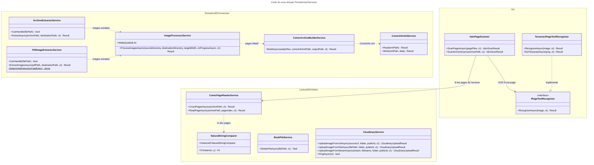
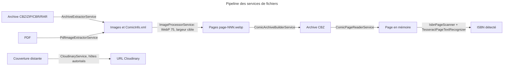

# C4 Code Level : Persistence/Services

## Vue d'ensemble

- **Nom** : Persistence.Services
- **Description** : Services techniques de la couche Persistence qui manipulent des fichiers et des flux : extraction d'archives et de PDF, conversion d'images en WebP, construction d'archives CBZ, lecture des pages de BD, lecture et écriture de `ComicInfo.xml`, suppression de fichiers de livres numériques, reconnaissance de texte (OCR Tesseract) pour la recherche d'ISBN, et téléversement vers Cloudinary.
- **Emplacement relatif** : `Persistence/Services/`
- **Langage** : C# (.NET 10), bibliothèques SharpCompress, PdfPig, SkiaSharp, CloudinaryDotNet, System.Xml
- **Objectif** : Implémenter les interfaces de traitement de fichiers définies dans `Application` (`IArchiveExtractor`, `IPdfImageExtractor`, `IImageProcessor`, `IComicArchiveBuilder`, `IComicPageReader`, `IComicInfoXmlService`, `IBookFileService`, `IIsbnPageScanner`, `ICloudinaryService`) et mettre en oeuvre les contraintes de sécurité (confinement des chemins, limites de taille, anti-SSRF, durées maximales).

Fichiers couverts :

| Fichier | Type | Interface implémentée | Rôle |
| --- | --- | --- | --- |
| [ArchiveExtractorService.cs](../Persistence/Services/ArchiveExtractorService.cs) | classe | `IArchiveExtractor` | Extraction d'images et de `ComicInfo.xml` depuis CBZ, ZIP, CBR, RAR |
| [PdfImageExtractorService.cs](../Persistence/Services/PdfImageExtractorService.cs) | classe | `IPdfImageExtractor` | Extraction des images embarquées d'un PDF |
| [ImageProcessorService.cs](../Persistence/Services/ImageProcessorService.cs) | classe | `IImageProcessor` | Conversion des pages en WebP (SkiaSharp) |
| [ComicArchiveBuilderService.cs](../Persistence/Services/ComicArchiveBuilderService.cs) | classe | `IComicArchiveBuilder` | Assemblage d'un CBZ à partir de pages WebP |
| [ComicPageReaderService.cs](../Persistence/Services/ComicPageReaderService.cs) | classe scellée | `IComicPageReader` | Lecture en mémoire d'une page d'un CBZ |
| [NaturalStringComparer.cs](../Persistence/Services/NaturalStringComparer.cs) | classe interne | `IComparer<string?>` | Tri naturel des noms de pages |
| [ComicInfoXmlService.cs](../Persistence/Services/ComicInfoXmlService.cs) | classe | `IComicInfoXmlService` | Lecture et écriture de `ComicInfo.xml` |
| [BookFileService.cs](../Persistence/Services/BookFileService.cs) | classe scellée partielle | `IBookFileService` | Suppression de fichiers de livres numériques |
| [IPageTextRecognizer.cs](../Persistence/Services/IPageTextRecognizer.cs) | interface | - | Contrat d'OCR d'une image de page |
| [TesseractPageTextRecognizer.cs](../Persistence/Services/TesseractPageTextRecognizer.cs) | classe scellée | `IPageTextRecognizer` | OCR via la ligne de commande Tesseract |
| [IsbnPageScanner.cs](../Persistence/Services/IsbnPageScanner.cs) | classe scellée | `IIsbnPageScanner` | Recherche d'ISBN sur les pages d'un livre |
| [CloudinaryService.cs](../Persistence/Services/CloudinaryService.cs) | classe | `ICloudinaryService` | Téléversement d'images de couverture |

## Éléments de code

### Classes

#### `ArchiveExtractorService`

- **Signature** : `public class ArchiveExtractorService(ILogger<ArchiveExtractorService> logger) : IArchiveExtractor`
- **Description** : Extrait les images et le `ComicInfo.xml` d'une archive (`.cbz`, `.zip`, `.cbr`, `.rar`) dans un dossier de destination. Refuse les archives trop volumineuses et les chemins qui sortent du dossier cible.
- **Emplacement** : [Persistence/Services/ArchiveExtractorService.cs:12-120](../Persistence/Services/ArchiveExtractorService.cs#L12-L120)
- **Champs statiques** :
  - `s_supportedArchives` (lignes 14-15) : `.cbz`, `.zip`, `.cbr`, `.rar`, insensible à la casse.
  - `s_allowedFileExtensions` (lignes 17-18) : `.jpeg`, `.jpg`, `.png`, `.gif`, `.webp`, `.xml`.
  - `MaxArchiveEntries = 5_000` (ligne 20) et `MaxUncompressedBytes = 5 GB` (ligne 21).
- **Méthodes** :
  - `public bool CanHandle(string filePath)` (lignes 23-24) : vérifie l'extension.
  - `public async Task<Result<ArchiveExtractionResult>> ExtractAsync(string archivePath, string destinationPath, CancellationToken ct = default)` (lignes 26-52) : retourne `FileProcessingError.FileNotFound` si l'archive est absente, crée le dossier, puis exécute `ExtractInternal` dans `Task.Run`. Mappe `InvalidDataException` vers `CorruptArchive`, les autres exceptions (hors annulation) vers `ProcessingFailed`.
  - `private Result<ArchiveExtractionResult> ExtractInternal(string archivePath, string destinationPath)` (lignes 54-119) : ouvre l'archive (`LookForHeader = true`), rejette si plus de 5 000 entrées ou si la somme des tailles déclarées dépasse 5 GB (`CorruptArchive`). Pour chaque entrée dont le nom base est autorisé, calcule le chemin cible, vérifie le confinement avec `PathContainment.IsWithinNormalizedRoot` (ordinal, lignes 92-97), écrit le fichier (`PreserveFileTime = false`, voir le commentaire lignes 99-100) et mémorise le chemin de `ComicInfo.xml`. Retourne les images triées (sans XML) et le chemin du XML.

#### `PdfImageExtractorService`

- **Signature** : `public class PdfImageExtractorService(ILogger<PdfImageExtractorService> logger) : IPdfImageExtractor`
- **Description** : Extrait les images embarquées dans un PDF (bibliothèque PdfPig) et les écrit en fichiers `page-NNN.<ext>`.
- **Emplacement** : [Persistence/Services/PdfImageExtractorService.cs:9-83](../Persistence/Services/PdfImageExtractorService.cs#L9-L83)
- **Méthodes** :
  - `public bool CanHandle(string filePath)` (lignes 11-12) : extension `.pdf`, insensible à la casse.
  - `public async Task<Result<PdfExtractionResult>> ExtractImagesAsync(string pdfPath, string destinationPath, CancellationToken ct = default)` (lignes 14-35) : `FileNotFound` si le PDF est absent, `Task.Run` autour de `ExtractInternal`. Toute exception hors annulation devient `FileProcessingError.CorruptArchive`.
  - `private Result<PdfExtractionResult> ExtractInternal(string pdfPath, string destinationPath, CancellationToken ct)` (lignes 37-65) : ouvre le document, parcourt les pages et les images (`page.GetImages()`), vérifie `ct` à chaque page, écrit `RawBytes` et incrémente un compteur d'index.
  - `internal static string DetermineExtension(byte[] rawBytes)` (lignes 67-82) : détecte JPEG (`FF D8`) et PNG (`89 50 4E 47`), sinon retourne `.jpg` par défaut.

#### `ImageProcessorService`

- **Signature** : `public class ImageProcessorService(ILogger<ImageProcessorService> logger) : IImageProcessor`
- **Description** : Convertit les pages d'une BD en WebP avec SkiaSharp, conçu pour une mémoire réduite (Raspberry Pi). Les JPEG sont décodés à échelle réduite (1/2, 1/4, 1/8) quand c'est possible, la réduction se fait par paliers de moitié puis par un rééchantillonnage Mitchell. Les pages déjà WebP à la bonne largeur sont copiées telles quelles. Les doubles pages (largeur > hauteur) sont traitées sur `2 × targetWidth`.
- **Emplacement** : [Persistence/Services/ImageProcessorService.cs:16-271](../Persistence/Services/ImageProcessorService.cs#L16-L271)
- **Constantes et champs statiques** :
  - `public const int WebpQuality = 75` (ligne 19).
  - `s_stepSampling` (ligne 21, `Linear`, sans mipmap) et `s_finalSampling` (ligne 22, `Mitchell`).
  - `s_decodeDenominators = [8, 4, 2]` (ligne 23) et `MaxDimension = 8_000` (ligne 25) : au-delà, la page est refusée.
  - `s_inputExtensions` (lignes 27-28) : `.jpeg`, `.jpg`, `.png`, `.gif`, `.webp`.
- **Type imbriqué** :
  - `private readonly record struct ImageSize(int Width, int Height)` (lignes 30-33) avec `IsDoublePage => Width > Height`.
- **Méthodes** :
  - `public async Task<Result<ImageProcessingResult>> ProcessImagesAsync(string sourceDirectory, string destinationDirectory, int targetWidth = 1400, Func<ImageConversionProgress, Task>? onProgressAsync = null, CancellationToken ct = default)` (lignes 35-71) : `InvalidPath` si le dossier source est absent. Sans image, retourne `ImageProcessingResult(0, 0, false)`. Sinon convertit, copie `ComicInfo.xml` et retourne `(processedCount, skippedCount, processedCount == 0)`.
  - `private static List<string> GetSortedImageFiles(string sourceDirectory)` (lignes 73-78) : fichiers à extension autorisée, sans fichiers cachés, triés ordinal insensible à la casse.
  - `private async Task<Result<(int ProcessedCount, int SkippedCount)>> ProcessAllImagesAsync(List<string> imageFiles, string destinationDirectory, int targetWidth, Func<ImageConversionProgress, Task>? onProgressAsync, CancellationToken ct)` (lignes 80-120) : nomme les sorties `page-NNN.webp`. Une exception hors annulation pendant la conversion renvoie `FileProcessingError.InvalidImageContent(nom)`.
  - `private bool ShouldSkipConversion(string filePath, int targetWidth)` (lignes 122-139) : vrai si le fichier est un `.webp` dont la largeur vaut déjà `EffectiveWidth`.
  - `private static void CopyComicInfoXml(string sourceDirectory, string destinationDirectory)` (lignes 141-154).
  - `private static int EffectiveWidth(ImageSize size, int targetWidth)` (ligne 156) : `targetWidth` ou `2 × targetWidth` pour une double page.
  - `private static void EnsureSupportedDimensions(ImageSize size)` (lignes 158-165) : lève `InvalidOperationException` si une dimension dépasse `MaxDimension`.
  - `private static ImageSize? Identify(string filePath)` (lignes 168-172) : taille sans décoder les pixels.
  - `private static void ConvertToWebp(string sourcePath, string outputPath, int targetWidth, CancellationToken ct)` (lignes 174-192) : décode, réduit, encode en WebP à qualité 75, écrit le fichier.
  - `private static SKCodec? OpenCodec(string filePath)` (lignes 195-208) : `null` si le fichier n'est pas une image lisible.
  - `internal static int DecodeScaleDenominator(int sourceWidth, int targetWidth)` (lignes 211-222) : plus grand dénominateur (8, 4, 2) qui garde une largeur au moins égale à la cible, sinon `1`.
  - `private static SKBitmap Decode(SKCodec codec, int targetWidth)` (lignes 225-242) : décode à l'échelle choisie, accepte `Success` et `IncompleteInput`.
  - `private static SKBitmap ResizeInSteps(SKBitmap source, int targetWidth, int targetHeight)` (lignes 244-266) : réductions par moitié tant que la largeur est au moins le double de la cible, puis un redimensionnement final. Libère les copies intermédiaires, jamais la source.
  - `private static SKBitmap Resize(SKBitmap source, int width, int height, SKSamplingOptions sampling)` (lignes 268-270).

#### `ComicArchiveBuilderService`

- **Signature** : `public class ComicArchiveBuilderService(ILogger<ComicArchiveBuilderService> logger) : IComicArchiveBuilder`
- **Description** : Assemble un fichier CBZ (ZIP sans compression) à partir de la liste des pages WebP, avec `ComicInfo.xml` optionnel.
- **Emplacement** : [Persistence/Services/ComicArchiveBuilderService.cs:9-61](../Persistence/Services/ComicArchiveBuilderService.cs#L9-L61)
- **Méthodes** :
  - `public async Task<Result<ComicArchiveResult>> BuildAsync(IReadOnlyList<string> webpFiles, string? comicInfoXmlPath, string outputPath, CancellationToken ct = default)` (lignes 11-39) : `EmptyDirectory` si la liste est vide. Exécute `CreateArchive` dans `Task.Run` et retourne `ComicArchiveResult(outputPath, taille, nombre de pages)`. Les erreurs hors annulation deviennent `ProcessingFailed`.
  - `private static void CreateArchive(string outputPath, IReadOnlyList<string> webpFiles, string? comicInfoPath)` (lignes 41-60) : crée le dossier parent, ouvre le ZIP en mode `Create`, ajoute chaque page sous son nom de fichier (`CompressionLevel.Fastest`), puis `ComicInfo.xml` si fourni.

#### `ComicPageReaderService`

- **Signature** : `public sealed class ComicPageReaderService(string rootPath, ILogger<ComicPageReaderService> logger) : IComicPageReader`
- **Description** : Sert les pages d'une BD directement depuis l'archive : chaque page est décompressée en mémoire pour la durée de la requête, sans écriture sur disque. Les pages sont ordonnées par tri naturel des noms.
- **Emplacement** : [Persistence/Services/ComicPageReaderService.cs:16-101](../Persistence/Services/ComicPageReaderService.cs#L16-L101)
- **Champs** :
  - `s_contentTypes` (lignes 18-25) : `.webp`, `.jpg`, `.jpeg`, `.png`, `.gif` vers le type MIME.
  - `MaxPageBytes = 50 MB` (ligne 27).
- **Méthodes** :
  - `public Task<Result<int>> CountPagesAsync(string archivePath, CancellationToken ct = default)` (lignes 29-30).
  - `public Task<Result<ComicPage>> ReadPageAsync(string archivePath, int pageIndex, CancellationToken ct = default)` (lignes 32-40) : `BooksError.PageNotFound` si `pageIndex < 0`.
  - `private async Task<Result<T>> RunOnArchiveAsync<T>(string archivePath, Func<IArchive, Result<T>> action, CancellationToken ct)` (lignes 42-70) : refuse les chemins hors de `rootPath` (`PathContainment.IsWithin`, `FileProcessingError.InvalidPath`), `BooksError.FileNotFound` si absent, ouvre le fichier en lecture partagée et exécute l'action dans `Task.Run`. Exception hors annulation : `FileProcessingError.CorruptArchive`.
  - `private static List<IArchiveEntry> GetPageEntries(IArchive archive)` (lignes 72-75) : entrées non dossiers aux extensions d'image, triées par `NaturalStringComparer.Instance`.
  - `private Result<ComicPage> ReadPage(IArchive archive, string archivePath, int pageIndex)` (lignes 77-100) : `PageNotFound` si l'index dépasse, `CorruptArchive` si la page dépasse 50 MB. Copie la page dans un `MemoryStream` et retourne `ComicPage(contenu, type MIME, date de modification de l'archive)`.

#### `NaturalStringComparer`

- **Signature** : `internal sealed class NaturalStringComparer : IComparer<string?>`
- **Description** : Comparaison insensible à la casse où les suites de chiffres sont comparées par valeur (`page2` avant `page10`). Les zéros de tête n'ont pas de valeur ; en cas d'égalité, la suite la plus courte passe avant.
- **Emplacement** : [Persistence/Services/NaturalStringComparer.cs:7-71](../Persistence/Services/NaturalStringComparer.cs#L7-L71)
- **Champ statique** : `public static readonly NaturalStringComparer Instance` (ligne 9).
- **Méthodes** :
  - `public int Compare(string? x, string? y)` (lignes 11-42) : gère les `null` et les références égales, puis compare caractère par caractère ou suite numérique.
  - `private static int CompareNumbers(string x, ref int i, string y, ref int j)` (lignes 44-59) : compare deux suites de chiffres par longueur après suppression des zéros de tête, puis par valeur ordinale.
  - `private static ReadOnlySpan<char> ReadDigits(string s, ref int index)` (lignes 61-70).

#### `ComicInfoXmlService`

- **Signature** : `public class ComicInfoXmlService(ILogger<ComicInfoXmlService> logger) : IComicInfoXmlService`
- **Description** : Lit et écrit le fichier `ComicInfo.xml` (métadonnées de BD au format ComicRack) via `XmlSerializer` et le DTO `ComicInfoDocument`. La lecture interdit les DTD et la résolution d'entités externes.
- **Emplacement** : [Persistence/Services/ComicInfoXmlService.cs:10-123](../Persistence/Services/ComicInfoXmlService.cs#L10-L123)
- **Champ statique** : `s_serializer = new(typeof(ComicInfoDocument))` (ligne 12).
- **Méthodes** :
  - `public Result<ComicInfoData> Read(string xmlPath)` (lignes 14-45) : `FileNotFound` si absent. Lecture avec `DtdProcessing.Prohibit`, `XmlResolver = null`, `MaxCharactersFromEntities = 0`, `MaxCharactersInDocument = 1_000_000`. Retourne `XmlReadError` si le document est vide ou invalide (`InvalidOperationException` ou `XmlException`).
  - `public Result Write(string xmlPath, ComicInfoData data)` (lignes 47-67) : sérialise avec indentation UTF-8. Retourne `XmlWriteError` en cas d'erreur hors annulation.
- **Type imbriqué** :
  - `public class ComicInfoDocument` (lignes 69-122), annoté `[XmlRoot("ComicInfo")]`. Propriétés : `string? Title`, `string? Series`, `int? Number`, `string? Summary`, `int Year`, `int Month`, `int Day`, `string? Writer`, `string? Penciller`, `string? Publisher`, `string? Isbn` (`[XmlElement("ISBN")]`), `int PageCount`. Méthodes `ShouldSerializeYear()`, `ShouldSerializeMonth()`, `ShouldSerializeDay()`, `ShouldSerializePageCount()` (omettent les zéros).
  - `public ComicInfoData ToComicInfoData()` (lignes 92-105) : convertit en DTO du domaine, avec `null` pour les zéros de date et de nombre de pages.
  - `public static ComicInfoDocument FromComicInfoData(ComicInfoData data)` (lignes 107-121) : opération inverse.

#### `BookFileService`

- **Signature** : `public sealed partial class BookFileService(ILogger<BookFileService> logger) : IBookFileService`
- **Description** : Supprime le fichier numérique d'un livre. Une absence de fichier est journalisée en avertissement et n'est pas une erreur ; les autres échecs sont journalisés en erreur et avalés.
- **Emplacement** : [Persistence/Services/BookFileService.cs:6-42](../Persistence/Services/BookFileService.cs#L6-L42)
- **Méthodes** :
  - `public Task DeleteFileAsync(string filePath, CancellationToken cancellationToken = default)` (lignes 8-32) : ignore les chemins vides, `File.Delete` si le fichier existe. Retourne `Task.CompletedTask` dans tous les cas. Le jeton d'annulation n'est pas utilisé.
  - `private partial void LogFileNotFound(string filePath)` (ligne 35) : `LoggerMessage` niveau `Warning`.
  - `private partial void LogFileDeleted(string filePath)` (ligne 38) : niveau `Information`.
  - `private partial void LogFileDeletionFailed(Exception ex, string filePath)` (ligne 41) : niveau `Error`.

#### `TesseractPageTextRecognizer`

- **Signature** : `public sealed class TesseractPageTextRecognizer(IOptions<IsbnOcrSettings> options, ILogger<TesseractPageTextRecognizer> logger) : IPageTextRecognizer`
- **Description** : Exécute la ligne de commande Tesseract sur une page. L'image, préparée en niveaux de gris et agrandie jusqu'à 2 fois (côté long limité à 4096 px), est envoyée sur l'entrée standard, et le texte est lu sur la sortie standard. Rien n'est écrit sur disque. Un délai `PageTimeoutSeconds` est appliqué.
- **Emplacement** : [Persistence/Services/TesseractPageTextRecognizer.cs:16-155](../Persistence/Services/TesseractPageTextRecognizer.cs#L16-L155)
- **Constantes et champs** :
  - `MaxUpscale = 2` (ligne 21), `MaxLongSide = 4096` (ligne 22).
  - `s_upscaleSampling` (ligne 24) : `CatmullRom`.
  - `_settings = options.Value` (ligne 26).
- **Méthodes** :
  - `public async Task<Result<string>> RecognizeAsync(ReadOnlyMemory<byte> image, CancellationToken ct = default)` (lignes 28-38) : `OcrError.UnreadableImage` si `Prepare` échoue, sinon `RunTesseractAsync`.
  - `private static byte[]? Prepare(ReadOnlyMemory<byte> image)` (lignes 41-64) : décode, agrandit si nécessaire, convertit en `Gray8` puis encode en PNG. Retourne `null` si le décodage échoue.
  - `private static SKBitmap Enlarge(SKBitmap page, double scale)` (lignes 66-72).
  - `private async Task<Result<string>> RunTesseractAsync(byte[] png, CancellationToken ct)` (lignes 74-121) : démarre le processus (`Win32Exception` vers `OcrError.Unavailable`), applique un délai lié à `ct`, écrit l'image sur stdin, attend la fin. Code de sortie non nul : `OcrError.Failed`. Délai dépassé : `OcrError.Timeout`. `IOException` : `OcrError.Failed`. Le bloc `finally` appelle `StopIfRunning`.
  - `private ProcessStartInfo CreateStartInfo()` (lignes 123-139) : arguments `stdin stdout -l <langue>`, redirections, `OMP_THREAD_LIMIT=1`.
  - `private static void StopIfRunning(Process process)` (lignes 141-154) : `Kill(entireProcessTree: true)` si le processus tourne encore.

#### `IsbnPageScanner`

- **Signature** : `public sealed class IsbnPageScanner(IPageTextRecognizer recognizer, IComicPageReader pageReader, IOptions<IsbnOcrSettings> options, IFeatureToggles featureToggles, ILogger<IsbnPageScanner> logger) : IIsbnPageScanner`
- **Description** : Recherche un ISBN dans les pages d'un livre, en commençant par les pages de début et de fin (ordre donné par `IsbnScanPages.GetScanOrder`). S'arrête à la première page qui contient un ISBN. Ne fait rien si la fonctionnalité `IsbnOcr` est désactivée.
- **Emplacement** : [Persistence/Services/IsbnPageScanner.cs:11-98](../Persistence/Services/IsbnPageScanner.cs#L11-L98)
- **Champ** : `_settings = options.Value` (ligne 18).
- **Méthodes** :
  - `public Task<IsbnScanResult> ScanPagesAsync(IReadOnlyList<string> pageFiles, CancellationToken ct = default)` (lignes 20-21) : scanne des fichiers image sur disque.
  - `public async Task<IsbnScanResult> ScanArchiveAsync(string archivePath, CancellationToken ct = default)` (lignes 23-38) : `NotScanned` si la fonctionnalité est désactivée ou si l'archive ne peut pas être comptée.
  - `private async Task<IsbnScanResult> ScanAsync(int pageCount, Func<int, CancellationToken, Task<ReadOnlyMemory<byte>?>> readPage, CancellationToken ct)` (lignes 40-73) : pour chaque index, lit la page, lance l'OCR, extrait les ISBN (`TextIsbnExtractor.ExtractAll`) et retourne le premier résultat non vide. Si l'OCR renvoie `OcrError.Unavailable`, retourne `NotScanned` pour que le livre reste à scanner.
  - `private async Task<ReadOnlyMemory<byte>?> ReadArchivePageAsync(string archivePath, int pageIndex, CancellationToken ct)` (lignes 75-84) : contenu de la page ou `null` en cas d'échec.
  - `private async Task<ReadOnlyMemory<byte>?> ReadFileAsync(string path, CancellationToken ct)` (lignes 86-97) : lit le fichier entier ; `null` sur `IOException` ou `UnauthorizedAccessException`.

#### `CloudinaryService`

- **Signature** : `public class CloudinaryService : ICloudinaryService`
- **Description** : Téléverse des images de couverture vers Cloudinary. Les URL distantes ne sont acceptées que pour une liste fermée d'hôtes HTTPS (protection SSRF). Les téléversements écrasent une image portant le même `publicId`.
- **Emplacement** : [Persistence/Services/CloudinaryService.cs:12-151](../Persistence/Services/CloudinaryService.cs#L12-L151)
- **Champs** :
  - `s_allowedCoverHosts` (lignes 14-16) : `www.bedetheque.com`, `books.google.com`, `books.googleusercontent.com`, `covers.openlibrary.org`.
  - `_cloudinary` (ligne 18) : client `Cloudinary` configuré avec `Account`, `Api.Secure = true` (ligne 27).
  - `_logger` (ligne 19).
- **Constructeur** :
  - `public CloudinaryService(IOptions<CloudinarySettings> settings, ILogger<CloudinaryService> logger)` (lignes 21-28)
- **Méthodes** :
  - `public async Task<CloudinaryUploadResult> UploadImageFromUrlAsync(Uri sourceUrl, string folder, string publicId, CancellationToken cancellationToken = default)` (lignes 30-49) : refuse les hôtes hors liste avec `IsAllowedHttpsHost` (méthode d'extension du Domain). Retourne alors un `CloudinaryUploadResult` en échec, sans appel réseau.
  - `public async Task<CloudinaryUploadResult> UploadImageFromFileAsync(string filePath, string folder, string publicId, CancellationToken cancellationToken = default)` (lignes 51-81) : ouvre le fichier, téléverse, ferme le flux dans `finally`. `IOException` ou `UnauthorizedAccessException` : résultat en échec.
  - `public async Task<CloudinaryUploadResult> UploadImageFromStreamAsync(Stream imageStream, string fileName, string folder, string publicId, CancellationToken cancellationToken = default)` (lignes 83-96).
  - `public async Task<bool> PingAsync(CancellationToken cancellationToken = default)` (lignes 98-110) : `GetUsageAsync` ; `true` si HTTP 200. Retourne `false` sur `HttpRequestException` ou `TaskCanceledException` non dû à l'annulation.
  - `private static ImageUploadParams CreateUploadParams(FileDescription file, string folder, string publicId)` (lignes 112-120) : `Overwrite = true`, `UniqueFilename = false`.
  - `private async Task<CloudinaryUploadResult> ExecuteUploadAsync(ImageUploadParams uploadParams, string source, CancellationToken cancellationToken)` (lignes 122-150) : appelle `UploadAsync`. Une erreur renvoyée par Cloudinary, une `HttpRequestException` ou un délai dépassé (`TaskCanceledException` non annulé) produit un `CloudinaryUploadResult` en échec.

### Interface

#### `IPageTextRecognizer`

- **Signature** : `public interface IPageTextRecognizer`
- **Description** : Contrat d'OCR d'une image de page, implémenté par `TesseractPageTextRecognizer` et enregistré en singleton.
- **Emplacement** : [Persistence/Services/IPageTextRecognizer.cs:5-9](../Persistence/Services/IPageTextRecognizer.cs#L5-L9)
- **Méthode** : `Task<Result<string>> RecognizeAsync(ReadOnlyMemory<byte> image, CancellationToken ct = default)`.

## Dépendances

### Dépendances internes

- **Application** : toutes les interfaces implémentées (`IArchiveExtractor`, `IPdfImageExtractor`, `IImageProcessor`, `IComicArchiveBuilder`, `IComicPageReader`, `IComicInfoXmlService`, `IBookFileService`, `IIsbnPageScanner`, `ICloudinaryService`) ; types de résultat (`ArchiveExtractionResult`, `PdfExtractionResult`, `ImageProcessingResult`, `ImageConversionProgress`, `ComicArchiveResult`, `ComicPage`, `ComicInfoData`, `IsbnScanResult`, `CloudinaryUploadResult`) ; `IsbnOcrSettings` et `CloudinarySettings` ; `IsbnScanPages`, `TextIsbnExtractor` (`Application.Books.IsbnScan`) ; `IsbnHelper` ; `IFeatureToggles` et `FeatureToggle` ; `CloudinaryUploadResult` (`Application.ComicInfoSearch`).
- **Domain** : `Result`, `TError` (`Domain.Primitives`), erreurs (`Domain.Errors` : `FileProcessingError`, `BooksError`, `OcrError`), méthode d'extension `IsAllowedHttpsHost` sur `Uri` (`Domain.Extensions`).
- **Persistence.LocalStorage** : `PathContainment`.

### Dépendances externes

- `SharpCompress` (`ArchiveFactory`, `IArchive`, `IArchiveEntry`, `ReaderOptions`, `ExtractionOptions`).
- `UglyToad.PdfPig` (`PdfDocument`, `IPage`, `IPdfImage`).
- `SkiaSharp` (`SKCodec`, `SKBitmap`, `SKImageInfo`, `SKSamplingOptions`, `SKCubicResampler`, `SKEncodedImageFormat`).
- `CloudinaryDotNet` (`Cloudinary`, `Account`, `ImageUploadParams`, `FileDescription`).
- `Microsoft.Extensions.Logging` (`ILogger<T>`, `LoggerMessage`), `Microsoft.Extensions.Options` (`IOptions<T>`).
- BCL : `System.IO.Compression` (`ZipFile`), `System.Xml` et `System.Xml.Serialization`, `System.Diagnostics` (`Process`), `System.ComponentModel` (`Win32Exception`), `System.Net` (`HttpStatusCode`).

## Relations

### Pipeline de traitement d'un fichier importé

Points d'attention :

- **Point à vérifier sur un échec d'OCR** : dans `IsbnPageScanner.ScanAsync` (ligne 65), `text.Value` est utilisé sans contrôle pour les échecs `Failed` et `Timeout`. `Result<T>.Value` est une propriété nullable, donc vaut `null` sur échec. Le comportement de `TextIsbnExtractor.ExtractAll(null)` n'a pas été vérifié dans cette couche.
- **Limite de taille déclarée** : `ArchiveExtractorService` vérifie la somme des tailles déclarées dans les en-têtes d'archive (`e.Size`), pas la taille réellement décompressée. Un en-tête trompeur contourne la limite de 5 GB.
- **Annulation non transmise à l'extraction** : `ArchiveExtractorService.ExtractInternal` et `PdfImageExtractorService.ExtractInternal` ne sont pas annulés pendant l'écriture des fichiers (le jeton n'est vérifié qu'à chaque page pour le PDF).
- **Nom de fichier PDF trompeur** : `PdfImageExtractorService` nomme `page-NNN` les images extraites, et non les pages. `DetermineExtension` retourne `.jpg` par défaut, même pour des données qui ne sont ni JPEG ni PNG.
- **Erreur de dimension masquée** : `ImageProcessorService.ProcessAllImagesAsync` convertit toute exception en `InvalidImageContent`. Le dépassement de `MaxDimension` (`InvalidOperationException` de `EnsureSupportedDimensions`) devient donc la même erreur qu'une image corrompue, sans détail.
- **Travail CPU sur le thread appelant** : `ImageProcessorService.ProcessImagesAsync` exécute le décodage et l'encodage SkiaSharp de façon synchrone, sans `Task.Run`. L'appelant doit donc le décharger s'il ne veut pas bloquer.
- **Suppression sans confinement** : `BookFileService.DeleteFileAsync` supprime le chemin reçu sans vérifier `PathContainment`, contrairement à `LibraryLocalStorage`. Le chemin provient de l'entité `DigitalBook`.
- **Écriture non atomique** : `ComicInfoXmlService.Write` écrit directement à `xmlPath`, sans fichier temporaire. `ComicArchiveBuilderService.CreateArchive` ne supprime pas l'archive partielle en cas d'erreur.
- **Duplication de l'ouverture d'archive** : `ArchiveExtractorService` et `ComicPageReaderService` ouvrent les archives avec les mêmes `ReaderOptions` et la même logique `ArchiveFactory.OpenArchive`.
- **Journalisation** : `CloudinaryService` enregistre l'URL source et le chemin de fichier dans les journaux (`LogInformation`). Les identifiants Cloudinary (`ApiKey`, `ApiSecret`) ne sont pas journalisés.
