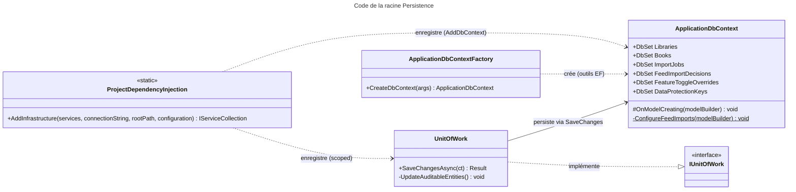

# C4 Code Level : Persistence (racine)

## Vue d'ensemble

- **Nom** : Persistence (racine du projet)
- **Description** : Point d'entrée de la couche de persistance. Contient le `DbContext` EF Core (mapping PostgreSQL), l'unité de travail, la fabrique de contexte utilisée par les outils de migration et l'extension d'injection de dépendances qui câble toute la couche Persistence dans le conteneur de l'application.
- **Emplacement relatif** : `Persistence/` (fichiers directement à la racine, hors sous-dossiers)
- **Langage** : C# (.NET 10), EF Core 10 / Npgsql
- **Objectif** : Définir le modèle relationnel (tables, index, contraintes, conversions), exposer la transaction d'écriture (`UnitOfWork`) et enregistrer dans le conteneur DI les dépôts, services de lecture, stockages locaux et services de traitement de fichiers.

Fichiers couverts :

| Fichier | Rôle |
| --- | --- |
| [ApplicationDbContext.cs](../Persistence/ApplicationDbContext.cs) | `DbContext` et configuration du modèle |
| [ApplicationDbContextFactory.cs](../Persistence/ApplicationDbContextFactory.cs) | Fabrique de contexte à la conception (`dotnet ef`) |
| [UnitOfWork.cs](../Persistence/UnitOfWork.cs) | Implémentation de `IUnitOfWork` |
| [ProjectDependencyInjection.cs](../Persistence/ProjectDependencyInjection.cs) | Enregistrement DI de la couche Persistence |

Le dossier `Persistence/Migrations/` est volontairement exclu de cette documentation.

## Éléments de code

### Classes

#### `ApplicationDbContext`

- **Signature** : `public class ApplicationDbContext(DbContextOptions options) : DbContext(options), IDataProtectionKeyContext`
- **Description** : Contexte EF Core unique de l'application. Expose un `DbSet` par agrégat persistant et configure le modèle dans `OnModelCreating` (noms de tables, longueurs maximales issues des constantes du Domain, héritage TPT de `Book`, index, clés étrangères en cascade, colonne `jsonb`, colonne de concurrence `xmin`).
- **Emplacement** : [Persistence/ApplicationDbContext.cs:13-143](../Persistence/ApplicationDbContext.cs#L13-L143)
- **Propriétés DbSet** (lignes 15-38) :
  - `DbSet<Library> Libraries`
  - `DbSet<User> Users`
  - `DbSet<Book> Books`
  - `DbSet<PhysicalBook> PhysicalBooks`
  - `DbSet<DigitalBook> DigitalBooks`
  - `DbSet<ReadingDate> ReadingDates`
  - `DbSet<IsbnBedethequeUrl> IsbnBedethequeUrls`
  - `DbSet<ImportJob> ImportJobs`
  - `DbSet<FeedImportDecision> FeedImportDecisions`
  - `DbSet<FeedImportDecisionEvent> FeedImportDecisionEvents`
  - `DbSet<FeatureToggleOverride> FeatureToggleOverrides`
  - `DbSet<DataProtectionKey> DataProtectionKeys` (trousseau ASP.NET Data Protection, persisté pour que les cookies d'authentification survivent à un redéploiement)
- **Méthodes** :
  - `protected override void OnModelCreating(ModelBuilder modelBuilder)` (lignes 40-110) : configure le modèle de chaque agrégat. Détails notables :
    - `Library` : table `Libraries`, propriété `RelativePath` ignorée, longueurs max pour `Name`, `Color`, `Icon`.
    - `Book` : table `Books`, `ISBN` nullable, relations `ReadingDates` (cascade) et `Library` (cascade).
    - `PhysicalBook` / `DigitalBook` : héritage TPT (tables `PhysicalBooks`, `DigitalBooks`). `IsbnCandidates` est une collection de type primitif mappée sur le champ `_isbnCandidates`.
    - `ImportJob` : index sur `LibraryId` et `Status`, index unique partiel sur `OriginalFilePath` filtré par `"Status" NOT IN (6, 7)` (ordinaux de `Completed` et `Failed`), colonne `xmin` de concurrence.
    - `IsbnBedethequeUrl` : index unique sur `ISBN`.
    - `FeatureToggleOverride` : `Toggle` stocké en chaîne (64 caractères max), index unique.
  - `private static void ConfigureFeedImports(ModelBuilder modelBuilder)` (lignes 112-142) : configure `FeedImportDecision` (longueurs, colonne `Links` en `jsonb`, index unique `(UserId, MinifluxEntryId, ItemIndex)`, index `(UserId, Status)`, cascade vers `Events`, colonne `xmin`) et `FeedImportDecisionEvent` (`Id` généré par le client via `ValueGeneratedNever`).

#### `ApplicationDbContextFactory`

- **Signature** : `public class ApplicationDbContextFactory : IDesignTimeDbContextFactory<ApplicationDbContext>`
- **Description** : Fabrique utilisée uniquement par les outils EF Core en conception (`dotnet ef migrations`, `dotnet ef database update`). Lit `appsettings.json`, `appsettings.{environnement}.json` (optionnel) et les variables d'environnement dans le dossier `../Web`, puis crée le contexte avec Npgsql.
- **Emplacement** : [Persistence/ApplicationDbContextFactory.cs:8-38](../Persistence/ApplicationDbContextFactory.cs#L8-L38)
- **Méthodes** :
  - `public ApplicationDbContext CreateDbContext(string[] args)` (lignes 10-37) : lit l'argument `--environment` (défaut `Development`), charge la configuration, récupère `ConnectionStrings:DefaultConnection` (garde `Guard.Against.Null`) et retourne `new ApplicationDbContext(options)`.
- **Dépendances** : `Ardalis.GuardClauses`, `Microsoft.Extensions.Configuration`, `Microsoft.EntityFrameworkCore.Design`, Npgsql.

#### `UnitOfWork`

- **Signature** : `public class UnitOfWork(ApplicationDbContext dbContext) : IUnitOfWork`
- **Description** : Unité de travail : persiste les changements du `DbContext` en renseignant automatiquement les dates d'audit, et convertit les erreurs de base de données en `TError` au lieu de propager l'exception.
- **Emplacement** : [Persistence/UnitOfWork.cs:8-43](../Persistence/UnitOfWork.cs#L8-L43)
- **Méthodes** :
  - `public async Task<Result<int>> SaveChangesAsync(CancellationToken cancellationToken)` (lignes 10-22) : appelle `UpdateAuditableEntities()`, puis `dbContext.SaveChangesAsync`. Retourne le nombre de lignes modifiées, ou `new TError("DB_UPDATE_ERROR", ex.Message)` si une `DbUpdateException` est levée.
  - `private void UpdateAuditableEntities()` (lignes 24-40) : parcourt les entrées `IAuditable` du `ChangeTracker`. Pour `Added`, renseigne `CreatedOnUtc` ; pour `Modified`, renseigne `ModifiedOnUtc` (avec `DateTime.UtcNow`).
- **Dépendances** : `Application.Interfaces.IUnitOfWork`, `Domain.Interfaces.IAuditable`, `Domain.Primitives.Result` / `TError`, EF Core.

#### `ProjectDependencyInjection` (classe statique)

- **Signature** : `public static class ProjectDependencyInjection`
- **Description** : Point d'entrée d'enregistrement DI de la couche Persistence. Enregistre le `DbContext`, l'unité de travail, les dépôts, les services de lecture, les stockages locaux et l'ensemble des services de traitement de fichiers, ainsi que les options validées au démarrage (OCR, Cloudinary).
- **Emplacement** : [Persistence/ProjectDependencyInjection.cs:21-88](../Persistence/ProjectDependencyInjection.cs#L21-L88)
- **Méthodes** :
  - `public static IServiceCollection AddInfrastructure(this IServiceCollection services, string connectionString, string rootPath, IConfiguration configuration)` (lignes 24-87) :
    - `AddDbContext<ApplicationDbContext>` avec Npgsql, `MigrationsAssembly("Persistence")`, erreurs détaillées activées.
    - `UnitOfWork` (scoped) et `IUnitOfWork` résolu vers la même instance.
    - Dépôts scoped : `IRepository<Library,Guid>`, `IRepository<User,Guid>`, `IRepository<Book,Guid>`, `IBookRepository`, `IImportJobRepository`, `IFeedImportDecisionRepository`, `IFeatureToggleOverrideRepository`, `IIsbnBedethequeCacheRepository`.
    - Services de lecture scoped : `ILibraryReadService`, `IUserReadService`, `IBookReadService`, `IStatisticsReadService`, `IFeedImportDecisionReadService`.
    - Stockages : `ILibraryLocalStorage` (instance `new LibraryLocalStorage(rootPath)`), `IImportDirectoryStorage`, `ITempWorkspace`.
    - Services de fichiers : `IArchiveExtractor`, `IPdfImageExtractor`, `IImageProcessor`, `IComicArchiveBuilder`, `IComicInfoXmlService`, `IBookFileService`, `IComicPageReader` (instance `new ComicPageReaderService(rootPath, logger)`), `IPageTextRecognizer` (singleton), `IIsbnPageScanner`, `ICloudinaryService`.
    - Options : `IsbnOcrSettings` (section `IsbnOcr`, validation : chemin Tesseract requis si activé, `PagesFromEachEnd` et `PageTimeoutSeconds` strictement positifs) et `CloudinarySettings` (section `Cloudinary`, `CloudName`, `ApiKey`, `ApiSecret` requis), validées avec `ValidateOnStart()`.

### Modèle de données (rappel)

Le contexte ne déclare pas de classe de données propre : il référence les entités de `Domain` (`Book`, `PhysicalBook`, `DigitalBook`, `ReadingDate`, `Library`, `User`, `ImportJob`, `FeedImportDecision`, `FeedImportDecisionEvent`, `FeatureToggleOverride`, `IsbnBedethequeUrl`) et les constantes de longueur (`BookConstants`, `LibraryConstants`, `ImportJobConstants`, `FeedImportConstants`).

## Dépendances

### Dépendances internes

- **Domain** : entités et constantes (`Domain.Books`, `Domain.Libraries`, `Domain.Users`, `Domain.ImportJobs`, `Domain.FeedImports`, `Domain.Settings`), `Domain.Primitives` (`Result`, `TError`), `Domain.Interfaces.IAuditable`.
- **Application** : interfaces implémentées (`IUnitOfWork`, `IRepository<,>`, `IBookRepository`, `IImportJobRepository`, `IFeedImportDecisionRepository`, `IFeatureToggleOverrideRepository`, services de lecture, stockages, services de fichiers, `ICloudinaryService`, `IIsbnPageScanner`) et types d'options (`IsbnOcrSettings`, `CloudinarySettings`, `ImportSettings`).
- **Persistence.LocalStorage**, **Persistence.Queries**, **Persistence.Repositories**, **Persistence.Services** : implémentations enregistrées dans `AddInfrastructure`.

### Dépendances externes

- `Microsoft.EntityFrameworkCore` et `Microsoft.EntityFrameworkCore.Design` (contexte, `IDesignTimeDbContextFactory`).
- `Npgsql.EntityFrameworkCore.PostgreSQL` (fournisseur PostgreSQL).
- `Microsoft.AspNetCore.DataProtection.EntityFrameworkCore` (persistance des clés Data Protection).
- `Ardalis.GuardClauses` (gardes de nullité).
- `Microsoft.Extensions.Configuration`, `.DependencyInjection`, `.Options`, `.Logging.Abstractions`.

## Relations

Relations entre les types de ce dossier et le conteneur DI :

Points d'attention :

- `ApplicationDbContext.OnModelCreating` (ligne 43) contient un test `if (modelBuilder != null)` redondant, puisque EF Core ne passe jamais `null`.
- Les ordinaux `6` et `7` de l'index filtré `ImportJob.OriginalFilePath` (ligne 90) doivent être mis à jour si l'enum `ImportJobStatus` est réordonné (commentaire présent dans le code).
- `UnitOfWork.SaveChangesAsync` ne convertit que `DbUpdateException` ; toute autre exception (annulation, erreur de connexion non typée) est propagée.
- `ProjectDependencyInjection` enregistre `BookRepository` deux fois (`IRepository<Book, Guid>` et `IBookRepository`) : deux instances scoped distinctes partagent le même `DbContext`.
