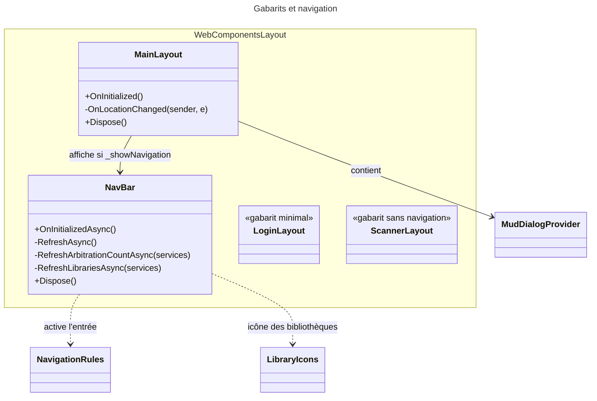
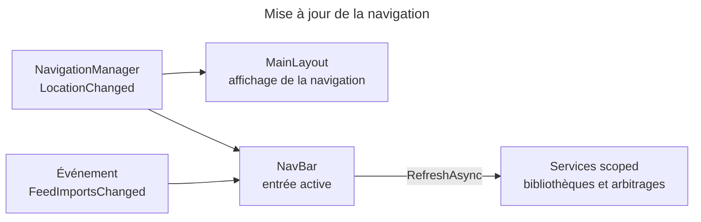

# C4 Code Level : Web/Components/Layout

## 1. Vue d'ensemble

- **Nom** : Web.Components.Layout (gabarits de page et navigation)
- **Description** : gabarits Blazor (`MainLayout` pour l'application connectée, `LoginLayout` et `ScannerLayout` pour les autres écrans), barre de navigation latérale et inférieure, et code-behind associé.
- **Emplacement relatif** : `Web/Components/Layout/`
- **Langage** : Razor, C# (classes partielles), CSS isolé
- **Objectif** : afficher la navigation principale (bibliothèques, statistiques, import, flux, paramètres), le compteur des flux à arbitrer, et le conteneur des dialogues.

## 2. Éléments de code

### 2.1 `MainLayout` (`Web/Components/Layout/MainLayout.razor` et `MainLayout.razor.cs`)

#### Gabarit (`MainLayout.razor`, lignes 1 à 25)

- `@inherits LayoutComponentBase`.
- `MudThemeProvider`, `MudSnackbarProvider`, `MudPopoverProvider`.
- `MudDialogProvider` dans une `div.dialog-host` (lignes 8 à 16) : centré, `FullWidth`, `MaxWidth.ExtraExtraLarge`, bouton de fermeture, fermeture par Échap, pas de fermeture par clic sur le fond.
- `<NavBar />` si `_showNavigation` ; `<main class="page-body with-nav">` contient `@Body`.

#### Code-behind (`MainLayout.razor.cs`, classe `public partial class MainLayout : IDisposable`, lignes 7 à 45)

```csharp
public partial class MainLayout : IDisposable
protected override void OnInitialized()                                 // lignes 13-17
private void OnLocationChanged(object? sender, LocationChangedEventArgs e)  // lignes 19-27
private void UpdateNavigationVisibility() => ...                        // ligne 29
public void Dispose()                                                   // lignes 32-36
protected virtual void Dispose(bool disposing)                          // lignes 38-...
```

- **Description** : s'abonne à `LocationChanged` pour masquer ou afficher la barre de navigation selon la route. `Dispose` se désabonne.
- **Champs** : `_isDisposed` (ligne 9), `_showNavigation` (ligne 10, `true` par défaut).
- **Dépendances** : `NavigationManager`, `NavBar`, MudBlazor.

### 2.2 `NavBar` (`Web/Components/Layout/NavBar.razor` et `NavBar.razor.cs`)

#### Gabarit (`NavBar.razor`)

- **Barre latérale** (`nav.side-nav`, `aria-label="Main"`) : marque (`/libraries/list`), entrée « Bibliothèques » (`/libraries/list`), liste des bibliothèques (`library.Href`, icône `LibraryIcons.Resolve`, couleur propre), « Statistiques » (`/statistics`), « Importer » (`/import`), « Flux » (`/feed-imports`, avec badge du nombre d'arbitrages), « Paramètres » (`/settings`).
- **Barre inférieure** (`nav.bottom-nav`) : mêmes entrées, pour les petits écrans.
- **Accessibilité** : `aria-current="page"` sur l'entrée active (`AriaCurrent`), `aria-label` sur le lien « Flux » (`FeedsLabel`) et sur chaque bibliothèque.

#### Code-behind (`NavBar.razor.cs`, classe `public partial class NavBar : IDisposable`, lignes 9 à 145)

```csharp
public partial class NavBar : IDisposable
protected override async Task OnInitializedAsync()                                    // lignes 21-27
private async void OnLocationChangedAsync(object? sender, LocationChangedEventArgs e) // lignes 29-37
private async void OnFeedImportsChangedAsync(object? sender, EventArgs e)              // lignes 39-46
private string RelativePath => NavigationManager.ToBaseRelativePath(NavigationManager.Uri);   // ligne 48
private void UpdateCurrentLibrary() => _currentLibraryId = NavigationRules.CurrentLibraryId(RelativePath);  // ligne 50
private async Task RefreshAsync()                                                      // lignes 55-70
private async Task RefreshArbitrationCountAsync(IServiceProvider services)             // lignes 72-83
private async Task RefreshLibrariesAsync(IServiceProvider services)                    // lignes 85-104
private string ArbitrationBadgeLabel => ...                                            // ligne 106
private string FeedsLabel => ...                                                       // ligne 110
private bool IsLibrariesEntryActive => ...                                             // ligne 113
private string LibrariesEntryClass                                                     // lignes 115-126
private static string ActiveClass(bool isActive)                                       // ligne 128
private static string? AriaCurrent(bool isActive)                                      // ligne 130
private bool IsActive(string path) => NavigationRules.IsActive(RelativePath, path);  // ligne 132
public void Dispose()                                                                  // lignes 134-138
protected virtual void Dispose(bool disposing)                                         // lignes 140-...
```

- **Description** : charge les bibliothèques et le nombre d'arbitrages de flux (`RefreshAsync`), met à jour l'entrée active à chaque navigation, et réagit à l'événement `OnFeedImportsChanged`.
- **Champs** : `_isDisposed`, `_arbitrationCount`, `_libraries` (`IReadOnlyList<NavLibraryItemViewModel>`), `_currentLibraryId`.
- **Dépendances** : `NavigationRules` (règles de routes), `NavLibraryItemViewModel`, `LibraryIcons`, `IServiceProvider` (services scoped à partir du circuit), `NavigationManager`, `IDisposable`.

### 2.3 `LoginLayout` (`Web/Components/Layout/LoginLayout.razor`, lignes 1 à 10)

- **Description** : gabarit minimal (`MudLayout` + `MudMainContent` + `@Body`) avec `MudThemeProvider`, sans navigation, pour les écrans de connexion.
- **Dépendances** : MudBlazor.

### 2.4 `ScannerLayout` (`Web/Components/Layout/ScannerLayout.razor`, lignes 1 à 7)

- **Description** : gabarit sans navigation, avec `MudThemeProvider`, `MudSnackbarProvider` et `MudPopoverProvider`, qui affiche `@Body` directement. Destiné à l'écran de scan d'ISBN (usage déduit du nom, à confirmer dans les pages qui l'utilisent).
- **Dépendances** : MudBlazor.

## 3. Dépendances

### 3.1 Internes

- `Web/Components/Routes.razor` : `MainLayout` est le `DefaultLayout`.
- `Web/Components/Layout/NavBar` : utilise `Web.Components.SharedComponents` (`@using` dans `NavBar.razor`), `NavigationRules`, `LibraryIcons`, `NavLibraryItemViewModel` (hors périmètre).
- `Application` : services de bibliothèques et d'arbitrage des flux (appelés via `IServiceProvider`, hors périmètre).

### 3.2 Externes

- MudBlazor (`MudThemeProvider`, `MudSnackbarProvider`, `MudPopoverProvider`, `MudDialogProvider`, `MudIcon`, `MudLayout`, `MudMainContent`, `Icons.Material`).
- Microsoft.AspNetCore.Components (`LayoutComponentBase`, `NavigationManager`, `LocationChangedEventArgs`).

## 4. Relations





## 5. Remarques

- `NavBar` appelle `async void` dans les gestionnaires d'événements (`OnLocationChangedAsync`, `OnFeedImportsChangedAsync`) : les exceptions ne sont pas remontées à l'appelant. À vérifier si la logique de rafraîchissement échoue.
- Les champs `_isDisposed` sont présents dans `MainLayout` et `NavBar` pour le motif `Dispose(bool)` standard.
- Les libellés de navigation sont en français ; les `aria-label` des entrées de flux utilisent `FeedsLabel` pour indiquer le nombre d'arbitrages.
