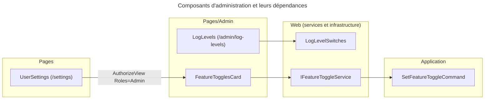
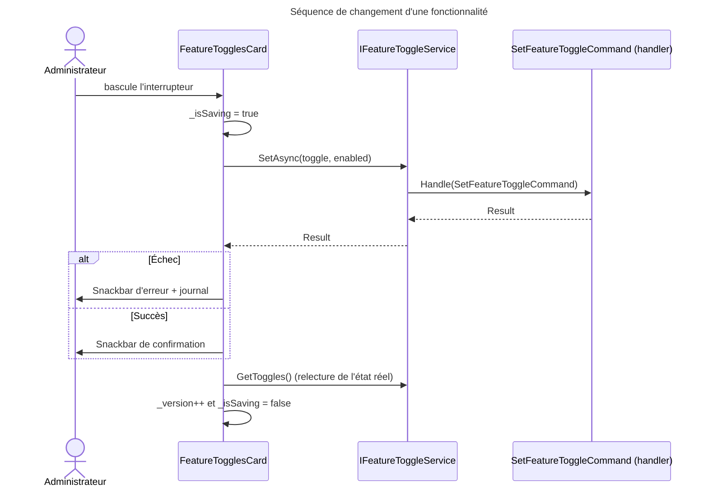

# C4 Code Level : Web/Components/Pages/Admin

## Vue d'ensemble

- **Nom** : Administration (réglages d'exploitation)
- **Description** : Composants réservés à l'administrateur : réglage du niveau de journalisation par logger, et carte de bascule des fonctionnalités (feature toggles). La carte de fonctionnalités est intégrée à la page des réglages utilisateur.
- **Emplacement** : `Web/Components/Pages/Admin`
- **Langage** : C# / .NET 10, Razor (Blazor Server), MudBlazor, Serilog
- **Objectif** : Permettre de modifier à chaud la verbosité des journaux et l'activation des fonctionnalités, sans redémarrage, en gardant la persistance des choix entre redémarrages.

## Éléments de code

### Pages

#### LogLevels (`LogLevels.razor`, `LogLevels.razor.cs`)

- **Route** : `@page "/admin/log-levels"`
- **Autorisation** : `@attribute [Authorize(Roles = "Admin")]`
- **Classe** : `public partial class LogLevels` (namespace `Web.Components.Pages.Admin`)
- **Type interne** : `LevelOption(string Label, LogEventLevel Level, string CssClass)` (record privé)
- **Constante** : `s_levels` : Debug, Information, Warning, Error, et `None` (valeur `LogLevelSwitches.Off`)
- **Services injectés** :
  - `LogLevelSwitches` (`Web.Infrastructure`) : registre des niveaux de journaux
  - `ISnackbar`
  - `ILogger<LogLevels>`
- **Champs** : `_loggers : IReadOnlyList<LoggerLevel>`, `_filter : string?`
- **Méthodes principales** :
  - `OnInitialized()` (l. 28) : `_loggers = LogLevelSwitches.GetLoggers()`
  - `MatchesFilter(LoggerLevel)` (l. 30) : filtre insensible à la casse sur le nom du logger
  - `SetLevel(string name, LogEventLevel? level)` (l. 34) : `LogLevelSwitches.Set(name, level)` ; `null` remet le logger en « hérité » ; journalise le changement puis recharge la liste
  - `ResetAll()` (l. 41) : `LogLevelSwitches.ResetAll()` ; affiche une confirmation
- **Rendu** : liste de loggers avec filtre, boutons de niveau (`aria-pressed`), bouton « hérité » pour les loggers qui ne sont pas root.
- **Interactions Application** : aucune. Le composant parle directement à l'infrastructure de journalisation (`Web.Infrastructure`), conformément à la règle « Serilog reserved to Program.cs » : les changements passent par `LogLevelSwitches`.

### Composants

#### FeatureTogglesCard (`FeatureTogglesCard.razor`, `FeatureTogglesCard.razor.cs`)

- **Route** : aucune (composant intégré)
- **Utilisé par** : `Web/Components/Pages/UserSettings.razor`, dans la section `AuthorizeView Roles="Admin"`
- **Classe** : `public partial class FeatureTogglesCard`
- **Services injectés** :
  - `IFeatureToggleService` (`Web.Services`)
  - `ISnackbar`
  - `ILogger<FeatureTogglesCard>`
- **Champs** : `_toggles : IReadOnlyList<FeatureToggleViewModel>`, `_isSaving : bool`, `_version : int` (clé de recréation des interrupteurs)
- **Méthodes principales** :
  - `OnInitialized()` (l. 19) : `FeatureToggleService.GetToggles()`
  - `internal async Task SetAsync(FeatureToggle toggle, bool enabled)` (l. 21) : garde anti-réentrance (`_isSaving`), appelle `FeatureToggleService.SetAsync(toggle, enabled)` ; en cas d'échec, affiche l'erreur (Snackbar + journal) ; dans `finally`, relit l'état réel (`GetToggles()`), incrémente `_version` et libère `_isSaving`
- **Rendu** : une ligne par fonctionnalité (libellé, description, valeur de configuration, mention « overridden » si la valeur est surchargée), interrupteur `role="switch"` désactivé pendant l'enregistrement.
- **Interactions Application** : `IFeatureToggleService.SetAsync` → `ICommandHandler<SetFeatureToggleCommand>` (`Application.Settings.SetFeatureToggle`) ; `GetToggles()` lit les valeurs courantes.

## Dépendances

### Dépendances internes

- `Web.Infrastructure` : `LogLevelSwitches`, `AppVersion`
- `Web.Services` : `IFeatureToggleService`
- `Web.Models` : `FeatureToggleViewModel`
- `Domain.Settings` : type `FeatureToggle` (énumération des fonctionnalités)
- `Web/Components/Pages/UserSettings.razor` (consommateur de `FeatureTogglesCard`)

### Dépendances externes

- `Microsoft.AspNetCore.Components` (composants, `[Inject]`, `[Authorize]`)
- MudBlazor : `MudIconButton`, `MudButton`, `MudIcon`, `ISnackbar`, `Severity`
- Serilog : `Serilog.Events.LogEventLevel`, `LogLevelSwitches`
- `Microsoft.Extensions.Logging` : `ILogger<T>`

## Relations

## Notes

- La persistance des fonctionnalités est décrite dans l'interface utilisateur : « kept across restarts ». Le mécanisme de stockage est dans `FeatureToggleService` (hors périmètre de ce document).
- `LogLevels` reste sur la route `/admin/log-levels`, protégée uniquement par le rôle `Admin` ; l'entrée de menu est dans `UserSettings`.
- `FeatureTogglesCard` ne possède pas de `@page` : il n'est accessible que depuis la page des réglages.
