# C4 Code Level : Web/Components/Pages/Books

## Périmètre et synthèse

- **Emplacement** : [`Web/Components/Pages/Books`](../Web/Components/Pages/Books)
- **Contenu analysé** : 10 composants Blazor (fichiers `.razor` et code-behind `.razor.cs`, soit 20 fichiers).
- **Fichiers annexes non détaillés** : 9 feuilles de style isolées (`*.razor.css`). Elles ne portent aucune logique et ne sont pas documentées ici.
- **Langage** : C# (.NET 10) et Razor, Blazor Server (`InteractiveServer`), bibliothèque de composants MudBlazor.
- **Objectif du dossier** : les pages et composants de gestion des livres. Ajout (scan ISBN, saisie manuelle, formulaire), consultation, modification, lecture numérique (CBZ), import d'informations depuis le web et déplacement d'un livre.

### Tableau des pages et composants

| Composant | Type | Route | Layout | Rôle |
|---|---|---|---|---|
| [`AddBookScan`](#addbookscan) | Page | `/books/add/scan` | `ScannerLayout` | Scan plein écran du code-barres ISBN |
| [`AddBookManual`](#addbookmanual) | Page | `/books/add/manual` | défaut | Saisie manuelle de l'ISBN |
| [`AddBookForm`](#addbookform) | Page | `/books/add/form` | défaut | Livre trouvé à ajouter en un geste, ou formulaire d'ajout |
| [`BookDetail`](#bookdetail) | Page | `/books/{BookId}` | défaut | Fiche d'un livre, lectures, actions |
| [`EditBook`](#editbook) | Page | `/books/{BookId}/edit` | défaut | Modification d'un livre et de ses lectures |
| [`BookReader`](#bookreader) | Page | `/books/{BookId}/read` | `ScannerLayout` | Lecteur de pages CBZ, recherche d'ISBN sur les pages |
| [`FindBookDetails`](#findbookdetails) | Page | `/books/{BookId}/find-details` | défaut | Comparaison des informations du livre avec les sources web |
| [`LibrarySelect`](#libraryselect) | Composant | (aucune) | (hérité) | Sélecteur de bibliothèque (feuille d'actions ou menu) |
| [`BookFields`](#bookfields) | Composant | (aucune) | (hérité) | Champs du livre, partagés par l'ajout et la modification |
| [`BookFormLayout`](#bookformlayout) | Composant | (aucune) | (hérité) | Mise en page du formulaire livre (couverture, champs, pied) |

### Navigation entre les pages

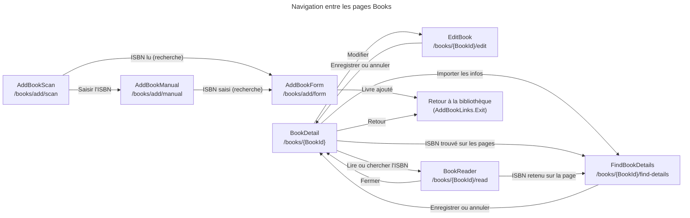

### Dépendances vers les services

Les composants n'appellent pas la base de données directement. Ils passent par les interfaces de `Web.Services`, qui consomment la couche Application (CLAUDE.md : « Web consomme Application »). Les appels directs à la couche Application visibles dans ce dossier se limitent aux helpers (`IsbnHelper`, `IsbnScanPages`) et aux types de résultat (`IsbnScanOutcome`).

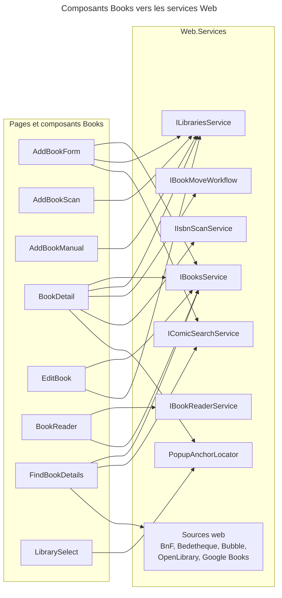

---

## AddBookScan

**Fichiers** : [`AddBookScan.razor`](../Web/Components/Pages/Books/AddBookScan.razor) · [`AddBookScan.razor.cs`](../Web/Components/Pages/Books/AddBookScan.razor.cs) · [`AddBookScan.razor.css`](../Web/Components/Pages/Books/AddBookScan.razor.css)

### 1. Vue d'ensemble

- **Nom** : `AddBookScan`
- **Description** : page plein écran de scan du code-barres ISBN par la caméra du navigateur. Elle affiche un message unique si la caméra est inaccessible (A3).
- **Emplacement** : `Web/Components/Pages/Books/AddBookScan.razor`, code-behind `AddBookScan.razor.cs`
- **Langage** : C# (classe `partial`, `IAsyncDisposable`) et Razor
- **Objectif** : lire un ISBN et envoyer l'utilisateur vers la recherche du livre (`AddBookLinks.LookUp`). Elle propose aussi la saisie manuelle en repli.

### 2. Éléments de code

- **Route** : `@page "/books/add/scan"`, `@layout ScannerLayout`, `@rendermode InteractiveServer`
- **Paramètres** : aucun paramètre de composant. Paramètre de requête `LibraryId` (`[SupplyParameterFromQuery]`).
- **Services injectés** : `NavigationManager`, `IJSRuntime`, `ISnackbar`, `ILibrariesService`, `ILogger<AddBookScan>`
- **Champs notables** :
  - `_jsModule` : module JavaScript `./js/isbnScanner.js`, chargé via `AppVersion.Versioned`.
  - `_dotNetObjectRef` : référence renvoyée au JavaScript pour les rappels.
  - `_videoElementId` : identifiant unique de l'élément `<video>` (GUID).
  - `_isScanning`, `_isbnDetected`, `_cameraUnavailable`, `_hasTorch`, `_torchOn` : états de l'interface.
- **Méthodes principales** :

| Méthode | Lignes | Rôle |
|---|---|---|
| `OnInitializedAsync()` | L35 | Lit `LibraryId`, charge le nom de la bibliothèque (`NameOfAsync`). |
| `OnAfterRenderAsync(bool)` | L41 | Au premier rendu, lance `StartScanningAsync`. |
| `StartScanningAsync()` | L49 | Importe le module, appelle `startScan` puis `hasTorch`. Sur `JSException`, passe en état « caméra indisponible ». |
| `RetryAsync()` | L71 | Réinitialise l'erreur et relance le scan. |
| `ToggleTorchAsync()` | L77 | Appelle `setTorch` pour allumer ou éteindre la lampe. |
| `StopScanningAsync()` | L95 | Appelle `stopScan`. Ignore `JSDisconnectedException` et `JSException`. |
| `OnIsbnScannedFromJsAsync(string)` | L117 | `[JSInvokable]`. Appelée par le JavaScript avec l'ISBN lu. Attend 300 ms, arrête le scan, valide l'ISBN (`IsbnHelper.IsValidISBN`) puis navigue vers `AddBookLinks.LookUp`. |
| `OnScanErrorFromJs(string)` | L145 | `[JSInvokable]`. Journalise l'erreur et affiche l'état « caméra indisponible ». |
| `ValidateIsbn(string)` | L154 | `[JSInvokable]`. Valide un ISBN pour le JavaScript. |
| `DisposeAsync()` | L159 | Arrête le scan si besoin, libère le module JavaScript et la référence .NET. |

- **Balisage (`.razor`)** : `<video>` d'aperçu, cadre de visée, message d'erreur `role="alert"` avec liens « Saisir l'ISBN » et « Réessayer », bouton de lampe (`aria-pressed`, `aria-label`), lien de fermeture (`aria-label="Close scanner"`).

### 3. Dépendances

- **Internes** : `Web.Infrastructure` (`AppVersion`), `Web.Models` (`AddBookLinks`), `Web.Services` (`ILibrariesService`), `Application.Helpers` (`IsbnHelper`), `ScannerLayout`, `isbnScanner.js` (fichier JavaScript).
- **Externes** : `Microsoft.AspNetCore.Components`, `Microsoft.JSInterop`, `MudBlazor` (`ISnackbar`, `Icons`, `Severity`).

### 4. Relations

Le JavaScript de `isbnScanner.js` appelle les méthodes `[JSInvokable]` de ce composant. Le composant renvoie ensuite l'utilisateur vers `AddBookForm` ou `AddBookManual`.

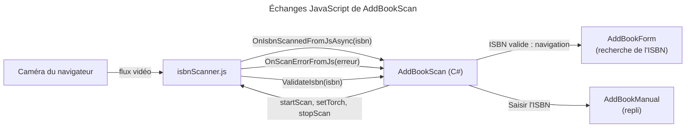

---

## AddBookManual

**Fichiers** : [`AddBookManual.razor`](../Web/Components/Pages/Books/AddBookManual.razor) · [`AddBookManual.razor.cs`](../Web/Components/Pages/Books/AddBookManual.razor.cs) · [`AddBookManual.razor.css`](../Web/Components/Pages/Books/AddBookManual.razor.css)

### 1. Vue d'ensemble

- **Nom** : `AddBookManual`
- **Description** : page de saisie manuelle d'un ISBN, utilisée quand le code-barres ne se lit pas (A4).
- **Emplacement** : `Web/Components/Pages/Books/AddBookManual.razor`, code-behind `AddBookManual.razor.cs`
- **Langage** : C# (classe `partial`) et Razor
- **Objectif** : valider l'ISBN saisi, afficher l'erreur éventuelle, puis naviguer vers la recherche du livre.

### 2. Éléments de code

- **Route** : `@page "/books/add/manual"`, `@rendermode InteractiveServer`
- **Paramètres** : aucun paramètre de composant. Paramètre de requête `LibraryId`.
- **Constante** : `InputId = "isbn"`.
- **Services injectés** : `NavigationManager`, `ILibrariesService`, `ILogger<AddBookManual>`
- **Champs** : `_input` (`ElementReference`), `_libraryId`, `_libraryName`, `_isbn`, `_error`.
- **Méthodes principales** :

| Méthode | Lignes | Rôle |
|---|---|---|
| `OnInitializedAsync()` | L26 | Lit `LibraryId` et charge le nom de la bibliothèque. |
| `OnAfterRenderAsync(bool)` | L32 | Au premier rendu, donne le focus au champ ISBN. Un `JSException` est journalisé en `Debug`. |
| `ClearError()` | L47 | Efface l'erreur à la saisie (`@bind:after`). |
| `LookUp()` | L49 | `IsbnEntry.Check(_isbn)` retourne `(isbn, error)`. Affiche l'erreur, et si l'ISBN est valide, navigue vers `AddBookLinks.LookUp(isbn, _libraryId)`. |

- **Balisage** : `FormPage` > `FormHeader` (sous-titre « Adding to … ») > `<form @onsubmit="LookUp">` contenant un `FormField` (libellé « ISBN », aide `IsbnEntry.Help`) et un bouton « Look up ».

### 3. Dépendances

- **Internes** : `Web.Components.SharedComponents` (`FormPage`, `FormHeader`, `FormField`), `Web.Models` (`AddBookLinks`, `IsbnEntry`, `FormFieldIds`), `Web.Services` (`ILibrariesService`).
- **Externes** : `Microsoft.AspNetCore.Components`, `Microsoft.JSInterop` (`JSException`), `MudBlazor` (`Icons`, `MudIcon`).

### 4. Relations

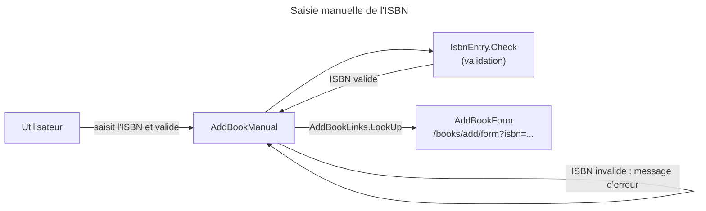

---

## AddBookForm

**Fichiers** : [`AddBookForm.razor`](../Web/Components/Pages/Books/AddBookForm.razor) · [`AddBookForm.razor.cs`](../Web/Components/Pages/Books/AddBookForm.razor.cs) · [`AddBookForm.razor.css`](../Web/Components/Pages/Books/AddBookForm.razor.css)

### 1. Vue d'ensemble

- **Nom** : `AddBookForm`
- **Description** : page d'ajout d'un livre à deux étapes. L'étape « Livre trouvé » propose d'ajouter le livre en un geste, après recherche de l'ISBN dans les catalogues (A5, T7). L'étape « Formulaire » permet de compléter ou corriger les champs (A6, T8).
- **Emplacement** : `Web/Components/Pages/Books/AddBookForm.razor`, code-behind `AddBookForm.razor.cs`
- **Langage** : C# (`partial`, `IDisposable`) et Razor
- **Objectif** : rechercher un livre par ISBN, valider la saisie et créer le livre dans la bibliothèque choisie.

### 2. Éléments de code

- **Route** : `@page "/books/add/form"`, `@rendermode InteractiveServer`
- **Paramètres de requête** : `Isbn` (`string?`), `LibraryId` (`string?`).
- **Paramètres de composant** : aucun.
- **Type interne** : `enum AddBookStep { Found, Form }`.
- **Services injectés** : `NavigationManager`, `IBooksService`, `ILibrariesService`, `IComicSearchService`, `ISnackbar`, `ILogger<AddBookForm>`
- **Champs** : `_validator` (`AddBookValidator`), `_disposalCts`, `_model` (`BookUiDto`), `_libraries` (`List<LibraryUiDto>`), `_found` (`BookFoundViewModel?`), `_step`, `_errors` (`FormErrors`), `_submitted`, `_isLoading`, `_isSaving`.
- **Propriétés calculées** : `ExitHref`, `LibraryName`, `AddToLabel` (« Add to {bibliothèque} »), `PageTitleText`, `FormSubtitle`.
- **Méthodes principales** :

| Méthode | Lignes | Rôle |
|---|---|---|
| `OnInitializedAsync()` | L63 | Charge les bibliothèques. Si un ISBN est fourni, normalise l'ISBN et lance `LookUpAsync`. |
| `LoadLibrariesAsync()` | L84 | `FilterBy` (page 1, 100 éléments, tri par nom). Ne garde que les bibliothèques `LibraryBookType.Physical`. Présélectionne la bibliothèque de la page précédente, ou la seule disponible. |
| `LookUpAsync(string)` | L100 | `IComicSearchService.SearchByIsbnAsync`. Si trouvé, construit `BookFoundViewModel` et `BookUiDto`, puis passe à l'étape « Livre trouvé ». Sur erreur réseau, timeout ou état invalide, affiche un avertissement et conserve l'ISBN. |
| `ChooseLibrary(Guid)` | L134 | Met à jour la bibliothèque et revalide. |
| `ChooseRating(int)` | L140 | Met à jour la note (optionnelle). |
| `EditDetails()` / `ShowFound()` | L142 / L144 | Bascule entre les étapes « Formulaire » et « Livre trouvé ». |
| `Revalidate()` | L152 | Après une première soumission, revalide à chaque modification. |
| `SaveAsync()` | L160 | Garde anti-double soumission. Valide (`ValidateAsync`). Si erreur, affiche le formulaire. Sinon appelle `CreateAsync` dans un `try/finally` qui remet `_isSaving` à `false`. |
| `CreateAsync()` | L187 | Construit `CreateBookRequest` et appelle `BooksService.Create`. Succès : notification, navigation vers la bibliothèque. Échec : `BooksError.Duplicate` donne « déjà dans vos bibliothèques », sinon erreur générique. |
| `Dispose()` | L214 | Annule puis libère `_disposalCts`. |

- **Composition du balisage** : `FormPage` avec, selon l'étape, `FormHeader` + `FormState` (chargement), `BookFoundViewModel` (étape trouvée : `LibrarySelect`, `StarRating`, `FormButton`), ou `FormHeader` + `BookFormLayout` (`BookFields`, `LibrarySelect`, `FormFooter`).

### 3. Dépendances

- **Internes** : `Application.Helpers` (`IsbnHelper`), `Domain.Books` (`BooksError`, `LibraryBookType`), `Domain.Libraries` (`LibrariesColumn`, `SortOrder`), `Domain.Primitives` (`Result`, `FormErrors`), `Web.Models` (`BookUiDto`, `LibraryUiDto`, `BookFoundViewModel`, `CreateBookRequest`), `Web.Services`, `Web.Validators` (`AddBookValidator`), `Web.Components.SharedComponents`, `Web.Components.Pages.Books` (`LibrarySelect`, `BookFields`, `BookFormLayout`).
- **Externes** : `MudBlazor` (`ISnackbar`, `Severity`, `Icons`, `MudIcon`), `Microsoft.AspNetCore.Components`.

### 4. Relations

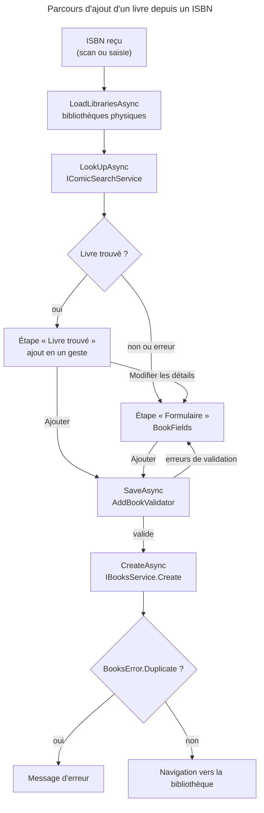

---

## BookDetail

**Fichiers** : [`BookDetail.razor`](../Web/Components/Pages/Books/BookDetail.razor) · [`BookDetail.razor.cs`](../Web/Components/Pages/Books/BookDetail.razor.cs) · [`BookDetail.razor.css`](../Web/Components/Pages/Books/BookDetail.razor.css)

### 1. Vue d'ensemble

- **Nom** : `BookDetail`
- **Description** : fiche d'un livre. Elle affiche la couverture, les détails, l'historique de lecture et l'état de l'ISBN. Elle propose la lecture (livres numériques), l'ajout d'une lecture, l'import d'informations, la modification, le déplacement et la suppression.
- **Emplacement** : `Web/Components/Pages/Books/BookDetail.razor`, code-behind `BookDetail.razor.cs`
- **Langage** : C# (`partial`, `IDisposable`) et Razor. Un `@code` local définit le `RenderFragment` statique `Stars`.
- **Objectif** : afficher et administrer un livre et son historique de lecture.

### 2. Éléments de code

- **Route** : `@page "/books/{BookId}"`, `@rendermode InteractiveServer`
- **Paramètres** : `[Parameter] string BookId`
- **Constantes et membres statiques** : `public static readonly string Msg_LoadFailed = "Unable to load the book"`, `ActionsButtonId = "book-actions"`.
- **Services injectés** : `NavigationManager`, `IBooksService`, `ILibrariesService`, `IBookMoveWorkflow`, `IDialogService`, `ISnackbar`, `PopupAnchorLocator`, `ILogger<BookDetail>`, `IIsbnScanService`
- **Champs** : `_book` (`Book?`), `_view` (`BookDetailViewModel?`), `_libraryName`, `_isLoading`, `_showAddReading`, `_newRating`, `_isAddingReading`, `_isMoving`, `_isScanningIsbn`, `_actionsOpen`, `_sheetAnchor`, `_disposalCts`.
- **Méthodes principales** :

| Méthode | Lignes | Rôle |
|---|---|---|
| `OnInitializedAsync()` | L43 | Charge le livre, puis passe `_isLoading` à `false`. |
| `LoadBookAsync()` | L50 | `BooksService.GetById`. Met à jour `_book` et `_view` seulement en cas de succès. Recharge le nom de la bibliothèque si elle a changé. En cas d'échec, `Log` et `Snackbar` (Msg_LoadFailed). |
| `LoadLibraryNameAsync(Guid)` | L79 | Nom de la bibliothèque, ou `null` avec un avertissement journalisé. |
| `ShowAddReading()` / `CancelAddReading()` | L95 / L101 | Ouvre ou ferme le formulaire d'ajout de lecture. |
| `AddReadingDateAsync()` | L103 | Garde anti-double envoi. `BooksService.AddReadingDate(BookId, note)`, puis rechargement. |
| `ScanIsbnAsync()` | L139 | `IsbnScanService.ScanBookAsync` sur les pages du livre (quelques secondes). |
| `ShowIsbnScanOutcomeAsync(IsbnScanOutcome)` | L170 | `Assigned` : navigue vers `find-details`. `WithCandidates` et `WithoutIsbn` : notification puis rechargement. Autre valeur : erreur. |
| `UseIsbnCandidate(string)` | L193 | Navigue vers `/books/{BookId}/find-details?isbn=…`. |
| `FindIsbn()` | L196 | Navigue vers `/books/{BookId}/read?mode=isbn` (`BookReader.IsbnSearchMode`). |
| `OpenActionsAsync()` / `CloseActions()` | L200 / L207 | Ouvre la feuille d'actions, ancrée au bouton `book-actions`. |
| `MoveFromActionsAsync()` / `DeleteFromActionsAsync()` | L209 / L215 | Ferment la feuille puis lancent l'action. |
| `DeleteBookAsync()` | L221 | Confirmation (`IDialogService`), puis `BooksService.Delete`. Succès : `GoBack()`. |
| `MoveBookAsync()` (interne) | L252 | `IBookMoveWorkflow.ChooseAndMoveAsync`. Si le déplacement a eu lieu, recharge le livre. Verrou `_isMoving`. |
| `GoBack()` | L273 | Retour à `/libraries/{LibraryId}`, ou `/libraries/list` si le livre est inconnu. |
| `Dispose()` | L278 | Annule et libère `_disposalCts`. |

- **Balisage** : barre (retour, fil d'Ariane, édition, menu d'actions), couverture, bouton principal (« Lire » ou « Add a reading »), `IsbnScanStateIcon`, liste des détails, historique (`Stars`), feuille d'actions (`ActionSheet` > `ActionSheetItem`).

### 3. Dépendances

- **Internes** : `Domain.Books` (`Book`, `IsbnScanState`), `Application.Books.IsbnScan` (`IsbnScanOutcome`), `Web.Components.SharedComponents` (`IsbnScanStateIcon`, `ActionSheet`, `ActionSheetItem`), `Web.Models` (`BookDetailViewModel`, `IsbnScanStateDisplay`), `Web.Extensions`, `Web.Services` (`IBooksService`, `ILibrariesService`, `IBookMoveWorkflow`, `IIsbnScanService`, `PopupAnchorLocator`), `BookReader` (constante `IsbnSearchMode`).
- **Externes** : `MudBlazor` (`IDialogService`, `ISnackbar`, `MudIconButton`, `MudButton`, `MudAlert`, `MudText`), `Microsoft.AspNetCore.Components` (`NavigationManager`, `ILogger`).

### 4. Relations

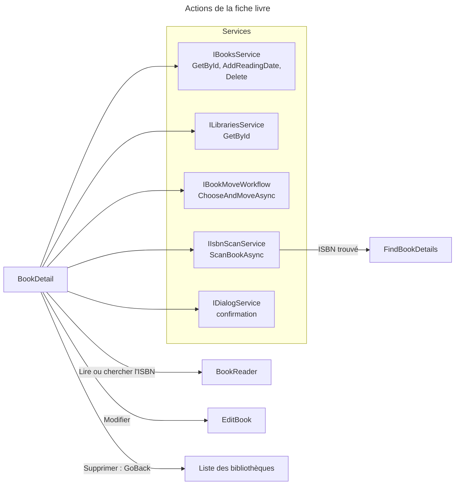

---

## EditBook

**Fichiers** : [`EditBook.razor`](../Web/Components/Pages/Books/EditBook.razor) · [`EditBook.razor.cs`](../Web/Components/Pages/Books/EditBook.razor.cs) · [`EditBook.razor.css`](../Web/Components/Pages/Books/EditBook.razor.css)

### 1. Vue d'ensemble

- **Nom** : `EditBook`
- **Description** : formulaire de modification d'un livre et de la liste de ses lectures (E1, E2, T11). Les lectures se suppriment ici. Les nouvelles lectures s'ajoutent depuis la fiche du livre.
- **Emplacement** : `Web/Components/Pages/Books/EditBook.razor`, code-behind `EditBook.razor.cs`
- **Langage** : C# (`partial`, `IDisposable`) et Razor
- **Objectif** : enregistrer les modifications du livre (`UpdateBookRequest`) et supprimer une lecture après confirmation.

### 2. Éléments de code

- **Route** : `@page "/books/{BookId}/edit"`, `@rendermode InteractiveServer`
- **Paramètres** : `[Parameter] string BookId`
- **Constantes** : `Msg_LoadFailed`, `Msg_SaveFailed`, `Msg_DeleteReadingFailed`.
- **Services injectés** : `NavigationManager`, `IBooksService`, `ILibrariesService`, `IDialogService`, `ISnackbar`, `ILogger<EditBook>`
- **Champs** : `_validator` (`BookValidator`), `_disposalCts`, `_view` (`EditBookViewModel?`), `_model` (`BookUiDto?`), `_libraryName`, `_errors`, `_submitted`, `_isLoading`, `_isSaving`, `_deletingReadingId` (`Guid?`).
- **Méthodes principales** :

| Méthode | Lignes | Rôle |
|---|---|---|
| `OnInitializedAsync()` | L42 | Charge le livre, construit `_model` (`BookUiDto.Convert`), charge le nom de la bibliothèque. `_isLoading` repasse à `false` dans `finally`. |
| `LoadBookAsync()` | L60 | Retourne le `Book` ou `null`. Met `_view` à jour seulement en cas de succès. Affiche `Msg_LoadFailed` en cas d'échec. |
| `LoadLibraryNameAsync(Guid)` | L83 | Affiche « Library » si le nom ne se charge pas (avertissement journalisé). |
| `Revalidate()` | L97 | Après une soumission, revalide à chaque changement de champ. |
| `SaveAsync()` | L105 | Valide, puis `UpdateAsync` dans un `try/finally`. |
| `UpdateAsync(BookUiDto)` | L135 | Construit `UpdateBookRequest` et appelle `BooksService.Update`. Succès : notification et navigation vers la fiche. `BooksError.Duplicate` : « Another book already has this ISBN ». |
| `DeleteReadingAsync(EditBookReading)` | L162 | Garde `_deletingReadingId`. Confirmation, puis `BooksService.DeleteReadingDate`, puis `LoadBookAsync` (les champs en cours d'édition sont conservés). |
| `Dispose()` | L199 | Annule et libère `_disposalCts`. |

- **Balisage** : `FormPage` > `FormHeader` (sous-titre `view.Subtitle`) > `BookFormLayout` avec la couverture et le nom de la bibliothèque en colonne latérale, `BookFields`, une `FormSection` « Readings » (liste des lectures, `StarRating` en lecture seule, bouton de suppression par ligne) et `FormFooter`.

### 3. Dépendances

- **Internes** : `Domain.Books` (`Book`, `BooksError`), `Web.Components.SharedComponents` (`FormPage`, `FormHeader`, `FormSection`, `FormState`, `FormButton`, `FormFooter`, `StarRating`), `Web.Components.Pages.Books` (`BookFormLayout`, `BookFields`), `Web.Extensions` (`LibraryLabel`), `Web.Models` (`BookUiDto`, `EditBookViewModel`, `EditBookReading`, `UpdateBookRequest`), `Web.Services`, `Web.Validators` (`BookValidator`, `FormErrors`).
- **Externes** : `MudBlazor` (`IDialogService`, `ISnackbar`, `Icons`, `Severity`), `Microsoft.AspNetCore.Components`.

### 4. Relations

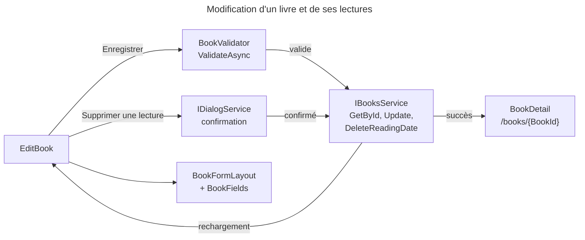

---

## BookReader

**Fichiers** : [`BookReader.razor`](../Web/Components/Pages/Books/BookReader.razor) · [`BookReader.razor.cs`](../Web/Components/Pages/Books/BookReader.razor.cs) · [`BookReader.razor.css`](../Web/Components/Pages/Books/BookReader.razor.css)

### 1. Vue d'ensemble

- **Nom** : `BookReader`
- **Description** : lecteur de pages d'un livre numérique (CBZ). Il gère le défilement continu ou page par page, le sens de lecture (gauche à droite ou droite à gauche pour les mangas), la progression sauvegardée et la fin de lecture. Le mode `?mode=isbn` cherche l'ISBN sur les pages par OCR dans le navigateur.
- **Emplacement** : `Web/Components/Pages/Books/BookReader.razor`, code-behind `BookReader.razor.cs`
- **Langage** : C# (`partial`, `IAsyncDisposable`) et Razor, avec deux modules JavaScript (`bookReader.js`, `isbnOcr.js`)
- **Objectif** : afficher les pages, mémoriser la progression, marquer le livre comme lu et extraire un ISBN des pages.

### 2. Éléments de code

- **Route** : `@page "/books/{BookId}/read"`, `@layout ScannerLayout`, `@rendermode InteractiveServer`
- **Paramètres** : `[Parameter] string BookId`. Paramètre de requête `Mode` (`?mode=`).
- **Constantes** :
  - `public const string IsbnSearchMode = "isbn"`
  - `s_saveProgressDelay` = 1 s (délai avant la sauvegarde de la progression)
  - `s_isbnOcrTimeout` = 2 min (le premier OCR télécharge le moteur et les données de langue)
  - `s_layoutOptions`, `s_scrollingOptions`, `s_directionOptions` : options du panneau « Display ». Le type `DisplayOption<T>` est un `record` interne.
- **Services injectés** : `NavigationManager`, `IBookReaderService`, `IBooksService`, `IJSRuntime`, `ISnackbar`, `ILogger<BookReader>`
- **Champs notables** : `_info` (`BookReaderInfoDto`), `_currentPage`, `_currentRow`, `_savedPage`, `_spreads` (`ReaderSpreads`), `_pages` (`ReaderPageWindow`), `_settings` (`ReaderSettings`), `_quickPages`, `_isbnCandidates`, `_jsModule`, `_ocrModule`, `_dotNetObjectRef`, `_saveCts`, `_scanCts`, plusieurs indicateurs `_pending*` (configuration et défilement).
- **Propriétés calculées** : `IsIsbnSearch`, `IsPaged`, `IsRightToLeft`, `IsFirstRow`, `IsLastRow`, `ScriptOptions`, `ScrollerClass`, `DisplayedRows`, `PreloadedPages`.
- **Méthodes principales** :

| Méthode | Lignes | Rôle |
|---|---|---|
| `OnInitializedAsync()` | L137 | `GetReaderInfoAsync`. Construit `ReaderSpreads`, la fenêtre de pages et la liste des pages rapides (mode ISBN). Ouvre la dernière page lue (ou la première en mode ISBN). |
| `OnAfterRenderAsync(bool)` | L175 | Attache le script au premier rendu, puis `configure` ou `scrollToRow` selon les indicateurs `_pending*`. |
| `AttachScriptAsync()` | L196 | Importe `./js/bookReader.js` et appelle `attach`. Récupère `ReaderClientState` (aide au geste, rotation, plein écran). |
| `ConfigureScriptAsync()` / `ScrollToCurrentRowAsync()` | L218 / L232 | Appellent `configure` et `scrollToRow`. |
| `OnNavigationKey(string)` | L246 | `[JSInvokable]`. Flèches gauche et droite, Échap. |
| `OnVisibleRowChanged(int)` | L256 | `[JSInvokable]`. Le défilement a changé la rangée visible. |
| `OnTurnPage(int)` | L266 | `[JSInvokable]`. Page suivante ou précédente (tap, glissement, espace). |
| `OnReachedEnd()` | L270 | `[JSInvokable]`. Fin du livre, affiche l'écran de fin. |
| `OnCenterTap()` | L273 | `[JSInvokable]`. Affiche ou masque les commandes. |
| `PageUrl(int)` | L279 | Retourne `/api/books/{guid}/pages/{index}`. |
| `GoToRowAsync(int)` | L313 | Navigation vers une rangée. En mode page par page, rendu puis défilement. En mode continu, `scrollToRow` puis mise à jour de l'état. |
| `ApplySettingsAsync(ReaderSettings)` | L373 | Recalcule les rangées, applique la configuration au script, puis `BookReaderService.SaveSettingsAsync`. Un échec affiche un avertissement. |
| `DismissGestureHelpAsync()` / `ReadInPortraitAsync()` | L402 / L419 | Appellent `markGestureHelpSeen` et `acceptPortrait` côté JavaScript. |
| `ToggleFullscreenAsync()` | L438 | Appelle `toggleFullscreen`. |
| `ExtractIsbnAsync()` | L460 | OCR de la page affichée (`isbnOcr.js`, `recognizeUrl`). Ignore le résultat si la page a changé entre-temps. |
| `ScanIsbnPagesAsync()` | L494 | Parcourt la première et la dernière page (`IsbnScanPages.GetScanOrder`) jusqu'à trouver un ISBN. Annule le scan précédent avant d'en lancer un nouveau. |
| `ReadIsbnsAsync(...)` | L548 | OCR d'une page avec un délai propre de 2 min lié au jeton du scan. |
| `GetOcrModuleAsync()` | L556 | Importe `./js/isbnOcr.js` une seule fois. |
| `ShowIsbnCandidates(...)` / `FetchBookInfoAsync(string)` | L563 / L574 | Affichent les ISBN trouvés. Sauvegardent la progression puis naviguent vers `find-details?isbn=…`. |
| `ScheduleProgressSave()` | L582 | Sauvegarde différée de 1 s, en `Task.Run`. Une nouvelle page annule la précédente. Sans effet en mode ISBN. |
| `SaveProgressAsync(int)` | L608 | `BookReaderService.SaveProgressAsync`. Ignore les pages déjà sauvegardées ou le mode ISBN. |
| `MarkAsReadAsync()` | L633 | `BooksService.AddReadingDate` avec la note choisie, réinitialise la progression à la page 0, puis retourne à la fiche. |
| `CloseAsync()` | L664 | Sauvegarde la progression puis retourne à la fiche. |
| `DisposeAsync()` | L670 | Annule les tâches, sauvegarde la progression, puis appelle `detach` (script) et `terminate` (OCR) via `ReleaseModuleAsync`. |

- **Balisage** : barre haute (fermer, titre, badges « ISBN search » et « Right to left », OCR, plein écran, menu), liens des pages rapides, zone de défilement avec les lignes et les images de pages, pré-chargement de la page suivante, barre basse (flèches, curseur, compteur), panneau d'affichage, aide aux gestes, invite de rotation (téléphone en portrait), écran de fin avec `MudRating`, liste des ISBN candidats.

### 3. Dépendances

- **Internes** : `Application.Books.Read` (`IsbnScanPages`, et types de lecture), `Application.Helpers` (`TextIsbnExtractor`), `Domain.Books` (`ReaderLayout`, `ReaderScrolling`, `ReadingDirection`), `Web.Infrastructure` (`AppVersion`, `ReaderScriptOptions`, `ReaderClientState`), `Web.Models` (`BookReaderInfoDto`, `ReaderSpreads`, `ReaderPageWindow`, `ReaderSettings`, `ReaderDisplay`), `Web.Services` (`IBookReaderService`, `IBooksService`), `ScannerLayout`, `bookReader.js`, `isbnOcr.js`.
- **Externes** : `Microsoft.JSInterop` (`IJSRuntime`, `IJSObjectReference`, `DotNetObjectReference`), `MudBlazor` (`MudSlider`, `MudRating`, `MudChip`, `MudMenu`), `Microsoft.AspNetCore.Components`.

### 4. Relations

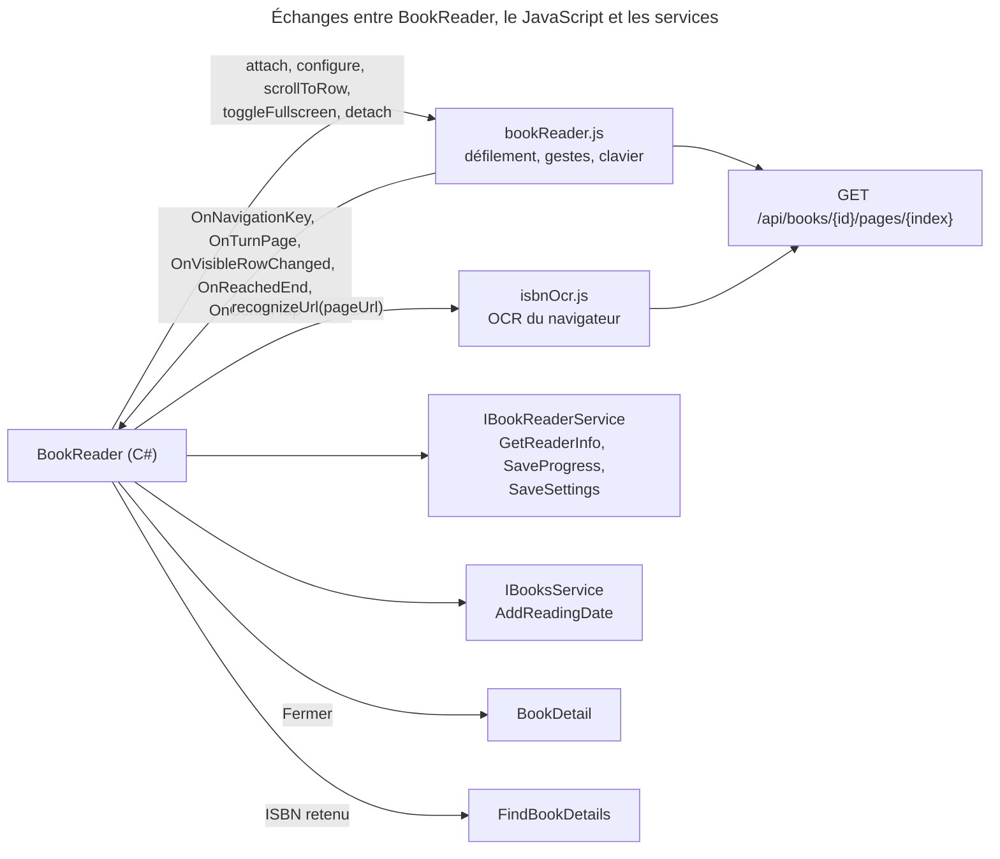

---

## FindBookDetails

**Fichiers** : [`FindBookDetails.razor`](../Web/Components/Pages/Books/FindBookDetails.razor) · [`FindBookDetails.razor.cs`](../Web/Components/Pages/Books/FindBookDetails.razor.cs) · [`FindBookDetails.razor.css`](../Web/Components/Pages/Books/FindBookDetails.razor.css)

### 1. Vue d'ensemble

- **Nom** : `FindBookDetails`
- **Description** : page qui interroge en parallèle les sources web (BnF, Bédethèque, Bubble, OpenLibrary, Google Books) avec l'ISBN du livre. Elle compare chaque champ du livre avec les valeurs trouvées. L'utilisateur choisit, champ par champ, la source à retenir.
- **Emplacement** : `Web/Components/Pages/Books/FindBookDetails.razor`, code-behind `FindBookDetails.razor.cs`
- **Langage** : C# (`partial`) et Razor
- **Objectif** : importer des informations depuis le web sans écraser les valeurs que l'utilisateur ne veut pas changer. Les sources désactivées dans les paramètres (Settings → Features) sont ignorées.

### 2. Éléments de code

- **Route** : `@page "/books/{BookId}/find-details"`, `@rendermode InteractiveServer`
- **Paramètres** : `[Parameter] string BookId`. Paramètre de requête `isbn` (`Isbn`), ISBN lu sur une page du livre.
- **Services injectés** (10) : `NavigationManager`, `IBooksService`, `IBnfCatalogueService`, `IBedethequeService`, `IBubbleService`, `IOpenLibraryService`, `IGoogleBooksService`, `IComicSearchService`, `ISnackbar`, `ILogger<FindBookDetails>`
- **Champs notables** :
  - `_currentBook` (`BookUiDto?`), `_isbn`, `_isbnFromPage`.
  - Résultats par source : `_bnfResult`, `_bedethequeResult`, `_bubbleResult`, `_olResult`, `_googleResult`, et les titres analysés `_bnfParsed`, `_olParsed`, `_googleParsed`.
  - `_searchStates` (`SortedDictionary<BookSource, ProviderSearchState>`) : état de chaque recherche.
  - `_selected` (`Dictionary<string, BookSource>`) : source retenue par champ.
  - `_comparison` (`BookDetailsComparison`), `_changeCount`, `_searchedFor` (`(BookId, Isbn)?`).
- **Type interne** : `record ParsedTitleInfo(string Title, string Serie, int VolumeNumber)`.
- **Méthodes principales** :

| Méthode | Lignes | Rôle |
|---|---|---|
| `OnParametersSetAsync()` | L62 | Ne relance la recherche que si `(BookId, Isbn)` a changé. |
| `LoadBookThenFetchAsync()` | L73 | `BooksService.GetById`, puis `ResolveIsbn`, `RefreshComparison` et `FetchWebServicesAsync`. |
| `ResolveIsbn(string?)` | L106 | Priorité à l'ISBN de la page (valide), sinon à l'ISBN du livre. `_isbnFromPage` indique qu'il sera enregistré. |
| `FetchWebServicesAsync()` | L116 | Initialise tous les états à `Searching`, lance les recherches en parallèle (`Task.WhenAll`). |
| `SearchSourceAsync(BookSource, string)` | L139 | Aiguillage vers `SearchProviderAsync` pour chaque source. |
| `SearchProviderAsync<T>(...)` | L172 | Capture `_searchedFor`. Attend la réponse. Si le livre ou l'ISBN a changé, abandonne le résultat. Sinon applique le résultat et recalcule la comparaison. |
| `WebSources()` | L191 | Sources activées (`IsEnabled`). |
| `RefreshComparison()` | L210 | Construit les `BookFieldComparison` pour chaque `BookFieldDefinition`. |
| `Select(string, BookSource)` / `CountChanges()` | L225 / L232 | Choix d'une source pour un champ, puis calcul du nombre de modifications (ISBN de la page inclus). |
| `AwaitProviderAsync<T>(...)` | L237 | Retourne `null` et affiche un avertissement si une source échoue (`HttpRequestException`, `TaskCanceledException`, `OperationCanceledException`). |
| `ParseTitle(IBookSearchResult?)` | L252 | `ComicSearchService.ParseTitleInfo` : sépare titre, série et tome. |
| `GetStructuredResultValue(...)` / `GetBookResultValue(...)` | L264 / L285 | Valeurs par champ pour les sources structurées (Bédethèque, Bubble) et les autres. |
| `GetSourceValue(BookSource, string)` / `GetCurrentValue(string)` | L315 / L325 | Valeur d'un champ pour une source donnée, ou valeur actuelle du livre. |
| `ApplyAndSaveAsync()` | L341 | Calcule les valeurs retenues. Si la couverture est une URL externe (hors `res.cloudinary.com`), la transfère avec `UploadCoverAsync`. Construit `UpdateBookRequest`, appelle `BooksService.Update`, puis retourne à la fiche. |
| `Cancel()` | L419 | Retour à la fiche du livre. |

- **Balisage** : barre (retour, titre, sous-titre), carte de statut (recherche en cours avec progression, aucune source, ou nombre de différences), bloc ISBN de la page, une ligne `role="radiogroup"` par champ différent avec une option par source, résumé des correspondances, liste des sources interrogées (icône d'état), boutons « Annuler » et « Appliquer » (libellé `BookDetailsComparison.ApplyLabel`).

### 3. Dépendances

- **Internes** : `Application.Helpers` (`IsbnHelper`), `Application.Interfaces`, `Web.Models` (`BookUiDto`, `BookDetailsComparison`, `BookFieldDefinition`, `BookFieldComparison`, `BookFieldKeys`, `BookFieldOption`, `BookSource`, `BookSources`, `ProviderSearchState`, `ProviderSearchStates`, `ProviderSearchStateDisplay`, `BookText`, `PublishDateHelper`, `UpdateBookRequest`), `Web.Services` (services de recherche web et `IBooksService`), `Web.Validators`.
- **Externes** : `MudBlazor` (`MudProgressCircular`, `MudProgressLinear`, `MudIcon`, `MudButton`), `Microsoft.AspNetCore.Components`, `System.Globalization`.

### 4. Relations

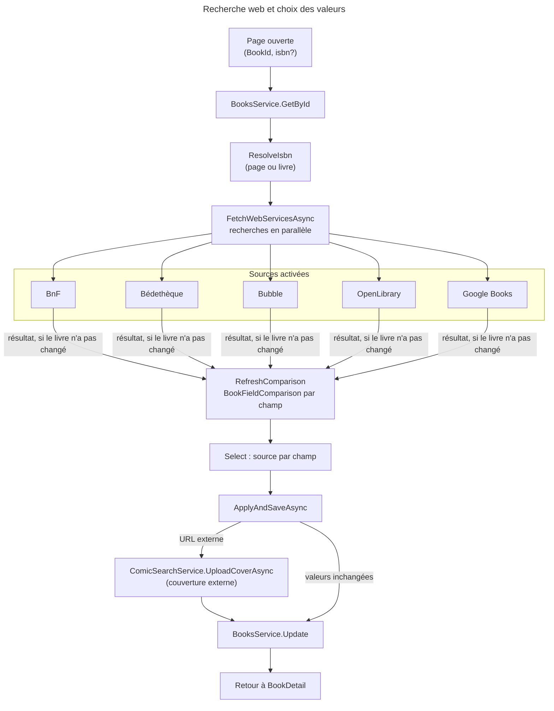

---

## LibrarySelect

**Fichiers** : [`LibrarySelect.razor`](../Web/Components/Pages/Books/LibrarySelect.razor) · [`LibrarySelect.razor.cs`](../Web/Components/Pages/Books/LibrarySelect.razor.cs) · [`LibrarySelect.razor.css`](../Web/Components/Pages/Books/LibrarySelect.razor.css)

### 1. Vue d'ensemble

- **Nom** : `LibrarySelect`
- **Description** : bouton qui affiche la bibliothèque choisie. Il ouvre une feuille d'actions (téléphone) ou un menu ancré (tablette et grand écran) listant les bibliothèques avec leur couleur et leur icône. Il sert à l'ajout, à l'import et au comptage.
- **Emplacement** : `Web/Components/Pages/Books/LibrarySelect.razor`, code-behind `LibrarySelect.razor.cs`
- **Langage** : C# (`partial`) et Razor
- **Objectif** : choisir une bibliothèque, avec un libellé d'erreur accessible et une variante compacte pour la barre d'une page.

### 2. Éléments de code

- **Route** : aucune (composant enfant).
- **Paramètres** :

| Paramètre | Type | Défaut | Rôle |
|---|---|---|---|
| `Id` | `string` | `"book-library"` | Identifiant du bouton, utilisé pour trouver l'ancre du menu. |
| `Libraries` | `IReadOnlyList<LibraryUiDto>` | `[]` | Bibliothèques proposées. |
| `Value` | `Guid` | — | Bibliothèque choisie (`Guid.Empty` pour « tout »). |
| `ValueChanged` | `EventCallback<Guid>` | — | Notifie le choix. |
| `Error` | `string?` | — | Message d'erreur affiché sous le bouton. |
| `AllLabel` | `string?` | — | Première option « toutes les bibliothèques ». |
| `Compact` | `bool` | `false` | Variante en pastille pour la barre d'une page. |

- **Services injectés** : `PopupAnchorLocator`
- **Champs** : `_open`, `_anchor` (`PopupAnchor?`).
- **Propriétés calculées** : `Selected`, `HasChoice`, `ValueText`, `AriaLabel` (« Library: … »), `CssClass` (ajoute `library-select-invalid` en cas d'erreur).
- **Méthodes** :

| Méthode | Rôle |
|---|---|
| `OpenAsync()` | Récupère l'ancre via `PopupAnchorLocator.AnchorOfAsync(Id)`, puis ouvre la feuille. |
| `Close()` | Ferme la feuille. |
| `ChooseAsync(Guid)` | Ferme la feuille, puis appelle `ValueChanged.InvokeAsync`. |

- **Balisage** : bouton `aria-haspopup="dialog"`, `aria-expanded`, `aria-invalid`, `aria-describedby` (erreur). Il contient une `LibraryIcon` et le libellé. La feuille `ActionSheet` contient un `ActionSheetItem` par bibliothèque (icône `LibraryIcons.Resolve`, couleur, état sélectionné).

### 3. Dépendances

- **Internes** : `Web.Components.SharedComponents` (`ActionSheet`, `ActionSheetItem`, `LibraryIcon`), `Web.Models` (`LibraryUiDto`, `PopupAnchor`, `LibraryIcons`), `Web.Services` (`PopupAnchorLocator`), `Web.Validators`.
- **Externes** : `MudBlazor` (`MudIcon`, `Icons`), `Microsoft.AspNetCore.Components`.

### 4. Relations

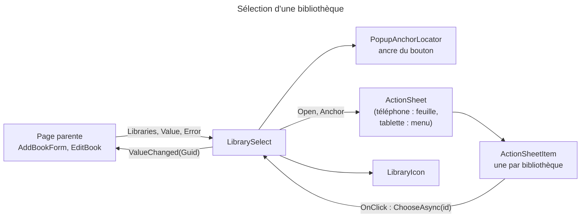

---

## BookFields

**Fichiers** : [`BookFields.razor`](../Web/Components/Pages/Books/BookFields.razor) · [`BookFields.razor.cs`](../Web/Components/Pages/Books/BookFields.razor.cs)

### 1. Vue d'ensemble

- **Nom** : `BookFields`
- **Description** : champs du livre, groupés en deux sections : « Book » (titre, série, ISBN, tome) et « Details » (auteurs, éditeur, date, pages, URL de couverture). Il est partagé par l'ajout et la modification (A6, E1, T8, T11).
- **Emplacement** : `Web/Components/Pages/Books/BookFields.razor`, code-behind `BookFields.razor.cs`
- **Langage** : C# (`partial`) et Razor
- **Objectif** : afficher et mettre à jour `BookUiDto`, avec les erreurs de validation et l'aide associée à chaque champ.

### 2. Éléments de code

- **Route** : aucune.
- **Paramètres** :

| Paramètre | Type | Rôle |
|---|---|---|
| `Model` | `BookUiDto` (`EditorRequired`) | Livre édité, modifié en place. |
| `Errors` | `FormErrors` | Erreurs de la dernière validation. |
| `OnChanged` | `EventCallback` | Appelé après chaque modification, pour revalider. |

- **Services injectés** : aucun.
- **Méthodes** :

| Méthode | Rôle |
|---|---|
| `OnInputAsync(Action<string>, ChangeEventArgs)` | Écrit la valeur saisie dans le modèle, puis notifie le parent. |
| `NotifyChangedAsync()` | `OnChanged.InvokeAsync()`. |
| `Describe(string, string)` | Identifiant de description (erreur) d'un champ (`FormFieldIds.DescribedBy`). |

- **Éléments du bloc `@code`** :
  - `record FieldOptions` : `Required`, `Placeholder`, `Help`, `Type` (`text` par défaut), `InputMode`.
  - `RequiredField` : options « obligatoire ».
  - `IsbnField` (L48) : obligatoire seulement si `Model.IsPhysical`. Un livre numérique peut n'avoir pas d'ISBN.
  - `TextField(...)` (L51) : `RenderFragment` qui produit un `FormField` et un `<input>` avec `@oninput`.
- **Champs du formulaire** : `book-title` (obligatoire), `book-serie` (obligatoire), `book-isbn`, `book-volume` (nombre, `@bind:after`), `book-authors` (aide « Separate several names with commas »), `book-publishers`, `book-published` (date), `book-pages` (nombre), `book-cover` (URL).

### 3. Dépendances

- **Internes** : `Web.Components.SharedComponents` (`FormSection`, `FormField`), `Web.Models` (`BookUiDto`, `FormFieldIds`), `Web.Validators` (`FormErrors`).
- **Externes** : `Microsoft.AspNetCore.Components`.

### 4. Relations

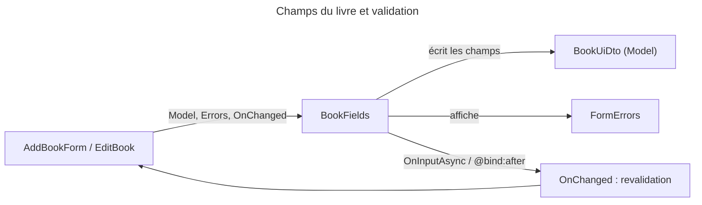

---

## BookFormLayout

**Fichiers** : [`BookFormLayout.razor`](../Web/Components/Pages/Books/BookFormLayout.razor) · [`BookFormLayout.razor.cs`](../Web/Components/Pages/Books/BookFormLayout.razor.cs) · [`BookFormLayout.razor.css`](../Web/Components/Pages/Books/BookFormLayout.razor.css)

### 1. Vue d'ensemble

- **Nom** : `BookFormLayout`
- **Description** : coquille du formulaire livre. Elle affiche l'aperçu de la couverture à côté des champs à partir de 840 px, un résumé des erreurs au-dessus des champs, et un pied de formulaire qui reste en bas de l'écran sur téléphone.
- **Emplacement** : `Web/Components/Pages/Books/BookFormLayout.razor`, code-behind `BookFormLayout.razor.cs`
- **Langage** : C# (`partial`) et Razor
- **Objectif** : fournir la mise en page commune à `AddBookForm` et `EditBook` (formulaire `<form id=FormId>`).

### 2. Éléments de code

- **Route** : aucune.
- **Paramètres** :

| Paramètre | Type | Rôle |
|---|---|---|
| `FormId` | `string` (`EditorRequired`) | Identifiant du `<form>`, pour que les boutons de l'en-tête le soumettent. |
| `OnSubmit` | `EventCallback` | Soumission du formulaire. |
| `Errors` | `FormErrors` | Erreurs, affichées dans `role="alert"` si `Errors.Any`. |
| `ImageLink` | `string?` | URL de l'aperçu de couverture. |
| `Side` | `RenderFragment?` | Contenu sous la couverture (bibliothèque). |
| `ChildContent` | `RenderFragment?` | Champs. |
| `Footer` | `RenderFragment?` | Actions du pied. |

- **Services injectés** : aucun.
- **Méthodes** : aucune. Le code-behind ne contient que les paramètres.

### 3. Dépendances

- **Internes** : `Web.Models` (`FormErrors`, `Errors.Summary`).
- **Externes** : `MudBlazor` (`MudIcon`, `Icons`), `Microsoft.AspNetCore.Components`.

### 4. Relations

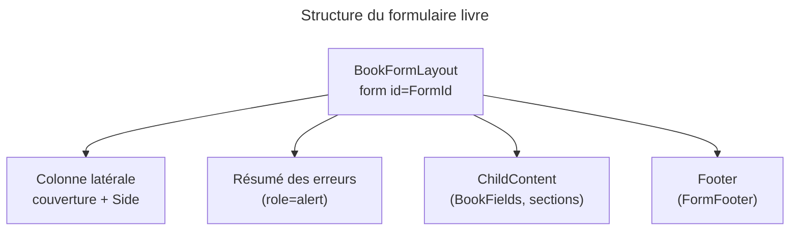

---

## Notes

- **Périmètre** : 10 composants (20 fichiers `.razor` et `.razor.cs`). Les 9 fichiers `.razor.css` sont listés dans chaque section mais non détaillés.
- **Conventions relevées** : tous les composants pages utilisent `@rendermode InteractiveServer`. Les composants sans route héritent du mode de leur page. Les journaux passent par `ILogger<T>` injecté, sans `Serilog.Log` statique.
- **Points d'attention relevés** (observations, sans correction) :
  - `BookDetail.ScanIsbnAsync` (L149) passe `CancellationToken.None` à `IsbnScanService.ScanBookAsync`, alors que les autres appels utilisent `_disposalCts.Token`. Un scan en cours n'est donc pas annulé à la fermeture de la page.
  - `FindBookDetails` n'implémente pas `IDisposable` et n'a pas de jeton d'annulation. Ses recherches web (`FetchWebServicesAsync`) et son appel `BooksService.Update` (L405) ne sont pas annulés à la sortie de la page. Les résultats tardifs sont ignorés grâce à `_searchedFor`.
  - `FindBookDetails.LoadBookThenFetchAsync` (L82-86) : en cas d'échec de `GetById`, la branche met `_loadError` à `true` sans `Log.Error` ni `Snackbar`. La règle CLAUDE.md « Blazor — Error Handling in Load Methods » prévoit ces deux appels dans la branche d'échec.
  - `BookReader.ScheduleProgressSave` (L594) lance `Task.Run` sans observer les exceptions autres que `OperationCanceledException`.
  - `BookDetail.DeleteBookAsync` (L241) utilise `res.Error!.Description` sans garde.
