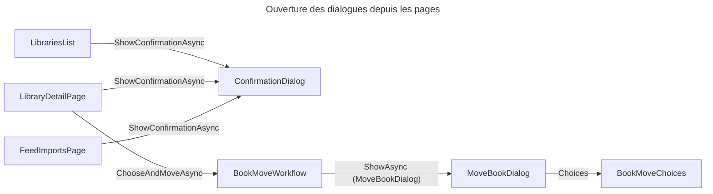
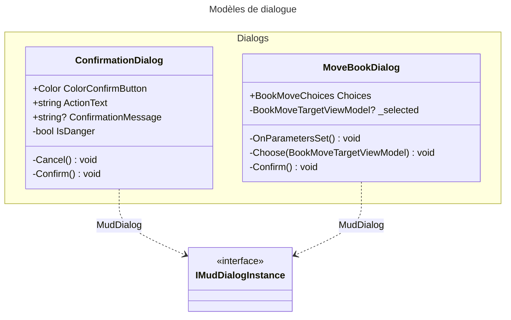

# C4 Code Level : Web/Components/Pages/Dialogs

## Vue d'ensemble

- **Nom** : Boîtes de dialogue MudBlazor
- **Description** : Deux dialogues modaux ouverts par `IDialogService` : une confirmation avant action (avec variante destructive) et un choix de bibliothèque de destination pour déplacer un livre.
- **Emplacement** : `Web/Components/Pages/Dialogs`
- **Langage** : C# / .NET 10, Razor (Blazor Server), MudBlazor
- **Objectif** : Centraliser les dialogues de décision de l'interface, avec un rendu et une accessibilité homogènes (`role="alertdialog"`, libellés liés aux titres).

## Éléments de code

### Composants

#### ConfirmationDialog (`ConfirmationDialog.razor`, `ConfirmationDialog.razor.cs`)

- **Route** : aucune (dialogue ouvert par programme)
- **Classe** : `public partial class ConfirmationDialog` (namespace `Web.Components.Pages.Dialogs`)
- **Paramètre en cascade** : `[CascadingParameter] required IMudDialogInstance MudDialog`
- **Paramètres** :
  - `string? ConfirmationMessage` : texte explicatif
  - `string ActionText = "Confirm"` : libellé du bouton d'action
  - `Color ColorConfirmButton = Color.Primary` : `Color.Error` signale une action destructive (bouton rouge, icône de suppression)
- **Champs** : `_id : string` (GUID sans tirets, identifiant d'accessibilité)
- **Propriétés calculées** : `TitleId` (`confirm-title-{_id}`), `TextId` (`confirm-text-{_id}`), `IsDanger` (`ColorConfirmButton == Color.Error`)
- **Méthodes** :
  - `Cancel()` (l. 29) : `MudDialog.Cancel()`
  - `Confirm()` (l. 34) : `MudDialog.Close(DialogResult.Ok(true))`
- **Appelants** : `DialogServiceExtensions.ShowConfirmationAsync` (`Web/Extensions`), utilisé par `LibrariesList` (suppression de bibliothèque), `LibraryDetailPage` (suppression de livre), `FeedImportsPage` (suppression de décisions)
- **Interactions Application** : aucune.

#### MoveBookDialog (`MoveBookDialog.razor`, `MoveBookDialog.razor.cs`)

- **Route** : aucune (dialogue ouvert par programme)
- **Classe** : `public partial class MoveBookDialog`
- **Paramètre en cascade** : `[CascadingParameter] required IMudDialogInstance MudDialog`
- **Paramètre** : `BookMoveChoices Choices` (défaut `new([], null)`) : bibliothèques proposées, bibliothèque actuelle, suggestion préselectionnée
- **Champs** : `_selected : BookMoveTargetViewModel?`, `TitleId` (`move-title-{GUID}`)
- **Méthodes** :
  - `OnParametersSet()` (l. 20) : préselectionne la bibliothèque suggérée à l'ouverture (`Choices.Preselected`)
  - `Choose(BookMoveTargetViewModel)` (l. 28) : ignore la bibliothèque actuelle (`IsCurrent`), sinon la sélectionne
  - `Cancel()` (l. 38) : `MudDialog.Cancel()`
  - `Confirm()` (l. 40) : `MudDialog.Close(DialogResult.Ok(_selected.Id))` si une bibliothèque est choisie
- **Rendu** : `role="radiogroup"` avec une ligne par bibliothèque (`LibraryIcon`, nom, mention « Suggested », détails), bouton « Move to … » désactivé tant que rien n'est choisi.
- **Appelants** : `BookMoveWorkflow.ChooseAndMoveAsync` (`Web/Services/BookMoveWorkflow.cs`, l. 52-53) ouvre le dialogue avec `DialogParameters<MoveBookDialog>` et `AppDialogs.Options`.
- **Interactions Application** : aucune directe. Le déplacement lui-même est fait ensuite par `IBookMoveService` (`GetBookMoveTargetsQuery` pour remplir `Choices`, `MoveBookCommand` pour appliquer le choix).

## Dépendances

### Dépendances internes

- `Web.Models` : `BookMoveChoices`, `BookMoveTargetViewModel`
- `Web.Extensions` : `DialogServiceExtensions` (appelant de `ConfirmationDialog`)
- `Web.Services` : `BookMoveWorkflow` (appelant de `MoveBookDialog`)
- `Web/Components/SharedComponents` : `LibraryIcon`

### Dépendances externes

- MudBlazor : `MudDialog`, `IMudDialogInstance`, `DialogResult`, `Color`, `Icons.Material`, `MudIcon`
- `Microsoft.AspNetCore.Components` : `[CascadingParameter]`, `[Parameter]`

## Relations

## Notes

- `MoveBookDialog.OnParametersSet` utilise `Choices.Libraries.First(l => l.Id == preselected)` : une suggestion absente de la liste lèverait une exception. Ce cas est supposé impossible tant que `BookMoveChoices` est construit à partir de la même liste.
- `ConfirmationDialog` n'a pas de route : on ne peut pas y accéder directement par URL.
- Les dialogues sont des composants `MudDialog` ; leur résultat est un `DialogResult` (`Ok(true)` pour la confirmation, `Ok(Guid)` pour le déplacement, `Cancel()` sinon).
