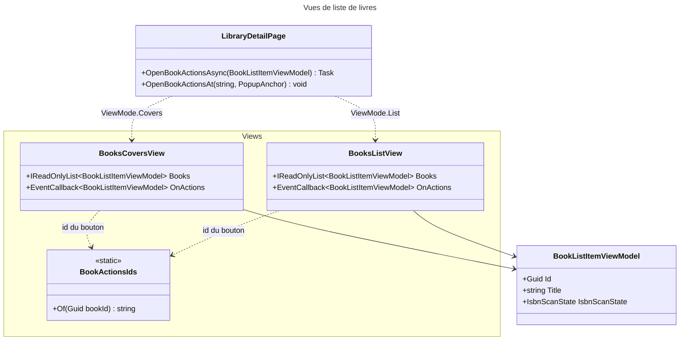
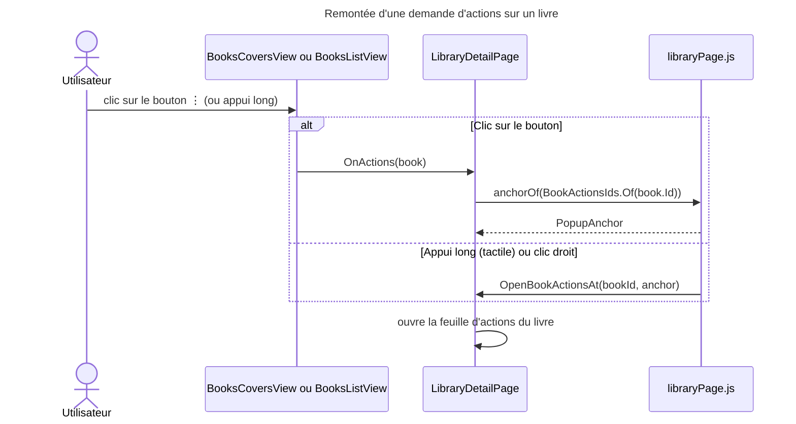

# C4 Code Level : Web/Components/Pages/Libraries/Views

## Vue d'ensemble

- **Nom** : Vues de la liste des livres d'une bibliothèque
- **Description** : Deux présentations interchangeables des livres d'une bibliothèque (grille de couvertures et liste détaillée), plus une classe utilitaire qui fournit l'identifiant DOM du bouton d'actions de chaque livre.
- **Emplacement** : `Web/Components/Pages/Libraries/Views`
- **Langage** : C# / .NET 10, Razor (Blazor Server), MudBlazor
- **Objectif** : Afficher les livres d'une page de détail de bibliothèque selon le mode choisi (`ViewMode.Covers` ou `ViewMode.List`), en remontant au parent les demandes d'actions sur un livre. Ces composants ne font aucun appel à la couche Application ; les données viennent de `LibraryDetailPage`.

## Éléments de code

### Composants

#### BooksCoversView (`BooksCoversView.razor`, `BooksCoversView.razor.cs`)

- **Route** : aucune
- **Classe** : `public partial class BooksCoversView` (namespace `Web.Components.Pages.Libraries.Views`)
- **Commentaire de conception** : 3 colonnes sur téléphone, 6 sur tablette et grand écran (CSS)
- **Paramètres** :
  - `[Parameter, EditorRequired] IReadOnlyList<BookListItemViewModel> Books`
  - `[Parameter, EditorRequired] EventCallback<BookListItemViewModel> OnActions`
- **Méthodes** : aucune (pas de code-behind logique)
- **Rendu** (`BooksCoversView.razor`) :
  - Pour chaque livre, `div.cover-item` avec `data-book-id` et `@key="book.Id"`
  - Lien `/books/{id}` : image de couverture (`alt` = « Cover of … ») ou placeholder avec le titre ; badge de tome (`VolumeBadge`) ; état ISBN (`IsbnScanStateIcon`) si le statut n'est pas `HasIsbn` ; titre ; série
  - Bouton `⋮` (`id = BookActionsIds.Of(book.Id)`, `aria-label` « More actions for … ») qui appelle `OnActions` avec le livre
  - Un appui long sur tactile est géré par `libraryPage.js` (voir `LibraryDetailPage.OpenBookActionsAt`)
- **Interactions Application** : aucune

#### BooksListView (`BooksListView.razor`, `BooksListView.razor.cs`)

- **Route** : aucune
- **Classe** : `public partial class BooksListView`
- **Commentaire de conception** : 1 colonne sur téléphone, 2 sur tablette, 3 sur grand écran (CSS)
- **Paramètres** :
  - `[Parameter, EditorRequired] IReadOnlyList<BookListItemViewModel> Books`
  - `[Parameter, EditorRequired] EventCallback<BookListItemViewModel> OnActions`
- **Méthodes** : aucune
- **Rendu** (`BooksListView.razor`) :
  - Pour chaque livre, `div.list-item` avec `data-book-id` et `@key="book.Id"`
  - Lien `/books/{id}` : vignette (`loading="lazy"`) ou emplacement vide ; titre ; série et volume (`SerieAndVolume`) ; auteurs (`Authors`) ; état ISBN (`IsbnScanStateIcon` avec `CandidateCount` et `Isbn`) ; note sur 5 étoiles (`LastRating`, `role="img"` avec libellé « Rated n out of 5 ») ; mention « Read » si `HasBeenRead`
  - Bouton `⋮` (`id = BookActionsIds.Of(book.Id)`) qui appelle `OnActions`
- **Interactions Application** : aucune

#### BookActionsIds (`BookActionsIds.cs`)

- **Classe** : `public static class BookActionsIds` (namespace `Web.Components.Pages.Libraries.Views`)
- **Méthode** : `public static string Of(Guid bookId)` renvoie `"book-actions-{bookId}"`
- **Rôle** : fournit un identifiant DOM stable pour le bouton d'actions d'un livre. Le parent (`LibraryDetailPage.OpenBookActionsAsync`) s'en sert pour ancrer la feuille d'actions près du bouton via `anchorOf` (JS).
- **Consommateurs** : `BooksCoversView.razor`, `BooksListView.razor`, `LibraryDetailPage.razor.cs`

## Dépendances

### Dépendances internes

- `Web.Models` : `BookListItemViewModel` (titre, série, volume, auteurs, couverture, note, statut ISBN, indicateur de lecture)
- `Web.Components.SharedComponents` : `IsbnScanStateIcon`
- `Web.Components.Pages.Libraries` : parent `LibraryDetailPage` (fournit `Books` et reçoit `OnActions`)
- `Domain.Books` : énumération `IsbnScanState` (utilisée par `BooksCoversView`)

### Dépendances externes

- `Microsoft.AspNetCore.Components` : `[Parameter]`, `EventCallback`, `@key`
- MudBlazor : `MudIcon`, `Icons.Material`, `Size`

## Relations

## Notes

- Les deux vues reçoivent la même liste et le même callback : le choix de la vue est fait uniquement par le parent (`LibraryDetailPage`, mode mémorisé par `LibraryStateService`).
- Les vues n'ont pas de `@rendermode` propre : elles héritent du mode de la page parente (`InteractiveServer`).
- Le bouton `⋮` est rendu dans les deux vues avec le même identifiant ; l'identifiant est donc unique par livre, et non par vue.
