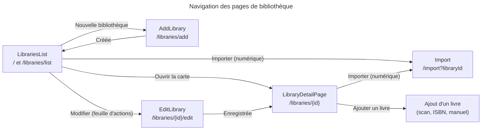
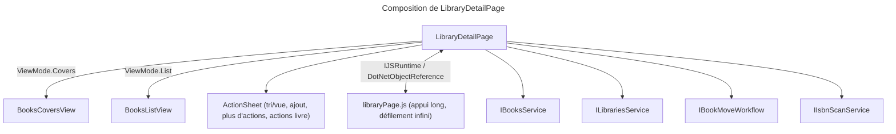
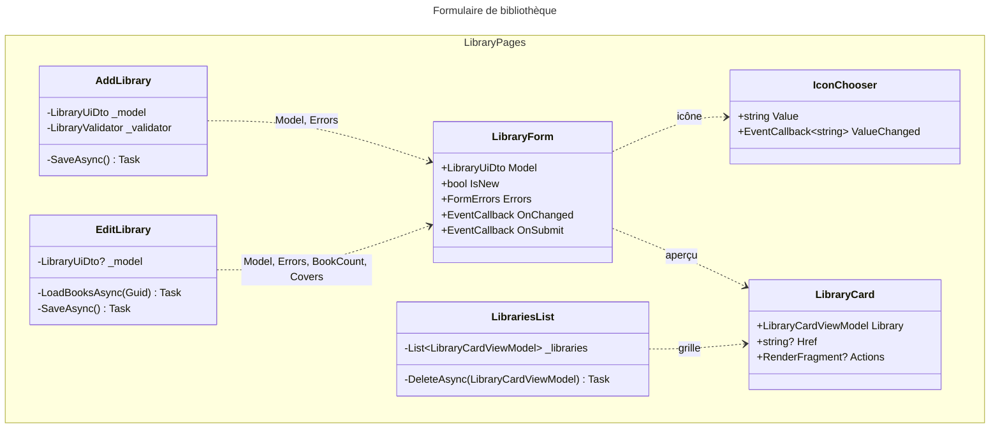

# C4 Code Level : Web/Components/Pages/Libraries

## Vue d'ensemble

- **Nom** : Gestion des bibliothèques
- **Description** : Pages et composants de création, modification, suppression et consultation des bibliothèques (physiques ou numériques). La page de détail affiche les livres d'une bibliothèque (recherche, tri, vue couvertures ou liste, défilement infini) et les actions sur les livres. Le sous-dossier `Views` contient les deux vues de livres.
- **Emplacement** : `Web/Components/Pages/Libraries` (non récursif ; `Libraries/Views` est documenté à part)
- **Langage** : C# / .NET 10, Razor (Blazor Server, `@rendermode InteractiveServer`), MudBlazor, JavaScript (`libraryPage.js`)
- **Objectif** : Permettre à l'utilisateur de gérer ses bibliothèques et de parcourir leurs livres, en déléguant toute logique métier aux services `Web.Services` puis à la couche Application.

## Éléments de code

### Pages

#### LibrariesList (`LibrariesList.razor`, `LibrariesList.razor.cs`)

- **Routes** : `@page "/"` et `@page "/libraries/list"` ; `@rendermode InteractiveServer`
- **Classe** : `public sealed partial class LibrariesList : IDisposable`
- **Constantes publiques** : `Msg_LibCorrectlyDeleted`, `Msg_LoadFailed`, `Msg_DeleteFailed`
- **Services injectés** : `ILibrariesService`, `IDialogService`, `ISnackbar`, `PopupAnchorLocator`, `ILogger<LibrariesList>`
- **Champs** : `_disposalCts`, `_libraries : List<LibraryCardViewModel>`, `_isLoading`, `_actionsLibrary`, `_sheetAnchor`
- **Méthodes principales** :
  - `OnInitializedAsync()` (l. 27) : `LoadLibrariesAsync()` puis `_isLoading = false`
  - `LoadLibrariesAsync()` (l. 33) : `GetSummaries(token)` ; met à jour `_libraries` seulement en cas de succès ; erreur = journal + Snackbar
  - `OpenActionsAsync(LibraryCardViewModel)` (l. 47) : positionne la feuille d'actions via `PopupAnchorLocator.AnchorOfAsync`
  - `CloseActions()` (l. 54)
  - `DeleteAsync(LibraryCardViewModel)` (l. 56) : confirmation (`ShowConfirmationAsync`) puis `Delete(id)` ; recharge en cas de succès
  - `Dispose()` (l. 81) : annule et libère `_disposalCts`
- **Rendu** : grille de `LibraryCard` avec un bouton « ⋮ » par carte ; feuille d'actions (`ActionSheet`) : modifier, importer (si numérique), supprimer. État vide avec appel à création.
- **Interactions Application** :
  - `ILibrariesService.GetSummaries` → `GetLibrarySummariesQuery`
  - `ILibrariesService.Delete` → `DeleteLibraryCommand`

#### AddLibrary (`AddLibrary.razor`, `AddLibrary.razor.cs`)

- **Route** : `@page "/libraries/add"` ; `@rendermode InteractiveServer`
- **Classe** : `public sealed partial class AddLibrary : IDisposable`
- **Constante** : `Msg_CreateFailed = "Unable to create the library"`
- **Services injectés** : `ILibrariesService`, `NavigationManager`, `ISnackbar`, `ILogger<AddLibrary>`
- **Champs** : `_model : LibraryUiDto`, `_validator : LibraryValidator`, `_errors : FormErrors`, `_submitted`, `_isSaving`, `_disposalCts`
- **Méthodes principales** :
  - `Revalidate()` (l. 27) : après une première soumission, revalide à chaque saisie
  - `SaveAsync()` (l. 35) : garde anti-réentrance ; `ValidateAsync` ; si valide, `LibrariesService.Create(new CreateLibraryRequest(...))` ; succès = Snackbar + navigation vers `/libraries/list` ; erreur = journal + Snackbar via `LibraryDisplay.SaveFailed` ; `catch` ciblé sur `OperationCanceledException` et `InvalidOperationException` ; `finally` libère `_isSaving`
  - `Dispose()` (l. 74)
- **Rendu** : `FormPage` / `FormHeader` avec boutons Annuler et Créer, `LibraryForm` (`FormId="library-form"`).
- **Interactions Application** : `ILibrariesService.Create` → `CreateLibraryCommand`

#### EditLibrary (`EditLibrary.razor`, `EditLibrary.razor.cs`)

- **Route** : `@page "/libraries/{LibraryId}/edit"` ; `@rendermode InteractiveServer`
- **Paramètre** : `[Parameter] string? LibraryId`
- **Classe** : `public sealed partial class EditLibrary : IDisposable`
- **Services injectés** : `ILibrariesService`, `NavigationManager`, `ISnackbar`, `ILogger<EditLibrary>`
- **Champs** : `_model : LibraryUiDto?`, `_name`, `_bookCount`, `_covers : IReadOnlyList<string>`, `_isLoading`, `_isSaving`, `_submitted`, `_errors`
- **Propriété** : `LibraryHref` = `/libraries/{LibraryId}`
- **Méthodes principales** :
  - `OnInitializedAsync()` (l. 35) : `LoadLibraryAsync()` puis, si trouvée, `LoadBooksAsync(id)` ; `finally` libère `_isLoading`
  - `LoadLibraryAsync()` (l. 51) : `GetById(LibraryId)` → `LibraryUiDto.Convert` ; échec = Snackbar « Unable to load the library »
  - `LoadBooksAsync(Guid)` (l. 74) : récupère le nombre de livres et les couvertures depuis `GetSummaries` pour l'aperçu ; en cas d'échec, l'aperçu s'affiche sans couvertures (avertissement journalisé)
  - `Revalidate()` (l. 89), `SaveAsync()` (l. 97) : `Update(new UpdateLibraryRequest(...))` ; le type de bibliothèque n'est pas modifiable
  - `Dispose()` (l. 136)
- **Rendu** : états chargement / introuvable / formulaire ; `LibraryForm` reçoit `BookCount` et `Covers` pour l'aperçu.
- **Interactions Application** :
  - `ILibrariesService.GetById` → `GetLibraryQuery`
  - `ILibrariesService.GetSummaries` → `GetLibrarySummariesQuery`
  - `ILibrariesService.Update` → `UpdateLibraryCommand`

#### LibraryDetailPage (`LibraryDetailPage.razor`, `LibraryDetailPage.razor.cs`)

- **Route** : `@page "/libraries/{LibraryId}"` ; `@rendermode InteractiveServer`
- **Paramètre** : `[Parameter] string? LibraryId`
- **Classe** : `public partial class LibraryDetailPage : IAsyncDisposable`
- **Constantes** : `internal const int PageSize = 24` ; identifiants DOM `library-sort-and-view`, `library-more-actions`, `library-add-book`, `library-add-book-icon`
- **Énumération** : `LibrarySheet { None, SortAndView, MoreActions, BookActions, AddBook }` (feuille d'actions ouverte)
- **Services injectés** : `ILibrariesService`, `IBooksService`, `IBookMoveWorkflow`, `NavigationManager`, `IDialogService`, `ISnackbar`, `IJSRuntime`, `LibraryStateService`, `ILogger<LibraryDetailPage>`, `IIsbnScanService`
- **Champs principaux** :
  - `_displayedBooks : List<BookListItemViewModel>` (pages cumulées, défilement infini)
  - `_currentPage`, `_hasNextPage`, `_isLoadingMore`, `_loadVersion` (version des chargements ; une page suivante demandée avant un rechargement est abandonnée)
  - `_libraryBookCount`, `_resultCount`, `_shownSearch`
  - `_currentViewMode : ViewMode` (défaut `Covers`), `_currentSortOrder : BookSortOrder`
  - `_searchCts`, `_sortCts`, `_disposalCts`, `_module : IJSObjectReference?`, `_dotNetRef`
- **Propriétés** : `SearchTerm` (setter : annule la recherche précédente, la relance après 300 ms via `ReloadOnSearchAsync`) ; `IsDigital` (type `Digital`)
- **Méthodes principales** :
  - `OnInitializedAsync()` → `LoadDataAsync()` (l. 183) : restaure l'état mémorisé (`LibraryStateService.Load`), charge la bibliothèque (`GetById`), applique son tri par défaut, charge la première page
  - `OnAfterRenderAsync(bool firstRender)` (l. 108) : au premier rendu, désactive le défilement du corps (`bodyScroll.disable`), importe `./js/libraryPage.js` (`AppVersion.Versioned`), appelle `attach` ; observe la sentinelle `scroll-sentinel` (`infiniteScroll.observe`)
  - `LoadFirstPageAsync(CancellationToken)` (l. 229) : `BooksService.GetPagedByLibrary(id, 1, PageSize, sort, search)` ; ignore la réponse si la version, le tri ou la recherche ont changé
  - `LoadMoreBooksAsync()` (l. 265, `[JSInvokable]`) : page suivante, appelée par le script de défilement infini
  - `ReloadOnSearchAsync` (l. 316), `OpenSearch`, `CloseSearch`, `ClearSearch` (l. 334-352)
  - `OpenSortAndViewAsync` (l. 356), `ChooseSortOrderAsync` (l. 360), `SetSortOrderAsync` (l. 369) : enregistre le tri par défaut via `LibrariesService.Update(new UpdateLibraryRequest(..., sortOrder))`, puis recharge
  - `ChooseViewMode(ViewMode)` (l. 412)
  - `OpenBookActionsAsync(BookListItemViewModel)` (l. 433), `OpenBookActionsAt(string, PopupAnchor)` (l. 441, `[JSInvokable]`, appui long ou clic droit depuis le script)
  - `AnchorOfAsync(string)` (l. 462) : position d'un élément DOM via le module JS (`anchorOf`)
  - `OpenAddBookAsync()` (l. 485) : feuille « Ajouter un livre » (scan, ISBN, saisie manuelle)
  - `FindMissingIsbnsAsync()` (l. 500) : `IIsbnScanService.StartLibraryScanAsync(id)` ; message selon le nombre de livres à analyser
  - `DownloadBookAsync(Guid)` (l. 537) : ouvre `/api/books/{id}/download` dans un nouvel onglet
  - `MoveAsync(Guid)` (l. 543) : `IBookMoveWorkflow.ChooseAndMoveAsync` ; recharge si le livre a quitté la bibliothèque
  - `ReloadBooksAsync()` (l. 571) : décrémente le compteur et recharge la première page
  - `DeleteAsync(Guid)` (l. 580) : confirmation puis `BooksService.Delete(id)`
  - `DisposeAsync()` (l. 148) : annule les jetons, appelle `bodyScroll.enable`, `infiniteScroll.dispose`, `detach`, et enregistre l'état via `LibraryStateService.Save`
- **Rendu** : barre (titre, sous-titre, recherche extensible, tri et vue, « ⋮ » pour les bibliothèques numériques, « Nouveau livre » pour les physiques), `BooksCoversView` ou `BooksListView` (`Views`), feuilles `ActionSheet` (tri et vue, ajout, plus d'actions, actions d'un livre : lire, éditer, infos web, ISBN, CBZ, déplacer, supprimer).
- **Interactions Application** :
  - `ILibrariesService.GetById` → `GetLibraryQuery`
  - `ILibrariesService.Update` (tri) → `UpdateLibraryCommand`
  - `IBooksService.GetPagedByLibrary` → `GetPagedBooksQuery` (tri `BookSortOrder`, recherche, pagination)
  - `IBooksService.Delete` → `DeleteBookCommand`
  - `IBookMoveWorkflow.ChooseAndMoveAsync` → `BookMoveService` : `GetBookMoveTargetsQuery` puis `MoveBookCommand`
  - `IIsbnScanService.StartLibraryScanAsync` → `IsbnScanOrchestrator` → `ScanLibraryIsbnsCommand`

#### LibraryForm (`LibraryForm.razor`, `LibraryForm.razor.cs`)

- **Route** : aucune (composant de formulaire)
- **Classe** : `public partial class LibraryForm`
- **Paramètres** :
  - `[EditorRequired] string FormId`
  - `[EditorRequired] LibraryUiDto Model`
  - `bool IsNew` (permet de choisir le type : physique ou numérique)
  - `FormErrors Errors`
  - `EventCallback OnChanged` (revalidation par la page parente)
  - `EventCallback OnSubmit`
  - `int BookCount`, `IReadOnlyList<string> Covers` (aperçu)
  - `RenderFragment? Footer` (actions en bas d'écran sur téléphone)
- **Propriétés privées** : `Preview` (`LibraryCardViewModel.Preview(...)`), `IconLabel` (`LibraryIcons.LabelOf`)
- **Méthodes** : `Describe(id, property)`, `OnNameInputAsync(ChangeEventArgs)` (l. 51), `ChooseTypeAsync(LibraryBookType)` (l. 57), `ChooseColorAsync(LibraryColor)` (l. 63), `ChooseIconAsync(string)` (l. 69), `OpenIcons()`, `CloseIcons()`, `ChooseIconFromSheetAsync(string)` (l. 79)
- **Rendu** : aperçu (`LibraryCard`), champ nom, cartes de type (`TypeCard`, uniquement si `IsNew`), palette de couleurs, sélecteur d'icône (`IconChooser` inline et dans une feuille `ActionSheet`).
- **Interactions Application** : aucune. Mutations du modèle puis `OnChanged` ; l'enregistrement est porté par la page parente.

#### IconChooser (`IconChooser.razor`, `IconChooser.razor.cs`)

- **Route** : aucune (composant de sélection)
- **Classe** : `public partial class IconChooser`
- **Paramètres** : `string Value` (nom Material de l'icône choisie), `EventCallback<string> ValueChanged`
- **Champs** : `_query`, `_choices : IReadOnlyList<LibraryIconChoice>` (initialisé à `LibraryIcons.Suggested`), `_caption`
- **Méthodes** :
  - `OnParametersSet()` (l. 20) : réaffiche les suggestions quand la recherche est vide
  - `Show(string query)` (l. 28) : `LibraryIcons.Search(query, Value)` ; l'icône courante apparaît en premier si elle n'est pas suggérée
  - `SearchAsync(ChangeEventArgs)` (l. 35), `ChooseAsync(LibraryIconChoice)` (l. 41) : notifie `ValueChanged`
- **Interactions Application** : aucune. Données d'icônes fournies par `LibraryIcons` (`Web.Models`).

#### LibraryCard (`LibraryCard.razor`, `LibraryCard.razor.cs`)

- **Route** : aucune
- **Classe** : `public partial class LibraryCard`
- **Paramètres** :
  - `[Parameter, EditorRequired] LibraryCardViewModel Library`
  - `string? Href` (sans lien si absent : aperçu du formulaire)
  - `RenderFragment? Actions` (boutons placés à côté du lien)
- **Rendu** : empilement de couvertures (la plus récente devant), icône de la bibliothèque, nom, type, nombre de livres. Variable CSS `--library-color`.
- **Interactions Application** : aucune.

## Dépendances

### Dépendances internes

- `Web.Services` : `ILibrariesService`, `IBooksService`, `IBookMoveWorkflow`, `IIsbnScanService`, `LibraryStateService`, `PopupAnchorLocator`, `IDialogService` (extension `ShowConfirmationAsync`)
- `Web.Models` : `LibraryUiDto`, `LibraryCardViewModel`, `BookListItemViewModel`, `LibraryIcons`, `LibraryColors`, `LibraryIconChoice`, `LibraryColor`, `CreateLibraryRequest`, `UpdateLibraryRequest`
- `Web.Validators` : `LibraryValidator`, `FormErrors`
- `Web.Extensions` : `DialogServiceExtensions`, `LibraryDisplay`
- `Web.Infrastructure` : `AppVersion`
- `Web.Enums` : `ViewMode`, `BookSortOrder`
- `FormFieldIds` : utilisé par `LibraryForm` (namespace non vérifié)
- `Web.Components.SharedComponents` : `LibraryIcon`, `ActionSheet`, `ActionSheetItem`, `FormPage`, `FormHeader`, `FormButton`, `FormFooter`, `FormField`, `FormState`
- `Web.Components.Pages.Libraries.Views` : `BooksCoversView`, `BooksListView`, `BookActionsIds`
- `Web.Components.Pages.Dialogs` : `ConfirmationDialog` (via `DialogService`)
- `Domain.Libraries` : `LibraryBookType`, `LibraryBookType.Digital`
- `js/libraryPage.js` (chargé par `AppVersion.Versioned("./js/libraryPage.js")`, emplacement physique non vérifié) : appui long, défilement infini, `anchorOf`

### Dépendances externes

- `Microsoft.AspNetCore.Components`, `Microsoft.JSInterop` (`IJSRuntime`, `IJSObjectReference`, `DotNetObjectReference`)
- MudBlazor : `MudIconButton`, `MudButton`, `MudIcon`, `MudText`, `MudProgressCircular`, `ISnackbar`, `IDialogService`, `Severity`, `Color`
- `Microsoft.Extensions.Logging` : `ILogger<T>`

## Relations

### Navigation entre pages

### Composition de la page de détail

### Modèles de formulaire

## Notes

- Les appels aux services suivent le modèle de la base de code : chaque méthode `Result` est testée par `IsSuccess` / `IsFailure` ; seules les réponses en succès modifient l'état local.
- `LibraryDetailPage` protège les chargements concurrents : `_loadVersion` (pages suivantes), `_searchCts` et `_sortCts` (recherche et tri) ; un résultat obsolète est ignoré.
- Le défilement infini s'appuie sur `libraryPage.js` (`infiniteScroll.observe`, `LoadMoreBooksAsync`). Le défilement de la page est désactivé pendant l'affichage de la bibliothèque (`bodyScroll.disable`).
- L'état de recherche et le mode d'affichage sont mémorisés par bibliothèque (`LibraryStateService`).
- `LibraryDetailPage` utilise `Books.BookReader.IsbnSearchMode` (page `Pages/Books`) pour construire le lien « Trouver l'ISBN ».
- `LibraryDetailPage.DeleteAsync` et `LibrariesList.DeleteAsync` demandent une confirmation avant toute suppression (composant `ConfirmationDialog`, voir `Pages/Dialogs`).
