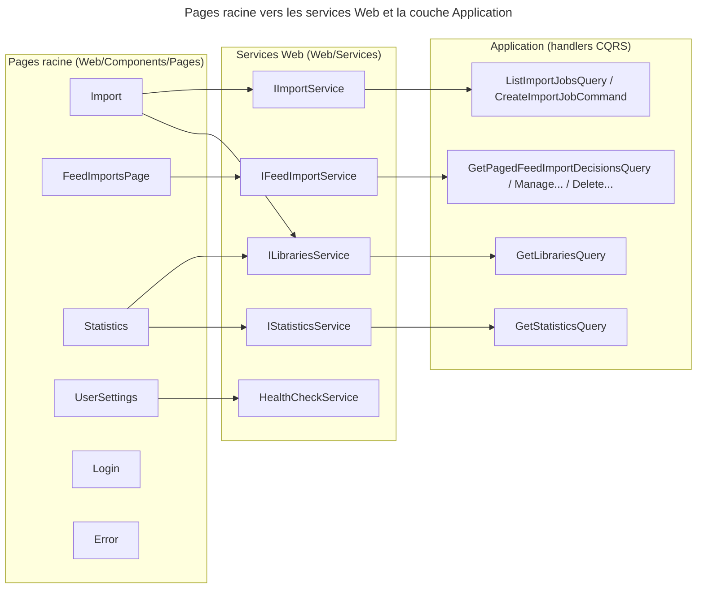
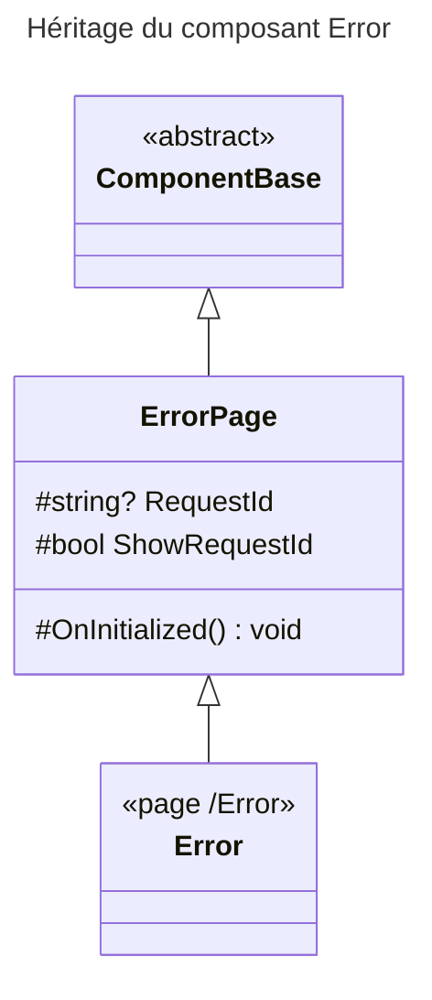

# C4 Code Level : Web/Components/Pages (pages racine)

## Vue d'ensemble

- **Nom** : Pages racine de l'interface Blazor Server
- **Description** : Pages routables de premier niveau (import de fichiers, flux RSS, statistiques, réglages utilisateur, connexion, erreur). Chaque composant `.razor` est une page ou un écran ; le code-behind `.razor.cs` porte la logique d'état et les appels aux services Web.
- **Emplacement** : `Web/Components/Pages` (non récursif ; les sous-dossiers `Admin`, `Dialogs`, `Libraries`, `Books` sont documentés à part)
- **Langage** : C# 13 / .NET 10, Razor (Blazor Server), MudBlazor
- **Objectif** : Offrir les écrans transverses de l'application (hors gestion des bibliothèques et des livres) et orchestrer, pour chacun, les appels vers la couche Application via les services `Web.Services`.

## Éléments de code

### Pages

#### Import (`Import.razor`, `Import.razor.cs`)

- **Route** : `@page "/import"` ; `@rendermode InteractiveServer`
- **Paramètre de requête** : `[SupplyParameterFromQuery] string? LibraryId` (préselection d'une bibliothèque numérique)
- **Services injectés** : `ILibrariesService`, `IImportService`, `ISnackbar`, `ILogger<Import>`
- **Interface** : `IAsyncDisposable`
- **Méthodes principales** :
  - `OnInitializedAsync()` (l. 35) : charge les bibliothèques, choisit la bibliothèque (paramètre ou première), puis les jobs
  - `OnParametersSetAsync()` (l. 55) : recharge les jobs si la bibliothèque sélectionnée change
  - `LoadLibrariesAsync()` (l. 63) : `ILibrariesService.FilterBy(...)`, filtre `BookType == Digital`
  - `LoadJobsAsync(Guid)` (l. 80) : `IImportService.GetImportJobsAsync` ; ignore la réponse si la bibliothèque a changé entre-temps
  - `OnFilesSelectedAsync(IReadOnlyList<IBrowserFile>)` (l. 124) : envoie chaque fichier via `IImportService.UploadAndCreateJobAsync` (10 fichiers max, extensions `.cbz .cbr .zip .rar .pdf`)
  - `StartPollingIfNeeded()` (l. 172) / `PollJobsAsync()` (l. 195) / `StopPolling()` (l. 228) : interrogation toutes les 3 secondes tant qu'un job n'est pas terminé (`System.Threading.Timer`)
  - `DeleteTerminalJobsAsync()` (l. 237) : supprime les jobs terminés (`DeleteImportJobAsync`)
  - `DeleteJobAsync(Guid)` (l. 276), `ForceFailJobAsync(Guid)` (l. 290) : suppression ou passage forcé en échec d'un job
  - `DisposeAsync()` (l. 311) : annule `_pollingCts` et arrête le timer
- **Interactions Application** (via `Web.Services`) :
  - `ILibrariesService.FilterBy` → `GetLibrariesQuery`
  - `IImportService.GetImportJobsAsync` → `ListImportJobsQuery` ; `UploadAndCreateJobAsync` → `CreateImportJobCommand` ; `DeleteImportJobAsync` → `DeleteImportJobCommand` ; `ForceFailImportJobAsync` → `ForceFailImportJobCommand`
- **Sous-composants** : `LibrarySelect` (`Pages/Books`), `ImportJobCard` (utilisé ici ; emplacement non vérifié dans ce périmètre), `MudFileUpload`

#### FeedImportsPage (`FeedImportsPage.razor`, `FeedImportsPage.razor.cs`)

- **Route** : `@page "/feed-imports"`
- **Services injectés** : `IFeedImportService`, `ISnackbar`, `FeedImportNotifier`, `IDialogService`, `ILogger<FeedImportsPage>`
- **Interface** : `IAsyncDisposable`
- **Constante** : `PageSize = 20`
- **Méthodes principales** :
  - `OnInitializedAsync()` → `ReloadAsync()` (l. 52) : charge la page 1 et les compteurs par statut en parallèle
  - `LoadPageAsync(int page)` (l. 59) : `IFeedImportService.GetDecisionsAsync(status, searchTerm, page, PageSize)` ; une réponse obsolète (filtre, recherche ou page 1 relancée entre-temps) est ignorée via `_loadVersion`
  - `LoadCountsAsync()` (l. 119) : `GetStatusCountsAsync` (puces de filtre)
  - `SelectFilterAsync(FeedImportFilter)` (l. 133), `OnSearchChangedAsync(string?)` (l. 144) : recharge la page 1
  - `SyncNowAsync()` (l. 170) : `TriggerSync()` puis rechargement
  - `ResolveAsync(...)` (l. 196) : `ResolveArbitrationAsync` (choisir un lien, « même fichier », « pas un doublon », « confirmer le doublon »)
  - `ApplyActionAsync(...)` (l. 200) : `ApplyActionAsync` (forcer le téléchargement, réessayer, ignorer)
  - `StartCorrection`, `SaveCorrectionAsync`, `CancelCorrection` (l. 206-227) : correction série / tome / titre via `CorrectAsync`
  - `RunDecisionActionAsync(...)` (l. 229) : verrou `_busyDecisionId`, notification `Notifier.NotifyChanged()` après succès
  - `DeleteAsync`, `DeleteSelectedAsync`, `ConfirmAndDeleteAsync` (l. 259-329) : suppression confirmée (`ShowConfirmationAsync`) puis `DeleteAsync(ids)`
  - `DeleteDownloadedAsync()` (l. 331) : supprime les décisions téléchargées avec succès (`DeleteDownloadedAsync`)
  - `DisposeAsync()` (l. 378) : annule `_disposeCts`
- **Structure Razor** : deux fonctions locales `RenderFragment` dans `FeedImportsPage.razor` (`Detail`, ligne 11 ; `DuplicateActions`, ligne 194) produisent le détail d'une décision, affiché sous la carte (téléphone) ou dans le panneau latéral (tablette et plus).
- **Interactions Application** (via `IFeedImportService`) :
  - `GetPagedFeedImportDecisionsQuery`, `ResolveFeedImportArbitrationCommand`, `ManageFeedImportDecisionCommand`, `CorrectFeedImportDecisionCommand`, `DeleteFeedImportDecisionCommand`, `DeleteDownloadedFeedImportDecisionsCommand`

#### Statistics (`Statistics.razor`, `Statistics.razor.cs`)

- **Route** : `@page "/statistics"`
- **Services injectés** : `IStatisticsService`, `ILibrariesService`, `ISnackbar`, `ILogger<Statistics>`
- **Interface** : `IAsyncDisposable`
- **Constante** : `MaxLibraries = 200`
- **Méthodes principales** :
  - `OnInitializedAsync()` (l. 24) : `LoadLibrariesAsync()` puis `LoadStatisticsAsync()`
  - `OnLibraryChangedAsync(Guid)` (l. 30) : change la bibliothèque (Guid vide = toutes)
  - `LoadStatisticsAsync()` (l. 50) : annule le chargement précédent (`_loadCts`), appelle `IStatisticsService.Get(libraryId?)`, construit `StatisticsViewModel.From(result.Value, allLibraries)`
  - `DisposeAsync()` (l. 93) : annule `_loadCts`
- **Interactions Application** : `IStatisticsService.Get` → `GetStatisticsQuery` ; `ILibrariesService.FilterBy` → `GetLibrariesQuery`
- **Rendu** : bilan (total, lus, non lus, pourcentage), tuiles, graphique des lectures par mois (rendu HTML/CSS, sans bibliothèque de graphiques)

#### UserSettings (`UserSettings.razor`, `UserSettings.razor.cs`)

- **Route** : `@page "/settings"`
- **Paramètre en cascade** : `Task<AuthenticationState>? AuthenticationState`
- **Services injectés** : `HealthCheckService` (ASP.NET Core), `ISnackbar`, `ILogger<UserSettings>`
- **Méthodes principales** :
  - `OnInitializedAsync()` (l. 27) : lit les revendications `picture` (n'accepte que HTTPS absolu), `name`, `email` (`ClaimTypes.Email` ou `email`) ; lance `LoadHealthAsync()`
  - `LoadHealthAsync()` (l. 55) : `HealthCheckService.CheckHealthAsync()` transformé en `SystemHealthViewModel`
  - `ToggleHealthDetail()` (l. 73) : affiche ou masque le détail de santé
- **Rendu** : profil, état de santé du système, version (`AppVersion.Current`), lien de déconnexion `/Account/Logout`. Section « Administration » visible pour le rôle `Admin` (`AuthorizeView Roles="Admin"`) : lien `/admin/log-levels`, lien `/hangfire` (hors Blazor, nouvel onglet), composant `FeatureTogglesCard` (`Pages/Admin`).
- **Interactions Application** : aucune directe ; l'état de santé vient de l'infrastructure ASP.NET Core.

#### Login (`Login.razor`, `Login.razor.cs`)

- **Route** : `@page "/login"` ; `@attribute [AllowAnonymous]` ; `@layout LoginLayout`
- **Services injectés** : `IWebHostEnvironment`, `PersistentComponentState`, `ILogger<Login>`
- **Interface** : `IDisposable`
- **Constante** : `MaxFiles = 10`
- **Méthodes principales** :
  - `OnInitialized()` (l. 17) : enregistre la persistance de `_selectedImage` (pré-rendu puis interactif) ; choisit au hasard une image de fond parmi `wwwroot/background`
  - `LoadBackgroundImages(string)` (l. 47) : énumère les `.png .webp .jpg .jpeg` (10 au maximum), gère `IOException` et `UnauthorizedAccessException` (journalisation)
  - `IsValidImageFile(string)` (l. 74), `SanitizeFileName(string)` (l. 85) : filtre d'extension et échappement de l'URL
  - `PersistSelectedImage()` (l. 39), `Dispose()` (l. 45)
- **Lien de connexion** : `Href="/Account/Login?redirectUri=/libraries/list"` (MudButton)
- **Interactions Application** : aucune.

#### Error (`Error.razor`, `Error.razor.cs`)

- **Route** : `@page "/Error"` ; `@attribute [AllowAnonymous]`
- **Héritage** : `@inherits ErrorPage` (classe `ErrorPage : ComponentBase`, définie dans `Error.razor.cs`)
- **Propriétés** : `RequestId` (protégée) = `Activity.Current?.Id` ou `HttpContext.TraceIdentifier` (`[CascadingParameter] HttpContext`), `ShowRequestId`
- **Méthode** : `OnInitialized()` (l. 14) initialise `RequestId`
- **Interactions Application** : aucune.

### Fichier sans code-behind

#### _Imports.razor

- Contient `@attribute [Authorize]`. Cette directive s'applique à toutes les pages du dossier **et des sous-dossiers** (`Admin`, `Dialogs`, `Libraries`, `Books`), sauf celles qui déclarent `[AllowAnonymous]` (`Login`, `Error`).

## Dépendances

### Dépendances internes

- `Web.Services` : `ILibrariesService`, `IImportService`, `IFeedImportService`, `FeedImportNotifier`, `IStatisticsService`
- `Web.Models` : `LibraryUiDto`, `ImportJobViewModel`, `FeedImportDecisionViewModel`, `StatisticsViewModel`, `SystemHealthViewModel`, `AccountViewModel`
- `Web.Validators`, `Web.Extensions` (`DialogServiceExtensions.ShowConfirmationAsync`), `Web.Infrastructure` (`AppVersion`)
- `Web.Components.SharedComponents` : `ActionSheet`, `ImportJobCard`, `LibraryIcon`, `FormPage`, `FormHeader`, `IsbnScanStateIcon`
- `Web.Components.Pages.Books` : `LibrarySelect`
- `Web.Components.Pages.Admin` : `FeatureTogglesCard`
- `Application.FeedImports.Arbitrate`, `Application.FeedImports.Manage` : enums d'arbitrage et d'action
- `Domain.Libraries` : `LibraryBookType`

### Dépendances externes

- ASP.NET Core : `Microsoft.AspNetCore.Components` (Forms, Authorization), `HealthCheckService`, `IWebHostEnvironment`, `PersistentComponentState`
- MudBlazor : `ISnackbar`, `IDialogService`, composants `MudTextField`, `MudMenu`, `MudFileUpload`, `MudProgressLinear`, `MudTooltip`, `MudNumericField`
- Serilog via `ILogger<T>` (journalisation contextualisée)

## Relations

### Pages vers services puis handlers Application

### Hiérarchie de composants

## Notes

- Les appels à la couche Application ne passent pas par MediatR : le projet utilise ses propres interfaces `ICommandHandler<TCommand>` et `IQueryHandler<TQuery, TResult>` (namespace `Application.Abstractions.Messaging`), injectées dans les services `Web.Services`, puis appelées depuis les pages.
- `Import.OnParametersSetAsync` : `_lastLoadedLibraryId` n'est mis à jour qu'en cas de succès ; après un échec de chargement, chaque changement de paramètre relance le chargement des jobs.
- `Login` : l'URL de connexion `/Account/Login` est codée en dur dans le composant.
- `FeedImportsPage` : la mise à jour après action est confirmée par `FeedImportNotifier.NotifyChanged()` (notification à d'autres composants).
