# C4 Code Level : Web/Components/SharedComponents

## Périmètre et synthèse

- **Emplacement** : [`Web/Components/SharedComponents`](../Web/Components/SharedComponents)
- **Contenu analysé** : 14 composants Blazor. Il y a 14 fichiers `.razor` et 13 code-behind `.razor.cs` (soit 27 fichiers). `RedirectToLogin.razor` n'a pas de code-behind.
- **Fichiers annexes non détaillés** : 13 feuilles de style isolées (`*.razor.css`).
- **Langage** : C# (.NET 10) et Razor, Blazor Server (`InteractiveServer` côté pages), bibliothèque de composants MudBlazor.
- **Objectif du dossier** : briques d'interface réutilisées par les pages. Elles fournissent la structure des formulaires (page, en-tête, section, champ, bouton, pied, état de chargement), les feuilles d'actions et les éléments d'affichage (icône de bibliothèque, note en étoiles, état de l'ISBN, carte d'import).

### Tableau des composants

| Composant | Rôle | Paramètres principaux | Utilisé par (périmètre Books) |
|---|---|---|---|
| [`ActionSheet`](#actionsheet) | Feuille (téléphone) ou menu ancré (tablette) | `Open`, `AriaLabel`, `Anchor`, `Header`, `ChildContent`, `OnClose` | `LibrarySelect`, `BookDetail` |
| [`ActionSheetItem`](#actionsheetitem) | Ligne d'une feuille : lien, action ou option | `Icon`, `Text`, `Href`, `OnClick`, `Selected`, `Danger` | `LibrarySelect`, `BookDetail` |
| [`FormButton`](#formbutton) | Bouton ou lien de formulaire (3 variantes) | `Variant`, `Href`, `Type`, `Form`, `Icon`, `OnClick` | `AddBookForm`, `EditBook`, `FormHeader` (contenu) |
| [`FormField`](#formfield) | Libellé, erreur et aide d'un champ | `Id`, `Label`, `Required`, `Error`, `Help` | `AddBookManual`, `BookFields` |
| [`FormFooter`](#formfooter) | Pied de formulaire, bas d'écran sur téléphone | `ChildContent` | `AddBookForm`, `EditBook` |
| [`FormHeader`](#formheader) | Barre de la page de formulaire | `Title`, `Subtitle`, `BackHref`, `OnBack`, `ChildContent` | `AddBookForm`, `AddBookManual`, `EditBook` |
| [`FormPage`](#formpage) | Conteneur plein écran d'un formulaire | `Class`, `ChildContent` | `AddBookForm`, `AddBookManual`, `EditBook` |
| [`FormSection`](#formsection) | Groupe titré de champs | `Id`, `Title`, `Note`, `ChildContent` | `BookFields`, `EditBook` |
| [`FormState`](#formstate) | État de chargement ou état vide | `Loading`, `Icon`, `Title`, `Text`, `ChildContent` | `AddBookForm`, `EditBook` |
| [`ImportJobCard`](#importjobcard) | Carte d'un travail d'import | `Job`, `OnDelete`, `OnForceFail` | (hors périmètre Books) |
| [`IsbnScanStateIcon`](#isbnscanstateicon) | Icône d'état de l'ISBN (connu ou manquant) | `State`, `CandidateCount`, `Isbn`, `HideWhenKnown` | `BookDetail` |
| [`LibraryIcon`](#libraryicon) | Icône d'une bibliothèque sur sa couleur | `Icon`, `Color`, `Large` | `LibrarySelect` |
| [`RedirectToLogin`](#redirecttologin) | Redirection vers `/login` | (aucun) | (hors périmètre Books) |
| [`StarRating`](#starrating) | Note sur 5 étoiles (saisie ou lecture seule) | `Value`, `ValueChanged`, `LabelledBy`, `ReadOnly` | `AddBookForm`, `EditBook` |

### Composition des formulaires

Les composants de formulaire forment une structure imbriquée. Les pages assemblent ces éléments, et `FormButton`, `FormField` et `StarRating` s'insèrent dans les emplacements (`ChildContent`) des conteneurs.

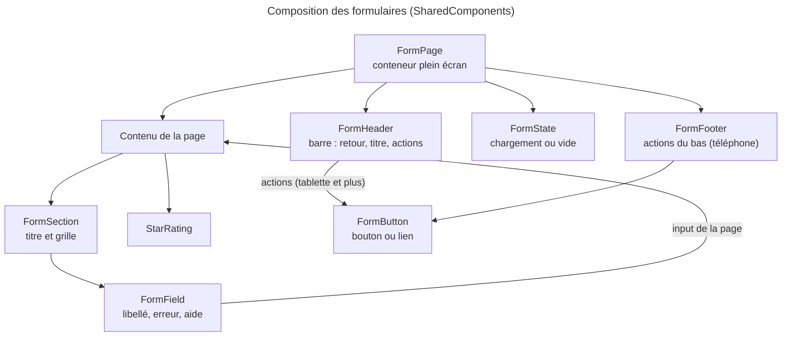

### Feuilles d'actions

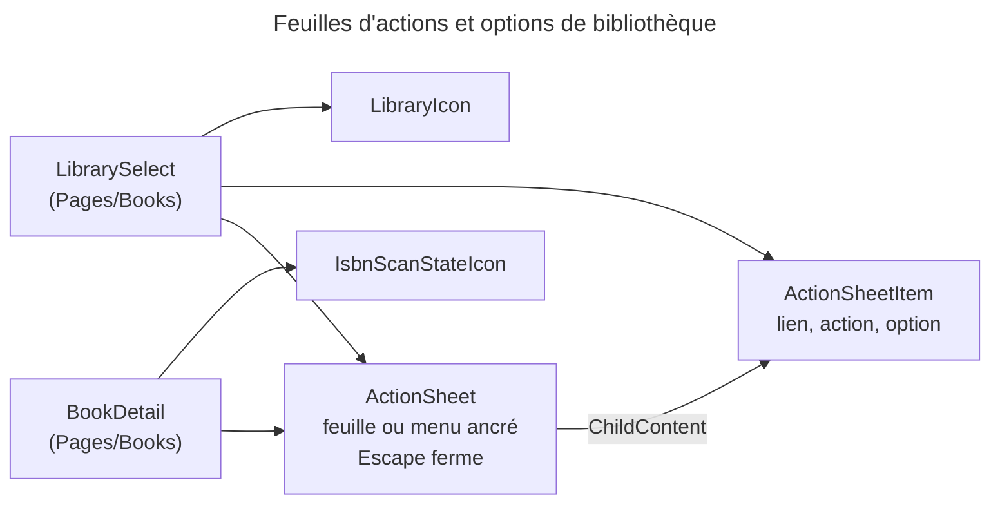

---

## ActionSheet

**Fichiers** : [`ActionSheet.razor`](../Web/Components/SharedComponents/ActionSheet.razor) · [`ActionSheet.razor.cs`](../Web/Components/SharedComponents/ActionSheet.razor.cs) · [`ActionSheet.razor.css`](../Web/Components/SharedComponents/ActionSheet.razor.css)

### 1. Vue d'ensemble

- **Nom** : `ActionSheet`
- **Description** : panneau modal qui s'affiche en bas de l'écran sur téléphone, et en menu ancré à son bouton sur tablette et grand écran (ADR-0021). Un panneau sans ancre est centré.
- **Emplacement** : `Web/Components/SharedComponents/ActionSheet.razor`, code-behind `ActionSheet.razor.cs`
- **Langage** : C# (`partial`) et Razor
- **Objectif** : fournir un menu d'actions ou d'options accessible (`role="dialog"`, `aria-modal`), avec le focus déplacé à l'ouverture et la fermeture à la touche Échap.

### 2. Éléments de code

- **Route** : aucune.
- **Paramètres** :

| Paramètre | Type | Défaut | Rôle |
|---|---|---|---|
| `Open` | `bool` | `false` | Affiche le panneau. |
| `AriaLabel` | `string` (`EditorRequired`) | `""` | Nom accessible du panneau. |
| `Title` | `string?` | — | Titre avec bouton de fermeture, affiché sur téléphone seulement. |
| `Anchor` | `PopupAnchor?` | — | Ancre du menu. Sans ancre, le panneau est centré. |
| `AlignEnd` | `bool` | `false` | Aligne le menu sur le bord droit de l'ancre. |
| `Header` | `RenderFragment?` | — | Contenu d'en-tête (ex. couverture et titre du livre). |
| `ChildContent` | `RenderFragment?` | — | Lignes du menu. |
| `OnClose` | `EventCallback` | — | Demande de fermeture (fond, bouton, Échap). |

- **Services injectés** : aucun.
- **Champs** : `_panel` (`ElementReference`), `_wasOpen`, `_focusPending`.
- **Méthodes** :

| Méthode | Lignes | Rôle |
|---|---|---|
| `OnParametersSet()` | L42 | Marque `_focusPending` à la transition fermé vers ouvert. |
| `OnAfterRenderAsync(bool)` | L49 | Donne le focus au panneau une seule fois à l'ouverture. |
| `CloseAsync()` | L58 | `OnClose.InvokeAsync()`. |
| `OnKeyDownAsync(KeyboardEventArgs)` | L60 | Échap appelle `CloseAsync`. |

- **Balisage** : fond cliquable (`action-sheet-backdrop`), panneau avec `PopupPlacement.Style(Anchor, AlignEnd)`, poignée, titre et bouton de fermeture `aria-label="Close"` (si `Title`), puis `Header` et `ChildContent`.

### 3. Dépendances

- **Internes** : `Web.Models` (`PopupAnchor`, `PopupPlacement`), `Web.Components.SharedComponents` (utilisé avec `ActionSheetItem` en `ChildContent`).
- **Externes** : `Microsoft.AspNetCore.Components`, `Microsoft.AspNetCore.Components.Web` (`KeyboardEventArgs`), `MudBlazor` (`MudIconButton`, `Icons`).

### 4. Relations

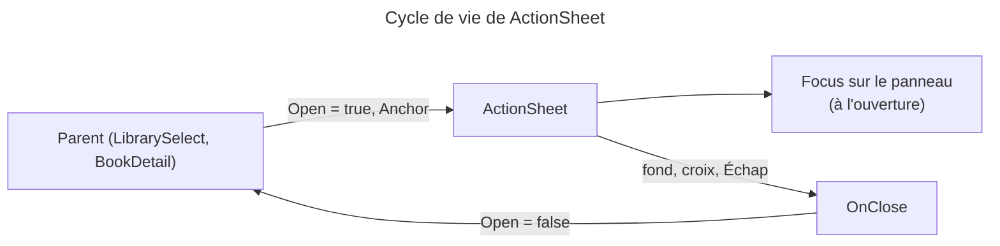

---

## ActionSheetItem

**Fichiers** : [`ActionSheetItem.razor`](../Web/Components/SharedComponents/ActionSheetItem.razor) · [`ActionSheetItem.razor.cs`](../Web/Components/SharedComponents/ActionSheetItem.razor.cs) · [`ActionSheetItem.razor.css`](../Web/Components/SharedComponents/ActionSheetItem.razor.css)

### 1. Vue d'ensemble

- **Nom** : `ActionSheetItem`
- **Description** : une ligne d'un `ActionSheet`. Elle est soit un lien (`Href`), soit un bouton qui appelle `OnClick`. Elle peut être une option sélectionnable (coche et `aria-pressed`) ou une action dangereuse (en rouge).
- **Emplacement** : `Web/Components/SharedComponents/ActionSheetItem.razor`, code-behind `ActionSheetItem.razor.cs`
- **Langage** : C# (`partial`) et Razor
- **Objectif** : une seule ligne réutilisable pour les liens, les actions et les choix de bibliothèque.

### 2. Éléments de code

- **Route** : aucune.
- **Paramètres** :

| Paramètre | Type | Défaut | Rôle |
|---|---|---|---|
| `Icon` | `string` (`EditorRequired`) | `""` | Nom de l'icône MudBlazor. |
| `Text` | `string` (`EditorRequired`) | `""` | Libellé. |
| `IconColor` | `string?` | — | Couleur de l'icône (couleur de la bibliothèque). |
| `Description` | `string?` | — | Texte secondaire sous le libellé. |
| `Href` | `string?` | — | Si défini, rend un lien `<a>`. |
| `OnClick` | `EventCallback` | — | Action du bouton. |
| `Selected` | `bool?` | `null` | `null` pour une action, `true` ou `false` pour une option. |
| `Danger` | `bool` | `false` | Style rouge (suppression). |
| `Disabled` | `bool` | `false` | Désactive le bouton. |

- **Services injectés** : aucun.
- **Propriétés calculées** :
  - `IconStyle` (L40) : `color: {IconColor}`, ou `null`.
  - `AriaPressed` (L42) : `"true"`, `"false"` ou `null` selon `Selected`.
  - `CssClass` (L49) : `action-sheet-item-selected`, `action-sheet-item-danger` ou `action-sheet-item`.
- **Méthodes** : aucune. Le code-behind ne contient que les paramètres et les propriétés calculées.

### 3. Dépendances

- **Internes** : `Web.Components.SharedComponents` (utilisé par `ActionSheet`).
- **Externes** : `Microsoft.AspNetCore.Components`, `MudBlazor` (`MudIcon`, `Icons`).

### 4. Relations

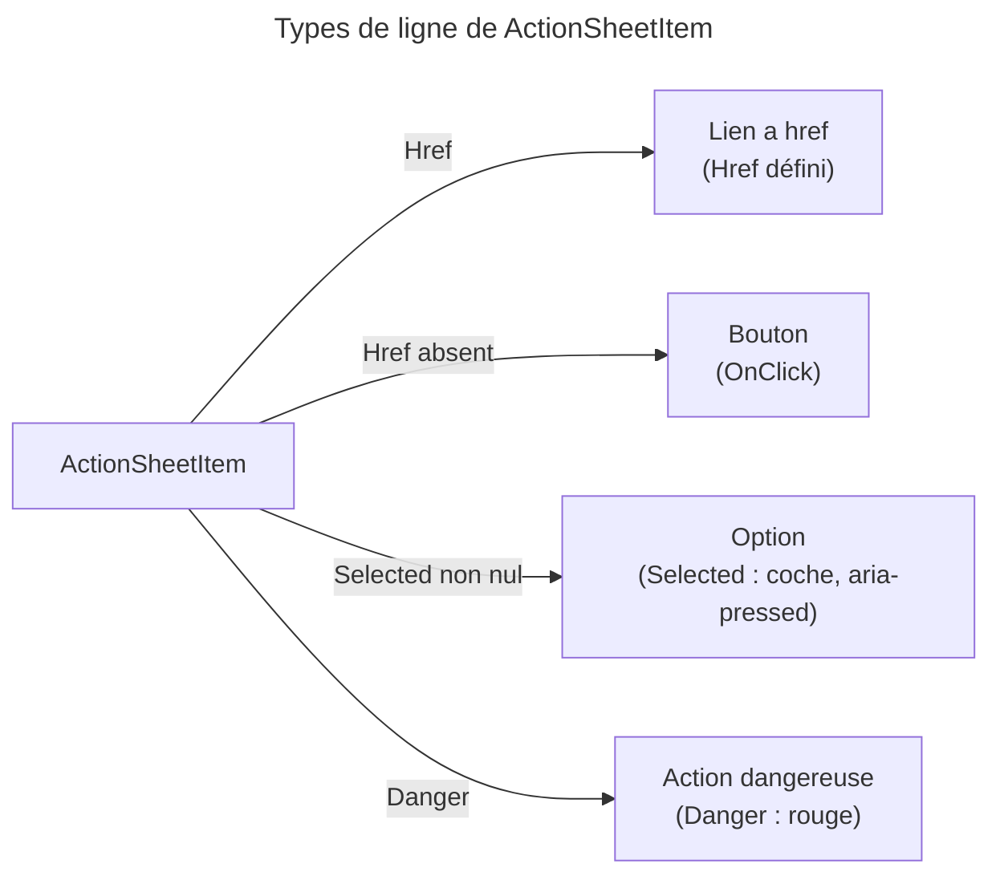

---

## FormButton

**Fichiers** : [`FormButton.razor`](../Web/Components/SharedComponents/FormButton.razor) · [`FormButton.razor.cs`](../Web/Components/SharedComponents/FormButton.razor.cs) · [`FormButton.razor.css`](../Web/Components/SharedComponents/FormButton.razor.css)

### 1. Vue d'ensemble

- **Nom** : `FormButton`
- **Description** : bouton d'un formulaire (ADR-0021). Il devient un lien si `Href` est défini, sinon un bouton. Il peut soumettre un formulaire placé hors de lui (`Form`), par exemple dans la barre d'en-tête.
- **Emplacement** : `Web/Components/SharedComponents/FormButton.razor`, code-behind `FormButton.razor.cs`
- **Langage** : C# (`partial`), enum `FormButtonVariant`, et Razor
- **Objectif** : fournir trois variantes visuelles (principale, contour, texte) et transmettre les attributs supplémentaires au bouton ou au lien.

### 2. Éléments de code

- **Route** : aucune.
- **Type** : `enum FormButtonVariant { Primary, Outlined, Text }`.
- **Paramètres** :

| Paramètre | Type | Défaut | Rôle |
|---|---|---|---|
| `Variant` | `FormButtonVariant` | `Primary` | Apparence. |
| `Href` | `string?` | — | Lien au lieu d'un bouton. |
| `Type` | `string` | `"button"` | `button` ou `submit`. |
| `Form` | `string?` | — | Identifiant du formulaire soumis (bouton hors formulaire). |
| `Disabled` | `bool` | `false` | Désactive le bouton. |
| `Icon` | `string?` | — | Icône placée avant le contenu. |
| `Class` | `string?` | — | Classe CSS ajoutée. |
| `OnClick` | `EventCallback<MouseEventArgs>` | — | Action. |
| `ChildContent` | `RenderFragment?` | — | Libellé. |
| `AdditionalAttributes` | `IReadOnlyDictionary<string, object>?` | — | Attributs non reconnus, capturés et transmis (`CaptureUnmatchedValues`). |

- **Services injectés** : aucun.
- **Méthodes** :

| Membre | Lignes | Rôle |
|---|---|---|
| `VariantClass(FormButtonVariant)` | L48 | Classe CSS de la variante (`internal static`). |
| `CssClass` | L55 | `form-button` + classe de variante + `Class` optionnelle. |
| `Content` (`RenderFragment`, dans le `@code`) | — | Icône optionnelle puis `ChildContent`. |

### 3. Dépendances

- **Internes** : aucune.
- **Externes** : `Microsoft.AspNetCore.Components`, `Microsoft.AspNetCore.Components.Web` (`MouseEventArgs`), `MudBlazor` (`MudIcon`).

### 4. Relations

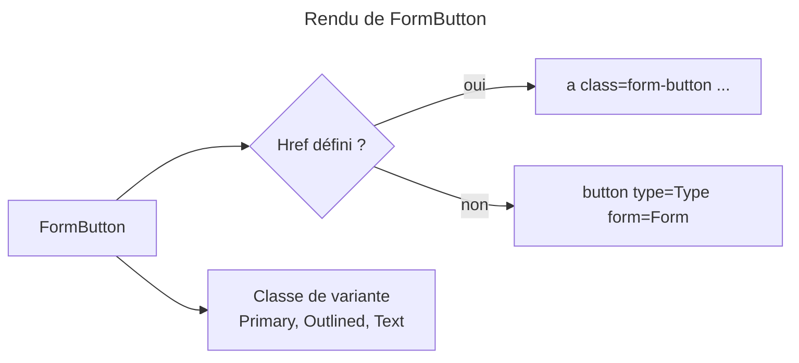

---

## FormField

**Fichiers** : [`FormField.razor`](../Web/Components/SharedComponents/FormField.razor) · [`FormField.razor.cs`](../Web/Components/SharedComponents/FormField.razor.cs) · [`FormField.razor.css`](../Web/Components/SharedComponents/FormField.razor.css)

### 1. Vue d'ensemble

- **Nom** : `FormField`
- **Description** : enveloppe d'un champ de formulaire. Elle affiche le libellé (suivi de « * » si obligatoire), le champ fourni en contenu, puis l'erreur et l'aide (A6).
- **Emplacement** : `Web/Components/SharedComponents/FormField.razor`, code-behind `FormField.razor.cs`
- **Langage** : C# (`partial`) et Razor
- **Objectif** : donner à chaque champ un libellé, un message d'erreur et une aide liés par des identifiants stables (`FormFieldIds.ErrorOf`, `FormFieldIds.HelpOf`). Le champ lui-même, avec `aria-invalid` et `aria-describedby`, est géré par la page.

### 2. Éléments de code

- **Route** : aucune.
- **Paramètres** :

| Paramètre | Type | Défaut | Rôle |
|---|---|---|---|
| `Id` | `string` (`EditorRequired`) | `""` | Identifiant de l'`input`, cible du `label for`. |
| `Label` | `string` (`EditorRequired`) | `""` | Libellé. |
| `Required` | `bool` | `false` | Ajoute « * » au libellé. |
| `Error` | `string?` | — | Message d'erreur, avec une classe `form-field-invalid`. |
| `Help` | `string?` | — | Texte d'aide. |
| `ChildContent` | `RenderFragment?` | — | Le champ. |

- **Services injectés** : aucun.
- **Méthodes** : aucune. Le code-behind ne contient que les paramètres.

### 3. Dépendances

- **Internes** : `Web.Models` (`FormFieldIds`).
- **Externes** : `Microsoft.AspNetCore.Components`, `MudBlazor` (`MudIcon`, `Icons`).

### 4. Relations

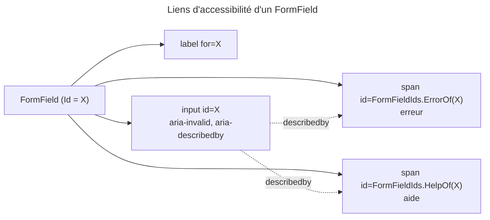

---

## FormFooter

**Fichiers** : [`FormFooter.razor`](../Web/Components/SharedComponents/FormFooter.razor) · [`FormFooter.razor.cs`](../Web/Components/SharedComponents/FormFooter.razor.cs) · [`FormFooter.razor.css`](../Web/Components/SharedComponents/FormFooter.razor.css)

### 1. Vue d'ensemble

- **Nom** : `FormFooter`
- **Description** : conteneur des actions d'un formulaire sur téléphone, maintenu en bas de l'écran. À partir de la tablette, ces actions sont dans `FormHeader`.
- **Emplacement** : `Web/Components/SharedComponents/FormFooter.razor`, code-behind `FormFooter.razor.cs`
- **Langage** : C# (`partial`) et Razor
- **Objectif** : fournir un emplacement fixe aux boutons d'action d'un formulaire sur petit écran.

### 2. Éléments de code

- **Route** : aucune.
- **Paramètres** : `ChildContent` (`RenderFragment?`).
- **Services injectés** : aucun.
- **Méthodes** : aucune.
- **Balisage** : `
@ChildContent
`.

### 3. Dépendances

- **Internes** : aucune. Utilisé par `AddBookForm` et `EditBook` via `BookFormLayout.Footer`.
- **Externes** : `Microsoft.AspNetCore.Components`.

### 4. Relations

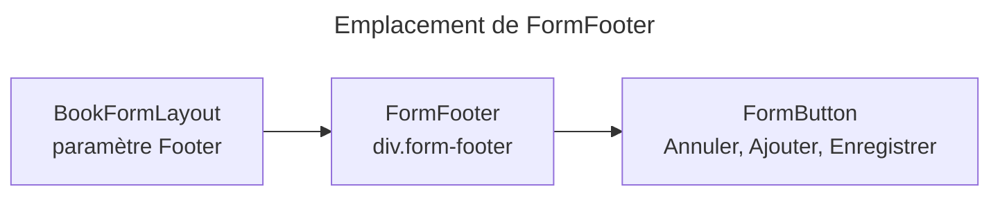

---

## FormHeader

**Fichiers** : [`FormHeader.razor`](../Web/Components/SharedComponents/FormHeader.razor) · [`FormHeader.razor.cs`](../Web/Components/SharedComponents/FormHeader.razor.cs) · [`FormHeader.razor.css`](../Web/Components/SharedComponents/FormHeader.razor.css)

### 1. Vue d'ensemble

- **Nom** : `FormHeader`
- **Description** : barre d'une page de formulaire. Elle contient un bouton retour, le titre, un sous-titre et, à partir de la tablette, les actions du formulaire (ADR-0021).
- **Emplacement** : `Web/Components/SharedComponents/FormHeader.razor`, code-behind `FormHeader.razor.cs`
- **Langage** : C# (`partial`) et Razor
- **Objectif** : fournir une barre de navigation cohérente. Le retour est un lien, ou un bouton si un gestionnaire `OnBack` est fourni.

### 2. Éléments de code

- **Route** : aucune.
- **Paramètres** :

| Paramètre | Type | Défaut | Rôle |
|---|---|---|---|
| `Title` | `string` (`EditorRequired`) | `""` | Titre `h1`. |
| `Subtitle` | `string?` | — | Sous-titre, affiché seulement s'il est renseigné. |
| `BackHref` | `string` | `"/libraries/list"` | Adresse du retour (lien). |
| `OnBack` | `EventCallback` | — | Retour sans quitter la page (bouton). Si défini, il remplace le lien. |
| `ChildContent` | `RenderFragment?` | — | Actions, affichées à partir de la tablette. |

- **Services injectés** : aucun.
- **Méthodes** : aucune. La condition `OnBack.HasDelegate` choisit entre bouton et lien.

### 3. Dépendances

- **Internes** : `Web.Components.SharedComponents` (`FormButton` placé dans `ChildContent` par les pages).
- **Externes** : `Microsoft.AspNetCore.Components`, `MudBlazor` (`MudIcon`, `Icons`).

### 4. Relations

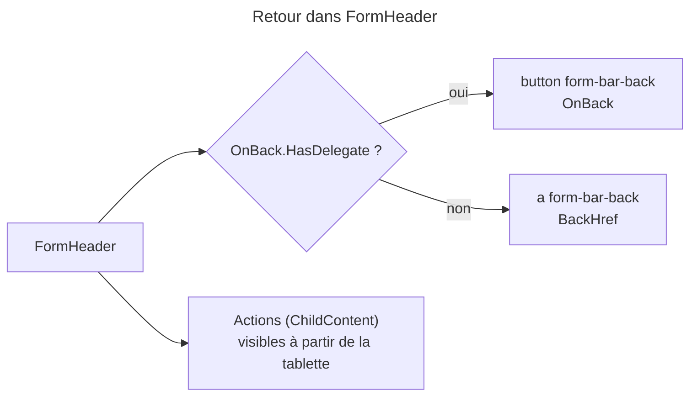

---

## FormPage

**Fichiers** : [`FormPage.razor`](../Web/Components/SharedComponents/FormPage.razor) · [`FormPage.razor.cs`](../Web/Components/SharedComponents/FormPage.razor.cs) · [`FormPage.razor.css`](../Web/Components/SharedComponents/FormPage.razor.css)

### 1. Vue d'ensemble

- **Nom** : `FormPage`
- **Description** : conteneur plein écran d'un formulaire ou d'une étape de formulaire (ADR-0021). L'en-tête, le contenu et le pied sont empilés.
- **Emplacement** : `Web/Components/SharedComponents/FormPage.razor`, code-behind `FormPage.razor.cs`
- **Langage** : C# (`partial`) et Razor
- **Objectif** : donner à toutes les pages de formulaire la même mise en page verticale.

### 2. Éléments de code

- **Route** : aucune.
- **Paramètres** :

| Paramètre | Type | Rôle |
|---|---|---|
| `Class` | `string?` | Classe CSS ajoutée à `form-page`. |
| `ChildContent` | `RenderFragment?` | Contenu de la page. |

- **Services injectés** : aucun.
- **Méthodes** : aucune.
- **Balisage** : `
@ChildContent
`.

### 3. Dépendances

- **Internes** : utilisé par `AddBookForm`, `AddBookManual` et `EditBook`.
- **Externes** : `Microsoft.AspNetCore.Components`.

### 4. Relations

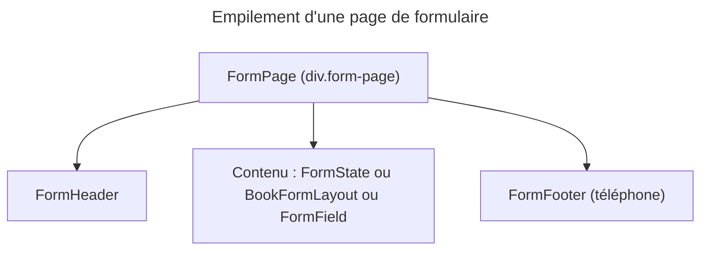

---

## FormSection

**Fichiers** : [`FormSection.razor`](../Web/Components/SharedComponents/FormSection.razor) · [`FormSection.razor.cs`](../Web/Components/SharedComponents/FormSection.razor.cs) · [`FormSection.razor.css`](../Web/Components/SharedComponents/FormSection.razor.css)

### 1. Vue d'ensemble

- **Nom** : `FormSection`
- **Description** : groupe de champs avec un titre et une note facultative (par exemple « 2 readings »). Sur téléphone, une colonne. À partir de la tablette, deux colonnes.
- **Emplacement** : `Web/Components/SharedComponents/FormSection.razor`, code-behind `FormSection.razor.cs`
- **Langage** : C# (`partial`) et Razor
- **Objectif** : structurer les formulaires longs. La section est une `<section>` étiquetée par son titre (`aria-labelledby`).

### 2. Éléments de code

- **Route** : aucune.
- **Paramètres** :

| Paramètre | Type | Défaut | Rôle |
|---|---|---|---|
| `Id` | `string` (`EditorRequired`) | `""` | Identifiant du titre, qui étiquette la section. |
| `Title` | `string` (`EditorRequired`) | `""` | Titre `h2`. |
| `Note` | `string?` | — | Texte court à côté du titre. |
| `ChildContent` | `RenderFragment?` | — | Champs, dans une grille `form-grid`. |

- **Services injectés** : aucun.
- **Méthodes** : aucune.
- **Classes de grille** : `form-pair` (deux champs côte à côte sur téléphone) et `form-wide` (occupe toute la largeur). Elles sont appliquées par les pages.

### 3. Dépendances

- **Internes** : utilisé par `BookFields` (sections « Book » et « Details ») et `EditBook` (section « Readings »).
- **Externes** : `Microsoft.AspNetCore.Components`.

### 4. Relations

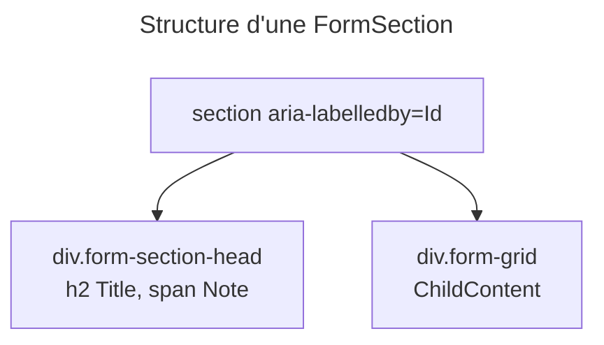

---

## FormState

**Fichiers** : [`FormState.razor`](../Web/Components/SharedComponents/FormState.razor) · [`FormState.razor.cs`](../Web/Components/SharedComponents/FormState.razor.cs) · [`FormState.razor.css`](../Web/Components/SharedComponents/FormState.razor.css)

### 1. Vue d'ensemble

- **Nom** : `FormState`
- **Description** : état d'une page de formulaire quand elle n'affiche pas encore de formulaire. Il peut être un chargement (spinner et texte) ou un état vide (icône, titre, texte et action de sortie).
- **Emplacement** : `Web/Components/SharedComponents/FormState.razor`, code-behind `FormState.razor.cs`
- **Langage** : C# (`partial`) et Razor
- **Objectif** : informer l'utilisateur sans laisser une page vide, avec `role="status"` pendant le chargement.

### 2. Éléments de code

- **Route** : aucune.
- **Paramètres** :

| Paramètre | Type | Défaut | Rôle |
|---|---|---|---|
| `Loading` | `bool` | `false` | Vrai : spinner et `Text`. Faux : icône, `Title`, `Text`. |
| `Icon` | `string` | `""` | Icône de l'état vide. |
| `Title` | `string?` | — | Titre de l'état vide. |
| `Text` | `string?` | — | Texte (chargement ou état vide). |
| `ChildContent` | `RenderFragment?` | — | Action de sortie, par exemple un bouton « Back to libraries ». |

- **Services injectés** : aucun.
- **Méthodes** : aucune.

### 3. Dépendances

- **Internes** : utilisé par `AddBookForm` (recherche de l'ISBN) et `EditBook` (chargement ou livre introuvable).
- **Externes** : `Microsoft.AspNetCore.Components`, `MudBlazor` (`MudProgressCircular`, `MudIcon`).

### 4. Relations

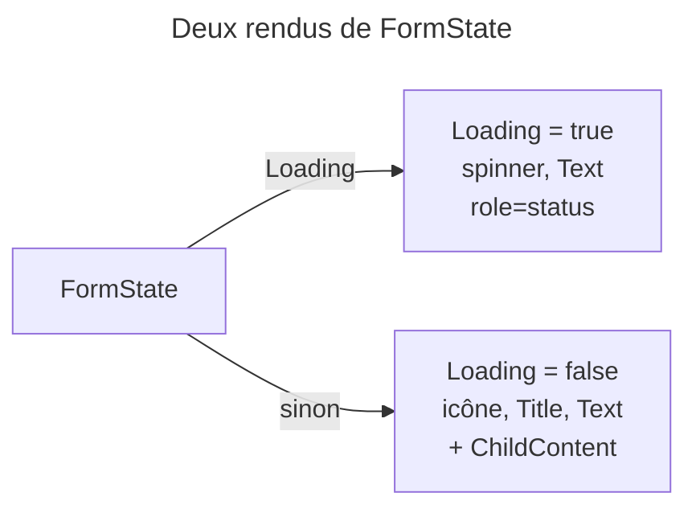

---

## ImportJobCard

**Fichiers** : [`ImportJobCard.razor`](../Web/Components/SharedComponents/ImportJobCard.razor) · [`ImportJobCard.razor.cs`](../Web/Components/SharedComponents/ImportJobCard.razor.cs) · [`ImportJobCard.razor.css`](../Web/Components/SharedComponents/ImportJobCard.razor.css)

### 1. Vue d'ensemble

- **Nom** : `ImportJobCard`
- **Description** : carte d'un travail d'import (fichier, taille, date, durée, statut, progression, erreur). Elle propose d'ouvrir le livre importé, de le supprimer une fois terminé, ou de marquer comme échoué un import bloqué.
- **Emplacement** : `Web/Components/SharedComponents/ImportJobCard.razor`, code-behind `ImportJobCard.razor.cs`
- **Langage** : C# (`partial`) et Razor
- **Objectif** : afficher l'état d'un import à partir d'un `ImportJobViewModel` déjà calculé, sans logique métier dans la vue.

### 2. Éléments de code

- **Route** : aucune.
- **Paramètres** :

| Paramètre | Type | Rôle |
|---|---|---|
| `Job` | `ImportJobViewModel` (`EditorRequired`) | Données d'affichage du travail. |
| `OnDelete` | `EventCallback<Guid>` | Supprime le travail (affiché si `IsTerminal`). |
| `OnForceFail` | `EventCallback<Guid>` | Marque l'import comme échoué (affiché si bloqué). |

- **Services injectés** : aucun.
- **Propriétés calculées** :
  - `IsStuck` (L18) : vrai si le travail n'est pas terminé et si son statut n'est pas `Pending`.
  - `StatusIcon` (L20) : icône selon la classe CSS de statut (`status-pending`, `status-completed`, `status-failed`, sinon synchronisation).
- **Méthodes** : aucune.
- **Champs affichés** : `Job.OriginalFileName`, `Job.FileSizeDisplay`, `Job.CreatedAt` (heure locale, format `dd/MM HH:mm`), `Job.DurationDisplay`, `Job.StatusDisplay`, `Job.StepDisplay`, `Job.ProgressPercent`, `Job.ConversionDetail`, `Job.FailureDisplay`, `Job.FailedStepDisplay`, `Job.BookHref`, `Job.IsTerminal`, `Job.Id`.

### 3. Dépendances

- **Internes** : `Web.Models` (`ImportJobViewModel`, `BookText.Join`). Ce composant n'est utilisé par aucune page du périmètre Books.
- **Externes** : `Microsoft.AspNetCore.Components`, `MudBlazor` (`MudIcon`, `MudIconButton`, `MudTooltip`, `Icons`).

### 4. Relations

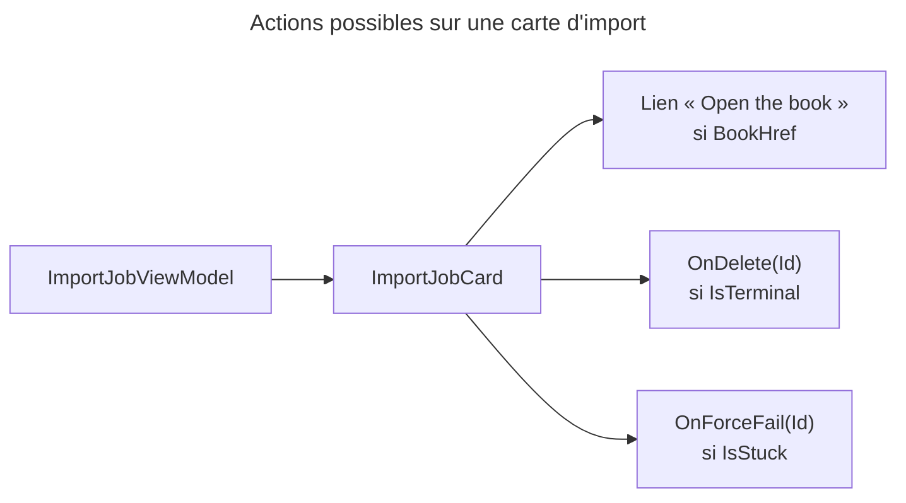

---

## IsbnScanStateIcon

**Fichiers** : [`IsbnScanStateIcon.razor`](../Web/Components/SharedComponents/IsbnScanStateIcon.razor) · [`IsbnScanStateIcon.razor.cs`](../Web/Components/SharedComponents/IsbnScanStateIcon.razor.cs) · [`IsbnScanStateIcon.razor.css`](../Web/Components/SharedComponents/IsbnScanStateIcon.razor.css)

### 1. Vue d'ensemble

- **Nom** : `IsbnScanStateIcon`
- **Description** : icône d'état de l'ISBN d'un livre. Si l'ISBN est connu, un QR code avec l'ISBN dans une info-bulle. Sinon, un badge qui indique l'état (pas d'ISBN, plusieurs candidats, lecture en attente) avec une info-bulle.
- **Emplacement** : `Web/Components/SharedComponents/IsbnScanStateIcon.razor`, code-behind `IsbnScanStateIcon.razor.cs`
- **Langage** : C# (`partial`) et Razor
- **Objectif** : signaler visuellement l'état de l'ISBN, sur la fiche du livre ou par-dessus une couverture (`OnDarkBackground`).

### 2. Éléments de code

- **Route** : aucune.
- **Paramètres** :

| Paramètre | Type | Défaut | Rôle |
|---|---|---|---|
| `State` | `IsbnScanState` (`Domain.Books`) | — | État de l'ISBN. |
| `CandidateCount` | `int` | `0` | Nombre d'ISBN candidats trouvés sur les pages. |
| `Isbn` | `string?` | — | ISBN affiché dans l'info-bulle. |
| `HideWhenKnown` | `bool` | `false` | Ne rien afficher quand l'ISBN est connu (couverture). |
| `OnDarkBackground` | `bool` | `false` | Couleur du QR code adaptée à un fond sombre. |
| `Size` | `Size` (MudBlazor) | `Size.Small` | Taille de l'icône. |
| `Class` | `string?` | — | Classe CSS ajoutée. |

- **Services injectés** : aucun.
- **Méthodes** : aucune. Le rendu s'appuie sur `IsbnScanStateDisplay` (`Label`, `BadgeContent`, `BadgeIcon`, `BadgeColor`).

### 3. Dépendances

- **Internes** : `Domain.Books` (`IsbnScanState`), `Web.Models` (`IsbnScanStateDisplay`). Utilisé par `BookDetail` et la couverture du livre.
- **Externes** : `Microsoft.AspNetCore.Components`, `MudBlazor` (`MudTooltip`, `MudBadge`, `MudIcon`, `Size`, `Color`, `Placement`).

### 4. Relations

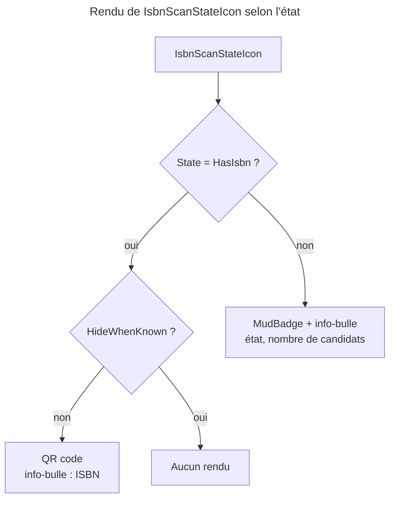

---

## LibraryIcon

**Fichiers** : [`LibraryIcon.razor`](../Web/Components/SharedComponents/LibraryIcon.razor) · [`LibraryIcon.razor.cs`](../Web/Components/SharedComponents/LibraryIcon.razor.cs) · [`LibraryIcon.razor.css`](../Web/Components/SharedComponents/LibraryIcon.razor.css)

### 1. Vue d'ensemble

- **Nom** : `LibraryIcon`
- **Description** : icône d'une bibliothèque, posée sur un fond teinté de sa couleur. Si la couleur n'est pas donnée, elle est héritée de `--library-color`.
- **Emplacement** : `Web/Components/SharedComponents/LibraryIcon.razor`, code-behind `LibraryIcon.razor.cs`
- **Langage** : C# (`partial`) et Razor
- **Objectif** : afficher l'identité visuelle d'une bibliothèque de façon uniforme (36 px, ou 40 px avec `Large`). Le composant est décoratif (`aria-hidden`).

### 2. Éléments de code

- **Route** : aucune.
- **Paramètres** :

| Paramètre | Type | Défaut | Rôle |
|---|---|---|---|
| `Icon` | `string` (`EditorRequired`) | `""` | Nom Material de l'icône, par exemple `CollectionsBookmark`. |
| `Color` | `string?` | — | Couleur, placée dans la variable `--library-color`. |
| `Large` | `bool` | `false` | Version 40 px. |

- **Services injectés** : aucun.
- **Méthodes** : aucune. Le nom est résolu par `LibraryIcons.Resolve(Icon)`.

### 3. Dépendances

- **Internes** : `Web.Models` (`LibraryIcons`). Utilisé par `LibrarySelect`.
- **Externes** : `Microsoft.AspNetCore.Components`, `MudBlazor` (`MudIcon`).

### 4. Relations

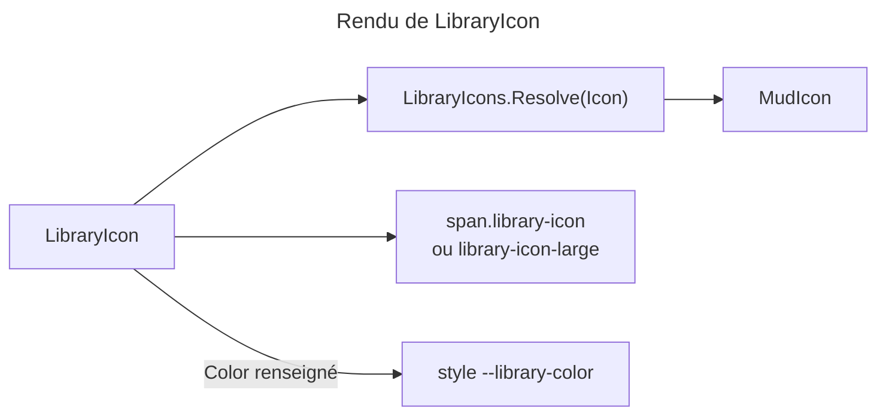

---

## RedirectToLogin

**Fichiers** : [`RedirectToLogin.razor`](../Web/Components/SharedComponents/RedirectToLogin.razor) (pas de code-behind)

### 1. Vue d'ensemble

- **Nom** : `RedirectToLogin`
- **Description** : composant sans rendu qui redirige l'utilisateur vers `/login` dès son initialisation.
- **Emplacement** : `Web/Components/SharedComponents/RedirectToLogin.razor`
- **Langage** : Razor (bloc `@code` inline)
- **Objectif** : envoyer vers la connexion un utilisateur non authentifié, sans afficher de contenu. L'emplacement exact de son utilisation n'est pas dans le périmètre Books.

### 2. Éléments de code

- **Route** : aucune (pas de `@page`).
- **Paramètres** : aucun.
- **Services injectés** : `@inject NavigationManager NavigationManager`.
- **Méthodes** :

| Méthode | Rôle |
|---|---|
| `OnInitialized()` | Appelle `NavigationManager.NavigateTo("/login")`. |

- **Balisage** : aucun.

### 3. Dépendances

- **Internes** : aucune.
- **Externes** : `Microsoft.AspNetCore.Components` (`NavigationManager`).

### 4. Relations

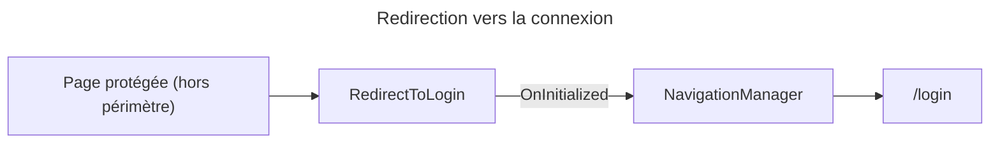

---

## StarRating

**Fichiers** : [`StarRating.razor`](../Web/Components/SharedComponents/StarRating.razor) · [`StarRating.razor.cs`](../Web/Components/SharedComponents/StarRating.razor.cs) · [`StarRating.razor.css`](../Web/Components/SharedComponents/StarRating.razor.css)

### 1. Vue d'ensemble

- **Nom** : `StarRating`
- **Description** : note sur cinq étoiles. En mode saisie, choisir l'étoile déjà active la remet à zéro (la note est facultative). En mode lecture seule, il affiche la note d'une lecture.
- **Emplacement** : `Web/Components/SharedComponents/StarRating.razor`, code-behind `StarRating.razor.cs`
- **Langage** : C# (`partial`) et Razor
- **Objectif** : saisir ou afficher une note accessible (boutons `aria-pressed`, libellés « 1 star », « N stars », et `role="img"` avec « Rated N out of 5 » en lecture seule).

### 2. Éléments de code

- **Route** : aucune.
- **Paramètres** :

| Paramètre | Type | Défaut | Rôle |
|---|---|---|---|
| `Value` | `int` | `0` | Note choisie (0 si aucune). |
| `ValueChanged` | `EventCallback<int>` | — | Notifie la nouvelle note. |
| `LabelledBy` | `string?` | — | Identifiant du texte qui nomme le groupe. |
| `ReadOnly` | `bool` | `false` | Affichage seul. |

- **Services injectés** : aucun.
- **Propriétés et méthodes** :

| Membre | Lignes | Rôle |
|---|---|---|
| `RatingLabel` | L22 | « Rated {Value} out of 5 ». |
| `ChooseAsync(int)` | L24 | Renvoie `0` si la valeur choisie est déjà la note, sinon la valeur choisie. Appelle `ValueChanged`. |

### 3. Dépendances

- **Internes** : utilisé par `AddBookForm` (étape « Livre trouvé ») et `EditBook` (lectures, en lecture seule). `BookDetail` a sa propre fonction `Stars` et n'utilise pas ce composant.
- **Externes** : `Microsoft.AspNetCore.Components`, `MudBlazor` (`MudIcon`, `Icons`).

### 4. Relations

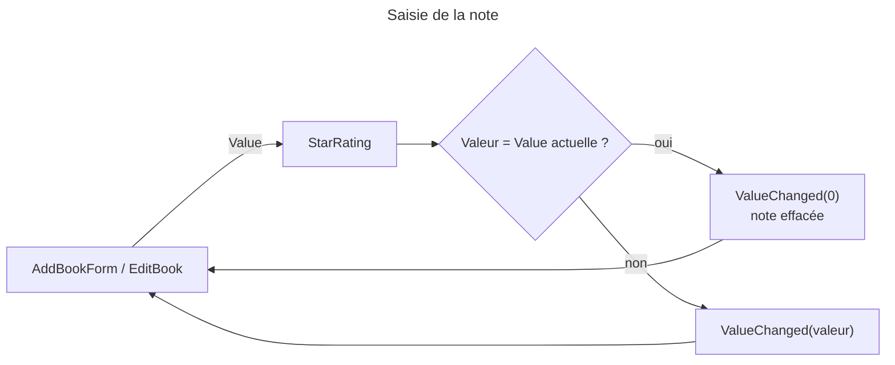

---

## Notes

- **Périmètre** : 14 composants, 27 fichiers `.razor` et `.razor.cs`. Les 13 feuilles de style `.razor.css` sont listées dans chaque section mais non détaillées.
- **Conventions relevées** : les composants partagés n'ont pas de `@rendermode`. Ils héritent du mode de la page qui les contient. Ils ne contiennent pas de logique métier. Les paramètres sont documentés par des commentaires qui renvoient aux identifiants de conception (A3, A6, ADR-0021).
- **Points d'attention** : aucune anomalie bloquante n'a été relevée dans ce périmètre. `ImportJobCard`, `RedirectToLogin` et `ActionSheetItem` n'ont pas de logique propre à vérifier. Leurs utilisateurs hors périmètre Books ne sont pas analysés ici.
