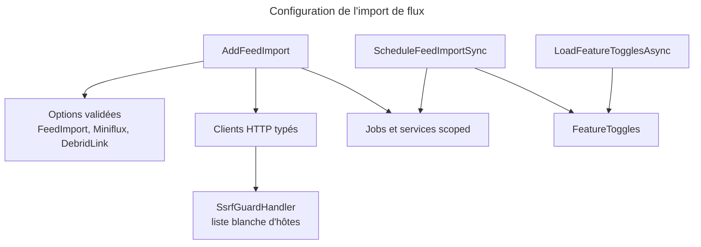
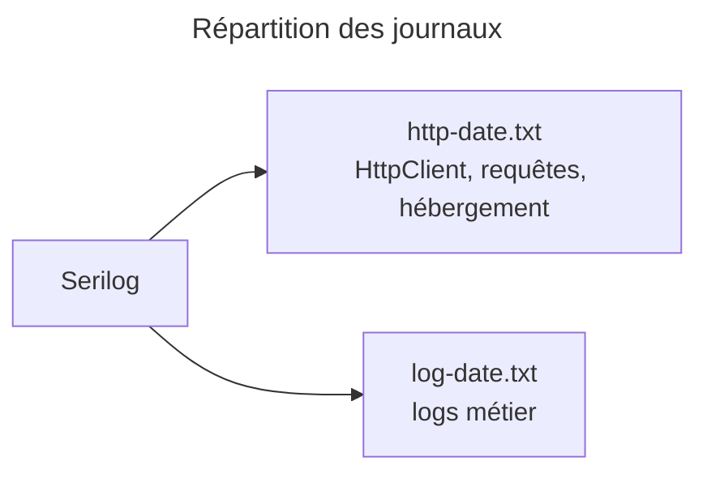

# C4 Code Level : Web/Configuration

## 1. Vue d'ensemble

- **Nom** : Web.Configuration (configuration et câblage des options)
- **Description** : classes d'options liées à la section `appsettings`, configuration de la journalisation Serilog, enregistrement des clients HTTP et des services d'import de flux, et chargement des bascules de fonctionnalités au démarrage.
- **Emplacement relatif** : `Web/Configuration/`
- **Langage** : C# (.NET 10)
- **Objectif** : isoler la configuration technique de `Program.cs` et appliquer la liste blanche SSRF à chaque client HTTP sortant.

## 2. Éléments de code

### 2.1 `Auth0Configuration` (`Web/Configuration/Auth0Configuration.cs`, lignes 3 à 7)

```csharp
public sealed class Auth0Configuration
{
    public required string Domain { get; init; }
    public required string ClientId { get; init; }
}
```

- **Description** : options de la section `Auth0`. Liée dans `Program.cs` (lignes 182-188), avec validation de `ClientId` et `Domain`.
- **Dépendances** : aucune.

### 2.2 `LocalStorageConfiguration` (`Web/Configuration/LocalStorageConfiguration.cs`, lignes 3 à 6)

```csharp
public sealed class LocalStorageConfiguration
{
    public required string RootPath { get; init; }
}
```

- **Description** : racine du stockage local des livres (section `LocalStorage`). Validée dans `Program.cs` : non vide, absolue, existante.
- **Dépendances** : aucune.

### 2.3 `LoggingConfiguration` (`Web/Configuration/LoggingConfiguration.cs`, lignes 8 à 53)

```csharp
internal static class LoggingConfiguration
internal static bool IsHttp(LogEvent logEvent)                                                          // ligne 22
internal static LogEventLevel GetRequestLevel(HttpContext httpContext, Exception? exception)            // lignes 25-35
internal static LoggerConfiguration WriteToSplitFiles(this LoggerConfiguration configuration,
    string directory = "log")                                                                           // lignes 39-52
```

- **Description** :
  - `GetRequestLevel` : niveau des journaux de requêtes. `Error` si exception ou statut 5xx ; `Verbose` pour `/health` ; `Information` sinon.
  - `WriteToSplitFiles` : deux sinks fichiers rotatifs par jour. `http-<date>.txt` reçoit `System.Net.Http.HttpClient`, `Serilog.AspNetCore.RequestLoggingMiddleware` et `Microsoft.AspNetCore.Hosting.Diagnostics` ; `log-<date>.txt` reçoit le reste.
  - `OutputTemplate` (ligne 11) : horodatage, niveau sur 3 caractères, `SourceContext`, message.
- **Dépendances** : Serilog (`LoggerConfiguration`, `Matching`, `LogEvent`, `RollingInterval`), `Microsoft.AspNetCore.Http`.

### 2.4 `FeedImportConfiguration` (`Web/Configuration/FeedImportConfiguration.cs`, lignes 11 à 134)

```csharp
public static class FeedImportConfiguration
public static IServiceCollection AddFeedImport(this IServiceCollection services, IConfiguration configuration)  // lignes 13-113
public static void ScheduleFeedImportSync(this IServiceProvider services)                                       // lignes 115-120
private static bool IsHttpUri(Uri? uri)                                                                          // lignes 122-123
private static Uri WithTrailingSlash(Uri uri)                                                                    // lignes 125-133
```

- **Description** : enregistre l'import de flux (Miniflux, Debrid-Link, pages d'articles et téléchargements) et sa planification.
  - Options `FeedImport`, `Miniflux` et `DebridLink` validées au démarrage : `UserEmail` requis si activé, intervalle de synchronisation, URL absolue HTTP(S), clé API et nom de catégorie requis si activé, URL Debrid-Link en HTTPS.
  - `IMinifluxClient` / `MinifluxClient` : URL de base avec `X-Auth-Token`, délai 30 s, liste blanche sur le seul hôte Miniflux (HTTP accepté pour le réseau Docker interne).
  - `IArticlePageFetcher` / `ArticlePageFetcher` : hôtes `FeedImport:AllowedSourceHosts` (sous-domaines inclus, HTTPS seulement), délai 30 s.
  - `IDebridLinkClient` / `DebridLinkClient` : hôte Debrid-Link unique, en-tête `Authorization: Bearer`, délai 60 s.
  - `IFeedImportFileDownloader` / `FeedImportFileDownloader` : hôtes `FeedImport:AllowedDownloadHosts` et `DebridLink:DownloadHosts`, délai 30 min.
  - Services scoped : `FeedImportSyncJob`, `FeedImportDownloadJob`, `FeedImportHandlers`, `FeedImportNotifier`, `IFeedImportService` / `FeedImportService`.
  - `ScheduleFeedImportSync` lit `FeatureToggle.FeedImport` et délègue à `FeedImportSyncJob.Schedule(...)`.
- **Dépendances** : `Application.FeedImports`, `Application.Interfaces`, `Domain.Settings` (`FeedImportSettings`, `MinifluxSettings`, `DebridLinkSettings`), `Hangfire` (`IRecurringJobManager`), `Web.Infrastructure` (clients, `SsrfGuardHandler`), `Web.Services` (`FeedImportSyncJob`, hors périmètre).

### 2.5 `FeatureToggleConfiguration` (`Web/Configuration/FeatureToggleConfiguration.cs`, lignes 6 à 15)

```csharp
public static class FeatureToggleConfiguration
public static async Task LoadFeatureTogglesAsync(this IServiceProvider services)   // lignes 9-14
```

- **Description** : charge les valeurs choisies sur la page Paramètres (`IFeatureToggleOverrideRepository.GetAllAsync()`) dans le singleton `FeatureToggles` avant toute lecture.
- **Dépendances** : `Application.Interfaces`, `Application.Settings` (`FeatureToggles`).

## 3. Dépendances

### 3.1 Internes

- `Web.Infrastructure` : `SsrfGuardHandler`, `MinifluxClient`, `DebridLinkClient`, `ArticlePageFetcher`, `FeedImportFileDownloader`.
- `Web.Services` : `FeedImportSyncJob` (hors périmètre).
- `Web/Program.cs` : appelle `AddFeedImport`, `LoggingConfiguration`, `LoadFeatureTogglesAsync`, `ScheduleFeedImportSync`.
- `Application` et `Domain` : interfaces, options et `FeatureToggle`.

### 3.2 Externes

- Microsoft.Extensions.Options, Microsoft.Extensions.Http (`AddHttpClient`).
- Serilog et Serilog.Filters.
- Hangfire.Core (`IRecurringJobManager`).

## 4. Relations





## 5. Remarques

- Les hôtes de la liste blanche sont codés en dur dans `Program.cs` pour OpenLibrary, BnF, Google Books, Bedetheque, SerpApi et Bubble. Pour les flux, ils viennent de la configuration.
- `LoggingConfiguration.WriteToSplitFiles` écrit par défaut dans `log` relatif au répertoire de travail.
