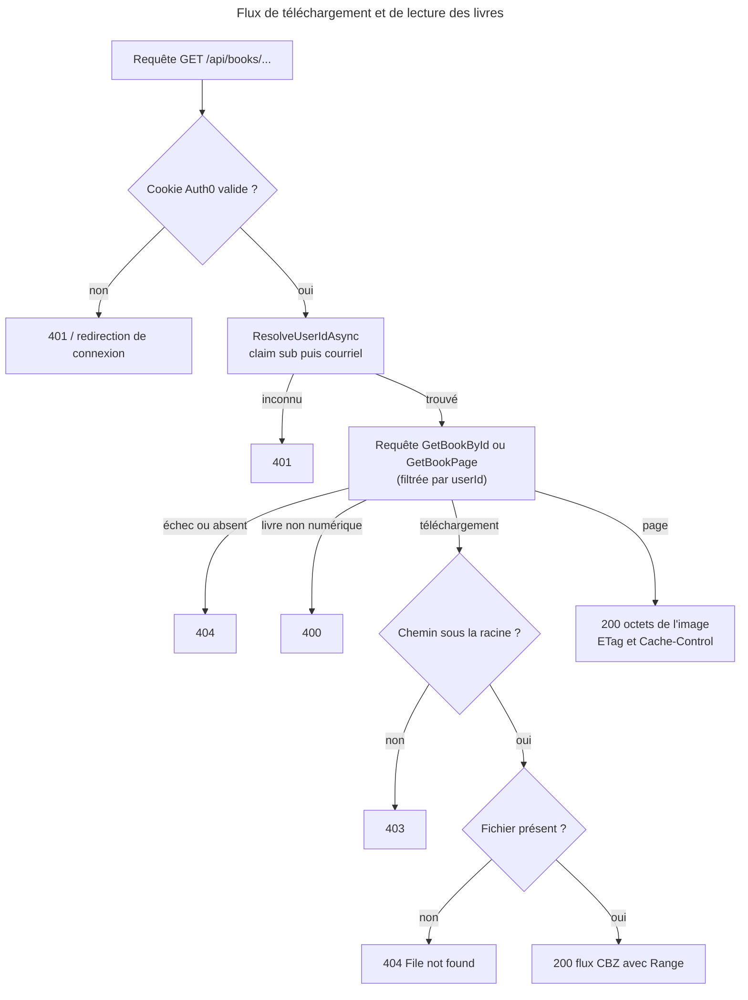
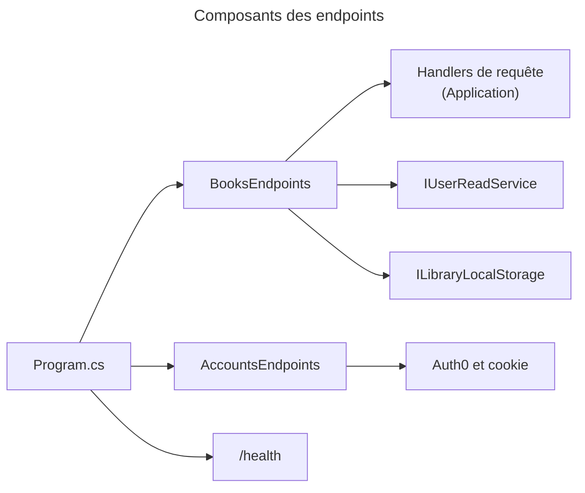

# C4 Code Level : Web/EndPoints

## 1. Vue d'ensemble

- **Nom** : Web.EndPoints (endpoints HTTP minimaux)
- **Description** : regroupe les endpoints HTTP hors composants Razor. Ils servent les téléchargements de livres, les pages de bande dessinée (CBZ/CBR) et les routes d'authentification Auth0.
- **Emplacement relatif** : `Web/EndPoints/`
- **Langage** : C# (API minimales ASP.NET Core, méthodes d'extension sur `WebApplication`)
- **Objectif** : fournir des routes HTTP stables pour le lecteur et la connexion/déconnexion. Les endpoints `/health` et `/hangfire` sont déclarés dans `Web/Program.cs` et sont décrits ici pour la spécification.

## 2. Éléments de code

### 2.1 `BooksEndpoints` (`Web/EndPoints/BooksEndpoints.cs`, lignes 13 à 120)

```csharp
internal static class BooksEndpoints
internal static void RegisterBooksEndpoints(this WebApplication app)                       // lignes 15-19
private static async Task<IResult> DownloadBookAsync(Guid bookId, ClaimsPrincipal user,
    IQueryHandler<GetBookByIdQuery, Book> getBookHandler, IUserReadService userReadService,
    ILibraryLocalStorage libraryStorage, CancellationToken ct)                             // lignes 21-63
internal static async Task<IResult> GetBookPageAsync(Guid bookId, int pageIndex, ClaimsPrincipal user,
    HttpContext httpContext, IQueryHandler<GetBookPageQuery, ComicPage> getPageHandler,
    IUserReadService userReadService, CancellationToken ct)                                 // lignes 65-93
internal static async Task<Guid?> ResolveUserIdAsync(ClaimsPrincipal user,
    IUserReadService userReadService, CancellationToken ct)                                 // lignes 97-119
```

- **Description** : déclare les deux routes de lecture de livres et la résolution de l'utilisateur applicatif à partir des claims.
- **Emplacement** : lignes 13 à 120.
- **Dépendances** : `IQueryHandler<GetBookByIdQuery, Book>`, `IQueryHandler<GetBookPageQuery, ComicPage>`, `IUserReadService`, `ILibraryLocalStorage` (propriété `rootPath`), `Domain.Books.DigitalBook`, `BooksError.BadRequest`.

**Résolution de l'utilisateur (`ResolveUserIdAsync`)** : lit le claim `sub` (sinon `ClaimTypes.NameIdentifier`) et cherche l'utilisateur par `AuthId`. S'il n'est pas trouvé, il se rabat sur `Identity.Name` (courriel) pour les comptes non migrés. Il retourne `null` si l'utilisateur est inconnu.

### 2.2 `AccountsEndpoints` (`Web/EndPoints/AccountsEndpoints.cs`, lignes 9 à 37)

```csharp
internal static class AccountsEndpoints
internal static void RegisterAccountEndpoints(this WebApplication app)   // lignes 11-36
```

- **Description** : routes de connexion et de déconnexion Auth0. Le code provient de l'exemple `auth0-blog/blazor-interactive-auto` (commentaire ligne 7).
- **Dépendances** : `Auth0.AspNetCore.Authentication` (`LoginAuthenticationPropertiesBuilder`, `LogoutAuthenticationPropertiesBuilder`, `Auth0Constants.AuthenticationScheme`), `CookieAuthenticationDefaults`.

### 2.3 Spécification des endpoints

Chaque endpoint est décrit pour une éventuelle spécification OpenAPI. Les codes indiqués sont ceux produits par le code, ou par le comportement standard d'ASP.NET Core ou de Hangfire lorsque le code ne les fixe pas.

#### E1. `GET /api/books/{bookId}/download`

- **Déclaration** : `BooksEndpoints.cs`, ligne 17. Handler `DownloadBookAsync`, lignes 21 à 63.
- **Authentification** : requise (`RequireAuthorization()`, cookie Auth0).
- **Paramètres**
  - `bookId` (chemin, `Guid`) : identifiant du livre.
- **Logique** : résout l'utilisateur, exécute `GetBookByIdQuery(bookId, userId)` (le propriétaire est filtré par la requête), vérifie que le fichier est sous `ILibraryLocalStorage.rootPath`, puis renvoie le fichier.
- **Réponses**

| Code | Condition | Corps / en-têtes |
|---|---|---|
| 200 | Livre numérique trouvé, fichier présent et sous la racine de stockage | Flux binaire, `Content-Type: application/x-cbz`, `Content-Disposition` avec le nom du fichier (`Path.GetFileName`), prise en charge des `Range` (`enableRangeProcessing: true`, donc 206 possibles) |
| 400 | Le livre n'est pas numérique (`DigitalBook`) | Texte `Only digital books can be downloaded.` |
| 401 | Utilisateur non résolu (ni `sub` ni courriel connu) | Vide |
| 403 | Chemin du fichier en dehors de la racine de stockage | Vide (`Results.Forbid()`) |
| 404 | Livre introuvable ou non possédé par l'utilisateur | Vide |
| 404 | Fichier absent du disque | Texte `File not found on server.` |

- **Remarque** : le type MIME est fixe (`application/x-cbz`) même pour les fichiers `.cbr`, `.zip`, `.rar` ou `.pdf` acceptés à l'import.

#### E2. `GET /api/books/{bookId:guid}/pages/{pageIndex:int}`

- **Déclaration** : `BooksEndpoints.cs`, ligne 18. Handler `GetBookPageAsync`, lignes 65 à 93.
- **Authentification** : requise (`RequireAuthorization()`).
- **Paramètres**
  - `bookId` (chemin, `Guid`, contrainte `:guid`).
  - `pageIndex` (chemin, `int`, contrainte `:int`) : index de la page dans l'archive.
- **Logique** : exécute `GetBookPageQuery(bookId, userId, pageIndex)`. La page est décompressée en mémoire à chaque requête et n'est jamais stockée sur le serveur.
- **Réponses**

| Code | Condition | Corps / en-têtes |
|---|---|---|
| 200 | Page trouvée | Octets de l'image, `Content-Type` fourni par la page, `Last-Modified` = `LastModifiedUtc`, `ETag: "<ticks en hexadécimal>-<pageIndex>"`, `Cache-Control: private, max-age=86400` |
| 400 | `BooksError.BadRequest` | Vide |
| 401 | Utilisateur non résolu | Vide |
| 404 | Autre échec ou page absente | Vide |

- **Remarque** : l'ETag change dès que le fichier d'archive est remplacé.

#### E3. `GET /Account/Login`

- **Déclaration** : `AccountsEndpoints.cs`, lignes 13 à 23.
- **Authentification** : anonyme.
- **Paramètres** : `redirectUri` (requête, `string`, défaut `"/"`).
- **Logique** : déclenche le challenge Auth0 (`ChallengeAsync`) avec `IsPersistent = true` et `WithRedirectUri(redirectUri)`. `Request.IsHttps` est forcé à `true` (terminaison TLS en amont, issue GitHub 522).
- **Réponses** : `302` vers le fournisseur Auth0, puis retour vers `redirectUri`.
- **Point d'attention** : le paramètre `redirectUri` n'est pas validé dans ce code (il n'est transmis qu'à Auth0). Il faut vérifier qu'il est limité aux chemins locaux pour exclure une redirection ouverte.

#### E4. `GET /Account/Logout`

- **Déclaration** : `AccountsEndpoints.cs`, lignes 25 à 35.
- **Authentification** : anonyme.
- **Paramètres** : `redirectUri` (requête, `string`, défaut `"/"`).
- **Logique** : `SignOutAsync(Auth0)` avec `WithRedirectUri(redirectUri)`, puis `SignOutAsync(Cookie)`.
- **Réponses** : `302` vers la déconnexion Auth0, puis vers `redirectUri`. Même point d'attention que E3.

#### E5. `GET /health`

- **Déclaration** : `Web/Program.cs`, lignes 349 à 352.
- **Authentification** : anonyme (sonde Docker et infrastructure).
- **Logique** : `HealthCheckService` exécute les checks `application-status`, `npgsql` (base de données), `import-directory`, `cloudinary`, `debrid-link` et `miniflux`. Les checks Cloudinary, Debrid-Link et Miniflux sont mis en cache 30 s (`HealthCheckResultCache`). Le check `import-directory` ne l'est pas.
- **Réponses**
  - `200` : `Healthy` ou `Degraded` (les services optionnels Debrid-Link et Miniflux ne sont que dégradés).
  - `503` : `Unhealthy` (comportement par défaut de `HealthCheckOptions`, qui ne redéfinit pas `ResultStatusCodes`).
  - Corps : JSON produit par `UIResponseWriter.WriteHealthCheckUIResponse` (statut, durée totale, entrées par check).

#### E6. `GET /hangfire` (et sous-chemins du tableau de bord)

- **Déclaration** : `Web/Program.cs`, lignes 336 à 339. Filtre `HangfireAuthorizationFilter` (`Web/Infrastructure/HangfireAuthorizationFilter.cs`).
- **Authentification** : utilisateur authentifié avec le rôle `Admin` (`IsInRole("Admin")`).
- **Réponses** : `200` pour le tableau de bord HTML ; un refus est renvoyé par Hangfire (comportement de la bibliothèque, généralement `401`).

#### E7. Rendu Razor (`/` et toutes les routes de composants)

- **Déclaration** : `Web/Program.cs`, ligne 341 (`MapRazorComponents<App>().AddInteractiveServerRenderMode()`).
- **Authentification** : `Routes.razor` applique `AuthorizeRouteView` ; une route protégée sans session redirige vers `RedirectToLogin`.
- **Réponses** : `200` HTML (rendu serveur interactif, SignalR).

### 2.4 Comportements transverses

- **En-tête** : toutes les réponses reçoivent `X-Content-Type-Options: nosniff` (middleware, `Program.cs` lignes 322 à 326).
- **Erreurs non gérées** : `500` avec `application/problem+json` et `Title = "Server error"` (`GlobalExceptionHandler`).
- **HSTS** : activé hors environnement `Development` (`Program.cs` lignes 316 à 320).
- **Antiforgery** : `UseAntiforgery()` est déclaré (ligne 334).

## 3. Dépendances

### 3.1 Internes

- `Application.Abstractions.Messaging` : `IQueryHandler<,>`.
- `Application.Books.GetById` (`GetBookByIdQuery`), `Application.Books.Read` (`GetBookPageQuery`, `ComicPage`).
- `Application.Interfaces` (`ILibraryLocalStorage`), `Application.Users` (`IUserReadService`), `Application.Libraries`.
- `Domain.Books` (`Book`, `DigitalBook`, `BooksError`).
- `Web/Program.cs` (enregistrement des endpoints), `Web/Infrastructure/HangfireAuthorizationFilter`, `Web/Components/Routes.razor`.

### 3.2 Externes

- ASP.NET Core : `Microsoft.AspNetCore.Authentication`, `Microsoft.AspNetCore.Authentication.Cookies`, `Microsoft.Net.Http.Headers` (`EntityTagHeaderValue`).
- Auth0.AspNetCore.Authentication.
- Hangfire.AspNetCore.
- Microsoft.AspNetCore.Diagnostics.HealthChecks, HealthChecks.UI.Client.

## 4. Relations





## 5. Remarques pour la spécification

- Les routes `/Account/*` ne sont pas sous `/api` et renvoient des redirections, pas du JSON.
- Le format des identifiants utilisateur et du `sub` Auth0 est une chaîne opaque.
- Les réponses `200` de téléchargement et de page sont binaires ; il faut les décrire avec `application/x-cbz` et le type MIME de la page.
