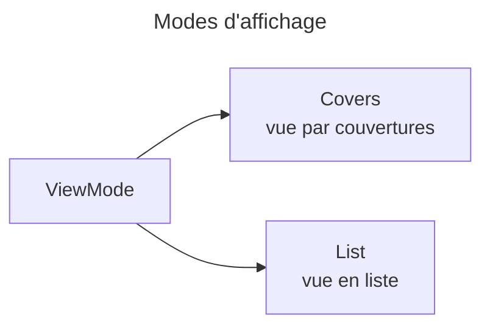

# C4 Code Level : Web/Enums

## 1. Vue d'ensemble

- **Nom** : Web.Enums (énumérations de présentation)
- **Description** : énumérations utilisées par l'interface Blazor, hors du modèle de domaine.
- **Emplacement relatif** : `Web/Enums/`
- **Langage** : C# (.NET 10)
- **Objectif** : décrire les modes d'affichage de la vue des livres.

## 2. Éléments de code

### 2.1 `ViewMode` (`Web/Enums/ViewMode.cs`, lignes 3 à 8)

```csharp
public enum ViewMode
{
    Covers,
    List
}
```

- **Description** : mode d'affichage de la liste des livres : `Covers` (couvertures) ou `List` (liste). Le commentaire de la ligne 3 indique que l'ancienne vue « Cards » a été fusionnée dans `List` (ADR-0021).
- **Emplacement** : lignes 4 à 8.
- **Dépendances** : aucune.

## 3. Dépendances

### 3.1 Internes

- Utilisée par les composants de `Web/Components` (vues de bibliothèque), non détaillés ici.

### 3.2 Externes

- Aucune.

## 4. Relations



## 5. Remarques

- Aucune persistance : la valeur choisie n'est pas stockée par cette énumération.
