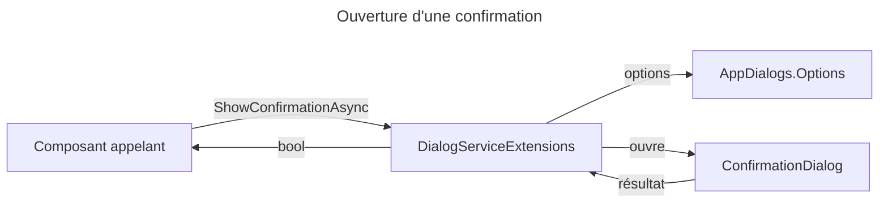

# C4 Code Level : Web/Extensions

## 1. Vue d'ensemble

- **Nom** : Web.Extensions (extensions et utilitaires de dialogues MudBlazor)
- **Description** : options communes des dialogues de l'application et méthode d'extension pour demander une confirmation.
- **Emplacement relatif** : `Web/Extensions/`
- **Langage** : C# (.NET 10), MudBlazor
- **Objectif** : unifier l'apparence et le comportement des dialogues (feuille en bas sur téléphone, centrée à partir de la tablette) et fournir un dialogue de confirmation réutilisable.

## 2. Éléments de code

### 2.1 `AppDialogs` (`Web/Extensions/AppDialogs.cs`, lignes 6 à 19)

```csharp
public static class AppDialogs
{
    public static DialogOptions Options => new() { ... };
}
```

- **Description** : propose `Options` (lignes 9 à 18), de type `DialogOptions` :
  - `NoHeader = true` (titre propre au dialogue) ;
  - `CloseButton = false` ; fermeture par Échap (`CloseOnEscapeKey = true`) et par clic sur le fond (`BackdropClick = true`) ;
  - `FullWidth = true`, `MaxWidth = MaxWidth.ExtraSmall` ;
  - `DefaultFocus = DefaultFocus.FirstChild` (le focus part du premier bouton).
- **Remarque** : la mise en forme (feuille, centrage) est dans `MainLayout.razor.css`, voir la documentation de `Web/Components/Layout`.
- **Dépendances** : `MudBlazor` (`DialogOptions`, `MaxWidth`, `DefaultFocus`).

### 2.2 `DialogServiceExtensions` (`Web/Extensions/DialogServiceExtensions.cs`, lignes 6 à 27)

```csharp
public static class DialogServiceExtensions
{
    public static async Task<bool> ShowConfirmationAsync(
        this IDialogService dialogService,
        string title,
        string message,
        string actionText = "Confirm",
        Color color = Color.Error)
}
```

- **Description** : méthode d'extension sur `IDialogService` (lignes 8 à 26). Elle ouvre `ConfirmationDialog` avec le message, le texte du bouton et la couleur du bouton de confirmation, puis retourne `true` si l'utilisateur a confirmé (résultat non nul, données non nulles, non annulé).
- **Emplacement** : lignes 8 à 26.
- **Dépendances** : `IDialogService`, `Web.Components.Pages.Dialogs.ConfirmationDialog` (hors périmètre), `AppDialogs.Options`.

## 3. Dépendances

### 3.1 Internes

- `Web.Components.Pages.Dialogs.ConfirmationDialog` : composant de dialogue de confirmation.
- `Web.Extensions.AppDialogs` : options partagées.

### 3.2 Externes

- MudBlazor (`IDialogService`, `DialogOptions`, `DialogParameters<T>`, `Color`).

## 4. Relations



## 5. Remarques

- Le libellé du bouton par défaut (`"Confirm"`) est en anglais, alors que l'interface est en français : les appelants doivent fournir `actionText` en français.
