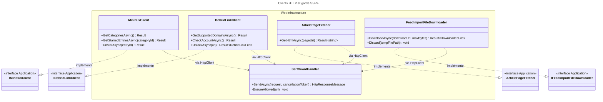
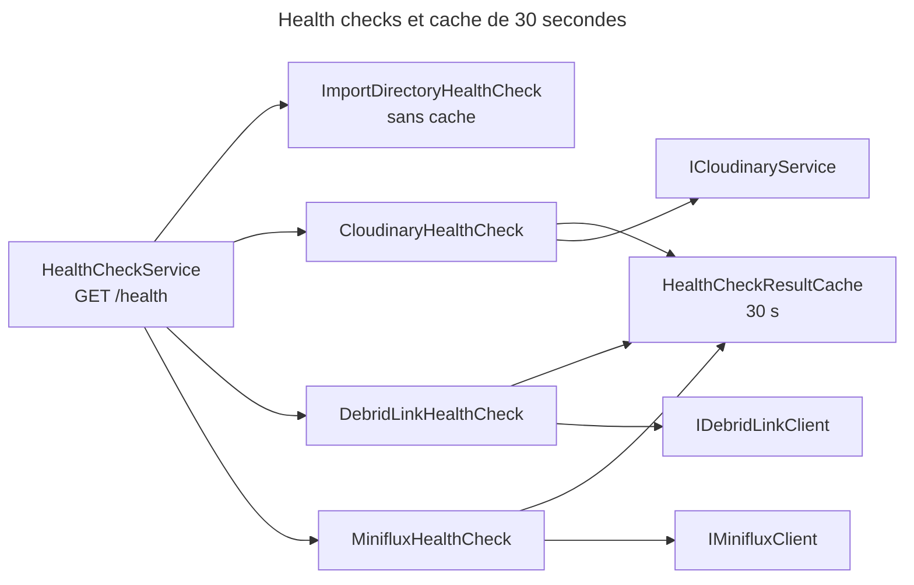

# C4 Code Level : Web/Infrastructure

## 1. Vue d'ensemble

- **Nom** : Web.Infrastructure (adaptateurs techniques de l'hôte Web)
- **Description** : clients HTTP vers les services externes (Miniflux, Debrid-Link, pages d'articles, téléchargements de flux), garde SSRF, health checks, filtre d'autorisation du tableau de bord Hangfire, niveaux de journaux modifiables à chaud, version de l'application.
- **Emplacement relatif** : `Web/Infrastructure/`
- **Langage** : C# (.NET 10), `HttpClient`, `System.Text.Json`, Serilog, `Microsoft.Extensions.Diagnostics.HealthChecks`
- **Objectif** : implémenter les interfaces d'`Application` pour les services de flux, appliquer la liste blanche d'hôtes à toutes les requêtes sortantes et exposer l'état de santé de l'application.

## 2. Éléments de code

### 2.1 Clients HTTP et garde SSRF

#### `SsrfGuardHandler` (`Web/Infrastructure/SsrfGuardHandler.cs`, lignes 6 à 89)

```csharp
internal sealed class SsrfGuardHandler(
    ILogger<SsrfGuardHandler> logger,
    IReadOnlySet<string> allowedHosts,
    bool allowHttp = false,
    bool allowSubdomains = false) : DelegatingHandler

protected override async Task<HttpResponseMessage> SendAsync(HttpRequestMessage request, CancellationToken cancellationToken)  // lignes 10-52
private void EnsureAllowed(Uri? uri)                                                                                          // lignes 54-61
private static bool IsRedirect(HttpStatusCode statusCode)                                                                     // lignes 63-65
private static HttpRequestMessage CloneAsRedirect(HttpRequestMessage original, Uri newUri, HttpStatusCode statusCode)         // lignes 72-88
```

- **Description** : `DelegatingHandler` qui vérifie chaque URL (y compris les redirections, suivies manuellement, 5 au maximum) par `Uri.IsAllowedHost(allowedHosts, allowHttp, allowSubdomains)`. Un hôte non autorisé lève `HttpRequestException` et journalise un avertissement.
- **Redirections** : 307 et 308 conservent la méthode, les autres codes passent en `GET`. `Authorization` et `Cookie` ne sont pas transmis lors d'un changement d'hôte. Le corps n'est pas recopié (tous les clients n'envoient que des `GET`).
- **Dépendances** : `Domain.Extensions` (`IsAllowedHost`), `ILogger<SsrfGuardHandler>`.

#### `ArticlePageFetcher` (`Web/Infrastructure/ArticlePageFetcher.cs`, lignes 8 à 60)

```csharp
internal sealed class ArticlePageFetcher(HttpClient httpClient, ILogger<ArticlePageFetcher> logger) : IArticlePageFetcher
internal const int MaxPageBytes = 5 * 1024 * 1024;                                              // ligne 10
public async Task<Result<string>> GetHtmlAsync(Uri pageUri, CancellationToken cancellationToken = default)  // lignes 12-36
private static async Task<Result<string>> ReadLimitedAsync(HttpContent content, CancellationToken cancellationToken)  // lignes 39-56
private static Encoding GetEncoding(string? charSet)                                             // ligne 58
```

- **Description** : récupère le HTML d'une page d'article, limité à 5 Mio. La lecture est bornée même sans `Content-Length` fiable. L'encodage est déduit du `charset` de la réponse.
- **Implémente** : `IArticlePageFetcher` (`Application`).
- **Dépendances** : `HttpClient` (typé, voir `FeedImportConfiguration`), `Result<T>`.

#### `MinifluxClient` (`Web/Infrastructure/MinifluxClient.cs`, lignes 11 à 135)

```csharp
internal sealed class MinifluxClient(HttpClient httpClient, ILogger<MinifluxClient> logger) : IMinifluxClient
private const int PageSize = 100;                                                                                             // ligne 13
public async Task<Result<IReadOnlyList<MinifluxCategory>>> GetCategoriesAsync(CancellationToken cancellationToken = default)  // lignes 15-27
public async Task<Result<IReadOnlyList<MinifluxEntry>>> GetStarredEntriesAsync(long categoryId, CancellationToken cancellationToken = default)  // lignes 29-51
public async Task<Result> UnstarAsync(long entryId, CancellationToken cancellationToken = default)                            // lignes 53-85
private async Task<Result<T?>> GetAsync<T>(Uri uri, CancellationToken cancellationToken, bool notFoundAsNull = false)         // lignes 87-120
private static bool IsTransportError(Exception ex, CancellationToken cancellationToken)                                        // lignes 123-125
private sealed record CategoryDto(...);                                                                                        // ligne 127
private sealed record EntriesResponseDto(...);                                                                                 // ligne 131
private sealed record EntryDto(...);                                                                                           // ligne 136
```

- **Description** : API REST Miniflux. `GetStarredEntriesAsync` pagine par 100 entrées (`PageSize`) et ne retient que les favoris de la catégorie. `UnstarAsync` retire le favori ; une entrée déjà supprimée ou non favorite est traitée comme un succès, pour éviter de la remettre en favori par erreur.
- **Dépendances** : `HttpClient` (URL de base et `X-Auth-Token`), `System.Text.Json`, `Application` (`IMinifluxClient`, `MinifluxCategory`, `MinifluxEntry`), `Result`.

#### `DebridLinkClient` (`Web/Infrastructure/DebridLinkClient.cs`, lignes 9 à 126)

```csharp
internal sealed class DebridLinkClient(HttpClient httpClient, ILogger<DebridLinkClient> logger) : IDebridLinkClient
private static readonly Uri s_domainsUri = new("downloader/domains", UriKind.Relative);   // ligne 11
private static readonly Uri s_addUri     = new("downloader/add", UriKind.Relative);         // ligne 12
private static readonly Uri s_accountUri = new("account/infos", UriKind.Relative);          // ligne 13
public async Task<Result<IReadOnlyList<string>>> GetSupportedDomainsAsync(CancellationToken cancellationToken = default)  // lignes 15-34
public async Task<Result> CheckAccountAsync(CancellationToken cancellationToken = default)                                 // lignes 36-41
public async Task<Result<DebridLinkFile>> UnlockAsync(string url, CancellationToken cancellationToken = default)            // lignes 43-59
internal Result<DebridLinkFile> ToFile(JsonElement link)                                                                    // lignes 61-79
internal static TError MapError(string? code)                                                                                // lignes 82-95
private static TError WithCode(TError error, string code)                                                                    // ligne 95
private async Task<Result<JsonElement>> SendAsync(Func<Task<HttpResponseMessage>> send, CancellationToken cancellationToken) // lignes 97-123
private static async Task<JsonElement?> ReadBodyAsync(HttpResponseMessage response, CancellationToken cancellationToken)     // lignes 125-...
```

- **Description** : API Debrid-Link v2. Chaque réponse est `{"success": bool, "value" | "error"}`. `UnlockAsync` envoie le lien à `downloader/add` ; pour un dossier, seul le premier fichier est retenu. `MapError` traduit les codes d'erreur documentés en `TError`.
- **Implémente** : `IDebridLinkClient` (`Application`).
- **Dépendances** : `HttpClient` (URL de base HTTPS, `Authorization: Bearer`, délai 60 s), `System.Text.Json`, `Application` (`DebridLinkFile`).

#### `FeedImportFileDownloader` (`Web/Infrastructure/FeedImportFileDownloader.cs`, lignes 10 à 75 et au-delà)

```csharp
internal sealed class FeedImportFileDownloader(HttpClient httpClient, IOptions<ImportSettings> importSettings,
    ILogger<FeedImportFileDownloader> logger) : IFeedImportFileDownloader
private const int BufferSize = 81920;                                                                                        // ligne 12
public async Task<Result<DownloadedFile>> DownloadAsync(Uri downloadUrl, long maxBytes, CancellationToken cancellationToken = default)  // lignes 14-43
public void Discard(string tempFilePath)                                                                                     // lignes 45-58
private async Task<Result<DownloadedFile>> DownloadToAsync(Uri downloadUrl, string tempPath, long maxBytes, CancellationToken cancellationToken)  // lignes 60-...
```

- **Description** : télécharge un fichier débloqué dans `Import:TempDirectory` (jamais dans le répertoire surveillé). Le corps est copié par tampons de 80 Kio et interrompu dès que `maxBytes` est dépassé, même sans `Content-Length` fiable. `Discard` supprime un fichier temporaire.
- **Implémente** : `IFeedImportFileDownloader` (`Application`).
- **Dépendances** : `HttpClient` (délai 30 min), `IOptions<ImportSettings>`, `Result<DownloadedFile>`.

### 2.2 Health checks

#### `HealthCheckResultCache<TCheck>` (`Web/Infrastructure/HealthCheckResultCache.cs`, lignes 12 à 34)

```csharp
internal sealed class HealthCheckResultCache<TCheck> where TCheck : IHealthCheck
public async Task<HealthCheckResult> GetOrAddAsync(Func<CancellationToken, Task<HealthCheckResult>> check, CancellationToken cancellationToken)  // lignes 22-33
```

- **Description** : cache en mémoire d'un résultat de check pendant 30 s (`CacheDuration`, ligne 15). Un singleton par type de check (enregistrement générique dans `Program.cs`, ligne 221). Les champs ne sont pas protégés par un verrou : une absence de cache concurrente peut déclencher deux appels.
- **Dépendances** : `HealthCheckResult`.

#### `ImportDirectoryHealthCheck` (`Web/Infrastructure/ImportDirectoryHealthCheck.cs`, lignes 7 à 25)

```csharp
internal sealed class ImportDirectoryHealthCheck(IOptions<ImportSettings> settings) : IHealthCheck
public async Task<HealthCheckResult> CheckHealthAsync(HealthCheckContext context, CancellationToken cancellationToken = default)  // lignes 9-24
```

- **Description** : vérifie que `ImportDirectory` est accessible en écriture en créant puis supprimant `.healthcheck`. Pas de cache.
- **Dépendances** : `Application.ImportJobs` (`ImportSettings`), `System.IO`.

#### `CloudinaryHealthCheck` (`Web/Infrastructure/CloudinaryHealthCheck.cs`, lignes 6 à 16)

```csharp
internal sealed class CloudinaryHealthCheck(ICloudinaryService cloudinaryService,
    HealthCheckResultCache<CloudinaryHealthCheck> cache) : IHealthCheck
public Task<HealthCheckResult> CheckHealthAsync(HealthCheckContext context, CancellationToken cancellationToken = default)   // lignes 8-15
```

- **Description** : appelle `ICloudinaryService.PingAsync` via le cache de 30 s. Un échec donne `Unhealthy`.
- **Dépendances** : `Application.Interfaces` (`ICloudinaryService`), `HealthCheckResultCache`.

#### `MinifluxHealthCheck` (`Web/Infrastructure/MinifluxHealthCheck.cs`, lignes 11 à 42)

```csharp
internal sealed class MinifluxHealthCheck(IMinifluxClient minifluxClient, IFeatureToggles featureToggles,
    IOptions<MinifluxSettings> minifluxSettings, HealthCheckResultCache<MinifluxHealthCheck> cache) : IHealthCheck
public Task<HealthCheckResult> CheckHealthAsync(HealthCheckContext context, CancellationToken cancellationToken = default)  // lignes 17-25
private async Task<HealthCheckResult> CheckMinifluxAsync(CancellationToken cancellationToken)                               // lignes 27-41
```

- **Description** : sans import de flux, renvoie `Healthy`. Sinon, liste les catégories Miniflux et vérifie que `CategoryName` existe. Un échec ou une catégorie absente donne `Degraded`, jamais `Unhealthy`.
- **Dépendances** : `Application.FeedImports`, `Domain.Settings`, `IFeatureToggles`.

#### `DebridLinkHealthCheck` (`Web/Infrastructure/DebridLinkHealthCheck.cs`, lignes 11 à 37)

```csharp
internal sealed class DebridLinkHealthCheck(IDebridLinkClient debridLinkClient, IFeatureToggles featureToggles,
    IOptions<DebridLinkSettings> debridLinkSettings, HealthCheckResultCache<DebridLinkHealthCheck> cache) : IHealthCheck
public Task<HealthCheckResult> CheckHealthAsync(HealthCheckContext context, CancellationToken cancellationToken = default)  // lignes 17-36
```

- **Description** : sans import de flux, `Healthy`. Sans `DebridLink:ApiKey`, `Degraded` (téléchargements non lancés). Sinon, `CheckAccountAsync` via le cache ; un échec donne `Degraded`.
- **Dépendances** : `Application.FeedImports`, `Domain.Settings`, `IFeatureToggles`.

### 2.3 Sécurité et administration

#### `HangfireAuthorizationFilter` (`Web/Infrastructure/HangfireAuthorizationFilter.cs`, lignes 5 à 13)

```csharp
public class HangfireAuthorizationFilter : IDashboardAuthorizationFilter
public bool Authorize(DashboardContext context)   // lignes 7-12
```

- **Description** : accès au tableau de bord `/hangfire` réservé aux utilisateurs authentifiés ayant le rôle `Admin`.
- **Dépendances** : `Hangfire.Dashboard`.

#### `LogLevelSwitches` (`Web/Infrastructure/LogLevelSwitches.cs`, lignes 9 à 233)

```csharp
public sealed record LoggerLevel(string Name, LogEventLevel? ConfiguredLevel, LogEventLevel EffectiveLevel);   // ligne 10
public sealed class LogLevelSwitches
public const string RootLoggerName = "ROOT";                                                                  // ligne 22
public const LogEventLevel Off = LevelAlias.Off;                                                              // ligne 25
public LogLevelSwitches(LogEventLevel defaultLevel, IReadOnlyDictionary<string, LogEventLevel> overrides,
    IEnumerable<string> loggerNames)                                                                          // lignes 43-68
public static LogLevelSwitches FromConfiguration(IConfiguration configuration, IEnumerable<Assembly> assemblies)  // lignes 70-86
public static IEnumerable<string> DiscoverLoggerNames(IEnumerable<Assembly> assemblies)                      // lignes 90-102
public IReadOnlyList<LoggerLevel> GetLoggers()                                                                // lignes 104-113
public bool Set(string name, LogEventLevel? level)                                                            // lignes 117-131
public void ResetAll()                                                                                        // lignes 133-144
public LoggerConfiguration ApplyTo(LoggerConfiguration configuration)                                         // lignes 147-158
```

- **Description** : un `LoggingLevelSwitch` Serilog par logger déclaré au démarrage (classes prenant un `ILogger<T>`, leurs espaces de noms parents, et préfixes tiers : `Microsoft.AspNetCore.Components`, `Npgsql`, `Hangfire`, etc.). Un logger sans niveau propre hérite de son parent le plus proche, puis du niveau racine. L'état est en mémoire : un redémarrage restaure `appsettings`.
- **Dépendances** : Serilog (`LoggingLevelSwitch`, `LevelAlias`), `System.Reflection` (découverte des `ILogger<T>` par réflexion), `IConfiguration`.

### 2.4 Version

#### `AppVersion` (`Web/Infrastructure/AppVersion.cs`, lignes 6 à 34)

```csharp
internal static class AppVersion
public static string Current { get; }                                                                       // lignes 8-10
internal static string Format(string? informationalVersion, Version? assemblyVersion)                      // lignes 13-22
public static string Versioned(string path)                                                                 // ligne 26
internal static string Versioned(string path, string version)                                               // lignes 28-33
```

- **Description** : version affichée dans les Paramètres, sans le suffixe `+<sha>`. `Versioned` ajoute `?v=<version>` aux fichiers statiques pour forcer le rechargement après une publication (utilisé dans `App.razor`).
- **Dépendances** : `System.Reflection`.

## 3. Dépendances

### 3.1 Internes

- `Application` : `IMinifluxClient`, `IDebridLinkClient`, `IArticlePageFetcher`, `IFeedImportFileDownloader`, `ICloudinaryService`, `IFeatureToggles`, `ImportSettings`, `Result`.
- `Domain` : `Domain.Extensions` (`IsAllowedHost`), `Domain.Settings`, `FeatureToggle`.
- `Web/Configuration` : enregistrement des clients (`FeedImportConfiguration`) et `LoggingConfiguration`.
- `Web/Components/App.razor` : `AppVersion.Versioned`.
- `Web/Program.cs` : `HealthCheckResultCache<>`, `LogLevelSwitches`, `HangfireAuthorizationFilter`.

### 3.2 Externes

- `Microsoft.Extensions.Diagnostics.HealthChecks`, `Microsoft.Extensions.Options`.
- `System.Net.Http`, `System.Text.Json`.
- Hangfire.Dashboard.
- Serilog.Core, Serilog.Events.
- Services externes appelés : Miniflux, Debrid-Link, hôtes d'articles et d'hébergeurs listés dans `appsettings`, Cloudinary.

## 4. Relations





## 5. Remarques

- `ImportDirectoryHealthCheck` n'est pas mis en cache alors que `/health` est public : chaque appel écrit puis supprime `.healthcheck`. À corriger si la charge augmente.
- `HealthCheckResultCache` n'est pas thread-safe (commentaire `ponytail` dans le fichier) : deux échecs de cache simultanés déclenchent deux appels.
- `FeedImportFileDownloader.DownloadToAsync` et `DebridLinkClient.ReadBodyAsync` sont tronqués dans cette documentation : leurs corps n'ont pas été relus en entier.
- `DebridLinkClient.MapError` et `ToFile` sont `internal` et visibles pour les tests.
