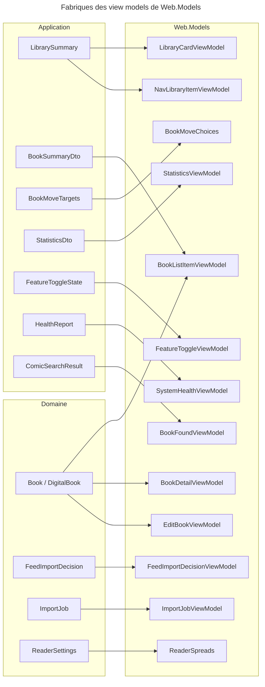
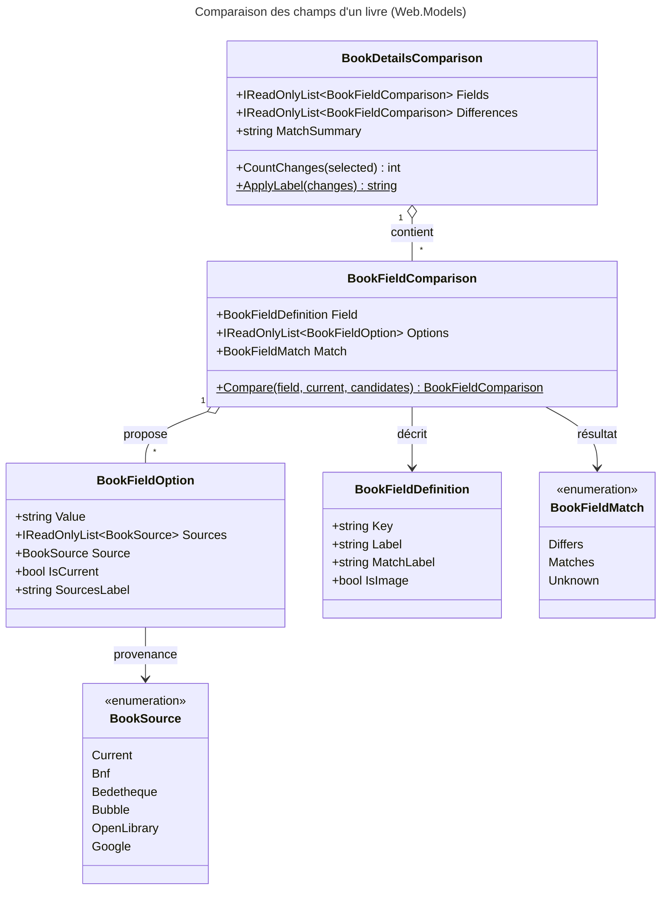
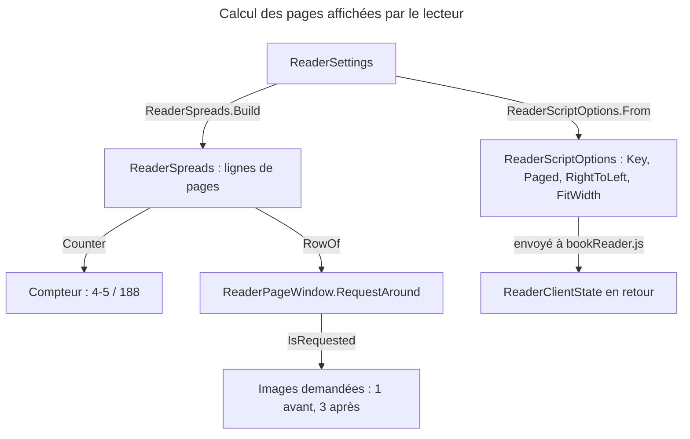

# C4 Code Level : Web/Models

## 1. Vue d'ensemble

- **Nom** : Web.Models (view models et helpers d'affichage)
- **Description** : Types immuables (records, classes statiques) et fonctions de mise en forme qui transforment les DTO de la couche Application et les entités du Domaine en textes, libellés, couleurs, icônes, liens et états prêts à être affichés par les composants Blazor / MudBlazor.
- **Emplacement relatif** : `Web/Models/` (34 fichiers, namespace `Web.Models`)
- **Langage** : C# (.NET 10). Dépendances UI : MudBlazor (icônes Material, couleurs), FluentValidation (`ValidationResult`), Microsoft.Extensions.Diagnostics.HealthChecks.
- **Objectif** : garder la logique de présentation hors des composants Razor (règle CLAUDE.md : « business logic stays outside Razor components »), calculer une seule fois les valeurs dérivées (ADR-0021) et centraliser les libellés, liens et règles d'affichage. Les libellés affichés à l'utilisateur sont aujourd'hui en anglais dans le code ; cette documentation est en français.

Organisation de la documentation par thème :

| Thème | Fichiers |
|---|---|
| A. Bibliothèques | LibraryCardViewModel, NavLibraryItemViewModel, LibraryDisplay, LibraryColors, LibraryIcons |
| B. Livres | BookListItemViewModel, BookDetailViewModel, EditBookViewModel, BookFoundViewModel, BookMoveTargetViewModel, BookText, BookFieldKeys, BookDetailsComparison, IsbnScanStateDisplay, IsbnEntry, AddBookLinks |
| C. Lecteur | ReaderScript, ReaderSpreads, ReaderPageWindow, ReaderDisplay |
| D. Imports et flux | ImportJobViewModel, FeedImportDecisionViewModel, FeedImportDecisionPageViewModel, FeedImportFilters |
| E. Statistiques | StatisticsViewModel |
| F. Formulaires et interface transverse | FormErrors, FormFieldIds, PopupAnchor / PopupPlacement, ProviderSearchState, NavigationRules, FeatureToggleViewModel, SystemHealthViewModel, AccountViewModel, FileSizeFormatter |

---

## 2. Éléments de code

### A. Bibliothèques

#### `LibraryCardViewModel`
- **Signature** : `public sealed record LibraryCardViewModel(Guid Id, string Name, string Color, string Icon, bool IsDigital, int BookCount, IReadOnlyList<string> Covers)`
- **Description** : carte d'une bibliothèque sur la page des bibliothèques, avec ses liens et libellés calculés une fois.
- **Emplacement** : `Web/Models/LibraryCardViewModel.cs:7-59`
- **Membres publics** :
  - `string Href { get; }` (l.16) : `/libraries/{Id}`
  - `string EditHref { get; }` (l.18) : `/libraries/{Id}/edit`
  - `string ImportHref { get; }` (l.20) : `/import?libraryId={Id}`
  - `string TypeLabel { get; }` (l.22) : `Digital` ou `Physical`
  - `string CountLabel { get; }` (l.24) : `No books yet` ou `LibraryDisplay.BookCount(BookCount)`
  - `string Details { get; }` (l.27) : `{TypeLabel} · {CountLabel}`
  - `string ActionsLabel { get; }` (l.29) : `More actions for {Name}`
  - `string ActionsButtonId { get; }` (l.31) : `library-actions-{Id}`
  - `public static LibraryCardViewModel From(LibrarySummary summary)` (l.33-45)
  - `public static LibraryCardViewModel Preview(Guid id, string? name, string color, string icon, LibraryBookType bookType, int bookCount, IReadOnlyList<string> covers)` (l.48-49) : carte de la bibliothèque en cours de création ou d'édition ; `New library` tant que le nom est vide.
  - `public static string Subtitle(IReadOnlyCollection<LibraryCardViewModel> libraries)` (l.52-58) : `3 libraries · 48 books`.
- **Dépendances** : `Application.Libraries.Summaries.LibrarySummary`, `Domain.Libraries.LibraryBookType`, `LibraryDisplay`.

#### `NavLibraryItemViewModel`
- **Signature** : `public sealed record NavLibraryItemViewModel(Guid Id, string Name, string Color, string Icon, string Href, string CountLabel, string AriaLabel)`
- **Description** : entrée d'une bibliothèque dans la navigation latérale.
- **Emplacement** : `Web/Models/NavLibraryItemViewModel.cs:6-29`
- **Membres publics** :
  - `public static NavLibraryItemViewModel From(LibrarySummary summary)` (l.15-28) : `Href` = `/libraries/{Id}`, `CountLabel` = nombre invariant, `AriaLabel` = `{Name}, 1 book` ou `{Name}, N books`.
- **Dépendances** : `Application.Libraries.Summaries.LibrarySummary`.

#### `LibraryDisplay`
- **Signature** : `public static class LibraryDisplay`
- **Description** : textes de la barre, de la recherche et du formulaire des pages bibliothèque.
- **Emplacement** : `Web/Models/LibraryDisplay.cs:8-31`
- **Membres publics** :
  - `public static string BookCount(int count)` (l.10) : `1 book` ou `N books`.
  - `public static string SortLabel(BookSortOrder sortOrder)` (l.12-17) : `Oldest first`, `Series & volume` ou `Newest first`.
  - `public static string ViewLabel(ViewMode viewMode)` (l.19) : `List` ou `Covers`.
  - `public static string Subtitle(int? bookCount, BookSortOrder sortOrder)` (l.22-23) : `24 books · Newest first`, ou seulement le tri si le nombre est inconnu.
  - `public static string SearchResults(int count, string searchTerm)` (l.25-26) : `N books match “…”`.
  - `public static string SaveFailed(TError? error, string fallback)` (l.29-30) : message de nom déjà pris (`LibrariesError.Duplicate`) sinon `fallback`.
- **Dépendances** : `Domain.Libraries.BookSortOrder`, `Web.Enums.ViewMode`, `Domain.Primitives.TError`, `LibrariesError`.

#### `LibraryColor` et `LibraryColors`
- **Signature** : `public sealed record LibraryColor(string Hex, string Name)` ; `public static class LibraryColors`
- **Description** : palette fermée de 12 couleurs qu'une bibliothèque peut prendre (Indigo, Purple, Teal, Blue, Green, Amber, Orange, Pink, Grey blue, Brown, Cyan, Lime).
- **Emplacement** : `Web/Models/LibraryColors.cs:4` (record), `:7-33` (classe)
- **Membres publics** :
  - `public static IReadOnlyList<LibraryColor> Palette { get; }` (l.25)
  - `public static bool IsSelected(LibraryColor color, string? hex)` (l.27-31) : comparaison insensible à la casse.

#### `LibraryIconChoice` et `LibraryIcons`
- **Signature** : `public sealed record LibraryIconChoice(string Name, string Label)` avec `public string Svg { get; }` ; `public static class LibraryIcons`
- **Description** : icônes Material qu'une bibliothèque peut afficher. Le dictionnaire des icônes est construit par réflexion sur `MudBlazor.Icons.Material.Filled` ; `LibraryIconsWarmupService` le force au démarrage.
- **Emplacement** : `Web/Models/LibraryIcons.cs:8-11` (choix), `:14-108` (classe)
- **Membres publics** :
  - `public const int MaxResults = 40;` (l.16)
  - `public static IReadOnlyList<LibraryIconChoice> Suggested { get; }` (l.44) : 16 suggestions (Collection, Book, Books, Star, Heart, ...).
  - `public static string Resolve(string? name)` (l.47-48) : SVG de l'icône, `Star` si le nom est inconnu.
  - `public static bool Exists(string? name)` (l.50)
  - `public static string LabelOf(string name)` (l.53-59) : libellé lu à l'utilisateur ; `Words` pour les noms hors suggestions (`AutoStories` devient `Auto stories`).
  - `public static LibraryIconChoice ChoiceOf(string name)` (l.61)
  - `public static IReadOnlyList<LibraryIconChoice> Search(string? query, string? chosen)` (l.64-80) : sans requête, les suggestions (l'icône choisie en tête si elle n'en fait pas partie) ; avec requête, toutes les icônes dont le nom ou le libellé contient chaque mot, triées, limitées à `MaxResults`.
  - `public static string ResultsCaption(string? query, int count)` (l.83-89) : `Suggested`, `First 40 icons`, `1 icon`, `N icons`.
- **Membres privés** : `s_icons` (l.18-22), `s_suggested` (l.24-42), `Words(string name)` (l.91-107).
- **Dépendances** : `MudBlazor.Icons.Material.Filled` (réflexion), `System.Reflection`, `System.Text.StringBuilder`.

### B. Livres

#### `BookListItemViewModel`
- **Signature** : `public sealed record BookListItemViewModel(Guid Id, string Serie, string Title, string? ISBN, int VolumeNumber, string ImageLink, string Authors, string Publishers, DateTime? LastRead, int? LastRating, int ReadCount, IsbnScanState IsbnScanState = IsbnScanState.HasIsbn, int IsbnCandidateCount = 0)`
- **Description** : ligne d'un livre dans une liste ou une grille. Les dérivés sont calculés à la construction, pour ne pas les recalculer dans les tris ou les templates (règle CLAUDE.md « View / ViewModel »).
- **Emplacement** : `Web/Models/BookListItemViewModel.cs:6-53`
- **Membres publics** :
  - `string? VolumeBadge { get; }` (l.22) : `#4`, ou `null` si pas de numéro de tome.
  - `string SerieAndVolume { get; }` (l.25-26) : `Blacksad · #4`.
  - `bool HasBeenRead { get; }` (l.28) : `ReadCount > 0`.
  - `public static BookListItemViewModel From(BookSummaryDto dto)` (l.30-33)
  - `public static BookListItemViewModel From(Book book)` (l.35-52) : retient la dernière lecture (`MaxBy` sur la date) ; l'état du scan ISBN vient de `DigitalBook.GetIsbnScanState()`.
- **Dépendances** : `Application.Books.List.BookSummaryDto`, `Domain.Books.Book`, `Domain.Books.DigitalBook`, `Domain.Books.IsbnScanState`.

#### `BookDetailField`, `BookReadingEntry` et `BookDetailViewModel`
- **Signature** :
  - `public sealed record BookDetailField(string Label, string Value)` (l.8)
  - `public sealed record BookReadingEntry(string Date, int Rating)` (l.11-14), avec `public string RatingLabel { get; }`
  - `public sealed record BookDetailViewModel` (l.17-153), propriétés `required` : `Guid Id`, `Guid LibraryId`, `string Title`, `string ImageLink`, `string Authors`, `bool IsDigital`, `string ActionsDetails`, `string ReadLabel` ; propriétés `init` : `string? SerieAndVolume`, `string? FormatLabel`, `int LatestRating`, `bool HasBeenRead`, `string? ReadProgressLabel`, `int? ReadProgressPercent`, `string? Isbn`, `IsbnScanState IsbnScanState`, `IReadOnlyList<string> IsbnCandidates`, `string? IsbnScanNotice`, `string ScanIsbnLabel` (défaut `Scan the pages`), `IReadOnlyList<BookDetailField> Details`, `IReadOnlyList<BookReadingEntry> Readings`
- **Description** : page détail d'un livre (ADR-0021). Regroupe le titre, la progression de lecture, l'ISBN et son état de scan, la grille de détails et l'historique des lectures.
- **Emplacement** : `Web/Models/BookDetailViewModel.cs:7-153` (détails ligne 8, lecture ligne 11-14, classe ligne 17-153)
- **Membres publics** :
  - `string LatestRatingLabel { get; }` (l.57) : `Rated N out of 5`.
  - `string CoverAlt { get; }` (l.58) : `Cover of {Title}`.
  - `string ActionsLabel { get; }` (l.59), `string LibraryHref { get; }` (l.60), `string EditHref { get; }` (l.61), `string FindDetailsHref { get; }` (l.62), `string ReadHref { get; }` (l.63), `string DownloadHref { get; }` (l.64 : `/api/books/{Id}/download`).
  - `public static string RatingLabel(int rating)` (l.66)
  - `public static BookDetailViewModel From(Book book)` (l.68-104) : ne traite le livre numérique (`DigitalBook`) que pour la progression, l'ISBN et la taille du fichier.
- **Membres privés** :
  - `ReadingProgress(DigitalBook? book)` (l.107-123) : retourne `(Label, Progress, Percent)` ; `Read` sans progression, `Continue reading` + `Page N of M` ensuite. `LastReadPage` est indexé à partir de zéro.
  - `IsbnScanNoticeOf(IsbnScanState state, DateTime? scannedAt)` (l.125-130)
  - `DetailsOf(Book book, DigitalBook? digitalBook)` (l.133-144) : Volume, Publisher, Published, Pages, File size, Added ; seuls les champs renseignés sont gardés.
  - `AddIfAny(List<BookDetailField> fields, string label, string? value)` (l.146-152)
- **Dépendances** : `Domain.Books.Book`, `Domain.Books.DigitalBook`, `Application.Helpers.PublishDateHelper.DisplayFormat`, `BookText`, `FileSizeFormatter`.

#### `EditBookReading` et `EditBookViewModel`
- **Signature** :
  - `public sealed record EditBookReading(Guid Id, string Date, int Rating)` (l.7-13) avec `string DeleteLabel { get; }` et `string DeleteMessage { get; }`
  - `public sealed record EditBookViewModel` (l.16-53) : `required` `Guid Id`, `string Title`, `string ImageLink`, `bool IsDigital`, `string Subtitle` ; `init` `IReadOnlyList<EditBookReading> Readings`
- **Description** : données que le formulaire d'édition d'un livre affiche en plus de ses champs (lectures à supprimer, sous-titre, couverture).
- **Emplacement** : `Web/Models/EditBookViewModel.cs:7-53`
- **Membres publics** :
  - `string BookHref { get; }` (l.28) : `/books/{Id}`
  - `string CoverAlt { get; }` (l.29)
  - `string ReadingsCountLabel { get; }` (l.31) : `1 reading` ou `N readings`
  - `public string LibraryLabel(string? libraryName)` (l.34) : `{libraryName ?? "Library"} · Digital|Physical`
  - `public static EditBookViewModel From(Book book)` (l.36-52) : lectures triées par date décroissante puis Id ; date au format `d MMMM yyyy`.
- **Dépendances** : `Domain.Books.Book`, `Domain.Books.DigitalBook`, `BookText`.

#### `BookFoundViewModel`
- **Signature** : `public sealed record BookFoundViewModel` (l.6-39) : `required` `string Title`, `string ImageLink`, `string IsbnLabel` ; `init` `string? SerieAndVolume`, `string? Authors`, `string? Publication`, `string? SourceLabel`
- **Description** : livre trouvé dans un catalogue pour un ISBN saisi ou scanné, affiché avant ajout (ADR-0021).
- **Emplacement** : `Web/Models/BookFoundViewModel.cs:6-39`
- **Membres publics** :
  - `string CoverAlt { get; }` (l.22) : `Cover of {Title}`
  - `public static BookFoundViewModel From(ComicSearchResult result)` (l.24-38) : `Publication` = éditeurs · année · pages ; `SourceLabel` = `Found on {Source}`.
- **Dépendances** : `Application.Interfaces.ComicSearchResult`, `BookText`.

#### `BookMoveTargetViewModel` et `BookMoveChoices`
- **Signature** :
  - `public sealed record BookMoveTargetViewModel(Guid Id, string Name, string Color, string Icon, string Details, bool IsSuggested, bool IsCurrent = false)` (l.8-11), avec `string MoveLabel { get; }` (l.10) : `Move to {Name}`
  - `public sealed record BookMoveChoices(IReadOnlyList<BookMoveTargetViewModel> Libraries, string? CurrentName)` (l.14-48)
- **Description** : bibliothèques proposées dans le dialogue de déplacement d'un livre. La bibliothèque courante est listée en tête, sans pouvoir être choisie.
- **Emplacement** : `Web/Models/BookMoveTargetViewModel.cs:8-48`
- **Membres publics** :
  - `bool HasTargets { get; }` (l.16) : au moins une bibliothèque autre que la courante.
  - `Guid? Preselected { get; }` (l.18) : la bibliothèque suggérée.
  - `public static BookMoveChoices From(BookMoveTargets targets)` (l.20-40) : détails `Digital · 112 books · 1 of this series`.
- **Membres privés** : `SameSerieLabel(int count)` (l.42-47).
- **Dépendances** : `Application.Books.MoveTargets.BookMoveTargets`, `Domain.Libraries.LibraryBookType`, `BookText`, `LibraryDisplay`.

#### `BookText`
- **Signature** : `public static class BookText`
- **Description** : petits textes partagés par les écrans livre (ADR-0021).
- **Emplacement** : `Web/Models/BookText.cs:4-29`
- **Membres publics** :
  - `public static string? Join(params string?[] parts)` (l.7-11) : concatène les parties renseignées avec ` · `, `null` si aucune.
  - `public static string? SerieAndVolume(string? serie, string title, int volumeNumber)` (l.14-19) : la série est omise si elle est identique au titre (one-shot).
  - `public static string? VolumeLabel(int volumeNumber)` (l.21) : `Volume N`.
  - `public static string? PagesLabel(int? numberOfPages)` (l.23-28) : `1 page` ou `N pages`.

#### `BookFieldKeys`
- **Signature** : `internal static class BookFieldKeys`
- **Description** : clés stables des champs comparés sur la page « Import info from the web ».
- **Emplacement** : `Web/Models/BookFieldKeys.cs:3-13`
- **Constantes internes** : `Title`, `Serie`, `VolumeNumber`, `Authors`, `Publishers`, `PublishDate`, `NumberOfPages`, `Cover` (valeurs `title`, `serie`, `volumeNumber`, `authors`, `publishers`, `publishDate`, `numberOfPages`, `cover`).

#### `BookSource`, `BookSources`, `BookFieldDefinition`, `BookFieldOption`, `BookFieldMatch`, `BookFieldComparison`, `BookDetailsComparison`
- **Signature** :
  - `public enum BookSource { Current, Bnf, Bedetheque, Bubble, OpenLibrary, Google }` (l.4-12)
  - `public static class BookSources` avec `public static string Name(BookSource source)` (l.16-24) : `Current`, `BnF`, `Bedetheque`, `Bubble`, `OpenLibrary`, `Google Books`.
  - `public sealed record BookFieldDefinition(string Key, string Label, string MatchLabel, bool IsImage = false)` (l.28-41) avec `public static readonly IReadOnlyList<BookFieldDefinition> All` (huit champs : title, series, volume, authors, publisher, publish date, pages, cover).
  - `public sealed record BookFieldOption(string? Value, IReadOnlyList<BookSource> Sources)` (l.44-51) : `BookSource Source` (= `Sources[0]`), `bool IsCurrent`, `string SourcesLabel` (`BnF · Google Books`).
  - `public enum BookFieldMatch { Differs, Matches, Unknown }` (l.53-63)
  - `public sealed record BookFieldComparison(BookFieldDefinition Field, IReadOnlyList<BookFieldOption> Options, BookFieldMatch Match)` (l.65-115) avec `public static BookFieldComparison Compare(BookFieldDefinition field, string? current, IEnumerable<(BookSource Source, string? Value)> candidates)` (l.67-102)
  - `public sealed record BookDetailsComparison(IReadOnlyList<BookFieldComparison> Fields)` (l.120-166) : `IReadOnlyList<BookFieldComparison> Differences { get; }` (l.122-123), `string? MatchSummary { get; }` (l.126-141), `string DifferencesSummary { get; }` (l.143-148), `public int CountChanges(IReadOnlyDictionary<string, BookSource> selected)` (l.151-158), `public static string ApplyLabel(int changes)` (l.160-165)
- **Description** : comparaison des champs d'un livre avec ce que connaissent les sources web. Seules les différences sont proposées au choix (S6). La valeur courante passe en premier dans les options ; les valeurs identiques entre sources sont fusionnées.
- **Emplacement** : `Web/Models/BookDetailsComparison.cs:4-166`
- **Membres privés** : `BookFieldComparison.MatchOf(int optionCount, bool matches)` (l.104-112) ; `BookFieldComparison.Normalize(string? value)` (l.114) ; `BookDetailsComparison.MatchSummary` construit « Title, series and volume already match. ».
- **Dépendances** : `BookFieldKeys`.

#### `IsbnEntry`
- **Signature** : `public static class IsbnEntry` avec `public const string Help`, `Missing`, `Invalid` (l.8-10) et `public static (string? Isbn, string? Error) Check(string? typed)` (l.13-22)
- **Description** : validation de l'ISBN saisi à la main. Les tirets et espaces sont ignorés, les chiffres sont vérifiés avant la recherche.
- **Emplacement** : `Web/Models/IsbnEntry.cs:6-23`
- **Dépendances** : `Application.Helpers.IsbnHelper` (`NormalizeIsbn`, `IsValidISBN`).

#### `IsbnScanStateDisplay`
- **Signature** : `public static class IsbnScanStateDisplay`
- **Description** : présentation de l'état du scan ISBN d'un livre numérique : libellé, icône, badge et couleur.
- **Emplacement** : `Web/Models/IsbnScanStateDisplay.cs:8-46`
- **Membres publics** :
  - `public static string Label(IsbnScanState state, int candidateCount = 0)` (l.10-16)
  - `public static string Icon(IsbnScanState state)` (l.19-25) : icône Material (`DocumentScanner`, `Rule`, `SearchOff`).
  - `public static string? BadgeContent(IsbnScanState state, int candidateCount)` (l.28-33) : `?` avant le scan, nombre de candidats ensuite.
  - `public static string? BadgeIcon(IsbnScanState state)` (l.36-37) : `Close` si aucun ISBN trouvé.
  - `public static Color BadgeColor(IsbnScanState state)` (l.40-45) : `Warning` (candidats), `Error` (non trouvé), `Dark` sinon.
- **Dépendances** : `Domain.Books.IsbnScanState`, `MudBlazor.Icons`, `MudBlazor.Color`.

#### `AddBookLinks`
- **Signature** : `public static class AddBookLinks`
- **Description** : liens des étapes d'ajout d'un livre, qui conservent la bibliothèque cible (ADR-0021).
- **Emplacement** : `Web/Models/AddBookLinks.cs:4-31`
- **Membres publics** :
  - `public static string Scan(Guid? libraryId)` (l.6) : `/books/add/scan`
  - `public static string TypeIsbn(Guid? libraryId)` (l.8) : `/books/add/manual`
  - `public static string EnterDetails(Guid? libraryId)` (l.10) : `/books/add/form`
  - `public static string LookUp(string isbn, Guid? libraryId)` (l.13-14) : `/books/add/form?isbn=...` (échappé)
  - `public static string Exit(Guid? libraryId)` (l.17) : `/libraries/{id}` ou `/libraries/list`
  - `public static Guid? ParseLibraryId(string? value)` (l.19)
- **Membres privés** : `WithLibrary(string path, Guid? libraryId)` (l.21-30) ajoute `libraryId=` avec `?` ou `&`.

### C. Lecteur

#### `ReaderScriptOptions` et `ReaderClientState`
- **Signature** :
  - `public sealed record ReaderScriptOptions(bool Paged, bool RightToLeft, bool FitWidth, string Key)` (l.8-20) avec `public static ReaderScriptOptions From(ReaderSettings settings)` (l.10-19). `Key` = `{Layout}-{Scrolling}-{Direction}`.
  - `public sealed record ReaderClientState(bool CanUseFullscreen, bool GestureHelpSeen, bool PortraitAccepted)` (l.24)
- **Description** : options envoyées à `bookReader.js` (gestes, sens de lecture, ajustement) et état renvoyé par le script à l'attachement. `Key` est aussi rendue sur l'élément défilé pour détecter une désynchronisation entre pages rendues et script.
- **Emplacement** : `Web/Models/ReaderScript.cs:5-24`
- **Dépendances** : `Domain.Books.ReaderSettings`, `ReaderScrolling`, `ReadingDirection`, `ReaderLayout`.

#### `ReaderSpreads`
- **Signature** : `public sealed class ReaderSpreads`
- **Description** : lignes d'affichage du lecteur : une page, ou deux pages côte à côte en mode « Two pages ». La couverture reste seule ; en sens droite-gauche (manga), les pages sont inversées.
- **Emplacement** : `Web/Models/ReaderSpreads.cs:7-73`
- **Membres publics** :
  - `public int Count { get; }` (l.25) : nombre de lignes.
  - `public IReadOnlyList<int> PagesOf(int row)` (l.27)
  - `public int FirstPageOf(int row)` (l.29) et `public int LastPageOf(int row)` (l.31)
  - `public int RowOf(int pageIndex)` (l.33) : borné à la plage des pages.
  - `public string Counter(int row)` (l.36-42) : `5 / 188` ou `4-5 / 188`.
  - `public static ReaderSpreads Build(int pageCount, ReaderSettings settings)` (l.44-53) : lève `ArgumentOutOfRangeException` si `pageCount <= 0`.
- **Membres privés** : constructeur `ReaderSpreads(IReadOnlyList<IReadOnlyList<int>> rows, int pageCount)` (l.12-23), `BuildPairs(int pageCount, bool rightToLeft)` (l.56-72).
- **Dépendances** : `Domain.Books.ReaderSettings`, `ReaderLayout`, `ReadingDirection`.

#### `ReaderPageWindow`
- **Signature** : `public sealed class ReaderPageWindow`
- **Description** : fenêtre des pages dont le lecteur continu demande l'image : la page visible et ses voisines. Une page demandée n'est jamais libérée, ce qui garde la hauteur et la position de défilement stables.
- **Emplacement** : `Web/Models/ReaderPageWindow.cs:5-32`
- **Membres publics** :
  - `public const int PagesBehind = 1;` et `public const int PagesAhead = 3;` (l.7-8)
  - `public ReaderPageWindow(int pageCount)` (l.12-16)
  - `public int PageCount { get; }` (l.18)
  - `public bool IsRequested(int pageIndex)` (l.20-21)
  - `public void RequestAround(int pageIndex)` (l.23-31)

#### `ReaderDisplay`
- **Signature** : `public static class ReaderDisplay`
- **Description** : titre affiché dans le lecteur et largeur de la barre de progression.
- **Emplacement** : `Web/Models/ReaderDisplay.cs:5-37`
- **Membres publics** :
  - `public static string Title(string? serie, string? title)` (l.8-24) : `Serie · Title`, sans répéter la série si elle est déjà dans le titre.
  - `public static string ProgressWidth(int pageIndex, int pageCount)` (l.27-36) : pourcentage `0.##%`, borné entre 0 et 100.

### D. Imports et flux

#### `ImportJobViewModel`
- **Signature** : `public record ImportJobViewModel(Guid Id, string OriginalFileName, long OriginalFileSize, string Status, string StatusDisplay, int ProgressPercent, DateTime CreatedAt, DateTime? CompletedAt, string? ErrorMessage, string? ErrorStep, int ConvertedImagesCount, int TotalImagesToConvert)` (l.5-18)
- **Description** : état d'un job d'import de fichier pour la page Import : étape, progression et erreur. Les extensions acceptées sont portées par `ImportSettings.SupportedExtensions` (hors de ce répertoire).
- **Emplacement** : `Web/Models/ImportJobViewModel.cs:5-152`
- **Membres publics** :
  - `public static ImportJobViewModel From(ImportJob job)` (l.19-34) ; renseigne aussi `DigitalBookId`.
  - `public const int StepCount = 6;` (l.37)
  - `public Guid? DigitalBookId { get; init; }` (l.40)
  - `public string? BookHref { get; }` (l.42-44) : `/books/{id}` si terminé.
  - `public string? StepDisplay { get; }` (l.47-49) : `Step 3 of 6 · 42%`.
  - `public string? FailureDisplay { get; }` (l.52-63)
  - `public string? FailedStepDisplay { get; }` (l.66-68) : `Failed while: Extracting pages`.
  - `public bool IsTerminal { get; }` (l.73) : `Completed` ou `Failed`.
  - `public string? DurationDisplay { get; }` (l.75-78)
  - `public string? ConversionDetail { get; }` (l.80-83) : `N/M images converted`.
  - `public string FileSizeDisplay { get; }` (l.85-91)
  - `public string StatusCssClass { get; }` (l.93-99)
- **Membres privés** : `FormatDuration(TimeSpan)` (l.101-112), `GetStatusDisplay(ImportJobStatus)` (l.114-125), `StepOf(ImportJobStatus)` (l.127-136), `GetProgressPercent(ImportJobStatus, int, int)` (l.138-151) ; les étapes ont des pourcentages fixes (15, 35 + conversion sur 20 points, 55, 70, 85, 100).
- **Dépendances** : `Domain.ImportJobs.ImportJob`, `Domain.ImportJobs.ImportJobStatus`.

#### `FeedImportDecisionEventViewModel`, `FeedImportMirrorViewModel`, `FeedImportCandidateViewModel`, `FeedImportDecisionActions`, `FeedImportDecisionViewModel`
- **Signature** :
  - `public sealed record FeedImportDecisionEventViewModel(DateTime OccurredAt, string OccurredAtDisplay, string StatusDisplay, string DecidedByDisplay, string Description)` (l.6-11)
  - `public sealed record FeedImportMirrorViewModel(string Url, string Host, bool IsChosen = false)` (l.14)
  - `public sealed record FeedImportCandidateViewModel(int Index, string Label, string? FileName, string? SizeDisplay, IReadOnlyList<FeedImportMirrorViewModel> Mirrors)` (l.16-19) avec `string DisplayName { get; }`
  - `public sealed record FeedImportDecisionActions(bool CanForceDownload, bool CanRetry, bool CanCorrect, bool CanIgnore, string? Serie, string? Title, int? Volume)` (l.22-34) : `static FeedImportDecisionActions None { get; }` (l.31), `bool Any { get; }` (l.33)
  - `public sealed record FeedImportDecisionViewModel(Guid Id, string EntryTitle, string EntryUrl, DateTime? PublishedAt, DateTime CreatedAt, FeedImportDecisionStatus Status, string StatusDisplay, string StatusCssClass, string Reason, string DecidedByDisplay, string? ParsedDisplay, string? ErrorDisplay, IReadOnlyList<FeedImportDecisionEventViewModel> Events, string? ItemDisplay, FeedImportArbitrationKind ArbitrationKind, Guid? MatchedBookId, IReadOnlyList<FeedImportCandidateViewModel> Candidates, string? ImportPageUrl = null, FeedImportDecisionActions? Actions = null, bool CanDelete = false)` (l.36-56, pragma CA1054/CA1056 car les URL sont affichées en lien)
- **Description** : une décision de la file « Feeds » (article Miniflux analysé, à arbitrer, téléchargé ou en échec). `FeedImportDecisionViewModel` expose aussi les actions manuelles autorisées par le domaine.
- **Emplacement** : `Web/Models/FeedImportDecisionViewModel.cs:6-56` (événements, miroirs, candidats, actions) et `:36-210` (décision)
- **Membres publics de `FeedImportDecisionViewModel`** :
  - `string CreatedAtDisplay { get; }` (l.59), `FeedImportDecisionActions ManualActions { get; }` (l.61)
  - `string? SubtitleDisplay { get; }` (l.64) : `Book 2 of the article · Serie · T2 · Title`
  - `string SummaryDisplay { get; }` (l.67) : erreur ou raison de la décision
  - `string PublishedAtDisplay { get; }` (l.69) : `-` si absent
  - `bool CanChooseCandidate { get; }` (l.71-72) : arbitrage de liens ambigus
  - `bool CanResolveDuplicate { get; }` (l.74-75) : arbitrage de doublon probable
  - `static IReadOnlyList<FeedImportDecisionStatus> FilterableStatuses { get; }` (l.78-79) : tous les statuts sauf `Imported`.
  - `public static FeedImportDecisionViewModel From(FeedImportDecision decision, bool isPartOfMultiBookArticle = false, Guid? importLibraryId = null)` (l.83-129) : `CanRetry` et `CanDelete` sont calculés avec `DateTime.UtcNow`.
  - `public static string GetStatusDisplay(FeedImportDecisionStatus status)` (l.155-167) : `Pending`, `Links extracted`, `To decide`, `Duplicate`, `Downloading...`, `Downloaded`, `Imported`, `Ignored`, `Failed`.
- **Membres privés** : `GetImportPageUrl` (l.131-141), `FormatDate` (l.144-145, `dd/MM/yyyy HH:mm` en heure locale), `FormatSize` (l.147-153), `GetStatusCssClass` (l.169-176), `GetDecidedByDisplay` (l.178-182), `GetParsedDisplay` (l.184-200), `GetErrorDisplay` (l.202-209).
- **Dépendances** : `Domain.FeedImports.FeedImportDecision`, `FeedImportDecisionStatus`, `FeedImportArbitrationKind`, `FeedImportDecidedBy`, `BookText`.

#### `FeedImportDecisionPageViewModel`
- **Signature** : `public sealed record FeedImportDecisionPageViewModel(IReadOnlyList<FeedImportDecisionViewModel> Items, int TotalCount)` (l.3)
- **Description** : une page de décisions et le nombre total pour la pagination.
- **Emplacement** : `Web/Models/FeedImportDecisionPageViewModel.cs:3`

#### `FeedImportFilter`, `FeedImportFilterChip`, `FeedImportStatusCounts`, `FeedImportFilters`
- **Signature** :
  - `public enum FeedImportFilter { All, ToDecide, Failed, Downloaded }` (l.6-12)
  - `public sealed record FeedImportFilterChip(FeedImportFilter Filter, string Label)` (l.14)
  - `public sealed record FeedImportStatusCounts(int All, int ToDecide, int Failed, int Downloaded)` (l.16-42) : `static FeedImportStatusCounts Empty { get; }` (l.18), `public static FeedImportStatusCounts From(IReadOnlyDictionary<FeedImportDecisionStatus, int> counts)` (l.20-29), `IReadOnlyList<FeedImportFilterChip> Chips { get; }` (l.32-38)
  - `public static class FeedImportFilters` (l.44-61) : `public static string Name(FeedImportFilter filter)` (l.46-52), `public static FeedImportDecisionStatus? StatusOf(FeedImportFilter filter)` (l.54-60)
- **Description** : filtres de statut de la page Feeds, affichés en puces avec leur compteur (`To decide · 1`). Un filtre vide n'affiche que son nom.
- **Emplacement** : `Web/Models/FeedImportFilters.cs:6-61`
- **Dépendances** : `Domain.FeedImports.FeedImportDecisionStatus`.

#### `HealthTone`, `HealthCheckViewModel`, `SystemHealthViewModel`
- **Signature** :
  - `public enum HealthTone { Healthy, Degraded, Unhealthy }` (l.5-10)
  - `public sealed record HealthCheckViewModel(string Name, string Status, HealthTone Tone)` (l.12)
  - `public sealed record SystemHealthViewModel(string Summary, HealthTone Tone, IReadOnlyList<HealthCheckViewModel> Checks)` (l.17-53) : `public static readonly SystemHealthViewModel Unavailable` (l.19), `public static SystemHealthViewModel From(HealthReport report)` (l.21-38), `public static string CssClass(HealthTone tone)` (l.40-45)
- **Description** : état de santé du système résumé en une ligne (`6 of 6 healthy`), avec le détail de chaque contrôle, trié par nom. `Tone` est le pire état des contrôles.
- **Emplacement** : `Web/Models/SystemHealthViewModel.cs:3-53`
- **Membres privés** : `ToneOf(HealthStatus status)` (l.47-52)
- **Dépendances** : `Microsoft.Extensions.Diagnostics.HealthChecks.HealthReport`, `HealthStatus`.

### E. Statistiques

#### `StatisticTileViewModel` et `StatisticsViewModel`
- **Signature** :
  - `public sealed record StatisticTileViewModel(string Label, string Value, string Icon, string? Suffix = null)` (l.7)
  - `public sealed record StatisticsViewModel(bool HasBooks, string TotalBooks, string BooksUnit, string ReadBooks, string UnreadBooks, int ReadPercent, IReadOnlyList<StatisticTileViewModel> Tiles, ReadingsChartViewModel Chart)` (l.9-65)
  - `public static StatisticsViewModel From(StatisticsDto dto, bool allLibraries)` (l.19-35) : `ReadPercent` arrondi par défaut (un seul livre non lu n'affiche jamais 100 %).
  - `internal static string FormatNumber(long value)` (l.60) : format `N0` invariant.
- **Membres privés** : `BuildTiles(StatisticsDto dto, bool allLibraries)` (l.37-58) : Series, Readings, Avg rating, Pages, Libraries (si toutes les bibliothèques), Storage (si taille > 0) ; `FormatRating(double? rating)` (l.62-64).
- **Description** : chiffres de la page statistiques et tuiles associées.
- **Emplacement** : `Web/Models/StatisticsViewModel.cs:7-65`
- **Dépendances** : `Application.Statistics.Get.StatisticsDto`, `MudBlazor.Icons`, `FileSizeFormatter`, `ReadingsChartViewModel`.

#### `ReadingsChartBarViewModel` et `ReadingsChartViewModel`
- **Signature** :
  - `public sealed record ReadingsChartBarViewModel(string Initial, string Month, int Count, double HeightPercent, bool IsPeak)` (l.67)
  - `public sealed record ReadingsChartViewModel(IReadOnlyList<ReadingsChartBarViewModel> Bars, IReadOnlyList<int> AxisTicks, int Total, string AriaLabel)` (l.72-147)
  - `public static ReadingsChartViewModel From(IReadOnlyList<MonthlyReadingCountDto> months)` (l.80-105)
  - `internal static int AxisStep(int peak)` (l.108-118) : plus petit pas 1, 2 ou 5 × 10ⁿ tel que deux pas atteignent le pic.
- **Membres privés** : `LastIndexOf(IReadOnlyList<MonthlyReadingCountDto> months, int count)` (l.120-131) : le mois le plus récent gagne en cas d'égalité ; `AriaLabelFor(...)` (l.133-146).
- **Description** : histogramme des lectures des derniers mois, sur un axe à deux pas égaux (0, pas, 2 × pas). `AxisTicks` = `[0, step, 2*step]`.
- **Emplacement** : `Web/Models/StatisticsViewModel.cs:67-147`
- **Dépendances** : `Application.Statistics.Get.MonthlyReadingCountDto`.

### F. Formulaires et interface transverse

#### `FormErrors`
- **Signature** : `public sealed class FormErrors`
- **Description** : erreurs d'un formulaire après soumission : un message par champ, et leur nombre au-dessus du formulaire.
- **Emplacement** : `Web/Models/FormErrors.cs:6-38`
- **Membres publics** :
  - `public static readonly FormErrors None` (l.8)
  - `public int Count { get; }` (l.14), `public bool Any { get; }` (l.16)
  - `public string Summary { get; }` (l.18) : `1 field needs your attention.` ou `N fields need your attention.`
  - `public static FormErrors From(ValidationResult result)` (l.21-32) : premier message par champ (`ArgumentNullException` si `result` est nul).
  - `public string? For(string propertyName)` (l.34)
  - `public string? AriaInvalid(string propertyName)` (l.37) : `"true"` si le champ est en erreur.
- **Dépendances** : `FluentValidation.Results.ValidationResult`.

#### `FormFieldIds`
- **Signature** : `public static class FormFieldIds`
- **Description** : relie un champ à ses textes d'erreur et d'aide, pour les lecteurs d'écran.
- **Emplacement** : `Web/Models/FormFieldIds.cs:4-26`
- **Membres publics** :
  - `public static string ErrorOf(string id)` (l.6) : `{id}-error`
  - `public static string HelpOf(string id)` (l.8) : `{id}-help`
  - `public static string? DescribedBy(string id, string? error, string? help)` (l.11-25) : valeur de `aria-describedby`, ou `null`.

#### `PopupAnchor` et `PopupPlacement`
- **Signature** :
  - `public sealed record PopupAnchor(double Left, double Top, double Right, double Bottom, double ViewportWidth, double ViewportHeight)` (l.6-10) avec `public static PopupAnchor At(double x, double y, double viewportWidth, double viewportHeight)` (l.8-9)
  - `public static class PopupPlacement` (l.14-45) : constantes `public const double Width = 300` (l.16), `private const double Margin = 8`, `private const double Gap = 4` ; `public static string Style(PopupAnchor? anchor, bool alignEnd)` (l.21-40) ; `private static string Css(double left, string verticalVariable, double vertical, double maxHeight)` (l.42-44)
- **Description** : placement d'un menu près de son ancre sur tablette ou grand écran : sous l'ancre, ou au-dessus s'il y a plus de place, toujours dans la fenêtre. Sans ancre, le menu est centré. Le résultat est une chaîne de variables CSS (`--popup-left`, `--popup-top` ou `--popup-bottom`, `--popup-max-height`).
- **Emplacement** : `Web/Models/PopupPlacement.cs:6-45`
- **Dépendances** : `System.Globalization.CultureInfo` (format invariant).

#### `ProviderSearchState`, `ProviderSearchStates`, `ProviderSearchStateDisplay`
- **Signature** :
  - `public enum ProviderSearchState { Searching, Found, NotFound, Failed }` (l.7-13)
  - `public static class ProviderSearchStates` (l.15-30) : `public static ProviderSearchState Of(IBookSearchResult? result)` (l.18-19), `public static ProviderSearchState Of(IStructuredBookResult? result)` (l.21-22), `private static ProviderSearchState Of(bool found, bool failed)` (l.24-29)
  - `public static class ProviderSearchStateDisplay` (l.34-59) : `public static string Icon(ProviderSearchState state)` (l.36-42), `public static Color Color(ProviderSearchState state)` (l.44-50), `public static string Label(ProviderSearchState state, string source)` (l.52-58)
- **Description** : état de la recherche auprès d'une source (BnF, Google Books...) sur la page « Find book details ». Un résultat nul signifie que la source a levé une exception (`Failed`).
- **Emplacement** : `Web/Models/ProviderSearchState.cs:7-59`
- **Dépendances** : `Application.Interfaces.IBookSearchResult`, `IStructuredBookResult`, `MudBlazor.Icons`, `MudBlazor.Color`.

#### `NavigationRules`
- **Signature** : `public static class NavigationRules`
- **Description** : règles de navigation à partir de l'URI relative : entrée de menu active et masquage de la navigation pendant les tâches ciblées.
- **Emplacement** : `Web/Models/NavigationRules.cs:4-56`
- **Membres publics** :
  - `public static string StripQueryAndFragment(string relativePath)` (l.14-20)
  - `public static bool IsActive(string relativePath, string path)` (l.22-35) : égalité ou préfixe `path/`, insensible à la casse.
  - `public static bool HidesNavigation(string relativePath)` (l.37-42) : `books/add` et `books/{id}/find-details`.
  - `public static Guid? CurrentLibraryId(string relativePath)` (l.45-55) : identifiant lu dans `libraries/{id}`.

#### `FeatureToggleViewModel`
- **Signature** : `public sealed record FeatureToggleViewModel(FeatureToggle Toggle, string Label, string Description, string ConfigurationKey, bool Enabled, bool ConfiguredOn, bool IsOverridden)` (l.6-14)
- **Membres publics** :
  - `public static FeatureToggleViewModel From(FeatureToggleState state)` (l.15-20)
  - `public string ConfigurationDisplay { get; }` (l.22) : `Configured on (FeedImport:Enabled)`
- **Membres privés** : `Describe(FeatureToggle toggle)` (l.24-34) : libellé, description et clé de configuration de chaque fonctionnalité (FeedImport, IsbnOcr, Bedetheque, Bnf, GoogleBooks, OpenLibrary, Bubble).
- **Emplacement** : `Web/Models/FeatureToggleViewModel.cs:6-35`
- **Dépendances** : `Application.Settings.FeatureToggleState`, `Domain.Settings.FeatureToggle`.

#### `AccountViewModel`
- **Signature** : `public static class AccountViewModel`
- **Membres publics** : `public static string Initials(string? name, string? email)` (l.8-19) : initiales du nom (premier et dernier mot), sinon de l'e-mail, sinon `?`, en majuscules.
- **Emplacement** : `Web/Models/AccountViewModel.cs:3-20`

#### `FileSizeFormatter`
- **Signature** : `public static class FileSizeFormatter`
- **Membres publics** : `public static string Format(long bytes)` (l.9-21) : unités B, KB, MB, GB, TB, base 1024 ; une décimale au plus (`0.#`) sauf pour les octets.
- **Emplacement** : `Web/Models/FileSizeFormatter.cs:5-22`
- **Champ privé** : `s_sizeUnits` (l.7).

---

## 3. Dépendances

### Internes

| Cible | Utilisée par |
|---|---|
| `Application.Interfaces` (`ComicSearchResult`, `IBookSearchResult`, `IStructuredBookResult`) | BookFoundViewModel, ProviderSearchState |
| `Application.Libraries.Summaries` (`LibrarySummary`) | LibraryCardViewModel, NavLibraryItemViewModel |
| `Application.Books.List` (`BookSummaryDto`) | BookListItemViewModel |
| `Application.Books.MoveTargets` (`BookMoveTargets`) | BookMoveTargetViewModel |
| `Application.Statistics.Get` (`StatisticsDto`, `MonthlyReadingCountDto`) | StatisticsViewModel |
| `Application.Settings` (`FeatureToggleState`) | FeatureToggleViewModel |
| `Application.Helpers` (`IsbnHelper`, `PublishDateHelper`) | IsbnEntry, BookDetailViewModel, FeedImportDecisionViewModel |
| `Domain.Books` (`Book`, `DigitalBook`, `IsbnScanState`, `ReaderSettings`, `ReaderLayout`, `ReaderScrolling`, `ReadingDirection`) | Livres, lecteur |
| `Domain.Libraries` (`LibraryBookType`, `BookSortOrder`) | Bibliothèques |
| `Domain.Primitives` (`TError`) | LibraryDisplay |
| `Domain.ImportJobs` (`ImportJob`, `ImportJobStatus`) | ImportJobViewModel |
| `Domain.FeedImports` (`FeedImportDecision`, `FeedImportDecisionStatus`, `FeedImportArbitrationKind`, `FeedImportDecidedBy`) | Feeds |
| `Domain.Settings` (`FeatureToggle`) | FeatureToggleViewModel |
| `Web.Enums` (`ViewMode`) | LibraryDisplay |
| Models entre eux | `BookText` (utilisé par BookDetailViewModel, EditBookViewModel, BookFoundViewModel, BookMoveTargetViewModel, FeedImportDecisionViewModel) ; `LibraryDisplay` (LibraryCardViewModel, BookMoveTargetViewModel) ; `FileSizeFormatter` (BookDetailViewModel, StatisticsViewModel) ; `BookFieldKeys` (BookDetailsComparison) ; `ReadingsChartViewModel` (StatisticsViewModel) |

### Externes

| Paquet | Usage |
|---|---|
| MudBlazor (`Icons.Material.Filled`, `Icons.Material.Outlined`, `Color`) | Icônes et couleurs de LibraryIcons, IsbnScanStateDisplay, ProviderSearchStateDisplay, StatisticsViewModel |
| FluentValidation | `ValidationResult` dans FormErrors |
| Microsoft.Extensions.Diagnostics.HealthChecks | `HealthReport`, `HealthStatus` dans SystemHealthViewModel |
| System.Reflection | Construction du dictionnaire d'icônes (LibraryIcons) |

---

## 4. Relations

### 4.1 Sources de données vers les view models

### 4.2 Comparaison des champs d'un livre avec les sources web

### 4.3 Chaîne d'affichage du lecteur

### 4.4 Relations internes les plus importantes

- `ReaderDisplay`, `BookText`, `FileSizeFormatter` et `LibraryDisplay` sont des fonctions utilitaires sans état, appelées par plusieurs view models.
- `BookListItemViewModel.From(Book)` et `BookDetailViewModel.From(Book)` lisent `ReadingDates` une seule fois ; la règle « pas de parcours répété dans un tri ou un template » est respectée.
- `ImportJobViewModel`, `FeedImportDecisionViewModel` et `FeedImportFilters` partagent la notion de statut et de libellé des statuts d'import (deux énumérations distinctes : `ImportJobStatus`, `FeedImportDecisionStatus`).

---

## Notes

- **Duplication de formatage de taille** : trois implémentations coexistent. `FileSizeFormatter.Format` (base 1024, B à TB), `ImportJobViewModel.FileSizeDisplay` (B à GB, `F1`/`F0`) et `FeedImportDecisionViewModel.FormatSize` (B à GB, même logique). Un seul point d'entrée serait plus cohérent.
- **Libellés en anglais** : les libellés affichés (`Read`, `Scan the pages`, `No ISBN found in the pages`...) sont codés en anglais dans des fichiers dont les commentaires sont en français. Les tests de l'interface doivent donc s'appuyer sur ces mêmes textes.
- **Dates** : `FeedImportDecisionViewModel.From` dépend de `DateTime.UtcNow` (`CanRetry`, `CanDelete`), ce qui rend le résultat non déterministe dans les tests unitaires sans horloge injectée.
- **Code ciblé par la réflexion** : `LibraryIcons` lit les champs statiques de `MudBlazor.Icons.Material.Filled` ; un changement de version de MudBlazor peut modifier les noms d'icônes disponibles. `LibraryIconsWarmupService` anticipe le coût de cette réflexion au démarrage.
- **Visibilité pour les tests** : `AxisStep` (ReadingsChartViewModel), `StatisticsViewModel.FormatNumber`, `BookFieldKeys` sont `internal` ; leur accès depuis `Web.Tests` passe par `InternalsVisibleTo` si configuré.
