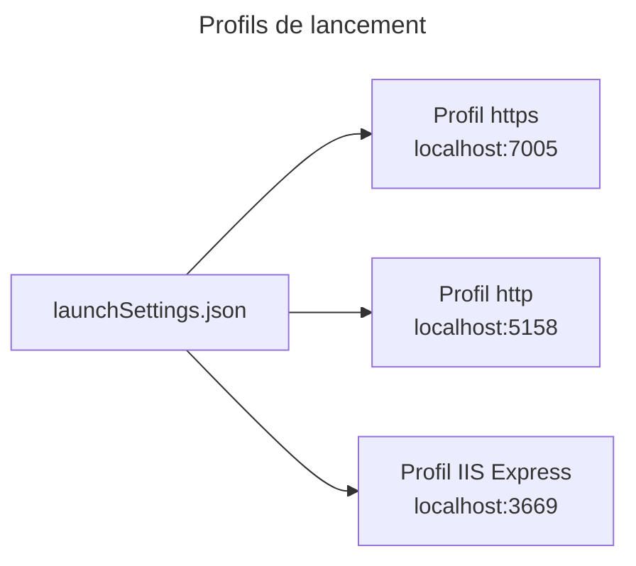

# C4 Code Level : Web/Properties

## 1. Vue d'ensemble

- **Nom** : Web.Properties (profils de lancement)
- **Description** : fichier `launchSettings.json` qui définit les profils de lancement locaux (Kestrel HTTP et HTTPS, IIS Express).
- **Emplacement relatif** : `Web/Properties/`
- **Langage** : JSON
- **Objectif** : permettre de lancer l'application en local en environnement `Development`.

## 2. Éléments de code

### 2.1 `launchSettings.json` (`Web/Properties/launchSettings.json`, lignes 1 à 38)

| Profil | Commande | Adresses | Environnement |
|---|---|---|---|
| `https` | `Project` | `https://localhost:7005` et `http://localhost:5158` | `Development` |
| `http` | `Project` | `http://localhost:5158` | `Development` |
| `IIS Express` | `IISExpress` | `http://localhost:3669`, port SSL `44347` (section `iisSettings`) | `Development` |

- **Remarque** : `windowsAuthentication` est à `false` et `anonymousAuthentication` à `true` dans `iisSettings`. `launchBrowser` vaut `true` pour tous les profils.
- **Dépendances** : aucune. Le port 8080 utilisé par le conteneur (`EXPOSE 8080` dans le `Dockerfile`) n'apparaît pas ici.

## 3. Dépendances

### 3.1 Internes

- Lu par le SDK .NET (`dotnet run --project Web/Web.csproj`, voir `CLAUDE.md`).

### 3.2 Externes

- Aucune.

## 4. Relations

## 5. Remarques

- Les adresses sont locales. Le déploiement en conteneur utilise la configuration de `Web/appsettings*.json` et les variables d'environnement, pas ce fichier.
