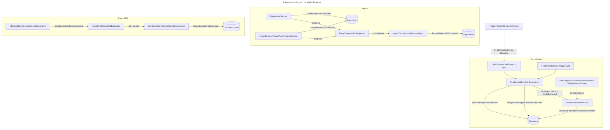
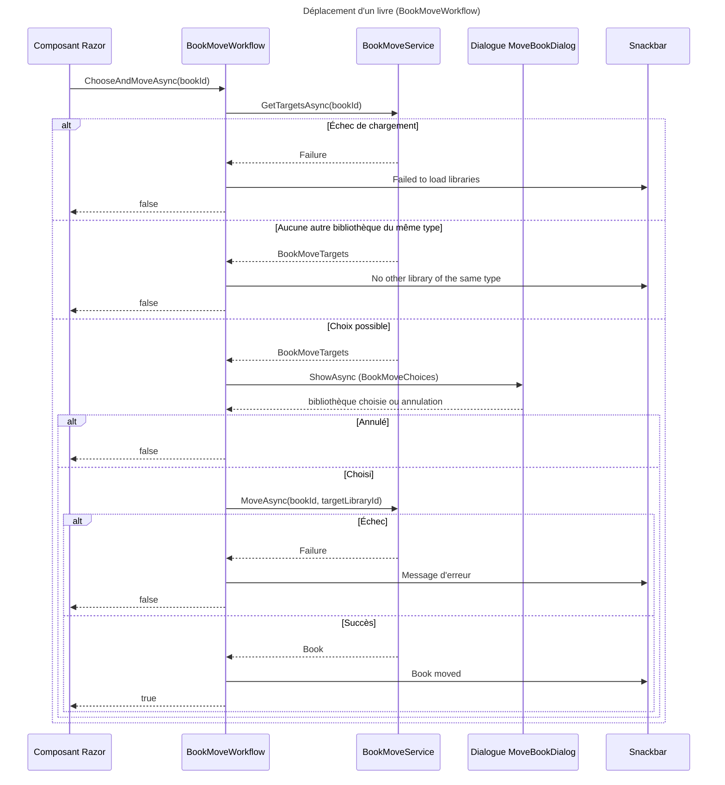

# C4 Code Level : Web/Services

## 1. Vue d'ensemble

- **Nom** : Web.Services (services de la couche Web, adaptateurs vers la couche Application)
- **Description** : services Blazor Server qui relient les composants de l'interface aux handlers CQRS de la couche Application et à Hangfire. Ils lisent l'utilisateur courant, valident les identifiants reçus de l'interface, convertissent les résultats en view models et planifient les travaux de fond (import de fichiers, scan ISBN, synchronisation Miniflux, téléchargements Debrid-Link).
- **Emplacement relatif** : `Web/Services/` (40 fichiers, namespace `Web.Services`)
- **Langage** : C# (.NET 10). Frameworks : ASP.NET Core Blazor Server, Hangfire, MudBlazor (dialogues et snackbars), Microsoft.Extensions (Options, Logging, Hosting, DependencyInjection), Microsoft.JSInterop.
- **Objectif** : fournir aux composants Razor une API stable (interfaces `I*Service`), appliquer l'identification de l'utilisateur sur chaque appel (`ICurrentUserService`), et déporter les traitements longs dans des jobs Hangfire ou des services hébergés.

Organisation par thème :

| Thème | Fichiers |
|---|---|
| A. Bibliothèques | ILibrariesService, LibrariesService, LibrariesServiceExtensions, CreateLibraryRequest, UpdateLibraryRequest, LibraryStateService, LibraryIconsWarmupService |
| B. Livres et déplacement | IBooksService, BooksService, CreateBookRequest, UpdateBookRequest, AddReadingDateRequest, IBookMoveService, BookMoveService, IBookMoveWorkflow, BookMoveWorkflow |
| C. Lecteur | IBookReaderService, BookReaderService, PopupAnchorLocator |
| D. Statistiques | IStatisticsService, StatisticsService |
| E. Scan ISBN | IIsbnScanService, IsbnScanService, IsbnScanOrchestrator, HangfireIsbnScanJobEnqueuer |
| F. Import de fichiers | IImportService, ImportService, ImportJobHandlers, ImportOrchestrator, HangfireImportJobEnqueuer, FileWatcherService |
| G. Flux Miniflux / Debrid-Link | IFeedImportService, FeedImportService, FeedImportHandlers, FeedImportSyncJob, FeedImportDownloadJob, FeedImportNotifier |
| H. Fonctionnalités et utilisateur | IFeatureToggleService, FeatureToggleService, CurrentUserService |

Convention commune à la plupart des services : chaque méthode extrait l'identifiant de l'utilisateur courant via `ICurrentUserService.GetCurrentUserIdAsync`, retourne l'erreur si elle échoue, puis délègue à un handler CQRS (`ICommandHandler` / `IQueryHandler`). Les identifiants reçus en `string` sont parsés avec `Guid.TryParse`, et `ValidationError` est retourné en cas d'échec.

---

## 2. Éléments de code

### A. Bibliothèques

#### `ILibrariesService`
- **Signature** : `public interface ILibrariesService` (l.12-31)
- **Membres publics** :
  - `Task<Result<Library>> Create(CreateLibraryRequest request, CancellationToken cancellationToken = default)` (l.14-15)
  - `Task<Result<Library>> GetById(string? id)` (l.17)
  - `Task<Result<Library>> Update(UpdateLibraryRequest request, CancellationToken cancellationToken = default)` (l.19-20)
  - `Task<Result<IPagedList<Library>>> FilterBy(string? searchTerm, LibrariesColumn? sortColumn, SortOrder? sortOrder, int page, int pageSize, CancellationToken cancellationToken = default)` (l.22-24)
  - `Task<Result<IReadOnlyList<LibrarySummary>>> GetSummaries(CancellationToken cancellationToken = default)` (l.26-27)
  - `Task<Result> Delete(string? id, CancellationToken cancellationToken = default)` (l.29-30)
- **Description** : contrat d'accès aux bibliothèques de l'utilisateur. Le fichier expose `InternalsVisibleTo("DynamicProxyGenAssembly2")` (l.7-8) pour les doublures NSubstitute des tests.
- **Emplacement** : `Web/Services/ILibrariesService.cs:12-31`
- **Dépendances** : `Application.Interfaces`, `Application.Libraries.Summaries.LibrarySummary`, `Domain.Libraries.Library`, `Domain.Primitives.Result`, `IPagedList`, `LibrariesColumn`, `SortOrder`.

#### `LibrariesService`
- **Signature** : `public class LibrariesService(IQueryHandler<GetLibraryQuery, Library> getLibraryHandler, IQueryHandler<GetLibrariesQuery, IPagedList<Library>> getLibrariesHandler, IQueryHandler<GetLibrarySummariesQuery, IReadOnlyList<LibrarySummary>> getLibrarySummariesHandler, ICommandHandler<CreateLibraryCommand, Library> createLibraryHandler, ICommandHandler<UpdateLibraryCommand, Library> updateLibraryHandler, ICommandHandler<DeleteLibraryCommand> deleteLibraryHandler, ICurrentUserService currentUserService) : ILibrariesService` (l.14-21)
- **Membres publics** :
  - `public async Task<Result<Library>> GetById(string? id)` (l.23-39) : parse le GUID, lit l'utilisateur, interroge `GetLibraryQuery`. Utilise `CancellationToken.None` (pas de paramètre d'annulation dans l'interface).
  - `public async Task<Result<Library>> Create(CreateLibraryRequest request, CancellationToken cancellationToken = default)` (l.41-57)
  - `public async Task<Result<Library>> Update(UpdateLibraryRequest request, CancellationToken cancellationToken = default)` (l.59-81) : transmet `DefaultBookSortOrder`.
  - `public async Task<Result<IPagedList<Library>>> FilterBy(string? searchTerm, LibrariesColumn? sortColumn, SortOrder? sortOrder, int page, int pageSize, CancellationToken cancellationToken = default)` (l.83-94)
  - `public async Task<Result<IReadOnlyList<LibrarySummary>>> GetSummaries(CancellationToken cancellationToken = default)` (l.96-105)
  - `public async Task<Result> Delete(string? id, CancellationToken cancellationToken = default)` (l.107-123)
- **Emplacement** : `Web/Services/LibrariesService.cs:14-124`
- **Dépendances** : `IQueryHandler<,>` et `ICommandHandler<,>` des commandes et requêtes `Application.Libraries.*` (Create, Delete, GetById, List, Summaries, Update), `ICurrentUserService`.

#### `LibrariesServiceExtensions`
- **Signature** : `public static class LibrariesServiceExtensions`
- **Membres publics** : `public static async Task<string?> NameOfAsync(this ILibrariesService librariesService, Guid? libraryId)` (l.6-17) : nom de la bibliothèque (ex. « Adding to Read Books »), `null` si l'identifiant est absent ou non lisible.
- **Emplacement** : `Web/Services/LibrariesServiceExtensions.cs:3-18`

#### `CreateLibraryRequest` et `UpdateLibraryRequest`
- **Signature** :
  - `public sealed record CreateLibraryRequest(string Name, string Color, string Icon, LibraryBookType BookType)` (l.5-9)
  - `public sealed record UpdateLibraryRequest(string? Id, string? Name, string Color, string Icon, BookSortOrder? DefaultBookSortOrder = null)` (l.5-10)
- **Description** : données du formulaire bibliothèque transmises au service.
- **Emplacement** : `Web/Services/CreateLibraryRequest.cs:5-9`, `Web/Services/UpdateLibraryRequest.cs:5-10`
- **Dépendances** : `Domain.Libraries.LibraryBookType`, `Domain.Libraries.BookSortOrder`.

#### `LibraryPageState` et `LibraryStateService`
- **Signature** :
  - `public sealed record LibraryPageState(string Search, ViewMode View)` (l.5)
  - `public sealed class LibraryStateService` (l.7-16) ; champ privé `_states` (`Dictionary<Guid, LibraryPageState>`, l.9)
  - `public void Save(Guid libraryId, LibraryPageState state)` (l.11-12)
  - `public LibraryPageState? Load(Guid libraryId)` (l.14-15)
- **Description** : mémorise, pour chaque bibliothèque, la recherche et le mode d'affichage (liste ou couvertures) afin de les restaurer au retour sur la page.
- **Emplacement** : `Web/Services/LibraryStateService.cs:5-16`
- **Dépendances** : `Web.Enums.ViewMode`. Le `Dictionary` n'est pas thread-safe ; la durée de vie du service (scoped ou singleton) est définie dans la composition racine (`Program.cs`, hors de ce répertoire).

#### `LibraryIconsWarmupService`
- **Signature** : `internal sealed class LibraryIconsWarmupService : IHostedService` (l.9-18)
- **Membres publics** :
  - `public Task StartAsync(CancellationToken cancellationToken)` (l.11-14) : appelle `LibraryIcons.Resolve(string.Empty)` pour initialiser le dictionnaire d'icônes au démarrage.
  - `public Task StopAsync(CancellationToken cancellationToken)` (l.17) : sans effet.
- **Emplacement** : `Web/Services/LibraryIconsWarmupService.cs:9-18`
- **Dépendances** : `Web.Models.LibraryIcons`, `Microsoft.Extensions.Hosting.IHostedService`.

### B. Livres et déplacement

#### `IBooksService`
- **Signature** : `public interface IBooksService` (l.13-24)
- **Membres publics** :
  - `Task<Result<Book>> Create(CreateBookRequest request, CancellationToken cancellationToken = default)` (l.15)
  - `Task<Result<Book>> GetById(string? id)` (l.16)
  - `Task<Result<Book>> Update(UpdateBookRequest request, CancellationToken cancellationToken = default)` (l.17)
  - `Task<Result<List<Book>>> GetAll()` (l.18)
  - `Task<Result<List<Book>>> GetByLibrary(Guid libraryId, CancellationToken cancellationToken = default)` (l.19)
  - `Task<Result<IPagedList<BookSummaryDto>>> GetPagedByLibrary(Guid libraryId, int page, int pageSize, BookSortOrder sortOrder, string? searchTerm = null, CancellationToken cancellationToken = default)` (l.20)
  - `Task<Result> Delete(string? id, CancellationToken cancellationToken = default)` (l.21)
  - `Task<Result<ReadingDate>> AddReadingDate(string bookId, int rating, CancellationToken cancellationToken = default)` (l.22)
  - `Task<Result> DeleteReadingDate(string bookId, string readingDateId, CancellationToken cancellationToken = default)` (l.23)
- **Description** : contrat d'accès aux livres (CRUD, pagination par bibliothèque, lectures). Expose aussi `InternalsVisibleTo("DynamicProxyGenAssembly2")` (l.8-9).
- **Emplacement** : `Web/Services/IBooksService.cs:13-24`

#### `BooksService`
- **Signature** : `public class BooksService(IQueryHandler<GetBookByIdQuery, Book> getBookByIdHandler, IQueryHandler<GetBooksQuery, List<Book>> getBooksHandler, IQueryHandler<GetPagedBooksQuery, IPagedList<BookSummaryDto>> getPagedBooksHandler, ICommandHandler<CreateBookCommand, Book> createBookHandler, ICommandHandler<UpdateBookCommand, Book> updateBookHandler, ICommandHandler<DeleteBookCommand> deleteBookHandler, ICommandHandler<AddReadingDateCommand, ReadingDate> addReadingDateHandler, ICommandHandler<DeleteReadingDateCommand> deleteReadingDateHandler, ICurrentUserService currentUserService) : IBooksService` (l.16-25)
- **Membres publics** :
  - `GetById(string? id)` (l.27-43) : `CancellationToken.None`.
  - `Create(CreateBookRequest request, CancellationToken cancellationToken = default)` (l.45-68)
  - `Update(UpdateBookRequest request, CancellationToken cancellationToken = default)` (l.70-97)
  - `AddReadingDate(string bookId, int rating, CancellationToken cancellationToken = default)` (l.99-114)
  - `DeleteReadingDate(string bookId, string readingDateId, CancellationToken cancellationToken = default)` (l.116-131) : valide les deux identifiants avant tout appel.
  - `GetAll()` (l.133-144) : `CancellationToken.None`.
  - `GetByLibrary(Guid libraryId, CancellationToken cancellationToken = default)` (l.146-162) : refuse `Guid.Empty`.
  - `GetPagedByLibrary(Guid libraryId, int page, int pageSize, BookSortOrder sortOrder, string? searchTerm = null, CancellationToken cancellationToken = default)` (l.164-180) : refuse `Guid.Empty`.
  - `Delete(string? id, CancellationToken cancellationToken = default)` (l.182-198)
- **Emplacement** : `Web/Services/BooksService.cs:16-199`
- **Dépendances** : handlers `Application.Books.*` (GetById, List, Create, Update, Delete, AddReadingDate, DeleteReadingDate), `ICurrentUserService`, `Domain.Books`, `Domain.Libraries`, `Domain.Primitives`.

#### `CreateBookRequest` et `UpdateBookRequest`
- **Signature** :
  - `public sealed record CreateBookRequest(string Series, string Title, string Isbn, Guid LibraryId, int VolumeNumber = 1, string ImageLink = "", int Rating = 0, string Authors = "", string Publishers = "", DateOnly? PublishDate = null, int? NumberOfPages = null)` (l.3-14)
  - `public sealed record UpdateBookRequest(string? Id, string Series, string Title, string Isbn, int VolumeNumber, string ImageLink, string Authors = "", string Publishers = "", DateOnly? PublishDate = null, int? NumberOfPages = null)` (l.3-13)
- **Emplacement** : `Web/Services/CreateBookRequest.cs:3-14`, `Web/Services/UpdateBookRequest.cs:3-13`

#### `AddReadingDateRequest`
- **Signature** : `public sealed record AddReadingDateRequest(string BookId, int Rating)` (l.3)
- **Description** : requête d'ajout d'une lecture. Aucune référence n'a été trouvée dans `Web/` en dehors de son fichier : type probablement inutilisé (voir Notes).
- **Emplacement** : `Web/Services/AddReadingDateRequest.cs:3`

#### `IBookMoveService` et `BookMoveService`
- **Signature** :
  - `public interface IBookMoveService` (l.7-12) : `Task<Result<BookMoveTargets>> GetTargetsAsync(Guid bookId, CancellationToken cancellationToken = default)` (l.9) ; `Task<Result<Book>> MoveAsync(Guid bookId, Guid targetLibraryId, CancellationToken cancellationToken = default)` (l.11)
  - `public class BookMoveService(IQueryHandler<GetBookMoveTargetsQuery, BookMoveTargets> getTargetsHandler, ICommandHandler<MoveBookCommand, Book> moveHandler, ICurrentUserService currentUserService) : IBookMoveService` (l.10-13) : `GetTargetsAsync` (l.15-24) ; `MoveAsync` (l.26-35)
- **Description** : lister les bibliothèques de même type vers lesquelles un livre peut être déplacé, puis déplacer le livre.
- **Emplacement** : `Web/Services/IBookMoveService.cs:7-12`, `Web/Services/BookMoveService.cs:10-36`
- **Dépendances** : `Application.Books.Move`, `Application.Books.MoveTargets`, `ICurrentUserService`.

#### `IBookMoveWorkflow` et `BookMoveWorkflow`
- **Signature** :
  - `public interface IBookMoveWorkflow` (l.3-7) : `Task<bool> ChooseAndMoveAsync(Guid bookId, CancellationToken cancellationToken = default)` (l.6). Vrai seulement si le livre a été déplacé.
  - `public class BookMoveWorkflow(IBookMoveService bookMoveService, IDialogService dialogService, ISnackbar snackbar, ILogger<BookMoveWorkflow> logger) : IBookMoveWorkflow` (l.8-12)
- **Membres publics** : `public async Task<bool> ChooseAndMoveAsync(Guid bookId, CancellationToken cancellationToken = default)` (l.14-32) : choix de la bibliothèque, déplacement, snackbar de succès ou d'échec.
- **Membres privés** : `private async Task<Guid?> ChooseTargetLibraryAsync(Guid bookId, CancellationToken cancellationToken)` (l.35-56) : charge les cibles, affiche `MoveBookDialog` (titre « Move to another library ») et retourne l'identifiant choisi, `null` si annulé ou s'il n'existe pas d'autre bibliothèque du même type.
- **Emplacement** : `Web/Services/IBookMoveWorkflow.cs:3-7`, `Web/Services/BookMoveWorkflow.cs:8-57`
- **Dépendances** : `IBookMoveService`, `MudBlazor.IDialogService`, `MudBlazor.ISnackbar`, `Web.Components.Pages.Dialogs.MoveBookDialog`, `Web.Extensions.AppDialogs`, `Web.Models.BookMoveChoices`.

### C. Lecteur

#### `IBookReaderService` et `BookReaderService`
- **Signature** :
  - `public interface IBookReaderService` (l.7-14) : `Task<Result<BookReaderInfoDto>> GetReaderInfoAsync(Guid bookId, CancellationToken cancellationToken = default)` (l.9) ; `Task<Result> SaveProgressAsync(Guid bookId, int pageIndex, CancellationToken cancellationToken = default)` (l.11) ; `Task<Result> SaveSettingsAsync(Guid bookId, ReaderSettings settings, CancellationToken cancellationToken = default)` (l.13)
  - `public class BookReaderService(IQueryHandler<GetBookReaderInfoQuery, BookReaderInfoDto> getReaderInfoHandler, ICommandHandler<UpdateReadingProgressCommand> updateProgressHandler, ICommandHandler<UpdateReaderSettingsCommand> updateSettingsHandler, ICurrentUserService currentUserService) : IBookReaderService` (l.11-15)
- **Membres publics** : `GetReaderInfoAsync` (l.17-26), `SaveProgressAsync` (l.28-37), `SaveSettingsAsync` (l.39-48).
- **Description** : informations nécessaires au lecteur, sauvegarde de la page courante et des réglages de lecture.
- **Emplacement** : `Web/Services/IBookReaderService.cs:7-14`, `Web/Services/BookReaderService.cs:11-49`
- **Dépendances** : `Application.Books.Read`, `Application.Books.ReaderDisplay`, `Application.Books.ReadingProgress`, `Domain.Books.ReaderSettings`, `ICurrentUserService`.

#### `PopupAnchorLocator`
- **Signature** : `public sealed class PopupAnchorLocator(IJSRuntime js, ILogger<PopupAnchorLocator> logger) : IAsyncDisposable` (l.9-10)
- **Membres publics** :
  - `public async Task<PopupAnchor?> AnchorOfAsync(string elementId, CancellationToken cancellationToken = default)` (l.13-25) : charge `./js/popupAnchor.js` (chemin versionné par `AppVersion.Versioned`) à la première demande, puis appelle `anchorOf`. Retourne `null` (et journalise un avertissement) sur `JSException`.
  - `public async ValueTask DisposeAsync()` (l.27-40) : libère le module JS ; ignore `JSException`, `JSDisconnectedException` et `InvalidOperationException` (circuit déconnecté).
- **Champ privé** : `_module` (`IJSObjectReference?`, l.11)
- **Description** : position d'un bouton dans la fenêtre pour ancrer un menu sur tablette ou grand écran. Une instance par circuit.
- **Emplacement** : `Web/Services/PopupAnchorLocator.cs:9-41`
- **Dépendances** : `Microsoft.JSInterop.IJSRuntime`, `IJSObjectReference`, `Web.Infrastructure.AppVersion`, `Web.Models.PopupAnchor`.

### D. Statistiques

#### `IStatisticsService` et `StatisticsService`
- **Signature** :
  - `public interface IStatisticsService` (l.6-9) : `Task<Result<StatisticsDto>> Get(Guid? libraryId, CancellationToken cancellationToken = default)` (l.8)
  - `public class StatisticsService(IQueryHandler<GetStatisticsQuery, StatisticsDto> getStatisticsHandler, ICurrentUserService currentUserService) : IStatisticsService` (l.8-10)
- **Membres publics** : `public async Task<Result<StatisticsDto>> Get(Guid? libraryId, CancellationToken cancellationToken = default)` (l.12-23) ; `libraryId` nul = toutes les bibliothèques.
- **Emplacement** : `Web/Services/IStatisticsService.cs:6-9`, `Web/Services/StatisticsService.cs:8-24`
- **Dépendances** : `Application.Statistics.Get`, `ICurrentUserService`.

### E. Scan ISBN

#### `IIsbnScanService` et `IsbnScanService`
- **Signature** :
  - `public interface IIsbnScanService` (l.6-14) :
    - `Task<Result<int>> StartLibraryScanAsync(Guid libraryId, CancellationToken cancellationToken = default)` (l.10) : lance en arrière-plan le scan des livres sans ISBN de la bibliothèque ; retourne le nombre de livres à scanner.
    - `Task<Result<IsbnScanOutcome>> ScanBookAsync(Guid bookId, CancellationToken cancellationToken = default)` (l.13) : lit les pages d'un livre immédiatement, même si elles ont déjà été scannées.
  - `public class IsbnScanService(ICommandHandler<StartLibraryIsbnScanCommand, int> startScanHandler, ICommandHandler<ScanBookIsbnCommand, IsbnScanOutcome> scanBookHandler, ICurrentUserService currentUserService) : IIsbnScanService` (l.8-11)
- **Membres publics** : `StartLibraryScanAsync` (l.13-22), `ScanBookAsync` (l.24-33).
- **Emplacement** : `Web/Services/IIsbnScanService.cs:6-14`, `Web/Services/IsbnScanService.cs:8-34`
- **Dépendances** : `Application.Books.IsbnScan`, `ICurrentUserService`.

#### `IsbnScanOrchestrator`
- **Signature** : `public class IsbnScanOrchestrator(IServiceScopeFactory scopeFactory, ILogger<IsbnScanOrchestrator> logger) : IIsbnScanOrchestrator` (l.8)
- **Membres publics** : `[DisableConcurrentExecution(timeoutInSeconds: 60)] public async Task ScanLibraryAsync(Guid libraryId, CancellationToken ct = default)` (l.10-31) : ouvre un scope DI, exécute `ScanLibraryIsbnsCommand` et journalise le résumé (assignés, à choisir, sans ISBN, non scannés).
- **Description** : job Hangfire qui exécute le scan d'une bibliothèque. Deux scans de la même bibliothèque ne peuvent pas tourner en même temps.
- **Emplacement** : `Web/Services/IsbnScanOrchestrator.cs:8-32`
- **Dépendances** : `Application.Books.IsbnScan.ScanLibraryIsbnsCommand`, `LibraryIsbnScanSummary`, `Hangfire.DisableConcurrentExecution`.

#### `HangfireIsbnScanJobEnqueuer`
- **Signature** : `public class HangfireIsbnScanJobEnqueuer : IIsbnScanJobEnqueuer` (l.6)
- **Membres publics** : `public string Enqueue(Guid libraryId)` (l.8-9) : `BackgroundJob.Enqueue<IIsbnScanOrchestrator>(x => x.ScanLibraryAsync(libraryId, CancellationToken.None))`, retourne l'identifiant du job.
- **Emplacement** : `Web/Services/HangfireIsbnScanJobEnqueuer.cs:6-10`
- **Dépendances** : `Application.Interfaces.IIsbnScanJobEnqueuer`, `Hangfire.BackgroundJob`.

### F. Import de fichiers

#### `IImportService`
- **Signature** : `public interface IImportService` (l.7-14)
- **Membres publics** :
  - `Task<Result<IReadOnlyList<ImportJobViewModel>>> GetImportJobsAsync(Guid libraryId, CancellationToken ct = default)` (l.9)
  - `Task<Result<ImportJobViewModel>> GetImportJobAsync(Guid importJobId, CancellationToken ct = default)` (l.10)
  - `Task<Result<ImportJobViewModel>> UploadAndCreateJobAsync(IBrowserFile file, Guid libraryId, CancellationToken ct = default)` (l.11)
  - `Task<Result> DeleteImportJobAsync(Guid importJobId, CancellationToken ct = default)` (l.12)
  - `Task<Result> ForceFailImportJobAsync(Guid importJobId, CancellationToken ct = default)` (l.13)
- **Emplacement** : `Web/Services/IImportService.cs:7-14`

#### `ImportService`
- **Signature** : `public class ImportService(ImportJobHandlers handlers, IImportJobEnqueuer importJobEnqueuer, ICurrentUserService currentUserService, IImportDirectoryStorage importDirectoryStorage, IOptions<ImportSettings> importSettings) : IImportService` (l.17-22)
- **Champ privé** : `_settings` (`ImportSettings`, l.24)
- **Membres publics** :
  - `GetImportJobsAsync(Guid libraryId, CancellationToken ct = default)` (l.26-48) : liste les jobs, convertit en `ImportJobViewModel`.
  - `GetImportJobAsync(Guid importJobId, CancellationToken ct = default)` (l.50-68)
  - `UploadAndCreateJobAsync(IBrowserFile file, Guid libraryId, CancellationToken ct = default)` (l.70-133) : contrôle l'extension (`ImportJobError.BadRequest`), vérifie la bibliothèque, crée le dossier d'import, copie le fichier (taille maximale `MaxFileSizeMb`), crée le job, le met en file. Supprime le fichier si la création du job échoue.
  - `DeleteImportJobAsync(Guid importJobId, CancellationToken ct = default)` (l.135-145)
  - `ForceFailImportJobAsync(Guid importJobId, CancellationToken ct = default)` (l.147-157)
- **Emplacement** : `Web/Services/ImportService.cs:17-158`
- **Dépendances** : `ImportJobHandlers`, `IImportJobEnqueuer`, `ICurrentUserService`, `IImportDirectoryStorage`, `ImportSettings`, `Microsoft.AspNetCore.Components.Forms.IBrowserFile`, `Domain.ImportJobs`.

#### `ImportJobHandlers`
- **Signature** : `public record ImportJobHandlers(IQueryHandler<ListImportJobsQuery, IReadOnlyList<ImportJob>> ListJobs, IQueryHandler<GetImportJobQuery, ImportJob> GetJob, ICommandHandler<CreateImportJobCommand, ImportJob> CreateJob, ICommandHandler<DeleteImportJobCommand> DeleteJob, ICommandHandler<ForceFailImportJobCommand> ForceFailJob, IQueryHandler<GetLibraryQuery, Library> GetLibrary)` (l.13-19)
- **Description** : regroupe les six handlers utilisés par `ImportService`, injectés en bloc.
- **Emplacement** : `Web/Services/ImportJobHandlers.cs:13-19`

#### `ImportOrchestrator`
- **Signature** : `public class ImportOrchestrator(IServiceScopeFactory scopeFactory, ILogger<ImportOrchestrator> logger) : IImportOrchestrator` (l.8)
- **Membres publics** : `public async Task ProcessAsync(Guid importJobId, CancellationToken ct = default)` (l.10-27) : exécute `ProcessImportJobCommand` dans un scope DI et journalise le succès (livre `DigitalBook` créé) ou l'échec.
- **Emplacement** : `Web/Services/ImportOrchestrator.cs:8-28`
- **Dépendances** : `Application.ImportJobs.Process.ProcessImportJobCommand`, `Domain.Books.DigitalBook`.

#### `HangfireImportJobEnqueuer`
- **Signature** : `public class HangfireImportJobEnqueuer : IImportJobEnqueuer` (l.6)
- **Membres publics** : `public string Enqueue(Guid importJobId)` (l.8-9) : `BackgroundJob.Enqueue<IImportOrchestrator>(x => x.ProcessAsync(importJobId, CancellationToken.None))`.
- **Emplacement** : `Web/Services/HangfireImportJobEnqueuer.cs:6-10`

#### `FileWatcherService`
- **Signature** : `public sealed class FileWatcherService : IHostedService, IDisposable` (l.13). Constructeur : `public FileWatcherService(IServiceScopeFactory scopeFactory, IImportJobEnqueuer enqueuer, IOptions<ImportSettings> settings, IHostApplicationLifetime lifetime, ILogger<FileWatcherService> logger)` (l.25-30)
- **Membres publics** :
  - `internal Task? StartupScanTask { get; private set; }` (l.40) : tâche du scan initial, exposée aux tests.
  - `public Task StartAsync(CancellationToken cancellationToken)` (l.42-60) : crée le dossier d'import, programme le scan initial après le démarrage de l'hôte, lance la boucle de scrutation (`PeriodicTimer`).
  - `public async Task StopAsync(CancellationToken cancellationToken)` (l.90-97)
  - `public void Dispose()` (l.99-102)
  - `internal async Task ProcessFileAsync(string filePath, CancellationToken ct)` (l.143-159) : évite le traitement concurrent d'un même fichier (`_inFlight`).
- **Membres privés** :
  - `RunStartupScanAsync(CancellationToken ct)` (l.62-66)
  - `PollAsync(CancellationToken ct)` (l.68-88)
  - `EnsureImportDirectoriesExistAsync()` (l.104-120) : crée le dossier de chaque bibliothèque numérique.
  - `ScanDirectoryAsync(string rootDir, CancellationToken ct)` (l.124-141) : parcourt les sous-dossiers hors `errors`.
  - `ProcessFileInternalAsync(string filePath, CancellationToken ct)` (l.161-245) : filtre les extensions, extrait l'identifiant de bibliothèque du nom du dossier, attend la fin de la copie, crée un `ImportJob` puis l'enfile.
  - `static bool TryExtractLibraryId(string directoryName, out Guid libraryId)` (l.250-259) : format `{Chemin}_{Guid}` ou GUID seul.
  - `WaitForFileReadyAsync(string filePath, CancellationToken ct)` (l.261-294) : jusqu'à 10 essais, 500 ms d'écart, fichier prêt quand deux tailles non nulles identiques sont lues.
- **Constantes** : `ErrorsDirectoryName = "errors"` (l.122), champs `_inFlight` (`ConcurrentDictionary<string, byte>`, l.22).
- **Description** : service hébergé qui surveille le dossier d'import et crée un job par fichier déposé.
- **Emplacement** : `Web/Services/FileWatcherService.cs:13-295`
- **Dépendances** : `IServiceScopeFactory`, `IImportJobEnqueuer`, `ImportSettings`, `IHostApplicationLifetime`, `IRepository<Library, Guid>`, `IImportDirectoryStorage`, `ICommandHandler<CreateImportJobCommand, ImportJob>`, `Domain.Libraries.LibraryBookType`.

### G. Flux Miniflux / Debrid-Link

#### `IFeedImportService`
- **Signature** : `public interface IFeedImportService` (l.10-44)
- **Membres publics** :
  - `bool IsSyncEnabled { get; }` (l.12)
  - `Task<Result<FeedImportDecisionPageViewModel>> GetDecisionsAsync(FeedImportDecisionStatus? status, string? searchTerm, int page, int pageSize, CancellationToken cancellationToken = default)` (l.14-19)
  - `Result TriggerSync()` (l.21)
  - `Task<Result> ResolveArbitrationAsync(Guid decisionId, FeedImportArbitrationAction action, int? candidateIndex, CancellationToken cancellationToken = default)` (l.23-27)
  - `Task<Result> ApplyActionAsync(Guid decisionId, FeedImportDecisionAction action, CancellationToken cancellationToken = default)` (l.29)
  - `Task<Result> CorrectAsync(Guid decisionId, string serie, string? title, int? volume, CancellationToken cancellationToken = default)` (l.31)
  - `Task<Result<int>> DeleteAsync(IReadOnlyCollection<Guid> decisionIds, CancellationToken cancellationToken = default)` (l.35) : nombre supprimé, ou la dernière erreur si aucun.
  - `Task<Result<DeleteDownloadedFeedImportDecisionsResult>> DeleteDownloadedAsync(CancellationToken cancellationToken = default)` (l.38)
  - `Task<int> CountAwaitingArbitrationAsync(CancellationToken cancellationToken = default)` (l.40)
  - `Task<Result<FeedImportStatusCounts>> GetStatusCountsAsync(CancellationToken cancellationToken = default)` (l.43)
- **Emplacement** : `Web/Services/IFeedImportService.cs:10-44`

#### `FeedImportService`
- **Signature** : `[SuppressMessage("Major Code Smell", "S107", ...)] public class FeedImportService(FeedImportHandlers handlers, ICurrentUserService currentUserService, ILibraryReadService libraryReadService, IFeedImportDecisionReadService decisionReadService, IBackgroundJobClient backgroundJobClient, IOptions<FeedImportSettings> feedImportSettings, IFeatureToggles featureToggles, IOptions<DebridLinkSettings> debridLinkSettings, ILogger<FeedImportService> logger) : IFeedImportService` (l.17-27)
- **Membres publics** :
  - `public bool IsSyncEnabled => ...` (l.29) : `FeatureToggle.FeedImport` activé.
  - `GetDecisionsAsync(...)` (l.31-66) : décisions paginées ; charge la bibliothèque d'import (`FeedImportSettings.TargetLibraryName`) seulement si une décision est `Downloaded`.
  - `TriggerSync()` (l.68-77) : retourne `FeedImportError.Disabled` si désactivé ; sinon enfile `FeedImportSyncJob.SyncAsync`.
  - `ResolveArbitrationAsync(Guid decisionId, FeedImportArbitrationAction action, int? candidateIndex, CancellationToken cancellationToken = default)` (l.79-100) : enfile le téléchargement si l'arbitrage aboutit.
  - `ApplyActionAsync(Guid decisionId, FeedImportDecisionAction action, CancellationToken cancellationToken = default)` (l.102-112)
  - `CorrectAsync(Guid decisionId, string serie, string? title, int? volume, CancellationToken cancellationToken = default)` (l.114-125)
  - `DeleteAsync(IReadOnlyCollection<Guid> decisionIds, CancellationToken cancellationToken = default)` (l.127-155) : supprime une par une, journalise les échecs, retourne le nombre supprimé ou la dernière erreur.
  - `DeleteDownloadedAsync(CancellationToken cancellationToken = default)` (l.157-166)
  - `CountAwaitingArbitrationAsync(CancellationToken cancellationToken = default)` (l.169-175) : `0` si l'utilisateur n'est pas résolu.
  - `GetStatusCountsAsync(CancellationToken cancellationToken = default)` (l.177-187)
- **Membres privés** :
  - `StartNextStep(Guid decisionId, Result<FeedImportDecisionStatus> result)` (l.189-207) : `LinksExtracted` lance le téléchargement ; `Pending` relance la synchronisation si elle est activée.
  - `EnqueueDownload(Guid decisionId)` (l.209-218) : ignoré sans clé `DebridLink:ApiKey`.
- **Emplacement** : `Web/Services/FeedImportService.cs:18-219`
- **Dépendances** : `FeedImportHandlers`, `ICurrentUserService`, `ILibraryReadService`, `IFeedImportDecisionReadService`, `IBackgroundJobClient`, `FeedImportSettings`, `DebridLinkSettings`, `IFeatureToggles`, `Web.Models` (view models Feeds).

#### `FeedImportHandlers`
- **Signature** : `public sealed record FeedImportHandlers(IQueryHandler<GetPagedFeedImportDecisionsQuery, FeedImportDecisionPage> GetDecisions, ICommandHandler<ResolveFeedImportArbitrationCommand> ResolveArbitration, ICommandHandler<ManageFeedImportDecisionCommand, FeedImportDecisionStatus> Manage, ICommandHandler<CorrectFeedImportDecisionCommand, FeedImportDecisionStatus> Correct, ICommandHandler<DeleteFeedImportDecisionCommand> Delete, ICommandHandler<DeleteDownloadedFeedImportDecisionsCommand, DeleteDownloadedFeedImportDecisionsResult> DeleteDownloaded)` (l.10-16)
- **Description** : regroupe les six handlers de `FeedImportService`.
- **Emplacement** : `Web/Services/FeedImportHandlers.cs:10-16`

#### `FeedImportSyncJob`
- **Signature** : `public class FeedImportSyncJob(IServiceScopeFactory scopeFactory, IBackgroundJobClient backgroundJobClient, IOptions<FeedImportSettings> feedImportSettings, IFeatureToggles featureToggles, IOptions<DebridLinkSettings> debridLinkSettings, ILogger<FeedImportSyncJob> logger)` (l.15-22)
- **Constantes** : `public const string RecurringJobId = "feed-import-sync"` (l.23) ; `private const int MaxIntervalMinutes = 24 * 60` (l.25)
- **Membres publics** :
  - `[DisableConcurrentExecution(timeoutInSeconds: 10 * 60)] [AutomaticRetry(Attempts = 0)] public async Task SyncAsync(CancellationToken cancellationToken = default)` (l.27-50) : enchaîne la synchronisation des entrées favorites, l'analyse des décisions `Pending`, puis la mise en file des téléchargements.
  - `public static bool IsValidInterval(int minutes)` (l.142-143) : de 1 à 59 minutes, ou de 60 à 1440 par pas de 60.
  - `public static string ToCron(int minutes)` (l.145-147) : `*/m * * * *` sous 60 minutes, sinon `0 */h * * *`.
  - `public static void Schedule(IRecurringJobManager recurringJobManager, FeedImportSettings settings, bool enabled)` (l.149-164) : ajoute/met à jour le job récurrent, ou le supprime.
- **Membres privés** :
  - `Task<Guid?> ResolveUserIdAsync(string userEmail, CancellationToken)` (l.52-65) : résout `FeedImport:UserEmail` via `IUserReadService`.
  - `SyncStarredEntriesAsync(Guid userId, CancellationToken)` (l.67-82) : `SyncFeedImportsCommand`.
  - `AnalyzePendingAsync(Guid userId, CancellationToken)` (l.85-98) : une portée DI par décision.
  - `AnalyzeAsync(Guid decisionId, CancellationToken)` (l.100-118) : capture toute exception (CA1031 justifiée) pour ne pas bloquer les autres décisions.
  - `EnqueueDownloadsAsync(Guid userId, CancellationToken)` (l.121-140) : enfile un `FeedImportDownloadJob` par décision `LinksExtracted`.
- **Description** : job récurrent Hangfire de la synchronisation Miniflux (activé par la fonctionnalité `FeedImport`).
- **Emplacement** : `Web/Services/FeedImportSyncJob.cs:15-165`
- **Dépendances** : `Application.FeedImports.Sync`, `Application.FeedImports.Analyze`, `Application.Users.IUserReadService`, `IFeedImportDecisionRepository` (namespace Application, à confirmer dans les usings), `Domain.Settings.FeatureToggle`, `Hangfire`.

#### `FeedImportDownloadJob`
- **Signature** : `public class FeedImportDownloadJob(ICommandHandler<DownloadFeedImportDecisionCommand> handler, ILogger<FeedImportDownloadJob> logger)` (l.8-9)
- **Membres publics** : `[AutomaticRetry(Attempts = 0)] [JobDisplayName("Feed import download {0}")] public async Task DownloadAsync(Guid decisionId, CancellationToken cancellationToken = default)` (l.10-20) : un job Hangfire par décision, un échec ne touche qu'elle.
- **Emplacement** : `Web/Services/FeedImportDownloadJob.cs:8-21`
- **Dépendances** : `Application.FeedImports.Download.DownloadFeedImportDecisionCommand`, `Hangfire`.

#### `FeedImportNotifier`
- **Signature** : `public sealed class FeedImportNotifier` (l.4-9)
- **Membres publics** :
  - `public event EventHandler? DecisionsChanged;` (l.6)
  - `public void NotifyChanged()` (l.8) : déclenche l'événement.
- **Description** : signal par circuit : une décision a changé sur la page Feeds, le badge de navigation doit être recompté.
- **Emplacement** : `Web/Services/FeedImportNotifier.cs:4-9`

### H. Fonctionnalités et utilisateur

#### `IFeatureToggleService` et `FeatureToggleService`
- **Signature** :
  - `public interface IFeatureToggleService` (l.7-12) : `IReadOnlyList<FeatureToggleViewModel> GetToggles()` (l.9) ; `Task<Result> SetAsync(FeatureToggle toggle, bool enabled, CancellationToken cancellationToken = default)` (l.11)
  - `public class FeatureToggleService(ICommandHandler<SetFeatureToggleCommand> setHandler, FeatureToggles featureToggles, IRecurringJobManager recurringJobManager, IOptions<FeedImportSettings> feedImportSettings, ILogger<FeatureToggleService> logger) : IFeatureToggleService` (l.13-18)
- **Membres publics** :
  - `public IReadOnlyList<FeatureToggleViewModel> GetToggles()` (l.20-21)
  - `public async Task<Result> SetAsync(FeatureToggle toggle, bool enabled, CancellationToken cancellationToken = default)` (l.23-40) : enregistre la bascule ; si c'est `FeedImport`, ajoute ou retire le job récurrent via `FeedImportSyncJob.Schedule`.
- **Emplacement** : `Web/Services/IFeatureToggleService.cs:7-12`, `Web/Services/FeatureToggleService.cs:13-41`
- **Dépendances** : `Application.Settings.SetFeatureToggle.SetFeatureToggleCommand`, `Application.Settings.FeatureToggles`, `Application.FeedImports`, `Web.Models.FeatureToggleViewModel`, `Hangfire.IRecurringJobManager`.

#### `CurrentUserService`
- **Signature** : `public class CurrentUserService(AuthenticationStateProvider authStateProvider, IUserReadService userReadService) : ICurrentUserService` (l.10-12)
- **Membres publics** : `public async Task<Result<Guid>> GetCurrentUserIdAsync(CancellationToken cancellationToken = default)` (l.14-46). Ordre de résolution :
  1. claim `sub` ou `ClaimTypes.NameIdentifier` → `IUserReadService.GetUserByAuthId` ;
  2. à défaut, `Identity.Name` (e-mail) → `IUserReadService.GetUserByEmail` (migration des comptes non encore liés par `sub`) ;
  3. `UsersError.NotFound` si aucun e-mail n'est disponible.
- **Emplacement** : `Web/Services/CurrentUserService.cs:10-47`
- **Dépendances** : `Microsoft.AspNetCore.Components.Authorization.AuthenticationStateProvider`, `Application.Users.IUserReadService`, `Application.Interfaces.ICurrentUserService`, `Domain.Users` (`UsersError`), `Domain.Primitives.Result`.

---

## 3. Dépendances

### Internes

| Cible | Utilisée par |
|---|---|
| `Application.Abstractions.Messaging` (`ICommandHandler`, `IQueryHandler`) | Tous les services qui délèguent à un handler CQRS |
| `Application.Interfaces` (`ICurrentUserService`, `IRepository`, `IImportDirectoryStorage`, `IImportJobEnqueuer`, `IImportOrchestrator`, `IIsbnScanOrchestrator`, `IIsbnScanJobEnqueuer`) et namespaces `Application.FeedImports` / `Application.Interfaces` pour `IFeedImportDecisionRepository` et `IFeedImportDecisionReadService` | Services et jobs |
| `Application.Libraries` (`ILibraryReadService`) et `Application.Libraries.Summaries` | LibrariesService, FeedImportService |
| `Application.Users` (`IUserReadService`) | CurrentUserService, FeedImportSyncJob |
| `Application.Books.*` (IsbnScan, Read, ReaderDisplay, ReadingProgress, Move, MoveTargets, Create, Update, Delete, GetById, List, AddReadingDate, DeleteReadingDate) | BooksService, BookReaderService, IsbnScanService, BookMoveService, IsbnScanOrchestrator |
| `Application.ImportJobs.*` (Create, Delete, ForceFail, GetById, List, Process) | ImportService, ImportJobHandlers, FileWatcherService, ImportOrchestrator |
| `Application.FeedImports.*` (Analyze, Arbitrate, Delete, Download, List, Manage, Sync) | FeedImportService, FeedImportHandlers, FeedImportSyncJob, FeedImportDownloadJob |
| `Application.Statistics.Get` | StatisticsService |
| `Application.Settings` et `Application.Settings.SetFeatureToggle` | FeatureToggleService |
| `Domain.Books`, `Domain.Libraries`, `Domain.ImportJobs`, `Domain.FeedImports`, `Domain.Settings`, `Domain.Users`, `Domain.Primitives` (`Result`, `TError`, `IPagedList`) | Signatures et contrôles |
| `Web.Models` (view models, `PopupAnchor`, `LibraryIcons`, `BookMoveChoices`, `FeatureToggleViewModel`, `ImportJobViewModel`, `FeedImportDecisionPageViewModel`, `FeedImportStatusCounts`, `FeedImportFilter`) | Conversions et présentation |
| `Web.Enums` (`ViewMode`) | LibraryStateService |
| `Web.Infrastructure` (`AppVersion`) | PopupAnchorLocator |
| `Web.Components.Pages.Dialogs` (`MoveBookDialog`) et `Web.Extensions` (`AppDialogs`) | BookMoveWorkflow |

### Externes

| Paquet | Usage |
|---|---|
| Hangfire (`BackgroundJob`, `IBackgroundJobClient`, `IRecurringJobManager`, `DisableConcurrentExecution`, `AutomaticRetry`, `JobDisplayName`) | Enfilage et planification des jobs |
| MudBlazor (`IDialogService`, `ISnackbar`, `Severity`, `DialogParameters`) | BookMoveWorkflow |
| Microsoft.AspNetCore.Components.Authorization (`AuthenticationStateProvider`) | CurrentUserService |
| Microsoft.AspNetCore.Components.Forms (`IBrowserFile`) | ImportService |
| Microsoft.JSInterop (`IJSRuntime`, `IJSObjectReference`, `JSException`, `JSDisconnectedException`) | PopupAnchorLocator |
| Microsoft.Extensions.Options (`IOptions<>`) | ImportService, FileWatcherService, FeedImportService, FeatureToggleService, FeedImportSyncJob |
| Microsoft.Extensions.Hosting (`IHostedService`, `IHostApplicationLifetime`) | FileWatcherService, LibraryIconsWarmupService, ImportOrchestrator (via DI) |
| Microsoft.Extensions.Logging, Microsoft.Extensions.DependencyInjection (`IServiceScopeFactory`) | Journalisation et scopes DI |
| System.Security.Claims (`ClaimTypes`) | CurrentUserService |
| System.Collections.Concurrent (`ConcurrentDictionary`) | FileWatcherService |

---

## 4. Relations

### 4.1 Interfaces et implémentations

```mermaid
---
title: Interfaces et implémentations de Web.Services
---
classDiagram
    class ILibrariesService {
        <<interface>>
        +Create(request) Result
        +GetById(id) Result
        +Update(request) Result
        +FilterBy(...) Result
        +GetSummaries() Result
        +Delete(id) Result
    }
    class LibrariesService {
        +Create(request) Result
        +GetById(id) Result
    }
    class IBooksService {
        <<interface>>
        +Create(request) Result
        +GetPagedByLibrary(libraryId, page, pageSize, sortOrder) Result
        +AddReadingDate(bookId, rating) Result
    }
    class BooksService
    class IBookMoveService {
        <<interface>>
        +GetTargetsAsync(bookId) Result
        +MoveAsync(bookId, targetLibraryId) Result
    }
    class BookMoveService
    class IBookMoveWorkflow {
        <<interface>>
        +ChooseAndMoveAsync(bookId) bool
    }
    class BookMoveWorkflow
    class IBookReaderService {
        <<interface>>
        +GetReaderInfoAsync(bookId) Result
        +SaveProgressAsync(bookId, pageIndex) Result
        +SaveSettingsAsync(bookId, settings) Result
    }
    class BookReaderService
    class IStatisticsService {
        <<interface>>
        +Get(libraryId) Result
    }
    class StatisticsService
    class IIsbnScanService {
        <<interface>>
        +StartLibraryScanAsync(libraryId) Result
        +ScanBookAsync(bookId) Result
    }
    class IsbnScanService
    class IImportService {
        <<interface>>
        +UploadAndCreateJobAsync(file, libraryId) Result
        +DeleteImportJobAsync(id) Result
        +ForceFailImportJobAsync(id) Result
    }
    class ImportService
    class IFeedImportService {
        <<interface>>
        +IsSyncEnabled bool
        +GetDecisionsAsync(status, searchTerm, page, pageSize) Result
        +TriggerSync() Result
        +DeleteAsync(decisionIds) Result
    }
    class FeedImportService
    class IFeatureToggleService {
        <<interface>>
        +GetToggles() list
        +SetAsync(toggle, enabled) Result
    }
    class FeatureToggleService
    class CurrentUserService {
        +GetCurrentUserIdAsync() Result
    }

    LibrariesService ..|> ILibrariesService : implémente
    BooksService ..|> IBooksService : implémente
    BookMoveService ..|> IBookMoveService : implémente
    BookMoveWorkflow ..|> IBookMoveWorkflow : implémente
    BookReaderService ..|> IBookReaderService : implémente
    StatisticsService ..|> IStatisticsService : implémente
    IsbnScanService ..|> IIsbnScanService : implémente
    ImportService ..|> IImportService : implémente
    FeedImportService ..|> IFeedImportService : implémente
    FeatureToggleService ..|> IFeatureToggleService : implémente
    BookMoveWorkflow --> IBookMoveService : utilise
    FeatureToggleService ..> FeedImportSyncJob : planifie
    FeedImportSyncJob
    BooksService ..> CurrentUserService : identifie l'utilisateur
    LibrariesService ..> CurrentUserService : identifie l'utilisateur
    BookReaderService ..> CurrentUserService : identifie l'utilisateur
    ImportService ..> CurrentUserService : identifie l'utilisateur
    FeedImportService ..> CurrentUserService : identifie l'utilisateur
```

### 4.2 Chaînes de traitement de fond (Hangfire et services hébergés)

### 4.3 Déplacement d'un livre vers une autre bibliothèque

---

## Notes

- **Validations après effet de bord fichier** : dans `ImportService.UploadAndCreateJobAsync`, le fichier est écrit sur disque (l.102-109) avant l'appel à `CreateJob` (l.120), qui porte les validations du domaine. Seuls l'extension, la bibliothèque et le dossier sont contrôlés avant l'écriture. En cas d'échec, le fichier est supprimé (l.123-126). La règle CLAUDE.md (« toutes les validations du domaine avant tout effet de bord fichier ») est écrite pour les `CommandHandler` ; ici elle n'est pas respectée au niveau du service. À arbitrer.
- **Annulation ignorée** : `LibrariesService.GetById`, `BooksService.GetById` et `BooksService.GetAll` passent `CancellationToken.None` au handler, et leurs signatures d'interface (`ILibrariesService.GetById`, `IBooksService.GetById`, `IBooksService.GetAll`) n'ont pas de paramètre d'annulation.
- **Code probablement inutilisé** : `AddReadingDateRequest` n'apparaît que dans son propre fichier dans `Web/` (recherche par nom). À confirmer avant suppression.
- **Durée de vie des services** : `LibraryStateService` (dictionnaire non thread-safe), `FeedImportNotifier` (signal « par circuit ») et `PopupAnchorLocator` (module JS « par circuit ») supposent une durée de vie scoped. Elle est définie dans `Program.cs`, hors de ce répertoire, et n'a pas été vérifiée ici.
- **Repli sur l'e-mail** : `CurrentUserService` retrouve l'utilisateur par son e-mail (`Identity.Name`) lorsque le claim `sub` ne correspond à aucun compte. Ce repli suppose que l'e-mail fourni par Auth0 est vérifié ; à confirmer dans la configuration Auth0.
- **Planification de la synchronisation** : `FeedImportSyncJob.Schedule` est appelé lors d'un changement de la bascule `FeedImport` (`FeatureToggleService.SetAsync`). Les intervalles acceptés sont validés par `IsValidInterval` (1 à 59 minutes, ou 1 à 24 heures par pas d'une heure). Les autres points d'appel éventuels n'ont pas été recherchés.
- **Libellés en anglais** : les messages de snackbar (`Book moved`, `Failed to load libraries`) et le titre du dialogue sont en anglais, comme les view models de `Web.Models`.
- **Interfaces de jobs hors de ce répertoire** : `IImportOrchestrator`, `IIsbnScanOrchestrator`, `IImportJobEnqueuer` et `IIsbnScanJobEnqueuer` sont définis dans `Application`. Leurs implémentations dans `Web/Services` (`ImportOrchestrator`, `IsbnScanOrchestrator`, `Hangfire*JobEnqueuer`) sont les cibles des jobs Hangfire.
