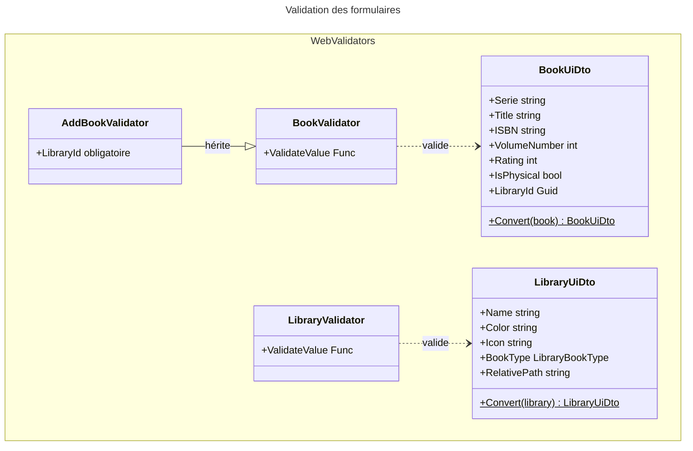
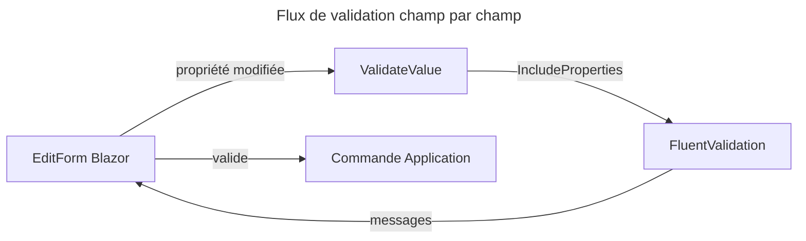

# C4 Code Level : Web/Validators

## 1. Vue d'ensemble

- **Nom** : Web.Validators (validation des formulaires et DTO d'interface)
- **Description** : DTO de formulaire (`BookUiDto`, `LibraryUiDto`) qui portent les champs édités, et validateurs FluentValidation associés, avec validation champ par champ pour les formulaires Blazor.
- **Emplacement relatif** : `Web/Validators/`
- **Langage** : C# (.NET 10), FluentValidation, MudBlazor (attributs `[Label]`)
- **Objectif** : valider les saisies côté interface avant d'envoyer les commandes à `Application`, et convertir les entités du domaine en DTO d'édition.

## 2. Éléments de code

### 2.1 `BookUiDto` (`Web/Validators/BookUiDto.cs`, lignes 7 à 67)

```csharp
public class BookUiDto : Entity<Guid>
```

| Propriété | Type | Valeur par défaut | Libellé (`[Label]`) |
|---|---|---|---|
| `Serie` | `string` | `""` | Serie |
| `Title` | `string` | `""` | Title |
| `ISBN` | `string?` | `null` | ISBN |
| `VolumeNumber` | `int` | `1` | Volume Number |
| `ImageLink` | `string` | `""` | Image Link |
| `Rating` | `int` | `0` | Rating |
| `Authors` | `string` | `""` | Authors |
| `Publishers` | `string` | `""` | Publishers |
| `PublishDate` | `DateOnly?` | `null` | Publish Date |
| `NumberOfPages` | `int?` | `null` | Number of Pages |
| `LibraryId` | `Guid` | `Guid.Empty` | Library |
| `IsPhysical` | `bool` | `true` | (aucun) |

- **Méthode** : `public static BookUiDto Convert(Book book)` (lignes 46 à 66). Copie les champs de l'entité, fixe `IsPhysical = book is PhysicalBook`, et force `Rating = 0`.
- **Remarque** : `IsPhysical` détermine si l'ISBN est obligatoire. Les livres numériques importés sans correspondance peuvent n'en avoir aucun (commentaire lignes 42-43).
- **Dépendances** : `Domain.Books` (`Book`, `PhysicalBook`), `Domain.Primitives` (`Entity<Guid>`), `MudBlazor` (`LabelAttribute`).

### 2.2 `BookValidator` (`Web/Validators/BookValidator.cs`, lignes 7 à 75)

```csharp
public class BookValidator : AbstractValidator<BookUiDto>
public BookValidator()                                                                          // lignes 9-48
private static bool BeValidISBN(string isbn)                                                    // lignes 50-53
public Func<object, string, Task<IEnumerable<string>>> ValidateValue => async (model, propertyName) => ...   // lignes 55-74
```

- **Règles** (lignes 11 à 47)
  - `Title` : requis ; longueur maximale `BookConstants.MaxTitleLength`.
  - `ISBN` : requis si `IsPhysical` ; longueur maximale `MaxIsbnLength` ; format valide (10 ou 13 chiffres, `IsbnHelper.IsValidISBN`) si `IsPhysical` ou si la valeur n'est pas vide.
  - `Serie` : requis ; longueur maximale `MaxSerieLength`.
  - `VolumeNumber` : strictement supérieur à 0.
  - `ImageLink` : longueur maximale `MaxImageLinkLength`.
  - `Rating` : entre 0 et 5 inclus (0 = non noté).
  - `Authors`, `Publishers` : longueurs maximales.
  - `NumberOfPages` : strictement supérieur à 0 si renseigné.
  - `PublishDate` : pas dans le futur (UTC).
- **`ValidateValue`** : valide une seule propriété pour `EditForm` (`ValidationContext.IncludeProperties`). Retourne des messages, ou une liste vide si la propriété est valide.
- **Dépendances** : `FluentValidation`, `Application.Helpers` (`IsbnHelper`), `Domain.Books` (`BookConstants`).

### 2.3 `AddBookValidator` (`Web/Validators/AddBookValidator.cs`, lignes 6 à 13)

```csharp
public sealed class AddBookValidator : BookValidator
public AddBookValidator()   // lignes 8-12
```

- **Description** : hérite de `BookValidator` et ajoute la règle `LibraryId` non vide (« Choose a library ») pour la création d'un livre.
- **Dépendances** : `BookValidator`.

### 2.4 `LibraryUiDto` (`Web/Validators/LibraryUiDto.cs`, lignes 8 à 38)

```csharp
public class LibraryUiDto : Entity<Guid>
public string RelativePath => Name.RemoveDiacritics().ToUpperInvariant();      // ligne 25
public static LibraryUiDto Convert(Library library)                             // lignes 27-37
```

| Propriété | Type | Valeur par défaut | Libellé |
|---|---|---|---|
| `Name` | `string` | `""` | Name |
| `Color` | `string` | `"#5C6BC0"` | Color |
| `Icon` | `string` | `"CollectionsBookmark"` | Icon |
| `BookType` | `LibraryBookType` | `Physical` | Type |
| `DefaultBookSortOrder` | `BookSortOrder` | `IdDesc` | (aucun) |
| `RelativePath` | `string` (calculée) | - | RelativePath |

- **Description** : DTO d'édition d'une bibliothèque. `RelativePath` est une version normalisée du nom (sans accents, en majuscules).
- **Dépendances** : `Domain.Libraries` (`Library`, `LibraryBookType`), `Domain.Extensions` (`RemoveDiacritics`), `Domain.Primitives`, `Domain` (`BookSortOrder`).

### 2.5 `LibraryValidator` (`Web/Validators/LibraryValidator.cs`, lignes 6 à 49)

```csharp
public class LibraryValidator : AbstractValidator<LibraryUiDto>
public LibraryValidator()                                                                       // lignes 8-27
public Func<object, string, Task<IEnumerable<string>>> ValidateValue => async (model, propertyName) => ...   // lignes 29-48
```

- **Règles**
  - `Name` : requis ; longueur maximale `LibraryConstants.MaxNameLength`.
  - `Color` : requis puis format `^#[0-9A-Fa-f]{6}$` (arrêt de la cascade en cas d'échec de `NotEmpty`).
  - `Icon` : requis ; longueur maximale `LibraryConstants.MaxIconLength`.
  - `BookType` : valeur de l'énumération (`IsInEnum`).
- **`ValidateValue`** : même principe que `BookValidator.ValidateValue`.
- **Dépendances** : `FluentValidation`, `Domain.Libraries` (`LibraryConstants`).

## 3. Dépendances

### 3.1 Internes

- `Web/Components` (pages et formulaires de livres et de bibliothèques) : consomment les DTO et les `ValidateValue`.
- `Application` : `Application.Helpers.IsbnHelper`, commandes de création et de modification.
- `Domain` : `Book`, `PhysicalBook`, `Library`, `BookConstants`, `LibraryConstants`, `Entity<TId>`, `RemoveDiacritics`.

### 3.2 Externes

- FluentValidation (`AbstractValidator`, `ValidationContext`, `CascadeMode`, `ApplyConditionTo`).
- MudBlazor (`LabelAttribute`).

## 4. Relations





## 5. Remarques

- Les messages de validation sont en anglais (« Enter a title », « Name is required. ») alors que l'interface est en français : ils ne sont pas localisés.
- `BookUiDto.Convert` force `Rating = 0` : la note n'est pas reprise depuis l'entité.
- Les constantes de longueur (`BookConstants`, `LibraryConstants`) sont définies dans `Domain` et n'ont pas été relues ici.
