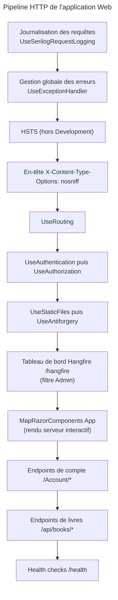
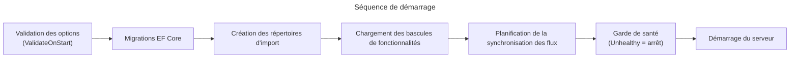

# C4 Code Level : Web (racine)

## 1. Vue d'ensemble

- **Nom** : Web (racine du projet)
- **Description** : Hôte ASP.NET Core et Blazor Server de l'application. Il assure la composition racine (injection de dépendances), le pipeline HTTP, l'authentification Auth0, Hangfire, les health checks, la journalisation Serilog et la gestion globale des erreurs.
- **Emplacement relatif** : `Web/` (fichiers directement dans ce dossier, hors sous-dossiers)
- **Langage** : C# (.NET 10, `ImplicitUsings` et `Nullable` activés), Razor, JSON, Dockerfile
- **Objectif** : démarrer l'application, enregistrer les services, exposer les endpoints HTTP, valider la configuration au démarrage et produire une réponse d'erreur normalisée.

## 2. Éléments de code

### 2.1 `Program.cs` (instructions de haut niveau, lignes 1 à 356)

Point d'entrée de l'application. Il ne déclare aucune classe : il enregistre les services puis construit le pipeline HTTP.

| Section | Lignes | Rôle |
|---|---|---|
| Gestion des erreurs | 36-38 | `AddExceptionHandler<GlobalExceptionHandler>()`, `AddProblemDetails()` |
| Chaîne de connexion | 40-42 | Lit `ConnectionStrings:DefaultConnection`, garde `NullOrWhiteSpace` |
| Options d'import | 44-50 | `ImportSettings` ; valide `Import:ImportDirectory` et `Import:TempDirectory` ; `ValidateOnStart` |
| Hangfire | 52-63 | Stockage PostgreSQL, serveur avec 1 worker (séquentiel, pour Raspberry Pi 4), files `import` et `default` |
| Stockage local | 65-72 | `LocalStorageConfiguration` : `RootPath` obligatoire, absolu, existant |
| Clients de métadonnées | 74-164 | `HttpClient` typés (OpenLibrary, BnF, Google Books, Bedetheque, SerpApi, Bubble) protégés par `SsrfGuardHandler` avec liste blanche d'hôtes ; redirections désactivées |
| Import de flux | 166-167 | `AddFeedImport(configuration)` (voir `Web/Configuration`) |
| Application et infrastructure | 169-171 | `AddApplication()` et `AddInfrastructure(connectionString, rootPath, configuration)` |
| Journalisation | 173-180 | Niveaux pilotables à chaud (`LogLevelSwitches`), écriture en deux fichiers (`WriteToSplitFiles`) |
| Auth0 | 182-195 | `AddAuth0WebAppAuthentication`, scope `openid profile email` |
| Cookie | 197-202 | Expiration 7 jours, glissante |
| Data Protection | 204-208 | Clés de chiffrement persistées dans `ApplicationDbContext` (application `MyComicsManager`) |
| État d'authentification | 210-212 | `AddCascadingAuthenticationState()`, `CustomAuthenticationStateProvider` |
| Razor | 214-215 | `AddRazorComponents().AddInteractiveServerComponents()` |
| Health checks | 217-229 | Cache singleton par check ; checks : application, Npgsql, `import-directory`, `cloudinary`, `debrid-link`, `miniflux` |
| MudBlazor | 231-242 | Snackbar en bas à droite, 10 s d'affichage, variante `Filled` |
| Services métier | 244-266 | Enregistrements scoped (bibliothèques, livres, déplacement, lecteur, import, ISBN, statistiques, utilisateur courant) et singletons (enfileurs Hangfire) ; `FileWatcherService` et `LibraryIconsWarmupService` en `HostedService` |
| Migrations | 270-275 | `Database.MigrateAsync()` au démarrage (sans verrou distribué, instance unique) |
| Répertoires | 277-280 | Création de `ImportDirectory` et `TempDirectory` |
| Fonctionnalités | 282-286 | `LoadFeatureTogglesAsync()` puis `ScheduleFeedImportSync()` |
| Garde de démarrage | 288-309 | Exécute `HealthCheckService` ; un check `Unhealthy` lève `InvalidOperationException` ; un check `Degraded` ne produit qu'un avertissement |
| Pipeline HTTP | 311-352 | Voir la section 4 |
| Démarrage | 354-356 | `StartupInfo.Print(...)` puis `RunAsync()` |

Le code référence le namespace `Web.Services` (par exemple `FileWatcherService`, `LibraryIconsWarmupService`, `CurrentUserService`, `LibraryStateService`, `PopupAnchorLocator`), situé hors de ce dossier et hors périmètre de cette documentation.

### 2.2 `GlobalExceptionHandler` (`Web/GlobalExceptionHandler.cs`, lignes 6 à 35)

```csharp
public sealed class GlobalExceptionHandler(ILogger<GlobalExceptionHandler> logger) : IExceptionHandler
{
    public async ValueTask<bool> TryHandleAsync(HttpContext httpContext, Exception exception, CancellationToken cancellationToken)
}
```

- **Description** : gestionnaire d'exceptions global (`IExceptionHandler`). Il journalise l'erreur puis répond `500` avec un `ProblemDetails` (`Title = "Server error"`, `Content-Type: application/problem+json`).
- **Comportement** : retourne `false` si la réponse a déjà commencé (`HasStarted`) ou si l'exception est nulle.
- **Emplacement** : lignes 6 à 35.
- **Dépendances** : `ILogger<GlobalExceptionHandler>`, `Microsoft.AspNetCore.Diagnostics`, `Microsoft.AspNetCore.Mvc`.

### 2.3 `CustomAuthenticationStateProvider` (`Web/CustomAuthenticationStateProvider.cs`, lignes 11 à 66)

```csharp
internal class CustomAuthenticationStateProvider(
    IUserReadService userReadService,
    IRepository<User, Guid> userRepository,
    IUnitOfWork unitOfWork) : ServerAuthenticationStateProvider

public override async Task<AuthenticationState> GetAuthenticationStateAsync()   // lignes 25-53
private async Task ProvisionAsync(string sub, string? email)                    // lignes 55-65
```

- **Description** : étend l'état d'authentification Blazor Server. Pour un utilisateur authentifié, elle crée l'utilisateur applicatif (`User.Create(email, sub)`) s'il n'existe pas encore (recherche par identifiant `sub`). La provision est exécutée une fois par circuit ; les appels concurrents attendent la même tâche, et un échec est réessayé à l'appel suivant.
- **Dépendances** : `IUserReadService`, `IRepository<User, Guid>`, `IUnitOfWork`, `Domain.Users.User`, `UsersError.NotFound`.

### 2.4 `StartupInfo` (`Web/StartupInfo.cs`, lignes 8 à 73)

```csharp
internal static class StartupInfo
internal static void Print(ILogger logger)                 // lignes 14-53
internal static string GetInBestUnit(long size)            // lignes 55-71
```

- **Description** : journalise au démarrage une bannière, l'architecture, l'OS, le runtime, l'utilisateur, le nom d'hôte, le nombre de processeurs, la mémoire disponible, et les versions des assemblies dont `AssemblyProduct` vaut `MCM`.
- **Dépendances** : `System.Net.Dns`, `System.Runtime.InteropServices.RuntimeInformation`, `System.Reflection`, `ILogger`.

### 2.5 Fichiers de configuration et de déploiement

- **`appsettings.json`** : sections `Serilog`, `AllowedHosts`, `ConnectionStrings`, `Auth0`, `LocalStorage`, `Cloudinary`, `OpenLibrary`, `BnfCatalogue`, `GoogleBooks`, `Bedetheque`, `Bubble`, `Import`, `IsbnOcr`, `FeedImport`, `Miniflux`, `DebridLink`. Les valeurs sont des substituts (`domain`, `client`, `apikey`, `need_to_be_not_empty`) ; les clés d'API sont vides. Aucun secret réel n'est présent et ce document n'en reproduit aucun.
- **`appsettings.Production.json`** et **`appsettings.Staging.json`** : seul `ConnectionStrings:DefaultConnection` est surchargé, avec la valeur de substitution `need_to_be_overridden_by_env_var`.
- **`Dockerfile`** : construction multi-étapes.
  - Étape `build` : image SDK `10.0.402-noble`, restauration puis publication (`-p:RunAnalyzers=false`).
  - Étape finale : image runtime ASP.NET `10.0.13-noble`, installation de `curl`, `tesseract-ocr` et `tesseract-ocr-eng` (OCR de l'ISBN).
  - `EXPOSE 8080`, utilisateur `$APP_UID`, point d'entrée `./Web`.
  - `HEALTHCHECK` toutes les 30 s : `curl -fsS http://localhost:8080/health`.
- **`Web.csproj`** : cible `net10.0`. Références de projet vers `Application`, `Domain` et `Persistence`. Paquets (versions dans `Directory.Packages.props`) : Ardalis.GuardClauses, Hangfire.AspNetCore, Hangfire.Core, Hangfire.PostgreSql, AspNetCore.HealthChecks (ApplicationStatus, NpgSql, UI.Client), Auth0.AspNetCore.Authentication, FluentValidation, Microsoft.EntityFrameworkCore.Design, MudBlazor, Serilog.AspNetCore.

## 3. Dépendances

### 3.1 Internes

- `Application` : `ApplicationDependencyInjection`, `IUserReadService`, `IFeatureToggleOverrideRepository`, `IImportJobEnqueuer`, services métier.
- `Domain` : `User`, `Book`, `Library`, `FeatureToggle`, `ImportSettings`, primitives `Result`.
- `Persistence` : `ApplicationDbContext`, `ProjectDependencyInjection` (`AddInfrastructure`).
- Sous-dossiers de `Web` : `Configuration`, `EndPoints`, `Infrastructure`, `Validators`, `Components`, `Enums`, `Extensions`, `Properties`.

### 3.2 Externes

- ASP.NET Core 10 (Razor Components, Authentication, Health checks, Data Protection, Antiforgery).
- Auth0.AspNetCore.Authentication (OIDC).
- Hangfire (dashboard `/hangfire`, stockage PostgreSQL).
- Serilog (fichiers rotatifs quotidiens, `SourceContext`).
- MudBlazor, FluentValidation, Ardalis.GuardClauses.
- PostgreSQL (EF Core, Npgsql).
- Image Docker `mcr.microsoft.com/dotnet/*`, Tesseract OCR, curl.

## 4. Relations

Pipeline HTTP tel que configuré dans `Program.cs` (ordre d'exécution, lignes 311 à 352) :



Séquence de démarrage :



## 5. Remarques

- `GlobalExceptionHandler` écrit le message de journal `"Exceptionoccured: {Message}"` (il manque un espace).
- `ImportDirectoryHealthCheck` (health check `import-directory`) n'utilise pas le cache `HealthCheckResultCache`, alors que `/health` est public et non authentifié. Chaque appel écrit puis supprime un fichier `.healthcheck` dans le répertoire d'import.
- Le code des bibliothèques (`Serilog`, `LogLevelSwitches`) s'appuie sur un répertoire de logs `log` relatif au répertoire de travail (`WriteToSplitFiles`).
