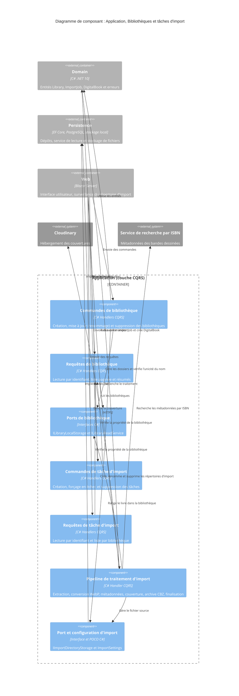

# Niveau Composant C4 : Application – Bibliothèques et tâches d'import

## 1. Vue d'ensemble

- **Nom** : Application – Bibliothèques et tâches d'import
- **Description** : Ensemble cohérent de cas d'usage CQRS gérant le cycle de vie des bibliothèques (numériques ou physiques) et des tâches d'import de fichiers (CBZ, CBR, ZIP, RAR, PDF) qui alimentent les bibliothèques numériques.
- **Type** : Composant applicatif (couche Application, handlers CQRS et ports)
- **Technologie** : C# (.NET 10), CQRS (`ICommand` / `IQuery`), pattern `Result<T>`, Ardalis.GuardClauses, Microsoft.Extensions.Logging, `TimeProvider`. Espaces de noms `Application.Libraries.*` et `Application.ImportJobs.*`.

## 2. Objectif

Le composant porte la logique applicative de deux sous-domaines étroitement liés :

- **Bibliothèques** : créer, lire, lister, résumer, mettre à jour (y compris le renommage avec déplacement des dossiers) et supprimer les bibliothèques d'un utilisateur, en gardant le système de fichiers cohérent avec la base.
- **Tâches d'import** : enregistrer une demande d'import, exécuter le pipeline asynchrone qui transforme un fichier source en `DigitalBook`, suivre les tâches, forcer leur échec ou les supprimer.

Le couplage est double : les commandes de bibliothèque utilisent le port `IImportDirectoryStorage` (sous-répertoire d'import par bibliothèque), et chaque tâche d'import appartient à une bibliothèque dont la propriété est vérifiée. Le composant définit des ports (`ILibraryLocalStorage`, `ILibraryReadService`, `IImportDirectoryStorage`) dont les implémentations sont dans `Persistence`, et la configuration `ImportSettings`.

## 3. Fonctionnalités logicielles

### Bibliothèques

- **Création** : unicité du nom par utilisateur, validation par l'entité `Library`, création du dossier de stockage et du dossier d'import pour une bibliothèque numérique, puis persistance.
- **Lecture par identifiant** : contrôle de propriété ; une bibliothèque absente ou d'un autre utilisateur renvoie la même erreur `NotFound`.
- **Liste paginée** : recherche textuelle, tri par colonne et ordre, pagination, déléguées au service de lecture.
- **Résumés** : nom, couleur, icône, type, nombre de livres et jusqu'à 3 dernières couvertures (`LibrarySummary`), sans pagination.
- **Mise à jour** : couleur, icône, ordre de tri par défaut des livres et nom optionnel ; le renommage déplace les dossiers (stockage puis import) avec tentative de retour arrière en cas d'échec partiel.
- **Suppression** : contrôle de propriété, suppression des dossiers (bibliothèque numérique) avant retrait de l'entité.

### Tâches d'import

- **Création** : validation des paramètres et de l'extension, contrôle de propriété et de type `Digital`, dédoublonnage des tâches actives par chemin, persistance au statut `Pending`.
- **Traitement (pipeline)** : vérification de l'espace disque (3 fois la taille du fichier), extraction, conversion WebP avec progression, recherche de métadonnées (ComicInfo.xml, ISBN du nom de fichier, OCR), envoi de la couverture en best-effort, construction de l'archive CBZ, finalisation (déplacement, création du `DigitalBook`, compensation), reprise des tâches bloquées et gestion du fichier source (suppression ou déplacement vers le répertoire d'erreur).
- **Lecture par identifiant** et **liste par bibliothèque**, avec contrôle de propriété via la bibliothèque.
- **Forçage en échec** : débloque une tâche restée dans un statut intermédiaire.
- **Suppression** : uniquement pour les tâches `Completed` ou `Failed`.
- **Configuration** : `ImportSettings` (répertoires d'import et temporaire, largeur cible des images, intervalle d'interrogation, extensions acceptées, taille maximale).

## 4. Éléments de code

### Bibliothèques

- [c4-code-Application-Libraries.md](./c4-code-Application-Libraries.md) : ports `ILibraryLocalStorage` et `ILibraryReadService` (racine du dossier, sans handler).
- [c4-code-Application-Libraries-Create.md](./c4-code-Application-Libraries-Create.md) : `CreateLibraryCommand` et son handler.
- [c4-code-Application-Libraries-Delete.md](./c4-code-Application-Libraries-Delete.md) : `DeleteLibraryCommand` et son handler.
- [c4-code-Application-Libraries-GetById.md](./c4-code-Application-Libraries-GetById.md) : `GetLibraryQuery` et son handler.
- [c4-code-Application-Libraries-List.md](./c4-code-Application-Libraries-List.md) : `GetLibrariesQuery` et son handler.
- [c4-code-Application-Libraries-Summaries.md](./c4-code-Application-Libraries-Summaries.md) : `GetLibrarySummariesQuery`, son handler et `LibrarySummary`.
- [c4-code-Application-Libraries-Update.md](./c4-code-Application-Libraries-Update.md) : `UpdateLibraryCommand` et son handler.

### Tâches d'import

- [c4-code-Application-ImportJobs.md](./c4-code-Application-ImportJobs.md) : port `IImportDirectoryStorage` et configuration `ImportSettings` (racine du dossier, sans handler).
- [c4-code-Application-ImportJobs-Create.md](./c4-code-Application-ImportJobs-Create.md) : `CreateImportJobCommand` et son handler.
- [c4-code-Application-ImportJobs-Process.md](./c4-code-Application-ImportJobs-Process.md) : `ProcessImportJobCommand`, regroupements de dépendances et pipeline en sept étapes.
- [c4-code-Application-ImportJobs-GetById.md](./c4-code-Application-ImportJobs-GetById.md) : `GetImportJobQuery` et son handler.
- [c4-code-Application-ImportJobs-List.md](./c4-code-Application-ImportJobs-List.md) : `ListImportJobsQuery` et son handler.
- [c4-code-Application-ImportJobs-ForceFail.md](./c4-code-Application-ImportJobs-ForceFail.md) : `ForceFailImportJobCommand` et son handler.
- [c4-code-Application-ImportJobs-Delete.md](./c4-code-Application-ImportJobs-Delete.md) : `DeleteImportJobCommand` et son handler.

## 5. Interfaces

Protocole : médiateur CQRS en processus (`ICommand` / `IQuery`), les handlers retournent des `Result` / `Result<T>`.

### Commandes et requêtes exposées

| Nom | Signature | Retour |
|---|---|---|
| `CreateLibraryCommand` | `(string Name, string Color, string Icon, LibraryBookType BookType, Guid UserId)` | `Result<Library>` |
| `UpdateLibraryCommand` | `(Guid Id, string? Name, string Color, string Icon, Guid UserId, BookSortOrder? DefaultBookSortOrder = null)` | `Result<Library>` |
| `DeleteLibraryCommand` | `(Guid Id, Guid UserId)` | `Result` |
| `GetLibraryQuery` | `(Guid Id, Guid UserId)` | `Result<Library>` |
| `GetLibrariesQuery` | `(string? searchTerm, LibrariesColumn? sortColumn, SortOrder? sortOrder, int page, int pageSize, Guid UserId)` | `Result<IPagedList<Library>>` |
| `GetLibrarySummariesQuery` | `(Guid UserId)` | `Result<IReadOnlyList<LibrarySummary>>` |
| `CreateImportJobCommand` | `(string OriginalFileName, string OriginalFilePath, long OriginalFileSize, Guid LibraryId, Guid UserId)` | `Result<ImportJob>` |
| `ProcessImportJobCommand` | `(Guid ImportJobId)` | `Result<DigitalBook>` |
| `ForceFailImportJobCommand` | `(Guid ImportJobId, Guid UserId)` | `Result` |
| `DeleteImportJobCommand` | `(Guid ImportJobId, Guid UserId)` | `Result` |
| `GetImportJobQuery` | `(Guid ImportJobId, Guid UserId)` | `Result<ImportJob>` |
| `ListImportJobsQuery` | `(Guid LibraryId, Guid UserId)` | `Result<IReadOnlyList<ImportJob>>` |

Type de résultat : `LibrarySummary(Guid Id, string Name, string Color, string Icon, LibraryBookType BookType, int BookCount)` avec `Covers` (au plus `MaxCovers` = 3 URL).

### Ports définis par le composant (implémentés dans Persistence)

- `ILibraryLocalStorage` :
  - `string rootPath { get; init; }`
  - `Result Create(string folderName)`
  - `Result Delete(string folderName)`
  - `Result Move(string originFolderName, string destinationFolderName)`
  - `Result<string> MoveFile(string sourceFilePath, string destinationFolderName)`
- `ILibraryReadService` :
  - `Task<IPagedList<Library>> GetLibrariesAsync(string? searchTerm, LibrariesColumn? sortColumn, SortOrder? sortOrder, int page, int pageSize, Guid userId, CancellationToken ct = default)`
  - `Task<Library?> GetByNameAsync(string name, Guid userId, CancellationToken ct = default)`
  - `Task<IReadOnlyList<LibrarySummary>> GetSummariesAsync(Guid userId, CancellationToken ct = default)`
  - `Task<bool> ExistsByNameAsync(string name, Guid userId, Guid? excludeId = null, CancellationToken ct = default)`
- `IImportDirectoryStorage` :
  - `Result EnsureExists(string directoryName)`
  - `Result Delete(string directoryName)`
  - `Result Move(string originDirectoryName, string destinationDirectoryName)`
  - `Result DeleteOriginalFile(string absoluteFilePath)`
  - `Result MoveOriginalFileToError(string absoluteFilePath)`
  - `Result<string> GetAvailableFilePath(string directoryName, string fileName)`
  - `Result DepositFile(string sourceFilePath, string destinationFilePath)`

### Configuration

- `ImportSettings` (liée par `IOptions<ImportSettings>`) : `ImportDirectory`, `TempDirectory`, `ImageTargetWidth` (1400), `PollingIntervalSeconds` (30), `SupportedExtensions`, `MaxFileSizeMb` (500).

## 6. Dépendances

### Composants et couches utilisés

- **Application/Interfaces** : `IRepository<TEntity, TEntityId>`, `IUnitOfWork`, `IPagedList<T>`, `IImportJobRepository`, `IBookRepository`, `IComicSearchService`, `ICloudinaryService`, `ITempWorkspace`, `IIsbnPageScanner`, `IArchiveExtractor`, `IPdfImageExtractor`, `IImageProcessor`, `IComicArchiveBuilder`, `IComicInfoXmlService`.
- **Application/Abstractions/Messaging** : `ICommand`, `IQuery`, `ICommandHandler`, `IQueryHandler`.
- **Application/Helpers** : `FileNameIsbnExtractor`, `IsbnHelper`.
- **Domain** : `Library`, `LibraryBookType`, `BookSortOrder`, `LibrariesColumn`, `LibrariesError`, `ImportJob`, `ImportJobStatus`, `ImportJobError`, `DigitalBook`, `BookMetadata`, `BooksError`, `Result`, `Result<T>`, `TError`, `SortOrder`.
- **Persistence** (implémentations des ports, hors composant) : `LibraryLocalStorage`, `ImportDirectoryStorage`, service de lecture des bibliothèques, dépôts.
- **Web** (consommateurs de `ImportSettings`) : `FileWatcherService`, `ImportService`, `ImportDirectoryHealthCheck`.

### Systèmes externes

- **Cloudinary** : envoi de la couverture (best-effort), via `ICloudinaryService`.
- **Service de recherche de bandes dessinées par ISBN** : via `IComicSearchService`.
- **Système de fichiers** : dossiers de bibliothèque, répertoires d'import, d'erreur et temporaire, via les ports de stockage.
- **Bibliothèques externes** : Ardalis.GuardClauses, Microsoft.Extensions.Logging.

## 7. Diagramme de composant

Note : dans le code, la vérification de propriété passe par `IRepository<Library, Guid>` (couche `Application/Interfaces`) et non par les handlers de lecture ; la relation `jobCmd` vers `libQry` du diagramme est une simplification logique de ce contrôle.
