# Niveau C4 Composant : Application – Imports depuis flux (Miniflux / Debrid-Link)

## 1. Vue d'ensemble

- **Nom** : Application – Imports depuis flux (Miniflux / Debrid-Link)
- **Description** : Composant applicatif qui automatise l'import de bandes dessinées : synchronisation des articles étoilés de Miniflux, analyse des pages d'articles, arbitrage manuel, téléchargement via Debrid-Link et dépôt dans le dossier d'import de la bibliothèque « À trier ».
- **Type** : Module de la couche Application (cas d'usage CQRS, logique d'analyse pure et ports d'accès externes)
- **Technologie** : C# (.NET 10), CQRS (`ICommandHandler` / `IQueryHandler`, enregistrement automatique par Scrutor), `Result<T>`, HtmlAgilityPack, `GeneratedRegex`, `IOptions<T>`, `ILogger<T>`

## 2. Objectif

Le composant évite à l'utilisateur de saisir à la main les livres qu'il repère dans ses flux. Il transforme un article étoilé dans Miniflux en une « décision d'import » qui suit un cycle de vie : `Pending`, analyse, éventuel arbitrage (`AwaitingArbitration`), téléchargement, puis suppression ou conservation.

Il garde la logique métier dans la couche Application. Les accès à Miniflux, à Debrid-Link, aux pages web et au téléchargement de fichiers sont des ports (interfaces) implémentés dans `Web/Infrastructure`. Les repères métier sont l'ISBN, la détection de doublons dans les bibliothèques de l'utilisateur et les miroirs d'un même livre.

## 3. Fonctionnalités logicielles

- **Synchronisation Miniflux** : lit les articles étoilés de la catégorie surveillée, crée une décision `Pending` par nouvel article, enregistre puis retire l'étoile. Les entrées rejetées par le domaine restent étoilées.
- **Analyse d'article** : contrôle le domaine source, récupère le HTML, extrait les liens de téléchargement, les regroupe en livres (miroirs), lit les métadonnées dans les liens, détecte les doublons et crée des décisions « frères » pour les articles multi-livres.
- **Extracteurs par site** : lecture ciblée du bloc d'article DataLife Engine pour planete-bd.org et zone-ebook.com. En cas de mise en page modifiée, l'extracteur journalise un avertissement et lit toute la page. Un extracteur générique sert de repli.
- **Arbitrage manuel** : choix du bon lien parmi des candidats ambigus, fusion de liens en miroirs, confirmation ou infirmation d'un doublon probable.
- **Téléchargement** : débridage du miroir avec Debrid-Link (hôtes pris en charge, quotas, limite de taille), téléchargement en flux dans le répertoire temporaire, création de l'`ImportJob` et dépôt du fichier dans le dossier d'import de la bibliothèque « À trier ».
- **Gestion manuelle** : forcer le téléchargement, ignorer, relancer, corriger série, titre et tome.
- **Suppression** : unitaire, ou en masse pour les décisions déjà téléchargées.
- **Consultation** : liste paginée des décisions, filtrable par statut et par texte, avec repérage des entrées Miniflux multi-livres.

## 4. Éléments de code

- [c4-code-Application-FeedImports.md](./c4-code-Application-FeedImports.md) - Racine du module : ports (`IMinifluxClient`, `IArticlePageFetcher`, `IDebridLinkClient`, `IFeedImportFileDownloader`), types de transfert et options (`FeedImportSettings`, `DebridLinkSettings`, `MinifluxSettings`)
- [c4-code-Application-FeedImports-Sync.md](./c4-code-Application-FeedImports-Sync.md) - Synchronisation Miniflux vers décisions `Pending`
- [c4-code-Application-FeedImports-Analyze.md](./c4-code-Application-FeedImports-Analyze.md) - Analyse d'une décision `Pending`
- [c4-code-Application-FeedImports-Analysis.md](./c4-code-Application-FeedImports-Analysis.md) - Logique pure d'analyse : extraction, regroupement, métadonnées, doublons
- [c4-code-Application-FeedImports-Analysis-Sites.md](./c4-code-Application-FeedImports-Analysis-Sites.md) - Extracteurs propres à planete-bd.org et zone-ebook.com
- [c4-code-Application-FeedImports-Arbitrate.md](./c4-code-Application-FeedImports-Arbitrate.md) - Arbitrage manuel des décisions ambiguës
- [c4-code-Application-FeedImports-Download.md](./c4-code-Application-FeedImports-Download.md) - Débridage Debrid-Link, téléchargement et dépôt dans l'import
- [c4-code-Application-FeedImports-Manage.md](./c4-code-Application-FeedImports-Manage.md) - Actions manuelles et corrections
- [c4-code-Application-FeedImports-Delete.md](./c4-code-Application-FeedImports-Delete.md) - Suppression unitaire et en masse
- [c4-code-Application-FeedImports-List.md](./c4-code-Application-FeedImports-List.md) - Requête paginée des décisions

## 5. Interfaces

### Commandes et requêtes exposées (CQRS, en process)

- **Protocole** : appels de handlers MediatR-like (`ICommandHandler` / `IQueryHandler`) depuis la couche Web (Blazor Server) ; retour via `Result<T>`.
- **Opérations** :
  - `SyncFeedImportsCommand(Guid UserId) : ICommand<SyncFeedImportsResult>` - synchronise Miniflux. Résultat : `SyncFeedImportsResult(int StarredEntries, int Created, int AlreadyKnown, int Rejected, int UnstarFailures)`
  - `AnalyzeFeedImportDecisionCommand(Guid DecisionId) : ICommand` - analyse une décision `Pending`
  - `ResolveFeedImportArbitrationCommand(Guid DecisionId, Guid UserId, FeedImportArbitrationAction Action, int? CandidateIndex = null) : ICommand` - résout un arbitrage
  - `DownloadFeedImportDecisionCommand(Guid DecisionId) : ICommand` - télécharge et dépose le livre
  - `ManageFeedImportDecisionCommand(Guid DecisionId, Guid UserId, FeedImportDecisionAction Action) : ICommand<FeedImportDecisionStatus>` - forcer, ignorer, relancer
  - `CorrectFeedImportDecisionCommand(Guid DecisionId, Guid UserId, string Serie, string? Title, int? Volume) : ICommand<FeedImportDecisionStatus>` - corrige série, titre et tome
  - `DeleteFeedImportDecisionCommand(Guid DecisionId, Guid UserId) : ICommand` - supprime une décision
  - `DeleteDownloadedFeedImportDecisionsCommand(Guid UserId) : ICommand<DeleteDownloadedFeedImportDecisionsResult>` - supprime en masse les décisions téléchargées. Résultat : `DeleteDownloadedFeedImportDecisionsResult(int Deleted, int Kept)`
  - `GetPagedFeedImportDecisionsQuery(Guid UserId, FeedImportDecisionStatus? Status, string? SearchTerm, int Page, int PageSize) : IQuery<FeedImportDecisionPage>` - liste paginée (page >= 1, taille de 1 à 100). Résultat : `FeedImportDecisionPage(IPagedList<FeedImportDecision> Decisions, IReadOnlySet<long> MultiBookEntryIds)`

### Ports sortants (implémentés hors du composant, dans Web/Infrastructure)

- **`IMinifluxClient`** : `GetCategoriesAsync(ct)`, `GetStarredEntriesAsync(long categoryId, ct)`, `UnstarAsync(long entryId, ct)`
- **`IArticlePageFetcher`** : `Task<Result<string>> GetHtmlAsync(Uri pageUri, ct)`
- **`IDebridLinkClient`** : `GetSupportedDomainsAsync(ct)`, `CheckAccountAsync(ct)`, `Task<Result<DebridLinkFile>> UnlockAsync(string url, ct)`
- **`IFeedImportFileDownloader`** : `Task<Result<DownloadedFile>> DownloadAsync(Uri downloadUrl, long maxBytes, ct)`
- **`IDownloadLinkExtractor`** (extensibilité) : implémenté par `GenericDownloadLinkExtractor`, `PlaneteBdLinkExtractor` et `ZoneEbookLinkExtractor`

## 6. Dépendances

### Composants utilisés

- **Domaine** : `FeedImportDecision`, `FeedImportDecisionStatus`, `Result<T>` et erreurs de domaine
- **Persistance (via interfaces Application)** : dépôt des décisions et `IFeedImportDecisionReadService` pour les lectures paginées
- **Composants Bibliothèques et Imports de l'Application** : `ILibraryReadService`, `CreateLibraryCommand`, `IImportDirectoryStorage`, `CreateImportJobCommand`, `IImportJobEnqueuer`, pour déposer le fichier dans la bibliothèque « À trier »
- **Web (composition root)** : implémentations des ports, page Feeds (`/feed-imports`)

### Systèmes externes

- **Miniflux** : lecteur de flux RSS auto-hébergé. Fournit les articles étoilés d'une catégorie surveillée, puis le retrait de l'étoile.
- **Debrid-Link** : service de débridage. Fournit les hôtes pris en charge, le contrôle du compte et la conversion d'un miroir en URL de téléchargement direct. Sans clé API, le téléchargement est refusé (`DebridLinkUnauthorized`).
- **planete-bd.org** : site d'articles (DataLife Engine), lu par `PlaneteBdLinkExtractor`.
- **zone-ebook.com** : site d'articles (DataLife Engine), lu par `ZoneEbookLinkExtractor`.

## 7. Diagramme de composant

```mermaid
C4Component
    title Diagramme de composant : Application – Imports depuis flux

    Container_Boundary(app, "Application (couche CQRS)") {
        Component(sync, "Synchronisation", "CommandHandler", "Lit les articles étoilés Miniflux et crée les décisions Pending")
        Component(analyze, "Analyse", "CommandHandler", "Récupère l'article, extrait et regroupe les liens, contrôle les doublons")
        Component(analysis, "Moteur d'analyse", "Logique pure C#", "Extracteurs de liens, regroupement, métadonnées, doublons")
        Component(sites, "Extracteurs par site", "HtmlAgilityPack", "Extraction DataLife Engine pour planete-bd.org et zone-ebook.com")
        Component(arbitrate, "Arbitrage", "CommandHandler", "Résout les ambiguïtés et les doublons probables")
        Component(download, "Téléchargement", "CommandHandler", "Débride, télécharge et dépose dans l'import")
        Component(manage, "Gestion manuelle", "CommandHandler", "Forcer, ignorer, relancer, corriger")
        Component(delete, "Suppression", "CommandHandler", "Supprime une décision ou les décisions téléchargées")
        Component(list, "Consultation", "QueryHandler", "Liste paginée et filtrable des décisions")
        Component(ports, "Contrats et options", "Interfaces et records", "Ports Miniflux, Debrid-Link, page et fichier, paramètres")
    }

    Container_Ext(web, "Web (Blazor Server)", "Composition root, page Feeds et implémentations des ports")
    ContainerDb_Ext(db, "PostgreSQL", "EF Core", "Décisions d'import")
    Container_Ext(imports, "Application – Imports de livres", "ImportJob et dossier d'import de la bibliothèque À trier")
    System_Ext(miniflux, "Miniflux", "Lecteur de flux RSS")
    System_Ext(debrid, "Debrid-Link", "Service de débridage")
    System_Ext(sitebd, "planete-bd.org", "Site d'articles")
    System_Ext(zone, "zone-ebook.com", "Site d'articles")

    Rel(web, sync, "Déclenche", "Commande")
    Rel(web, analyze, "Déclenche", "Commande")
    Rel(web, arbitrate, "Déclenche", "Commande")
    Rel(web, download, "Déclenche", "Commande")
    Rel(web, manage, "Déclenche", "Commande")
    Rel(web, delete, "Déclenche", "Commande")
    Rel(web, list, "Interroge", "Requête")

    Rel(analyze, analysis, "Utilise")
    Rel(analysis, sites, "Délègue l'extraction à")
    Rel(sync, ports, "Utilise IMinifluxClient")
    Rel(analyze, ports, "Utilise IArticlePageFetcher")
    Rel(download, ports, "Utilise IDebridLinkClient et IFeedImportFileDownloader")
    Rel(manage, analyze, "Relance l'analyse")

    Rel(sync, db, "Crée les décisions Pending")
    Rel(analyze, db, "Met à jour les décisions")
    Rel(arbitrate, db, "Met à jour les décisions")
    Rel(manage, db, "Met à jour les décisions")
    Rel(delete, db, "Supprime les décisions")
    Rel(list, db, "Lit les décisions", "Lecture paginée")
    Rel(download, imports, "Crée l'ImportJob et dépose le fichier")

    Rel(ports, miniflux, "Lit les articles étoilés et retire l'étoile", "HTTPS")
    Rel(ports, debrid, "Débride les miroirs", "HTTPS")
    Rel(ports, sitebd, "Récupère le HTML des articles", "HTTPS")
    Rel(ports, zone, "Récupère le HTML des articles", "HTTPS")
```

