# Niveau Composant C4 : Application – Livres et recherche de métadonnées

## 1. Vue d'ensemble

- **Nom** : Application – Livres et recherche de métadonnées
- **Description** : Composant de la couche Application qui regroupe tous les cas d'usage CQRS liés aux livres (création, consultation, modification, suppression, déplacement, lecture numérique, scan ISBN) et la recherche de métadonnées d'albums par ISBN auprès de catalogues externes.
- **Type** : Composant applicatif (handlers CQRS et services d'intégration), au sein du conteneur Web (application Blazor Server .NET 10).
- **Technologie** : C# (.NET 10), CQRS avec `Result<T>`, `HttpClient`, `HtmlAgilityPack`, `System.Text.Json`, `System.Xml.Linq`, `Ardalis.GuardClauses`, `Microsoft.Extensions.Logging` et `Options`. Handlers enregistrés automatiquement par Scrutor.

## 2. Objectif

Ce composant porte toute la logique métier applicative autour d'un livre, sans dépendre de l'interface ni de la persistance.

- Il garantit les règles de propriété (un utilisateur n'accède qu'aux livres de ses propres bibliothèques) et la cohérence entre base de données et système de fichiers (validations avant tout effet de bord, compensation lors d'un déplacement).
- Il permet de compléter automatiquement les métadonnées d'un album (titre, série, tome, auteurs, éditeur, date, pages, couverture) à partir de son ISBN, en interrogeant plusieurs sources par ordre de priorité, puis d'envoyer la couverture vers Cloudinary.
- Il attribue automatiquement un ISBN aux livres numériques sans ISBN grâce à un scan OCR de leurs pages.

## 3. Fonctionnalités logicielles

- **Création d'un livre physique** : validation des métadonnées et de l'ISBN, normalisation, refus des doublons, contrôle du type de bibliothèque, enregistrement d'une lecture si le livre est déjà noté.
- **Consultation d'un livre** : lecture par identifiant avec contrôle de propriété ; liste complète (utilisateur ou bibliothèque) ; liste paginée de résumés (`BookSummaryDto`) avec tri et recherche texte.
- **Modification des métadonnées** : validation de l'ISBN, détection de doublon, mise à jour de l'agrégat `Book`.
- **Suppression d'un livre** : suppression en base puis du fichier associé pour un livre numérique.
- **Historique de lecture** : ajout d'une date de lecture (note de 1 à 5) et suppression d'une date de lecture.
- **Déplacement entre bibliothèques** : déplacement du fichier d'un livre numérique avec compensation (`RestoreFile`) en cas d'échec, et liste des destinations possibles avec bibliothèque suggérée (celle qui contient le plus de tomes de la même série).
- **Lecteur de livres numériques** : informations du lecteur (nombre de pages, dernière page lue, réglages), contenu d'une page, mémorisation de la progression, réglages d'affichage (disposition, défilement, sens de lecture).
- **Scan ISBN par OCR** : scan d'un livre, scan en arrière-plan d'une bibliothèque, mise en file d'attente du travail, configuration OCR (Tesseract). Un ISBN unique est attribué automatiquement ; les autres cas sont conservés comme candidats.
- **Recherche de métadonnées par ISBN** : façade `ComicSearchService` qui interroge dans l'ordre la BnF, Google Books, Open Library, Bubble puis Bedetheque, avec recherche de couverture complémentaire, analyse du titre (série et tome) et téléversement de la couverture vers Cloudinary (ou d'une couverture fournie par l'utilisateur).
- **Résilience des sources** : activation par `IFeatureToggles`, coupe-circuit `BedethequeCircuit` après un défi Cloudflare, cache ISBN vers URL pour Bedetheque.

## 4. Éléments de code

Ce composant contient les éléments de code suivants.

- [c4-code-Application-Books.md](./c4-code-Application-Books.md) : racine `Application.Books`, DTO partagés `BookIdentityDto` et `BookSerieLocationDto`.
- [c4-code-Application-Books-Create.md](./c4-code-Application-Books-Create.md) : création d'un livre physique.
- [c4-code-Application-Books-GetById.md](./c4-code-Application-Books-GetById.md) : lecture d'un livre par identifiant.
- [c4-code-Application-Books-List.md](./c4-code-Application-Books-List.md) : liste complète et liste paginée de résumés.
- [c4-code-Application-Books-Update.md](./c4-code-Application-Books-Update.md) : modification des métadonnées.
- [c4-code-Application-Books-Delete.md](./c4-code-Application-Books-Delete.md) : suppression d'un livre et de son fichier.
- [c4-code-Application-Books-AddReadingDate.md](./c4-code-Application-Books-AddReadingDate.md) : ajout d'une date de lecture.
- [c4-code-Application-Books-DeleteReadingDate.md](./c4-code-Application-Books-DeleteReadingDate.md) : suppression d'une date de lecture.
- [c4-code-Application-Books-Move.md](./c4-code-Application-Books-Move.md) : déplacement d'un livre avec compensation.
- [c4-code-Application-Books-MoveTargets.md](./c4-code-Application-Books-MoveTargets.md) : destinations de déplacement et suggestion.
- [c4-code-Application-Books-Read.md](./c4-code-Application-Books-Read.md) : informations du lecteur, pages, contrôle d'accès `OwnedDigitalBook`.
- [c4-code-Application-Books-ReaderDisplay.md](./c4-code-Application-Books-ReaderDisplay.md) : réglages d'affichage du lecteur.
- [c4-code-Application-Books-ReadingProgress.md](./c4-code-Application-Books-ReadingProgress.md) : progression de lecture.
- [c4-code-Application-Books-IsbnScan.md](./c4-code-Application-Books-IsbnScan.md) : scan OCR des ISBN (livre et bibliothèque).
- [c4-code-Application-ComicInfoSearch.md](./c4-code-Application-ComicInfoSearch.md) : catalogues externes, façade `ComicSearchService`, configurations `*Settings`.

## 5. Interfaces

### Commandes et requêtes CQRS (livres)

- **Protocole** : médiateur CQRS en processus (`ICommand`, `IQuery`) ; chaque handler renvoie un `Result` ou `Result<T>` (pas d'exception pour les erreurs métier).
- **Consommateur** : couche Web (composants Blazor).

**Commandes**

- `CreateBookCommand(string Serie, string Title, string ISBN, Guid LibraryId, Guid UserId, int VolumeNumber = 1, string ImageLink = "", int Rating = 1, string Authors = "", string Publishers = "", DateOnly? PublishDate = null, int? NumberOfPages = null) : ICommand<Book>` : crée un livre physique.
- `UpdateBookCommand(Guid Id, string Serie, string Title, string? ISBN, int VolumeNumber, string ImageLink, Guid UserId, string Authors = "", string Publishers = "", DateOnly? PublishDate = null, int? NumberOfPages = null) : ICommand<Book>` : modifie les métadonnées.
- `DeleteBookCommand(Guid Id, Guid UserId) : ICommand` : supprime un livre.
- `AddReadingDateCommand(Guid BookId, int Rating, Guid UserId) : ICommand<ReadingDate>` : ajoute une lecture.
- `DeleteReadingDateCommand(Guid BookId, Guid ReadingDateId, Guid UserId) : ICommand` : supprime une lecture.
- `MoveBookCommand(Guid BookId, Guid TargetLibraryId, Guid UserId) : ICommand<Book>` : déplace un livre.
- `UpdateReaderSettingsCommand(Guid BookId, Guid UserId, ReaderSettings Settings) : ICommand` : réglages d'affichage.
- `UpdateReadingProgressCommand(Guid BookId, Guid UserId, int PageIndex) : ICommand` : progression de lecture.
- `ScanBookIsbnCommand(Guid BookId, Guid UserId) : ICommand<IsbnScanOutcome>` : scan immédiat d'un livre.
- `StartLibraryIsbnScanCommand(Guid LibraryId, Guid UserId) : ICommand<int>` : met en file le scan d'une bibliothèque et renvoie le nombre de livres concernés.
- `ScanLibraryIsbnsCommand(Guid LibraryId) : ICommand<LibraryIsbnScanSummary>` : scan d'une bibliothèque en arrière-plan.

**Requêtes**

- `GetBookByIdQuery(Guid Id, Guid UserId) : IQuery<Book>`
- `GetBooksQuery(Guid UserId, Guid? LibraryId = null) : IQuery<List<Book>>`
- `GetPagedBooksQuery(Guid UserId, Guid LibraryId, int Page, int PageSize, BookSortOrder SortOrder, string? SearchTerm = null) : IQuery<IPagedList<BookSummaryDto>>`
- `GetBookMoveTargetsQuery(Guid BookId, Guid UserId) : IQuery<BookMoveTargets>`
- `GetBookReaderInfoQuery(Guid BookId, Guid UserId) : IQuery<BookReaderInfoDto>`
- `GetBookPageQuery(Guid BookId, Guid UserId, int PageIndex) : IQuery<ComicPage>`

**Types de données exposés** : `BookSummaryDto`, `BookIdentityDto`, `BookSerieLocationDto`, `BookMoveTargets`, `BookMoveTarget`, `BookReaderInfoDto`, `IsbnScanOutcome` (`Assigned`, `WithCandidates`, `WithoutIsbn`, `NotScanned`), `LibraryIsbnScanSummary(int Assigned, int WithCandidates, int WithoutIsbn, int NotScanned)`, `IsbnOcrSettings`.

### Recherche de métadonnées (`IComicSearchService`)

- **Protocole** : appels asynchrones en processus ; les catalogues sont joints en HTTP (REST/JSON, SRU/XML, HTML).
- **Opérations** (`ComicSearchService`) :
  - `SearchByIsbnAsync(string isbn, CancellationToken cancellationToken = default): Task<ComicSearchResult>` : recherche par priorité et téléversement de la couverture.
  - `SearchByIsbnWithLocalCoverAsync(string isbn, Stream? coverStream, string? coverFileName, CancellationToken cancellationToken = default): Task<ComicSearchResult>` : utilise la couverture fournie par l'utilisateur.
  - `ParseTitleInfo(string rawTitle, string? subtitle): (string Title, string Serie, int VolumeNumber)` : extrait série et tome d'un titre brut.
  - `UploadCoverAsync(Uri coverUrl, string isbn, CancellationToken cancellationToken = default): Task<string>` : téléverse une couverture distante.

### Interfaces de catalogue implémentées

Chaque service expose `bool IsEnabled { get; }` et `SearchByIsbnAsync(string isbn, CancellationToken)`.

- `IBnfCatalogueService` : `BnfCatalogueService`, renvoie `BnfBookResult`.
- `IGoogleBooksService` : `GoogleBooksService`, renvoie `GoogleBooksBookResult`.
- `IOpenLibraryService` : `OpenLibraryService`, renvoie `OpenLibraryBookResult`.
- `IBubbleService` : `BubbleService`, renvoie `BubbleBookResult`.
- `IBedethequeService` : `BedethequeService`, renvoie `BedethequeBookResult`.

Les cinq catalogues sont regroupés dans `BookCatalogues(IBnfCatalogueService Bnf, IGoogleBooksService GoogleBooks, IOpenLibraryService OpenLibrary, IBubbleService Bubble, IBedethequeService Bedetheque)`.

### Interfaces requises (ports implémentés ailleurs)

`IBookRepository`, `IRepository<Library, Guid>`, `IUnitOfWork`, `IBookReadService`, `ILibraryReadService`, `ILibraryLocalStorage`, `IBookFileService`, `IComicPageReader`, `IIsbnPageScanner`, `IIsbnScanJobEnqueuer`, `ICloudinaryService`, `IIsbnBedethequeCacheRepository`, `IFeatureToggles`.

## 6. Dépendances

### Composants utilisés

- **Application – Interfaces et abstractions** (`Application.Interfaces`, `Application.Abstractions.Messaging`) : contrats de dépôts, services de lecture, `ICommand`, `IQuery`, `IPagedList<T>`, `ComicPage`.
- **Application – Helpers** : `IsbnHelper` (validation et normalisation), `PublishDateHelper`, `IsbnScanPages`, `SerieMatcher`.
- **Application – Bibliothèques** : `ILibraryLocalStorage` (déplacement de fichiers) et contrôle de propriété des bibliothèques.
- **Domaine** : `Domain.Books` (`Book`, `PhysicalBook`, `DigitalBook`, `BookMetadata`, `ReadingDate`, `ReaderSettings`, `BooksError`), `Domain.Libraries` (`Library`, `LibrariesError`, `BookSortOrder`), `Domain.Primitives.Result`, `Domain.Settings.FeatureToggle`.
- **Persistance** : implémente `IBookRepository`, `IUnitOfWork`, `IBookReadService`, `IIsbnBedethequeCacheRepository` (par les interfaces uniquement).
- **Infrastructure de scan et de fichiers** : implémentations de `IIsbnPageScanner` (OCR Tesseract), `IIsbnScanJobEnqueuer`, `IComicPageReader`, `IBookFileService`.

### Systèmes externes

- **BnF** : API SRU (Dublin Core, requête `bib.fuzzyISBN`), source prioritaire, sans couverture.
- **Google Books** : API `volumes?q=isbn:` (clé API facultative, quota anonyme souvent épuisé).
- **Open Library** : API `/isbn/{isbn}.json` et service de couvertures.
- **Bubble (bubblebd.com)** : index Algolia `Albums` et pages d'albums (schema.org).
- **Bedetheque (bedetheque.com)** : site interrogé via **SerpApi** (recherche Google), protégé par Cloudflare.
- **Cloudinary** : hébergement des couvertures (via `ICloudinaryService`).
- **Tesseract** : binaire OCR installé dans l'image Docker, utilisé pour le scan ISBN.
- **Système de fichiers local** : archives de livres numériques.
- **Bibliothèques tierces** : HtmlAgilityPack, System.Text.Json, System.Xml.Linq, Ardalis.GuardClauses.

## 7. Diagramme de composant

```mermaid
C4Component
    title Diagramme de composant : Application – Livres et recherche de métadonnées

    Container(web, "Web", "Blazor Server, MudBlazor", "Interface utilisateur qui envoie commandes et requêtes")
    ContainerDb(bdd, "Base de données", "PostgreSQL, EF Core", "Livres, bibliothèques, dates de lecture, cache ISBN")

    Container_Boundary(appLivres, "Application – Livres et recherche de métadonnées") {
        Component(crud, "Gestion des livres", "Handlers CQRS", "Création, consultation, liste paginée, modification, suppression")
        Component(lectures, "Historique de lecture", "Handlers CQRS", "Ajout et suppression des dates de lecture")
        Component(deplacement, "Déplacement de livres", "Handlers CQRS", "Déplacement avec compensation et destinations suggérées")
        Component(lecteur, "Lecteur numérique", "Handlers CQRS", "Pages, progression, réglages d'affichage, contrôle OwnedDigitalBook")
        Component(scan, "Scan ISBN par OCR", "Handlers CQRS", "Scan d'un livre ou d'une bibliothèque, attribution automatique de l'ISBN")
        Component(recherche, "Recherche de métadonnées", "ComicSearchService", "Interroge les catalogues par priorité et téléverse la couverture")
        Component(catalogues, "Catalogues par ISBN", "HttpClient, HtmlAgilityPack", "BnF, Google Books, Open Library, Bubble, Bedetheque")
        Component(circuit, "Coupe-circuit Bedetheque", "BedethequeCircuit", "Suspend Bedetheque après un défi Cloudflare")
    }

    Container(appInterfaces, "Application – Interfaces et domaine", "C#", "Ports, dépôts, entités du domaine, Result")
    Container(infra, "Services d'infrastructure", "C#", "Stockage local, lecture d'archives, file de scan, OCR")

    System_Ext(bnf, "BnF", "API SRU")
    System_Ext(google, "Google Books", "API REST")
    System_Ext(openlib, "Open Library", "API REST")
    System_Ext(bubble, "Bubble et Algolia", "Index de recherche et pages HTML")
    System_Ext(serpapi, "SerpApi et Bedetheque", "Recherche Google puis pages HTML")
    System_Ext(cloudinary, "Cloudinary", "Hébergement des couvertures")

    Rel(web, crud, "Envoie commandes et requêtes")
    Rel(web, lectures, "Envoie commandes")
    Rel(web, deplacement, "Envoie commandes et requêtes")
    Rel(web, lecteur, "Envoie commandes et requêtes")
    Rel(web, scan, "Envoie commandes")
    Rel(web, recherche, "Recherche par ISBN")

    Rel(crud, appInterfaces, "Utilise les dépôts et le domaine")
    Rel(lectures, appInterfaces, "Utilise les dépôts et le domaine")
    Rel(deplacement, appInterfaces, "Utilise les dépôts et le domaine")
    Rel(lecteur, appInterfaces, "Utilise les dépôts et le domaine")
    Rel(scan, lecteur, "Réutilise le contrôle OwnedDigitalBook")
    Rel(scan, infra, "Lit les pages et met le travail en file")
    Rel(deplacement, infra, "Déplace le fichier numérique")
    Rel(crud, infra, "Supprime le fichier numérique")
    Rel(lecteur, infra, "Lit les pages d'archive")
    Rel(appInterfaces, bdd, "Lit et écrit", "EF Core")

    Rel(recherche, catalogues, "Interroge par ordre de priorité")
    Rel(catalogues, circuit, "Consulte et déclenche la pause")
    Rel(recherche, cloudinary, "Téléverse la couverture", "HTTPS")
    Rel(catalogues, bnf, "Interroge", "HTTPS, SRU")
    Rel(catalogues, google, "Interroge", "HTTPS, JSON")
    Rel(catalogues, openlib, "Interroge", "HTTPS, JSON")
    Rel(catalogues, bubble, "Interroge", "HTTPS")
    Rel(catalogues, serpapi, "Interroge", "HTTPS")
```

## Notes

- **Ordre de priorité des sources** : BnF, Google Books, Open Library, Bubble, puis Bedetheque (la plus fragile et la plus coûteuse en appels SerpApi). Un livre trouvé par la BnF déclenche jusqu'à trois requêtes supplémentaires pour la couverture.
- **Risque relevé** : les clés API de Google Books et de SerpApi sont placées dans la chaîne de requête et peuvent apparaître dans les journaux si une exception contient l'URL.
- **Points relevés dans les documents de code** : `MoveBookCommandHandler` valide le chemin non vide après le déplacement du fichier (couvert par `RestoreFile`) ; `GetPagedBooksQueryHandler` ne borne pas `PageSize` ; `CreateBookCommandHandler` renvoie `LibrariesError.NotFound` là où les autres handlers renvoient `BooksError.NotFound`.
