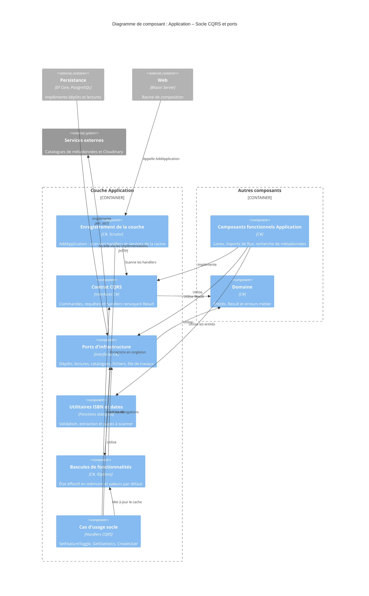

# Niveau Composant C4 : Application – Socle CQRS et ports

## 1. Vue d'ensemble

- **Nom** : Application – Socle CQRS et ports
- **Description** : Socle de la couche Application. Il fournit le contrat CQRS (commandes, requêtes, handlers), les ports que l'infrastructure doit implémenter, les utilitaires ISBN et dates, la gestion des bascules de fonctionnalités, l'enregistrement dans le conteneur d'injection de dépendances, ainsi que trois cas d'usage transverses (changer une bascule, lire les statistiques, créer un utilisateur).
- **Type** : Bibliothèque applicative (couche Application de l'architecture Clean Architecture / CQRS)
- **Technologie** : C# (.NET 10), Scrutor (scan des handlers), Microsoft.Extensions.DependencyInjection et Options, `Result` / `Result<T>` du domaine, Ardalis.GuardClauses

## 2. Objectif

Ce composant est la charnière de la couche Application. Il définit le vocabulaire commun (`ICommand`, `IQuery`, `ICommandHandler`, `IQueryHandler`) sur lequel reposent tous les autres composants fonctionnels. Il inverse aussi les dépendances : la couche Application ne connaît que les interfaces de `Application.Interfaces`, que `Persistence` et `Web` implémentent. Il regroupe enfin les règles pures sans état (validation et extraction d'ISBN, analyse des dates de publication) et l'état en mémoire des bascules de fonctionnalités, qui suit la configuration tant qu'un administrateur n'a pas choisi de valeur.

Trois cas d'usage servent de référence d'implémentation du patron CQRS : `SetFeatureToggle` (commande sans valeur), `CreateUser` (commande avec valeur) et `GetStatistics` (requête). Les erreurs connues sont renvoyées par `Result`, non par exception.

## 3. Fonctionnalités logicielles

- **Enregistrement de la couche** : `AddApplication` scanne et enregistre les handlers CQRS (durée scoped), les services de la racine (catalogues, extracteurs de liens, `TimeProvider`) et les singletons de configuration.
- **Contrat CQRS** : marqueurs `IBaseCommand`, `ICommand`, `ICommand<TResponse>`, `IQuery<TResponse>` et interfaces de handlers contravariantes renvoyant `Task<Result>` ou `Task<Result<T>>`.
- **Ports d'infrastructure** : dépôts (`IRepository`, `IBookRepository`, `IImportJobRepository`, `IFeedImportDecisionRepository`, `IFeatureToggleOverrideRepository`), `IUnitOfWork`, services de lecture, catalogues de métadonnées (BnF, Google Books, Open Library, Bubble, Bedetheque), traitement de fichiers et d'images, file de travaux d'import et de scan ISBN, Cloudinary, utilisateur courant.
- **Utilitaires ISBN** : validation (sommes de contrôle ISBN-10 et ISBN-13), normalisation, extraction depuis un nom de fichier ou un texte OCR, choix des pages à scanner (`IsbnScanPages`).
- **Utilitaires de dates** : analyse des dates de publication renvoyées par les sources externes (`PublishDateHelper`).
- **Bascules de fonctionnalités** : état effectif en mémoire (`FeatureToggles`), valeurs par défaut issues de la configuration (`FeatureToggleDefaults`), options des sources (`BookSourceOptions`), état d'affichage (`FeatureToggleState`).
- **Changement d'une bascule** : `SetFeatureToggleCommand` crée, met à jour ou supprime la dérogation en base, puis met à jour le cache seulement si la sauvegarde réussit.
- **Statistiques de lecture** : `GetStatisticsQuery` renvoie un `StatisticsDto` (livres, séries, bibliothèques, lectures, pages, stockage numérique, lectures par mois sur 12 mois), global ou limité à une bibliothèque appartenant à l'utilisateur.
- **Création d'utilisateur** : `CreateUserCommand` crée l'utilisateur interne à partir de l'e-mail et de l'identifiant d'authentification, avec contrôle des doublons. Le contrat de lecture des utilisateurs est `IUserReadService`.

## 4. Éléments de code

- [c4-code-Application.md](./c4-code-Application.md) : racine, `ApplicationDependencyInjection.AddApplication` (enregistrements Scrutor et services).
- [c4-code-Application-Abstractions-Messaging.md](./c4-code-Application-Abstractions-Messaging.md) : contrats CQRS (commandes, requêtes, handlers).
- [c4-code-Application-Interfaces.md](./c4-code-Application-Interfaces.md) : ports de la couche (dépôts, lectures, catalogues, traitement de fichiers, bascules).
- [c4-code-Application-Helpers.md](./c4-code-Application-Helpers.md) : utilitaires ISBN et dates.
- [c4-code-Application-Settings.md](./c4-code-Application-Settings.md) : bascules de fonctionnalités et configuration des sources.
- [c4-code-Application-Settings-SetFeatureToggle.md](./c4-code-Application-Settings-SetFeatureToggle.md) : commande de changement d'une bascule.
- [c4-code-Application-Statistics-Get.md](./c4-code-Application-Statistics-Get.md) : requête des statistiques de lecture.
- [c4-code-Application-Users.md](./c4-code-Application-Users.md) : contrat de lecture des utilisateurs (`IUserReadService`).
- [c4-code-Application-Users-Create.md](./c4-code-Application-Users-Create.md) : création d'un utilisateur.

## 5. Interfaces

Toutes les interfaces ci-dessous sont des API .NET in-process (appels de méthodes, injection de dépendances), sans réseau.

### Contrat CQRS

- **Protocole** : API .NET in-process
- **Description** : Contrat que chaque handler de la couche Application implémente et que le conteneur scanne.
- **Opérations** :
  - `ICommandHandler<TCommand>.Handle(command, cancellationToken): Task<Result>` : traite une commande sans valeur de retour.
  - `ICommandHandler<TCommand, TResponse>.Handle(command, cancellationToken): Task<Result<TResponse>>` : traite une commande et renvoie la valeur créée ou modifiée.
  - `IQueryHandler<TQuery, TResponse>.Handle(query, cancellationToken): Task<Result<TResponse>>` : traite une requête en lecture seule.

### Enregistrement de la couche (`AddApplication`)

- **Protocole** : API .NET in-process (méthode d'extension)
- **Description** : Point d'entrée appelé par la racine de composition (projet Web).
- **Opérations** :
  - `AddApplication(this IServiceCollection services): IServiceCollection` : enregistre handlers, services et configuration.

### Ports de persistance et de lecture

- **Protocole** : API .NET in-process (implémentée par `Persistence`)
- **Description** : Dépôts, unité de travail et services de lecture utilisés par les handlers.
- **Opérations** :
  - `IRepository<TEntity, TEntityId>` : `GetByIdAsync`, `Add`, `Update`, `Remove`, `ListAsync`, `Count`.
  - `IBookRepository` : `GetByIsbnAsync`, `AddReadingDate`, `ListByLibraryIdAsync`, `ListByUserIdAsync`, `ListIdsToScanForIsbnAsync`.
  - `IFeatureToggleOverrideRepository` : `Add`, `Remove`, `GetAsync`, `GetAllAsync`.
  - `IImportJobRepository`, `IFeedImportDecisionRepository`, `IIsbnBedethequeCacheRepository` : accès aux travaux, décisions d'import et cache.
  - `IUnitOfWork.SaveChangesAsync` : valide les modifications.
  - `IStatisticsReadService`, `IBookReadService`, `IFeedImportDecisionReadService`, `IPagedList<T>` : lectures et pagination.
  - `IUserReadService` : `GetUsersAsync(searchTerm, sortColumn, sortOrder, page, pageSize, ct)`, `GetUserByEmail`, `GetUserByAuthIdAndEmail`, `GetUserByAuthId` (renvoient `Result<User>`).

### Ports de métadonnées, fichiers et services externes

- **Protocole** : API .NET in-process (implémentée par `Application/ComicInfoSearch`, `Persistence` ou `Web`)
- **Description** : Recherche par ISBN, traitement de fichiers, file de travaux, stockage d'images et contexte utilisateur.
- **Opérations** :
  - `IComicSearchService`, `IBnfCatalogueService`, `IGoogleBooksService`, `IOpenLibraryService`, `IBubbleService`, `IBedethequeService` : recherche de métadonnées.
  - `IImportJobEnqueuer`, `IImportOrchestrator`, `IIsbnScanJobEnqueuer`, `IIsbnScanOrchestrator`, `IIsbnPageScanner` : import et scan ISBN.
  - `IArchiveExtractor`, `IPdfImageExtractor`, `IImageProcessor`, `IComicArchiveBuilder`, `IComicPageReader`, `IComicInfoXmlService`, `ITempWorkspace`, `IBookFileService` : traitement de fichiers.
  - `ICloudinaryService`, `ICurrentUserService` : stockage d'images et utilisateur courant.

### Bascules de fonctionnalités

- **Protocole** : API .NET in-process
- **Description** : Lecture de l'état effectif des fonctionnalités optionnelles et commande de changement.
- **Opérations** :
  - `IFeatureToggles.IsEnabled(toggle): bool` : état effectif (singleton en mémoire).
  - `FeatureToggles.GetStates(): IReadOnlyList<FeatureToggleState>` : états pour la page Réglages.
  - `SetFeatureToggleCommand(Toggle, Enabled): ICommand` : fixe ou retire une dérogation.

### Utilitaires statiques ISBN et dates

- **Protocole** : API .NET in-process (fonctions statiques pures)
- **Description** : Règles sans état ni dépendance d'infrastructure.
- **Opérations** :
  - `IsbnHelper.IsValidISBN(isbn): bool` et `IsbnHelper.NormalizeIsbn`.
  - `FileNameIsbnExtractor.ExtractIsbn(fileName): string?`.
  - `TextIsbnExtractor` : extraction depuis un texte OCR.
  - `IsbnScanPages.GetScanOrder(pageCount, pagesFromEachEnd)` et `GetPagesInReadingOrder(pageCount, pagesFromEachEnd)`.
  - `PublishDateHelper` : analyse des dates de publication.

### Cas d'usage transverses

- **Protocole** : API .NET in-process (CQRS)
- **Description** : Commandes et requête portées par ce composant.
- **Opérations** :
  - `GetStatisticsQuery(UserId, LibraryId?): IQuery<StatisticsDto>`.
  - `CreateUserCommand(email, authId): ICommand<User>`.
  - `SetFeatureToggleCommand(Toggle, Enabled): ICommand`.

## 6. Dépendances

### Composants utilisés

- **Domaine** (`Domain.Primitives`, `Domain.Users`, `Domain.Settings`, `Domain.Books`, `Domain.FeedImports`, `Domain.ImportJobs`) : `Result`, `Result<T>`, entités `User`, `Book`, `FeatureToggle` et erreurs métier.
- **Application – ComicInfoSearch** : `BookCatalogues`, `ComicSearchService` et les `*Settings` des sources, enregistrés et consommés par ce socle.
- **Application – FeedImports (Analysis, Sites, Download)** : extracteurs de liens et services de téléchargement et de dépôt enregistrés par `AddApplication`.

### Composants qui dépendent de celui-ci

- **Tous les composants fonctionnels de la couche Application** : ils implémentent les contrats CQRS et consomment les ports.
- **Persistence** : implémente les dépôts, `IUnitOfWork` et les services de lecture (par exemple `UserReadService`).
- **Web** (racine de composition) : appelle `AddApplication` et implémente certains ports.

### Systèmes et bibliothèques externes

- **Scrutor** : scan et enregistrement automatique des handlers.
- **Microsoft.Extensions.DependencyInjection / Options** : `IServiceCollection`, `IOptions<T>`.
- **Ardalis.GuardClauses** : gardes de paramètres.
- **Cloudinary, catalogues BnF, Google Books, Open Library, Bubble, Bedetheque** : accédés uniquement via les ports, jamais directement.

### Point d'attention

- `CreateUserCommandHandler` teste `user is not null` sur un `Result<User>` toujours non nul : tout appel renvoie `UsersError.Duplicate` et aucun utilisateur n'est créé (anomalie décrite dans [c4-code-Application-Users-Create.md](./c4-code-Application-Users-Create.md)).

## 7. Diagramme de composant

