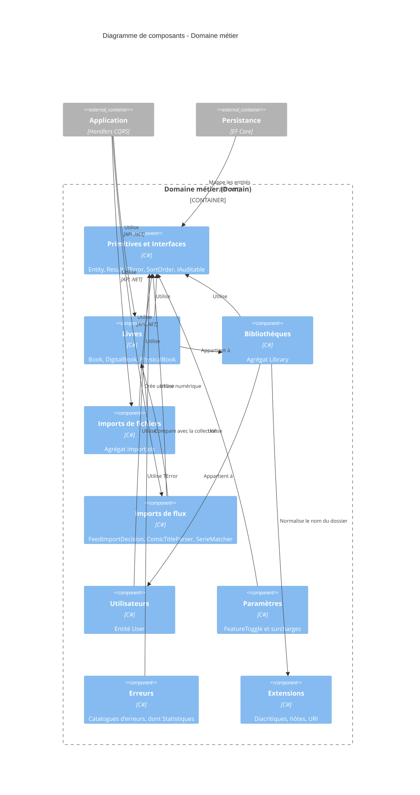

# Niveau C4 Composant : Domaine métier

## 1. Vue d'ensemble

- **Nom** : Domaine métier
- **Description** : Cœur du système : entités, agrégats, objets de valeur, catalogues d'erreurs et primitives (`Entity`, `Result`, `TError`) qui portent les règles métier de la gestion de collection de BD, sans dépendance vers la persistance, l'application ou l'interface.
- **Type** : Bibliothèque de domaine (modèle riche, Clean Architecture)
- **Technologie** : C# (.NET 10), `Ardalis.GuardClauses`, `System.Text.Json`, expressions régulières source-générées

## 2. Objectif

Le composant regroupe l'ensemble du projet `Domain/`. Il garantit les invariants métier (livres, bibliothèques, imports de fichiers, décisions d'import depuis les flux Miniflux, utilisateurs, surcharges de fonctionnalités) et fournit à toutes les couches un socle commun fondé sur le pattern `Result<T>` plutôt que sur les exceptions pour les cas connus. Il n'a aucune dépendance externe métier : les couches Application, Persistance et Web dépendent de lui, jamais l'inverse (règle vérifiée par `Architecture.Tests`).

## 3. Fonctionnalités logicielles

- **Gestion des livres** : agrégat `Book` et spécialisations `DigitalBook` / `PhysicalBook`, métadonnées, déplacement entre bibliothèques, dates de lecture, progression, réglages du lecteur, ISBN détectés.
- **Gestion des bibliothèques** : agrégat `Library` (type physique ou numérique, couleur, icône, tri par défaut, dossier de stockage dérivé du nom) et contrôle de compatibilité livre/bibliothèque.
- **Suivi des imports de fichiers** : agrégat `ImportJob` à statuts linéaires (extraction, conversion WebP, métadonnées, couverture, archive CBZ) terminant en `Completed` ou `Failed`.
- **Import automatique depuis les flux** : `FeedImportDecision` avec cycle de vie historisé, candidats de téléchargement, `ComicTitleParser`, `SerieMatcher`.
- **Utilisateurs** : entité `User` liée à l'identité externe (Auth0) par `AuthId`.
- **Fonctionnalités activables** : énumération `FeatureToggle` et surcharge `FeatureToggleOverride` de la configuration.
- **Gestion d'erreurs sans exception** : `Result`, `Result<TValue>`, `TError` et catalogues d'erreurs (fichiers, stockage, OCR, statistiques, par agrégat).
- **Audit** : `IAuditable` et `Entity<TEntityId>` (horodatages UTC de création et de modification).
- **Utilitaires** : suppression des diacritiques sans ICU, validation d'hôtes et d'URI autorisées.

## 4. Éléments de code

- [c4-code-Domain-Books.md](./c4-code-Domain-Books.md) : livres (`Book`, `DigitalBook`, `PhysicalBook`), dates de lecture, réglages du lecteur, ISBN détectés.
- [c4-code-Domain-Errors.md](./c4-code-Domain-Errors.md) : catalogues d'erreurs transverses (traitement de fichiers, stockage de bibliothèque, dossier d'import, OCR).
- [c4-code-Domain-Extensions.md](./c4-code-Domain-Extensions.md) : méthodes d'extension (diacritiques, domaines d'hôtes, URI HTTP/HTTPS).
- [c4-code-Domain-FeedImports.md](./c4-code-Domain-FeedImports.md) : décisions d'import Miniflux, historique, candidats de téléchargement, `ComicTitleParser`, `SerieMatcher`.
- [c4-code-Domain-ImportJobs.md](./c4-code-Domain-ImportJobs.md) : agrégat `ImportJob`, statuts et erreurs d'import de fichiers.
- [c4-code-Domain-Interfaces.md](./c4-code-Domain-Interfaces.md) : contrat d'audit `IAuditable`.
- [c4-code-Domain-Libraries.md](./c4-code-Domain-Libraries.md) : agrégat `Library`, types, tris, erreurs.
- [c4-code-Domain-Primitives.md](./c4-code-Domain-Primitives.md) : `Entity<TEntityId>`, `Result`, `TError`, `SortOrder`.
- [c4-code-Domain-Settings.md](./c4-code-Domain-Settings.md) : `FeatureToggle`, `FeatureToggleOverride`, erreurs.
- [c4-code-Domain-Statistics.md](./c4-code-Domain-Statistics.md) : `StatisticsError` (catalogue d'erreurs uniquement).
- [c4-code-Domain-Users.md](./c4-code-Domain-Users.md) : entité `User`, erreurs, colonnes de tri.

## 5. Interfaces

### API des agrégats et entités

- **Protocole** : API .NET in-process (appels de méthodes C#)
- **Description** : Fabriques et méthodes de domaine retournant des `Result`, consommées par les handlers CQRS et les dépôts.
- **Opérations** (principales) :
  - `User.Create(email, authId)` / `User.Update(email, authId)` : création et mise à jour d'un utilisateur.
  - Méthodes de `Book` / `DigitalBook` / `PhysicalBook` : création, mise à jour des métadonnées, déplacement de bibliothèque, dates de lecture, ISBN.
  - Méthodes de `Library` : création, modification, vérification de compatibilité d'un livre.
  - Méthodes de `ImportJob` : transitions d'étapes, compteurs de conversion, passage en `Completed` ou `Failed`.
  - Méthodes de `FeedImportDecision` : transitions de statut historisées (téléchargement, échec, ignorance, arbitrage).
  - `ComicTitleParser`, `SerieMatcher` : analyse de titre et comparaison de séries.

### Primitives de résultat et d'entité

- **Protocole** : API .NET in-process
- **Description** : Socle commun à toutes les couches.
- **Opérations** :
  - `Result.Success()` / `Result.Failure(TError)` / `Result<TValue>` : résultat d'une opération, conversion implicite depuis `TError`.
  - `Entity<TEntityId>.CloneAuditable(IAuditable)` : recopie des dates d'audit.
  - `IAuditable` : `CreatedOnUtc`, `ModifiedOnUtc`.

### Catalogues d'erreurs

- **Protocole** : API .NET in-process
- **Description** : Constantes `TError` (code et description) statiques : `FileProcessingError`, erreurs de stockage, d'OCR, de bibliothèque, d'import, d'utilisateur, de paramètres, `StatisticsError.BadRequest` (`STA400`).

### Fonctionnalités et utilitaires

- **Protocole** : API .NET in-process
- **Description** : `FeatureToggle` (énumération associée à des clés de configuration) et `FeatureToggleOverride` ; méthodes d'extension `RemoveDiacritics()` et contrôles de domaine d'hôte / d'URI.

## 6. Dépendances

### Composants utilisés

- Aucun : le Domaine métier ne dépend d'aucun autre composant du système (il est la base de l'Application, de la Persistance et du Web).

### Systèmes externes

- Aucun appel externe. Bibliothèques : `Ardalis.GuardClauses`, BCL (.NET, `System.Text.Json`).
- Concepts liés à des systèmes externes, sans dépendance technique : Auth0 (`User.AuthId`), Miniflux (`FeedImports`), fournisseurs de métadonnées (clés de `FeatureToggle`).

## 7. Diagramme de composant

