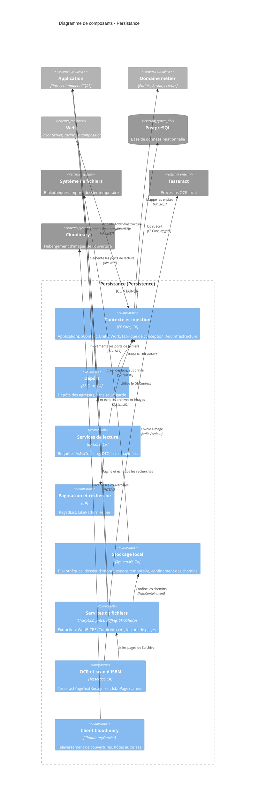

# Niveau Composant C4 : Persistance

## 1. Vue d'ensemble

- **Nom** : Persistance
- **Description** : Couche d'infrastructure qui implémente les ports de l'Application : modèle relationnel PostgreSQL via EF Core (`ApplicationDbContext`, migrations, unité de travail), dépôts d'écriture, services de lecture paginés, adaptateurs du système de fichiers local et services techniques de traitement de fichiers (archives, PDF, WebP, CBZ, `ComicInfo.xml`, OCR Tesseract, Cloudinary).
- **Type** : Bibliothèque d'infrastructure (implémentation des ports, Clean Architecture / CQRS)
- **Technologie** : C# (.NET 10), EF Core 10, Npgsql (PostgreSQL), SharpCompress, PdfPig, SkiaSharp, CloudinaryDotNet, Tesseract (ligne de commande), Ardalis.GuardClauses

## 2. Objectif

Le composant regroupe l'ensemble du projet `Persistence/`. Il isole toute la technique derrière les interfaces de `Application.Interfaces` : la couche Application ne voit ni EF Core, ni le disque, ni les bibliothèques d'images. Côté écriture, les dépôts encapsulent les `DbSet` sans jamais sauvegarder ; `UnitOfWork` déclenche la persistance, renseigne les dates d'audit et convertit les erreurs de base en `TError`. Côté lecture, les services de requête projettent en lecture seule (`AsNoTracking`) vers des DTO et des listes paginées. Les adaptateurs de stockage local et les services de fichiers appliquent les contraintes de sécurité (confinement des chemins, limites de taille, DTD interdites, liste d'hôtes autorisés contre le SSRF, délais maximaux). `ProjectDependencyInjection.AddInfrastructure` câble le tout dans le conteneur de l'application hôte (Web).

## 3. Fonctionnalités logicielles

- **Modèle relationnel PostgreSQL** : `ApplicationDbContext` (héritage TPT de `Book`, index uniques et partiels, colonne `jsonb`, concurrence `xmin`, trousseau Data Protection), `ApplicationDbContextFactory` pour `dotnet ef`, dossier `Migrations/` (non documenté au niveau code).
- **Unité de travail** : `UnitOfWork.SaveChangesAsync` renseigne `CreatedOnUtc` / `ModifiedOnUtc` et retourne `DB_UPDATE_ERROR` sur `DbUpdateException`.
- **Dépôts d'agrégats** : livres, bibliothèques, utilisateurs, jobs d'import, décisions d'import de flux, cache ISBN vers Bédéthèque (insertion tolérante à la concurrence, SQLSTATE `23505`), surcharges de bascules de fonctionnalités.
- **Services de lecture** : livres (pagination, recherche `ILIKE` échappée), bibliothèques (résumés avec couvertures), utilisateurs, décisions de flux (comptages par statut) et statistiques de lecture.
- **Pagination et recherche** : `PagedList<T>` (comptage puis page) et `LikePatternHelper` (échappement de `\`, `%`, `_`).
- **Stockage local** : dossiers de bibliothèques (`LibraryLocalStorage`), dossier d'import surveillé avec dépôt quasi atomique par fichier `.part` et dossier `errors` (`ImportDirectoryStorage`), espace de travail temporaire des jobs (`TempWorkspace`), garde `PathContainment`.
- **Traitement de fichiers** : extraction CBZ/ZIP/CBR/RAR et PDF, conversion WebP, assemblage CBZ, lecture de page en mémoire avec tri naturel, lecture et écriture de `ComicInfo.xml`, suppression de fichiers de livres numériques.
- **Reconnaissance d'ISBN par OCR** : `TesseractPageTextRecognizer` et `IsbnPageScanner` (pages de début et de fin d'abord, désactivable par bascule `IsbnOcr`).
- **Couvertures Cloudinary** : téléversement depuis URL (hôtes autorisés), fichier ou flux, et test de disponibilité (`PingAsync`).
- **Configuration validée au démarrage** : `IsbnOcrSettings` et `CloudinarySettings` (`ValidateOnStart`).

## 4. Éléments de code

- [c4-code-Persistence.md](./c4-code-Persistence.md) : racine du projet : `ApplicationDbContext`, `ApplicationDbContextFactory`, `UnitOfWork`, `ProjectDependencyInjection`.
- [c4-code-Persistence-LocalStorage.md](./c4-code-Persistence-LocalStorage.md) : adaptateurs du système de fichiers (`LibraryLocalStorage`, `ImportDirectoryStorage`, `TempWorkspace`, `PathContainment`).
- [c4-code-Persistence-Queries.md](./c4-code-Persistence-Queries.md) : services de lecture (livres, bibliothèques, utilisateurs, décisions de flux, statistiques).
- [c4-code-Persistence-Queries-Helpers.md](./c4-code-Persistence-Queries-Helpers.md) : `PagedList<T>` et `LikePatternHelper`.
- [c4-code-Persistence-Repositories.md](./c4-code-Persistence-Repositories.md) : dépôts des agrégats (livres, bibliothèques, utilisateurs, jobs d'import, décisions de flux, cache ISBN, surcharges de bascules).
- [c4-code-Persistence-Services.md](./c4-code-Persistence-Services.md) : services de fichiers, OCR Tesseract, scanner d'ISBN et client Cloudinary.

## 5. Interfaces

### Ports d'écriture (dépôts et unité de travail)

- **Protocole** : API .NET in-process (interfaces de `Application.Interfaces`, durée de vie scoped)
- **Description** : Accès aux agrégats sans sauvegarde ; la persistance n'est effective qu'après `IUnitOfWork.SaveChangesAsync`.
- **Opérations** (principales) :
  - `IUnitOfWork.SaveChangesAsync(ct): Result<int>` : persiste les changements, audit inclus.
  - `IRepository<Book | Library | User, Guid>` : `GetByIdAsync`, `Add`, `Update`, `Remove`, `Count`, `ListAsync`.
  - `IBookRepository` : `ListByLibraryIdAsync`, `ListByUserIdAsync`, `ListIdsToScanForIsbnAsync`, `GetByIsbnAsync`, `AddReadingDate`.
  - `IImportJobRepository` : `GetByIdAsync`, `GetByIdsAsync`, `GetByLibraryIdAsync`, `GetPendingAsync`, `ExistsActiveForFilePathAsync`.
  - `IFeedImportDecisionRepository` : `GetByMinifluxEntryIdAsync`, `GetPendingIdsAsync`, `GetIdsByStatusAsync`, `GetByStatusAsync`.
  - `IIsbnBedethequeCacheRepository` : `GetUrlByIsbnAsync`, `SaveAsync`.
  - `IFeatureToggleOverrideRepository` : `GetAsync`, `GetAllAsync`, `Add`, `Remove`.

### Ports de lecture (services de requête)

- **Protocole** : API .NET in-process (requêtes LINQ en lecture seule)
- **Description** : Données de lecture pour les handlers de requête, sous forme de DTO, d'entités ou de `IPagedList<T>`.
- **Opérations** (principales) :
  - `IBookReadService.GetPagedByLibraryAsync(...)`, `ListIdentitiesByUserAsync(userId)`, `ListSerieLocationsAsync(userId)`.
  - `ILibraryReadService.GetLibrariesAsync(...)`, `GetByNameAsync`, `GetSummariesAsync`, `ExistsByNameAsync`.
  - `IUserReadService.GetUsersAsync(...)`, `GetUserByAuthIdAndEmail`, `GetUserByEmail`, `GetUserByAuthId` (retournent `Result<User>`).
  - `IFeedImportDecisionReadService.GetPagedAsync(...)`, `GetMultiBookEntryIdsAsync`, `CountByStatusAsync`, `CountPerStatusAsync`.
  - `IStatisticsReadService.GetStatisticsAsync(userId, libraryId, readingsFromUtc)`.

### Ports de stockage local

- **Protocole** : API .NET in-process (système de fichiers)
- **Description** : Opérations de fichiers et de dossiers confinées à leur racine autorisée.
- **Opérations** (principales) :
  - `ILibraryLocalStorage.Create`, `Move`, `MoveFile`, `Delete` et la propriété `rootPath`.
  - `IImportDirectoryStorage.EnsureExists`, `Move`, `Delete`, `DeleteOriginalFile`, `MoveOriginalFileToError`, `GetAvailableFilePath`, `DepositFile`.
  - `ITempWorkspace.HasFreeSpace`, `CreateScratch`, `GetWebpFiles`, `MoveToLibrary`, `TryDeleteFile`, `CleanupDirectory`.

### Ports de traitement de fichiers et de services externes

- **Protocole** : API .NET in-process (appels locaux, ligne de commande Tesseract, HTTPS vers Cloudinary)
- **Description** : Chaîne de traitement d'un fichier importé et services annexes.
- **Opérations** (principales) :
  - `IArchiveExtractor.ExtractAsync`, `IPdfImageExtractor.ExtractImagesAsync` : extraction d'images.
  - `IImageProcessor.ProcessImagesAsync` : conversion en WebP (qualité 75, largeur cible 1400 par défaut).
  - `IComicArchiveBuilder.BuildAsync` : assemblage d'un CBZ.
  - `IComicPageReader.CountPagesAsync` / `ReadPageAsync` : lecture d'une page en mémoire.
  - `IComicInfoXmlService.Read` / `Write` : métadonnées `ComicInfo.xml`.
  - `IBookFileService.DeleteFileAsync` : suppression du fichier d'un livre numérique.
  - `IIsbnPageScanner.ScanPagesAsync` / `ScanArchiveAsync` : recherche d'ISBN par OCR.
  - `ICloudinaryService.UploadImageFromUrlAsync` / `FromFileAsync` / `FromStreamAsync` / `PingAsync` : couvertures.

### Enregistrement dans le conteneur

- **Protocole** : Extension d'injection de dépendances
- **Description** : Point d'entrée unique appelé par la racine de composition (Web).
- **Opérations** :
  - `AddInfrastructure(services, connectionString, rootPath, configuration): IServiceCollection` : enregistre le `DbContext` (Npgsql, assembly de migrations `Persistence`), l'unité de travail, les dépôts, les services de lecture, les stockages et les services de fichiers, puis valide les options OCR et Cloudinary au démarrage.

## 6. Dépendances

### Composants utilisés

- Domaine métier : entités et constantes de longueur, `Result` / `TError`, `IAuditable`, catalogues d'erreurs (`FileProcessingError`, `OcrError`, `BooksError`, `UsersError`, `ImportJobError`), extensions `RemoveDiacritics` et `IsAllowedHttpsHost`.
- Application – Socle CQRS et ports : interfaces implémentées, DTO de requête, `IPagedList<T>`, `IsbnOcrSettings`, `CloudinarySettings`, `ImportSettings`, `IFeatureToggles`, `IsbnHelper`, `IsbnScanPages`, `TextIsbnExtractor`.

### Systèmes externes

- **PostgreSQL** (via EF Core / Npgsql) : base relationnelle de l'application, y compris le trousseau Data Protection ; `ConnectionStrings:DefaultConnection` pour les outils de migration.
- **Système de fichiers local** : bibliothèques, dossier d'import surveillé, dossier temporaire des jobs.
- **Tesseract OCR** : processus local lancé en ligne de commande (stdin / stdout), chemin et langue configurés dans `IsbnOcr`.
- **Cloudinary** : téléversement d'images de couverture en HTTPS (`ApiKey`, `ApiSecret` requis).
- **Sites de couvertures** : `www.bedetheque.com`, `books.google.com`, `books.googleusercontent.com`, `covers.openlibrary.org` (liste d'hôtes autorisés pour les URL source).
- **Bibliothèques** : EF Core, Npgsql, SharpCompress, PdfPig, SkiaSharp, CloudinaryDotNet, `Microsoft.AspNetCore.DataProtection.EntityFrameworkCore`, `Microsoft.Extensions.Options` et `Logging`.

### Points d'attention

- **Tri paginé sans clé de départage** : `LibraryReadService.GetLibrariesAsync` et `UserReadService.GetUsersAsync` trient sans `ThenBy(Id)` final, contrairement à la règle du projet ; des éléments peuvent être dupliqués ou omis entre pages.
- **Pagination non validée** : `PagedList.ExecuteQueryAsync` ne borne ni `page` ni `pageSize` (exception à `Skip` si négatif) ; comptage et lecture sont deux requêtes sans snapshot.
- **Recherche `LIKE` incohérente** : `LikePatternHelper` n'est utilisé que par `BookReadService` et `FeedImportDecisionReadService` ; `LibraryReadService` et `UserReadService` s'appuient sur `Contains`.
- **Coût des requêtes** : `StatisticsReadService` exécute neuf requêtes séquentielles ; `LibraryReadService.GetSummariesAsync` utilise des sous-requêtes corrélées ; la projection de `BookReadService` caste en `DigitalBook` (dépend de la traduction TPT).
- **Index filtré fragile** : l'index unique partiel de `ImportJob.OriginalFilePath` repose sur les ordinaux 6 et 7 de `ImportJobStatus` ; tout réordonnancement de l'énumération casse l'index.
- **Unité de travail partielle** : `UnitOfWork.SaveChangesAsync` ne convertit que `DbUpdateException` ; les autres exceptions sont propagées. `IsbnBedethequeCacheRepository.SaveAsync` appelle lui-même `SaveChangesAsync`, en contradiction avec le principe « les dépôts ne sauvegardent pas ».
- **Dépôts** : `Guard.Against.Null` sur un `Guid` sans effet (`LibraryRepository`, `UserRepository`) ; `BookRepository.GetByIsbnAsync` lève `ArgumentException` au lieu de retourner une erreur de domaine ; `BookRepository` est enregistré deux fois (deux instances scoped) ; `Update` réécrit toutes les colonnes ; lectures suivies pour `ImportJobRepository.GetByIdAsync` et `FeedImportDecisionRepository.GetByStatusAsync`.
- **Stockage local** : validation de chemin dupliquée entre `LibraryLocalStorage` et `ImportDirectoryStorage` ; `LibraryLocalStorage.Create` n'applique pas `RemoveDiacritics` (contrairement à `Move`, `MoveFile`, `Delete`) ; `TempWorkspace.MoveToLibrary` et certaines opérations d'`ImportDirectoryStorage` n'interceptent pas les `IOException` ; le renommage final du dépôt `.part` n'est atomique qu'au sein d'un même volume.
- **Sécurité des fichiers** : la limite de 5 Go d'`ArchiveExtractorService` repose sur les tailles déclarées des en-têtes ; `BookFileService.DeleteFileAsync` supprime sans contrôle de confinement ; `ComicInfoXmlService.Write` et `ComicArchiveBuilderService` écrivent sans fichier temporaire ni nettoyage.
- **Robustesse du traitement** : `IsbnPageScanner.ScanAsync` utilise `text.Value` sans contrôle lors d'un échec OCR (`Failed`, `Timeout`) ; `ImageProcessorService` masque le dépassement de dimension sous `InvalidImageContent` et décode de façon synchrone sans `Task.Run` ; les extractions PDF et archive ne sont pas annulables pendant l'écriture.
- **Duplication** : ouverture d'archive identique dans `ArchiveExtractorService` et `ComicPageReaderService` ; `ApplicationDbContext.OnModelCreating` contient un test `modelBuilder != null` redondant.

## 7. Diagramme de composant

