# Niveau Composant C4 : Web – Hôte, configuration et infrastructure

## 1. Vue d'ensemble

- **Nom** : Web – Hôte, configuration et infrastructure
- **Description** : hôte ASP.NET Core / Blazor Server de l'application. Il assemble les services (racine de composition), construit le pipeline HTTP, authentifie via Auth0, expose les endpoints minimaux, planifie les tâches Hangfire, surveille la santé de l'application et fournit les adaptateurs techniques vers les services externes (Miniflux, Debrid-Link, pages d'articles).
- **Type** : application hôte (racine de composition) et adaptateurs d'infrastructure
- **Technologie** : C# / .NET 10, ASP.NET Core (API minimales, Razor Components en rendu serveur interactif), Auth0.AspNetCore.Authentication, Hangfire (PostgreSQL), Serilog, FluentValidation, MudBlazor, AspNetCore.HealthChecks, Docker

## 2. Objectif

Ce composant démarre l'application et en porte les préoccupations transverses, afin que les composants métier (`Application`, `Domain`, `Persistence`, `Web/Components`, `Web/Services`) n'aient pas à les connaître.

- Il lit et valide la configuration au démarrage (`ValidateOnStart`), puis enregistre les services.
- Il applique une liste blanche d'hôtes (garde SSRF) à tous les clients HTTP sortants.
- Il expose les routes HTTP hors composants Razor : téléchargement de livres, pages de bande dessinée, connexion et déconnexion.
- Il garantit l'observabilité : journaux Serilog à niveaux modifiables à chaud, health checks, bannière de démarrage.
- Il refuse de démarrer si un check de santé est `Unhealthy`.
- Il valide les saisies des formulaires (livres, bibliothèques) avant l'envoi des commandes à `Application`.

## 3. Fonctionnalités logicielles

- **Racine de composition** (`Program.cs`) : enregistrement des services scoped et singletons, des services hébergés (`FileWatcherService`, `LibraryIconsWarmupService`) et de MudBlazor (snackbar en bas à droite, 10 s).
- **Authentification Auth0** : OIDC (scope `openid profile email`), cookie de 7 jours glissant, clés Data Protection persistées dans `ApplicationDbContext`.
- **Provision des utilisateurs** : `CustomAuthenticationStateProvider` crée l'utilisateur applicatif lors de la première connexion (une fois par circuit).
- **Gestion globale des erreurs** : `GlobalExceptionHandler` journalise et renvoie un `500` `application/problem+json`.
- **Endpoints minimaux** : téléchargement CBZ avec `Range`, pages d'images avec `ETag` et `Cache-Control`, routes `/Account/Login` et `/Account/Logout`.
- **Hangfire** : stockage PostgreSQL, un seul worker (exécution séquentielle, cible Raspberry Pi 4), files `import` et `default`, tableau de bord réservé au rôle `Admin`.
- **Import de flux** : options validées, clients HTTP typés (Miniflux, Debrid-Link, pages d'articles, téléchargements) et planification de la synchronisation récurrente (`ScheduleFeedImportSync`).
- **Garde SSRF** : `SsrfGuardHandler` vérifie chaque URL et chaque redirection (5 au maximum, suivies manuellement), sans transmettre `Authorization` ni `Cookie` en cas de changement d'hôte.
- **Health checks** : application, Npgsql, `import-directory`, `cloudinary`, `debrid-link`, `miniflux`. Cache de 30 s pour les checks distants (`HealthCheckResultCache`). Garde de démarrage : `Unhealthy` interrompt, `Degraded` avertit.
- **Journalisation** : niveaux Serilog modifiables à chaud par logger (`LogLevelSwitches`), deux fichiers rotatifs quotidiens (`http-<date>.txt`, `log-<date>.txt`) via `WriteToSplitFiles`.
- **Bascules de fonctionnalités** : chargement des valeurs choisies dans la page Paramètres au démarrage (`LoadFeatureTogglesAsync`).
- **Démarrage** : migrations EF Core, création des répertoires d'import, bannière système (`StartupInfo`), version de l'application et versionnage des fichiers statiques (`AppVersion.Versioned`).
- **Validation de formulaires** : DTO `BookUiDto` et `LibraryUiDto`, validateurs FluentValidation avec validation champ par champ (`ValidateValue`).
- **Utilitaires d'interface** : options communes des dialogues (`AppDialogs`), confirmation réutilisable (`ShowConfirmationAsync`), énumération `ViewMode` (`Covers` / `List`).
- **Déploiement** : `Dockerfile` multi-étapes (port 8080, Tesseract OCR, `HEALTHCHECK` sur `/health`), `appsettings*.json` avec valeurs de substitution, profils de lancement locaux.

## 4. Éléments de code

Ce composant contient les éléments de code suivants :

- [c4-code-Web.md](./c4-code-Web.md) : racine du projet (`Program.cs`, `GlobalExceptionHandler`, `CustomAuthenticationStateProvider`, `StartupInfo`, `appsettings`, `Dockerfile`, `Web.csproj`)
- [c4-code-Web-Configuration.md](./c4-code-Web-Configuration.md) : options (`Auth0Configuration`, `LocalStorageConfiguration`), `LoggingConfiguration`, `FeedImportConfiguration`, `FeatureToggleConfiguration`
- [c4-code-Web-EndPoints.md](./c4-code-Web-EndPoints.md) : `BooksEndpoints`, `AccountsEndpoints` et spécification des endpoints
- [c4-code-Web-Enums.md](./c4-code-Web-Enums.md) : énumération `ViewMode`
- [c4-code-Web-Extensions.md](./c4-code-Web-Extensions.md) : `AppDialogs`, `DialogServiceExtensions`
- [c4-code-Web-Infrastructure.md](./c4-code-Web-Infrastructure.md) : `SsrfGuardHandler`, clients HTTP, health checks, `HangfireAuthorizationFilter`, `LogLevelSwitches`, `AppVersion`
- [c4-code-Web-Properties.md](./c4-code-Web-Properties.md) : `launchSettings.json`
- [c4-code-Web-Validators.md](./c4-code-Web-Validators.md) : `BookUiDto`, `BookValidator`, `AddBookValidator`, `LibraryUiDto`, `LibraryValidator`

## 5. Interfaces

### Endpoints HTTP

- **Protocole** : HTTP/HTTPS (API minimales ASP.NET Core)
- **Description** : routes hors composants Razor. Toutes les réponses reçoivent `X-Content-Type-Options: nosniff`. Le HSTS est actif hors `Development`.

| Méthode | Route | Authentification | Réponses principales |
|---|---|---|---|
| GET | `/api/books/{bookId}/download` | Requise (cookie Auth0) | 200 flux `application/x-cbz` avec `Range` ; 400 livre non numérique ; 401 utilisateur non résolu ; 403 chemin hors racine de stockage ; 404 livre ou fichier absent |
| GET | `/api/books/{bookId:guid}/pages/{pageIndex:int}` | Requise (cookie Auth0) | 200 octets de l'image (`ETag`, `Cache-Control: private, max-age=86400`) ; 400 ; 401 ; 404 |
| GET | `/Account/Login?redirectUri=/` | Anonyme | 302 vers Auth0 (challenge, session persistante, HTTPS forcé) |
| GET | `/Account/Logout?redirectUri=/` | Anonyme | 302 vers la déconnexion Auth0, puis suppression du cookie |
| GET | `/health` | Anonyme | 200 `Healthy` ou `Degraded` ; 503 `Unhealthy` ; corps JSON `UIResponseWriter` |
| GET | `/hangfire` (et sous-chemins) | Utilisateur authentifié, rôle `Admin` | 200 tableau de bord ; refus géré par Hangfire |

Points d'attention : `redirectUri` n'est pas validé dans ce code (risque de redirection ouverte à vérifier). Le type MIME de téléchargement est fixe (`application/x-cbz`), même pour les autres formats acceptés.

### Circuit Blazor (rendu serveur interactif)

- **Protocole** : HTTP puis SignalR (WebSocket)
- **Description** : `MapRazorComponents<App>().AddInteractiveServerRenderMode()`. Le circuit est le comportement standard d'ASP.NET Core ; le point de terminaison SignalR n'est pas déclaré explicitement dans le code documenté.
- **Authentification** : `Routes.razor` applique `AuthorizeRouteView`. Une route protégée sans session redirige vers `RedirectToLogin`. `CustomAuthenticationStateProvider` provisionne l'utilisateur une fois par circuit.
- **Durée de vie** : les services par circuit (`LibraryStateService`, `FeedImportNotifier`, `PopupAnchorLocator`) supposent une durée de vie scoped, non vérifiée dans ce composant.

### Contrats d'extension internes

- `AddFeedImport(configuration)`, `ScheduleFeedImportSync()`, `LoadFeatureTogglesAsync()` : enregistrement et initialisation appelés depuis `Program.cs`.
- `ShowConfirmationAsync(title, message, actionText, color): Task<bool>` : confirmation réutilisable par les composants.
- `BookValidator.ValidateValue` et `LibraryValidator.ValidateValue` : `Func<object, string, Task<IEnumerable<string>>>` pour `MudForm`.
- Implémentations d'interfaces `Application` : `IMinifluxClient`, `IDebridLinkClient`, `IArticlePageFetcher`, `IFeedImportFileDownloader`.

## 6. Dépendances

### Composants utilisés

- **Application** : requêtes et commandes CQRS (`GetBookByIdQuery`, `GetBookPageQuery`), `IUserReadService`, `ILibraryLocalStorage`, `IFeatureToggles`, `ICloudinaryService`, `ImportSettings`, `ApplicationDependencyInjection`.
- **Domain** : `User`, `Book`, `DigitalBook`, `Library`, constantes de validation, `Result`, `FeatureToggle`, `IsAllowedHost`.
- **Persistence** : `ApplicationDbContext`, `AddInfrastructure`, migrations au démarrage.
- **Web – Composants Razor** : `App`, `Routes`, `ConfirmationDialog`, formulaires consommant les DTO et validateurs.
- **Web – Services** : `FileWatcherService`, `LibraryIconsWarmupService`, `FeedImportSyncJob`, `LibraryStateService`.

### Systèmes externes

- **Auth0** : authentification OIDC (connexion, déconnexion).
- **Miniflux** : catégories, entrées favorites, retrait du favori (`X-Auth-Token`).
- **Debrid-Link** : API v2 (domaines pris en charge, compte, déblocage de liens ; `Authorization: Bearer`).
- **Cloudinary** : health check (ping).
- **Fournisseurs de métadonnées** : OpenLibrary, BnF, Google Books, Bedetheque, SerpApi, Bubble (liste blanche d'hôtes).
- **Hôtes d'articles et d'hébergeurs** : listes `FeedImport:AllowedSourceHosts`, `AllowedDownloadHosts`, `DebridLink:DownloadHosts`.
- **PostgreSQL** : EF Core, stockage Hangfire, clés Data Protection.
- **Hangfire** : tâches asynchrones et planifiées.
- **Serilog** : journalisation en fichiers.
- **FluentValidation, MudBlazor** : validation et interface.
- **Docker, Tesseract OCR, curl** : image d'exécution et sonde de santé.

## 7. Diagramme de composant

```mermaid
C4Component
    title Diagramme de composant : Web – Hôte, configuration et infrastructure

    Person(utilisateur, "Utilisateur", "Lecteur de bandes dessinées authentifié")
    Person(admin, "Administrateur", "Rôle Admin")

    Container_Boundary(web, "Application Web (ASP.NET Core)") {
        Component(programme, "Program.cs", "Racine de composition", "Services, pipeline HTTP, migrations, garde de démarrage")
        Component(erreurs, "GlobalExceptionHandler", "IExceptionHandler", "Réponse 500 ProblemDetails")
        Component(authState, "CustomAuthenticationStateProvider", "Blazor", "Provision de l'utilisateur par circuit")
        Component(endpoints, "Endpoints HTTP", "API minimales", "Livres, pages, Account/Login et Logout")
        Component(config, "Configuration", "Options et DI", "Auth0, stockage local, import de flux, bascules, journalisation")
        Component(ssrf, "SsrfGuardHandler", "DelegatingHandler", "Liste blanche d'hôtes et redirections")
        Component(clients, "Clients HTTP", "HttpClient typés", "Miniflux, Debrid-Link, pages d'articles, téléchargements")
        Component(sante, "Health checks", "IHealthCheck", "Santé avec cache de 30 s, route /health")
        Component(hfFiltre, "HangfireAuthorizationFilter", "Filtre", "Tableau de bord réservé au rôle Admin")
        Component(logs, "LogLevelSwitches", "Serilog", "Niveaux de journaux modifiables à chaud")
        Component(validateurs, "Validateurs et DTO", "FluentValidation", "BookUiDto, LibraryUiDto et validateurs")
        Component(ui, "Utilitaires d'interface", "MudBlazor", "AppDialogs, confirmation, ViewMode")
    }

    Container(razor, "Composants et services Web", "Razor, C#", "Pages, dialogues, services par circuit")
    Container(app, "Application", "C#, CQRS", "Requêtes, commandes et interfaces")
    ContainerDb(bdd, "PostgreSQL", "Npgsql, EF Core", "Données, Hangfire, Data Protection")
    System_Ext(auth0, "Auth0", "Fournisseur OIDC")
    System_Ext(miniflux, "Miniflux", "Lecteur de flux")
    System_Ext(debrid, "Debrid-Link", "Service de déblocage de liens")
    System_Ext(cloudinary, "Cloudinary", "Hébergement d'images")
    System_Ext(hangfire, "Hangfire", "Tâches asynchrones et planifiées")
    System_Ext(serilog, "Serilog", "Fichiers de journaux")

    Rel(utilisateur, endpoints, "Télécharge et lit", "HTTPS")
    Rel(utilisateur, programme, "Ouvre un circuit Blazor", "HTTPS, SignalR")
    Rel(admin, hfFiltre, "Accède à /hangfire", "HTTPS")
    Rel(programme, config, "Enregistre les options et les clients")
    Rel(programme, erreurs, "Utilise")
    Rel(programme, sante, "Exécute à la garde de démarrage et sur /health")
    Rel(programme, authState, "Enregistre")
    Rel(programme, razor, "Mappe MapRazorComponents")
    Rel(endpoints, app, "Exécute les requêtes de livres")
    Rel(authState, app, "Lit et crée l'utilisateur")
    Rel(endpoints, auth0, "Challenge et déconnexion", "OIDC")
    Rel(config, clients, "Configure")
    Rel(clients, ssrf, "Passent par")
    Rel(clients, miniflux, "Appelle", "REST, X-Auth-Token")
    Rel(clients, debrid, "Appelle", "REST, Bearer")
    Rel(sante, cloudinary, "Ping")
    Rel(sante, clients, "Vérifie Miniflux et Debrid-Link")
    Rel(sante, bdd, "Vérifie la connexion", "Npgsql")
    Rel(hfFiltre, hangfire, "Protège le tableau de bord")
    Rel(config, hangfire, "Planifie la synchronisation des flux")
    Rel(config, logs, "Alimente la journalisation")
    Rel(logs, serilog, "Contrôle les niveaux")
    Rel(razor, validateurs, "Valide les formulaires")
    Rel(razor, ui, "Ouvre les dialogues")
    Rel(validateurs, app, "Envoie des commandes valides")
    Rel(programme, bdd, "Applique les migrations", "EF Core")
```

