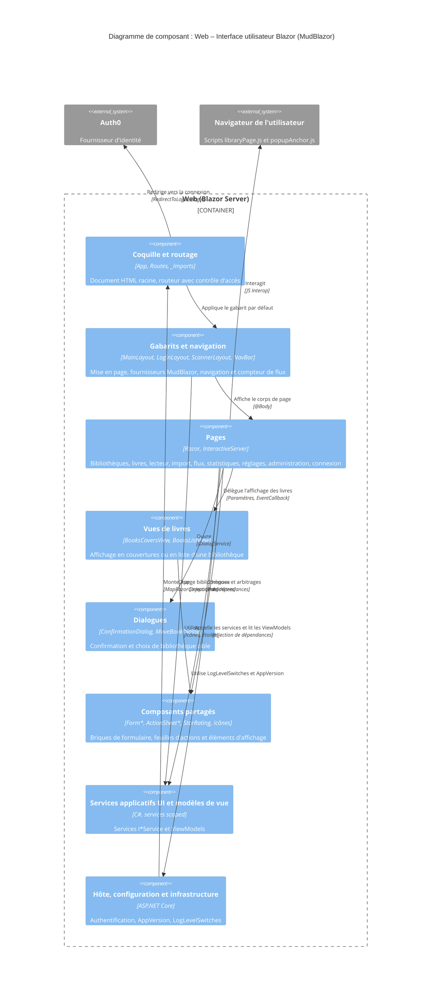

# Niveau C4 Composant : Web – Interface utilisateur Blazor (MudBlazor)

## 1. Vue d'ensemble

- **Nom** : Web – Interface utilisateur Blazor (MudBlazor)
- **Description** : interface utilisateur de l'application (`Web/Components`). Elle regroupe la coquille HTML et le routeur, les gabarits et la navigation, les pages (bibliothèques, livres, import, flux, statistiques, réglages, administration, connexion), les dialogues et les composants partagés (formulaires, feuilles d'actions, étoiles, icônes).
- **Type** : Interface utilisateur (composants Razor interactifs, au sein du conteneur Web Blazor Server)
- **Technologie** : Razor / C# (classes partielles, code-behind), Blazor Server (`InteractiveServer`), MudBlazor, CSS isolé (`.razor.css`), JavaScript Interop (`libraryPage.js`, `popupAnchor.js`), Microsoft.AspNetCore.Components.Authorization

## 2. Objectif

Ce composant porte tout ce que l'utilisateur voit et manipule. Il respecte la règle « la logique métier reste hors des composants Razor » : les pages ne contiennent que de l'orchestration d'affichage.

- **Coquille et routage** : `App.razor` produit le document HTML racine (polices, feuilles MudBlazor et de l'application versionnée par `AppVersion.Versioned`, scripts Blazor). `Routes.razor` route sur l'assemblage `Web`, applique `MainLayout` par défaut et redirige vers la connexion (`RedirectToLogin`) en l'absence de session autorisée.
- **Gabarits** : `MainLayout` (application connectée, fournisseurs MudBlazor de thème, snackbar, popover et dialogues), `LoginLayout` et `ScannerLayout` (écrans plein écran), `NavBar` (navigation latérale et inférieure, compteur des flux à arbitrer).
- **Pages** : chaque page appelle les services `I*Service` du composant [Services applicatifs UI et modèles de vue](./c4-component-web-services-modeles.md), teste chaque `Result` (`IsSuccess` / `IsFailure`) et n'applique à l'état local que les réponses en succès, avec Snackbar et `ILogger<T>` en cas d'échec.
- **Composants réutilisables** : formulaires, feuilles d'actions, dialogues, vues en couvertures ou en liste, dont les données viennent des modèles de vue (`BookListItemViewModel`, `LibraryCardViewModel`, etc.), jamais d'un calcul répété dans le gabarit.

## 3. Fonctionnalités logicielles

### Coquille, routage et gabarits

- **Document racine et routeur** : `App`, `Routes` (`AuthorizeRouteView`, `FocusOnNavigate` sur le `h1`), `_Imports.razor` (espaces de noms communs).
- **Gabarit principal** : `MainLayout` affiche la navigation selon l'URL (écoute de `LocationChanged`) et héberge `MudDialogProvider` (centré, fermeture par Échap, pas de fermeture par clic sur le fond).
- **Navigation** : `NavBar` liste les bibliothèques, les statistiques, l'import, les flux et les réglages, rafraîchit le compteur d'arbitrages sur l'événement `FeedImportsChanged`.
- **Gabarits dédiés** : `LoginLayout` (connexion), `ScannerLayout` (scan ISBN et lecteur).

### Bibliothèques

- **Liste** (`LibrariesList`) : cartes de bibliothèques (`LibraryCard`), suppression avec confirmation.
- **Création et modification** (`AddLibrary`, `EditLibrary`, `LibraryForm`) : nom, couleur, icône (`IconChooser`), tri par défaut.
- **Détail** (`LibraryDetailPage`) : livres paginés en défilement infini, recherche et tri, deux modes d'affichage mémorisés par bibliothèque (`BooksCoversView`, `BooksListView`), feuille d'actions par livre (`BookActionsIds`), suppression de la bibliothèque avec confirmation, lien « Trouver l'ISBN ».

### Livres

- **Ajout** : scan plein écran du code-barres (`AddBookScan`), saisie manuelle de l'ISBN (`AddBookManual`), formulaire ou ajout en un geste d'un livre trouvé (`AddBookForm`).
- **Consultation et modification** : fiche du livre avec lectures, scan ISBN, déplacement et suppression (`BookDetail`) ; édition du livre et de ses lectures (`EditBook`).
- **Lecteur** (`BookReader`) : lecture des pages CBZ, sauvegarde différée de la progression, recherche d'ISBN sur les pages (paramètre `mode`).
- **Recherche de détails** (`FindBookDetails`) : comparaison champ par champ avec les sources web (BnF, Bedetheque, Bubble, OpenLibrary, Google Books).
- **Composants de formulaire livre** : `LibrarySelect`, `BookFields`, `BookFormLayout`.

### Import, flux, statistiques et réglages

- **Import de fichiers** (`Import`) : téléversement, suivi des jobs (`ImportJobCard`), suppression et échec forcé.
- **Flux Miniflux et Debrid-Link** (`FeedImportsPage`) : décisions paginées, arbitrage, actions manuelles, signal `FeedImportNotifier.NotifyChanged()`.
- **Statistiques** (`Statistics`) : tuiles et histogramme des lectures par bibliothèque ou globales.
- **Réglages** (`UserSettings`) : profil, état de santé du système, version, déconnexion, section Administration réservée au rôle `Admin`.
- **Administration** : niveaux de journalisation par logger (`LogLevels`), bascules de fonctionnalités (`FeatureTogglesCard`).
- **Connexion et erreurs** : `Login` (anonyme, `LoginLayout`), `Error` (anonyme).

### Dialogues et composants partagés

- **Dialogues** : `ConfirmationDialog` (résultat `Ok(true)`), `MoveBookDialog` (résultat `Ok(Guid)`, bibliothèque suggérée présélectionnée).
- **Formulaires** : `FormPage`, `FormHeader`, `FormSection`, `FormField`, `FormFooter`, `FormButton`, `FormState`.
- **Feuilles d'actions** : `ActionSheet` (feuille sur téléphone, menu ancré sur tablette) et `ActionSheetItem`.
- **Éléments d'affichage** : `StarRating`, `LibraryIcon`, `IsbnScanStateIcon`, `ImportJobCard`, `RedirectToLogin`.
- **Accessibilité** : `aria-label` sur les boutons-icônes, `aria-pressed` sur les boutons de niveau, focus sur le `h1` après navigation.

## 4. Éléments de code

Ce composant contient les éléments de code suivants :

- [c4-code-Web-Components.md](./c4-code-Web-Components.md) : racine `Web/Components` (`App`, `Routes`, `_Imports`).
- [c4-code-Web-Components-Layout.md](./c4-code-Web-Components-Layout.md) : gabarits `MainLayout`, `LoginLayout`, `ScannerLayout` et `NavBar`.
- [c4-code-Web-Components-Pages.md](./c4-code-Web-Components-Pages.md) : pages racine (`Import`, `FeedImportsPage`, `Statistics`, `UserSettings`, `Login`, `Error`).
- [c4-code-Web-Components-Pages-Admin.md](./c4-code-Web-Components-Pages-Admin.md) : `LogLevels` et `FeatureTogglesCard`.
- [c4-code-Web-Components-Pages-Books.md](./c4-code-Web-Components-Pages-Books.md) : 10 composants (7 pages et 3 composants enfants) de gestion des livres.
- [c4-code-Web-Components-Pages-Dialogs.md](./c4-code-Web-Components-Pages-Dialogs.md) : `ConfirmationDialog` et `MoveBookDialog`.
- [c4-code-Web-Components-Pages-Libraries.md](./c4-code-Web-Components-Pages-Libraries.md) : pages de bibliothèques, `LibraryForm`, `IconChooser`, `LibraryCard`.
- [c4-code-Web-Components-Pages-Libraries-Views.md](./c4-code-Web-Components-Pages-Libraries-Views.md) : `BooksCoversView`, `BooksListView`, `BookActionsIds`.
- [c4-code-Web-Components-SharedComponents.md](./c4-code-Web-Components-SharedComponents.md) : 14 composants partagés (formulaires, feuilles d'actions, étoiles, icônes).

## 5. Interfaces

### Routes de pages (`@page`)

- **Protocole** : routage Blazor (HTTP et circuit SignalR), rendu `InteractiveServer`. `_Imports.razor` du dossier `Pages` porte `@attribute [Authorize]`, qui s'applique à toutes les pages du dossier et de ses sous-dossiers ; seules `Login` et `Error` sont `[AllowAnonymous]`.

| Route | Composant | Gabarit | Remarques |
|---|---|---|---|
| `/` et `/libraries/list` | `LibrariesList` | `MainLayout` | page d'accueil |
| `/libraries/add` | `AddLibrary` | `MainLayout` | |
| `/libraries/{LibraryId}` | `LibraryDetailPage` | `MainLayout` | paramètre `LibraryId` |
| `/libraries/{LibraryId}/edit` | `EditLibrary` | `MainLayout` | paramètre `LibraryId` |
| `/books/add/scan` | `AddBookScan` | `ScannerLayout` | |
| `/books/add/manual` | `AddBookManual` | `MainLayout` | |
| `/books/add/form` | `AddBookForm` | `MainLayout` | |
| `/books/{BookId}` | `BookDetail` | `MainLayout` | paramètre `BookId` |
| `/books/{BookId}/edit` | `EditBook` | `MainLayout` | paramètre `BookId` |
| `/books/{BookId}/read` | `BookReader` | `ScannerLayout` | `BookId` ; requête `?mode=` |
| `/books/{BookId}/find-details` | `FindBookDetails` | `MainLayout` | `BookId` ; requête `isbn` |
| `/import` | `Import` | `MainLayout` | |
| `/feed-imports` | `FeedImportsPage` | `MainLayout` | |
| `/statistics` | `Statistics` | `MainLayout` | |
| `/settings` | `UserSettings` | `MainLayout` | |
| `/admin/log-levels` | `LogLevels` | `MainLayout` | `[Authorize(Roles = "Admin")]` |
| `/login` | `Login` | `LoginLayout` | `[AllowAnonymous]` |
| `/Error` | `Error` | `MainLayout` | `[AllowAnonymous]` |

### Composants partagés et paramètres

- **Protocole** : paramètres de composant (`[Parameter]`, `EventCallback`, `RenderFragment`) ; paramètre en cascade `IMudDialogInstance` pour les dialogues.
- **Composants** :
  - `ActionSheet` : `Open`, `AriaLabel`, `Anchor`, `Header`, `ChildContent`, `OnClose`.
  - `ActionSheetItem` : `Icon`, `Text`, `Href`, `OnClick`, `Selected`, `Danger`.
  - `FormButton` : `Variant` (3 variantes), `Href`, `Type`, `Form`, `Icon`, `OnClick`.
  - `FormField` : `Id`, `Label`, `Required`, `Error`, `Help`.
  - `FormHeader` : `Title`, `Subtitle`, `BackHref`, `OnBack`, `ChildContent`. `FormPage` : `Class`. `FormSection` : `Id`, `Title`, `Note`. `FormFooter` : `ChildContent`. `FormState` : `Loading`, `Icon`, `Title`, `Text`.
  - `StarRating` : `Value`, `ValueChanged`, `LabelledBy`, `ReadOnly`.
  - `LibraryIcon` : `Icon`, `Color`, `Large`. `IsbnScanStateIcon` : `State`, `CandidateCount`, `Isbn`, `HideWhenKnown`. `ImportJobCard` : `Job`, `OnDelete`, `OnForceFail`.
  - `LibraryCard` : `[EditorRequired] LibraryCardViewModel Library`.
  - `BooksCoversView` et `BooksListView` : `[EditorRequired] Books : IReadOnlyList<BookListItemViewModel>` et `OnActions : EventCallback<BookListItemViewModel>`.
  - `ConfirmationDialog` et `MoveBookDialog` : `[CascadingParameter] IMudDialogInstance MudDialog` ; `MoveBookDialog` reçoit aussi `Choices` (`BookMoveChoices`) et est ouvert par `BookMoveWorkflow.ChooseAndMoveAsync` avec `AppDialogs.Options`.

### Interactions avec le navigateur

- **JavaScript Interop** : `libraryPage.js` (`infiniteScroll.observe`, `LoadMoreBooksAsync`, `bodyScroll.disable`) pour le défilement infini ; `popupAnchor.js` pour ancrer les menus ; scripts du scan de code-barres et du lecteur.
- **Événements applicatifs** : `NavigationManager.LocationChanged`, `FeedImportsChanged` / `FeedImportNotifier`.

## 6. Dépendances

### Composants utilisés

- [Web – Services applicatifs UI et modèles de vue](./c4-component-web-services-modeles.md) : services `I*Service` appelés par les pages (`ILibrariesService`, `IBooksService`, `IBookMoveWorkflow`, `IBookReaderService`, `IStatisticsService`, `IIsbnScanService`, `IImportService`, `IFeedImportService`, `IFeatureToggleService`, `LibraryStateService`) et modèles de vue (`LibraryCardViewModel`, `BookListItemViewModel`, `BookDetailViewModel`, `EditBookViewModel`, `ImportJobViewModel`, `FeedImportDecisionViewModel`, `StatisticsViewModel`, `FeatureToggleViewModel`, `SystemHealthViewModel`, `FormErrors`, `BookMoveChoices`).
- [Web – Hôte, configuration et infrastructure](./c4-component-web-hote.md) : montage du composant racine `App` par `MapRazorComponents<App>()`, authentification Auth0 et contrôle d'accès, `AppVersion`, `LogLevelSwitches` (utilisé par `LogLevels`), `AppDialogs.Options`, `Web.Enums.ViewMode`.
- Couche Application et Domaine : types `Result` et DTO exposés via les services ; les pages n'appellent pas directement les handlers CQRS (interfaces `ICommandHandler` / `IQueryHandler` injectées dans les services, pas via MediatR).

### Systèmes et bibliothèques externes

- **MudBlazor** : `MudThemeProvider`, `MudDialogProvider`, `ISnackbar`, `IDialogService`, composants de mise en page et de saisie.
- **Blazor Server** : `AuthorizeRouteView`, `AuthorizeView`, `NavigationManager`, `IJSRuntime`, `IBrowserFile`, `[Authorize]` / `[AllowAnonymous]`.
- **Auth0** : identité de l'utilisateur, via le composant hôte (`/Account/Login`, `/Account/Logout`).
- **Scripts clients** : `libraryPage.js`, `popupAnchor.js`, scripts de scan et de lecteur.
- **Serilog / Microsoft.Extensions.Logging** : `ILogger<T>` injecté (pas de `Serilog.Log` statique).

### Points d'attention

- `BookDetail.ScanIsbnAsync` (L149) passe `CancellationToken.None` à `IsbnScanService.ScanBookAsync` : un scan en cours n'est pas annulé à la fermeture de la page. `BookDetail.DeleteBookAsync` (L241) utilise `res.Error!.Description` sans garde.
- `FindBookDetails` n'implémente pas `IDisposable` et n'a pas de jeton d'annulation (les résultats tardifs sont ignorés grâce à `_searchedFor`). Dans `LoadBookThenFetchAsync` (L82-86), l'échec de `GetById` met `_loadError` à `true` sans `Log.Error` ni Snackbar, contrairement à la règle « Blazor — Error Handling in Load Methods ».
- `BookReader.ScheduleProgressSave` (L594) lance `Task.Run` sans observer les exceptions autres que `OperationCanceledException`.
- `NavBar` utilise `async void` dans `OnLocationChangedAsync` et `OnFeedImportsChangedAsync` : les exceptions ne remontent pas à l'appelant.
- `MoveBookDialog.OnParametersSet` utilise `Choices.Libraries.First(...)` : une suggestion absente de la liste lèverait une exception (cas supposé impossible).
- `Import.OnParametersSetAsync` : `_lastLoadedLibraryId` n'est mis à jour qu'en cas de succès, donc chaque changement de paramètre relance le chargement après un échec. `Login` code en dur l'URL `/Account/Login`.
- `LibraryDetailPage` protège les chargements concurrents (`_loadVersion`, `_searchCts`, `_sortCts`) ; `LogLevels` est protégé uniquement par le rôle `Admin` (l'entrée de menu est dans `UserSettings`).
- Aucune anomalie bloquante dans les composants partagés ; les vues `BooksCoversView` et `BooksListView` réutilisent le même identifiant de bouton `⋮` (unique par livre, pas par vue).

## 7. Diagramme de composant

