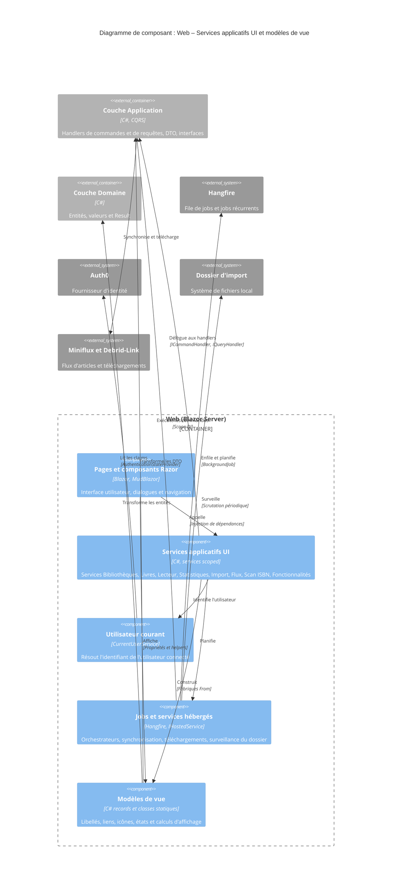

# Niveau C4 Composant : Web – Services applicatifs UI et modèles de vue

## 1. Vue d'ensemble

- **Nom** : Web – Services applicatifs UI et modèles de vue
- **Description** : couche d'adaptation entre les composants Razor et la couche Application. Les services (`Web/Services`) appellent les handlers CQRS pour l'utilisateur courant et planifient les traitements de fond ; les modèles de vue (`Web/Models`) transforment les DTO et entités en textes, liens, icônes et états prêts à afficher.
- **Type** : Bibliothèque de services applicatifs et de modèles de présentation (au sein du conteneur Web Blazor Server)
- **Technologie** : C# (.NET 10), Blazor Server, MudBlazor, Hangfire, FluentValidation, Microsoft.Extensions (Options, Logging, Hosting, DependencyInjection), Microsoft.JSInterop

## 2. Objectif

Ce composant garde la logique de présentation et d'orchestration hors des composants Razor (règle « business logic stays outside Razor components »).

- **Services** : ils exposent aux pages une API stable (`I*Service`). Chaque appel identifie l'utilisateur courant (`ICurrentUserService`), valide les identifiants reçus en `string` (`Guid.TryParse`, `ValidationError` en cas d'échec), puis délègue à un handler `ICommandHandler` ou `IQueryHandler`. Les traitements longs (import de fichiers, scan ISBN, synchronisation Miniflux, téléchargements Debrid-Link) sont déportés dans des jobs Hangfire ou des services hébergés.
- **Modèles de vue** : ils calculent une seule fois les valeurs dérivées (règle « View / ViewModel », ADR-0021) et centralisent libellés, liens, couleurs, icônes et règles d'affichage. Les pages et les tris n'ont plus à parcourir les collections de façon répétée.

## 3. Fonctionnalités logicielles

### Services applicatifs UI

- **Bibliothèques** : création, lecture, mise à jour, filtrage paginé, résumés et suppression (`LibrariesService`) ; mémorisation de la recherche et du mode d'affichage par bibliothèque (`LibraryStateService`) ; préchauffage du dictionnaire d'icônes au démarrage (`LibraryIconsWarmupService`).
- **Livres** : CRUD, liste paginée par bibliothèque avec tri et recherche, ajout et suppression de lectures (`BooksService`).
- **Déplacement de livre** : liste des bibliothèques cibles de même type et déplacement (`BookMoveService`) ; enchaînement dialogue de choix, déplacement et notification (`BookMoveWorkflow`).
- **Lecteur** : informations du lecteur, sauvegarde de la page courante et des réglages (`BookReaderService`) ; position d'un bouton pour ancrer un menu via un module JavaScript (`PopupAnchorLocator`).
- **Statistiques** : statistiques d'une bibliothèque ou de toutes (`StatisticsService`).
- **Scan ISBN** : lancement du scan d'une bibliothèque en arrière-plan, scan immédiat d'un livre (`IsbnScanService`) ; job Hangfire sans exécution concurrente pour une même bibliothèque (`IsbnScanOrchestrator`, `HangfireIsbnScanJobEnqueuer`).
- **Import de fichiers** : téléversement avec contrôle de l'extension et de la taille, création et mise en file du job, liste, suppression et échec forcé (`ImportService`) ; traitement du job (`ImportOrchestrator`, `HangfireImportJobEnqueuer`) ; surveillance du dossier d'import (`FileWatcherService`).
- **Flux Miniflux et Debrid-Link** : décisions paginées, arbitrage, actions manuelles, correction, suppression, compteurs (`FeedImportService`) ; synchronisation récurrente (`FeedImportSyncJob`) ; un téléchargement par décision (`FeedImportDownloadJob`) ; signal de recomptage du badge de navigation (`FeedImportNotifier`).
- **Fonctionnalités et utilisateur** : lecture et bascule des feature toggles, avec planification ou retrait du job de synchronisation (`FeatureToggleService`) ; résolution de l'utilisateur courant par le claim `sub`, puis par e-mail (`CurrentUserService`).

### Modèles de vue et helpers d'affichage

- **Bibliothèques** : cartes, entrées de navigation, textes de tri et de recherche, palette de 12 couleurs, choix et recherche d'icônes Material (`LibraryCardViewModel`, `NavLibraryItemViewModel`, `LibraryDisplay`, `LibraryColors`, `LibraryIcons`).
- **Livres** : ligne de liste, page de détail, formulaire d'édition, livre trouvé par ISBN, cibles de déplacement, textes partagés, validation de l'ISBN saisi, état du scan ISBN, liens des étapes d'ajout (`BookListItemViewModel`, `BookDetailViewModel`, `EditBookViewModel`, `BookFoundViewModel`, `BookMoveTargetViewModel`, `BookText`, `IsbnEntry`, `IsbnScanStateDisplay`, `AddBookLinks`).
- **Comparaison avec les sources web** : comparaison champ par champ d'un livre avec BnF, Bedetheque, Bubble, OpenLibrary et Google Books, avec fusion des valeurs identiques et décompte des changements (`BookDetailsComparison`).
- **Lecteur** : options du script client, regroupement des pages en doubles pages (sens manga inclus), fenêtre de pages demandées, titre et largeur de progression (`ReaderScriptOptions`, `ReaderSpreads`, `ReaderPageWindow`, `ReaderDisplay`).
- **Imports et flux** : état d'un job d'import (étape, progression, durée, erreur) ; décisions de flux avec actions manuelles autorisées ; filtres de statut avec compteurs (`ImportJobViewModel`, `FeedImportDecisionViewModel`, `FeedImportFilters`).
- **Statistiques** : tuiles, pourcentage de lecture et histogramme des lectures mensuelles à axe à deux pas égaux (`StatisticsViewModel`, `ReadingsChartViewModel`).
- **Transverses** : erreurs de formulaire et accessibilité des champs, placement de menus, état de recherche par source, règles de navigation, feature toggles, santé du système, initiales du compte, formatage des tailles de fichier (`FormErrors`, `FormFieldIds`, `PopupPlacement`, `ProviderSearchState`, `NavigationRules`, `FeatureToggleViewModel`, `SystemHealthViewModel`, `AccountViewModel`, `FileSizeFormatter`).

## 4. Éléments de code

Ce composant contient les éléments de code suivants :

- [c4-code-Web-Services.md](./c4-code-Web-Services.md) : services de la couche Web (`Web/Services`, 40 fichiers), adaptateurs vers les handlers CQRS, jobs Hangfire et services hébergés.
- [c4-code-Web-Models.md](./c4-code-Web-Models.md) : view models et helpers d'affichage (`Web/Models`, 34 fichiers).

## 5. Interfaces

### Services applicatifs exposés aux composants Razor

- **Protocole** : appels C# in-process via injection de dépendances (Blazor Server). Toutes les méthodes retournent `Result` ou `Result<T>` (pas d'exception pour les erreurs connues).
- **Description** : contrats `I*Service` consommés par les pages et dialogues ; l'utilisateur courant est résolu à chaque appel.

#### `ILibrariesService`
- `Create(CreateLibraryRequest, ct): Result<Library>` : crée une bibliothèque.
- `GetById(string? id): Result<Library>` : lit une bibliothèque.
- `Update(UpdateLibraryRequest, ct): Result<Library>` : met à jour nom, couleur, icône, tri par défaut.
- `FilterBy(searchTerm, sortColumn, sortOrder, page, pageSize, ct): Result<IPagedList<Library>>` : liste paginée.
- `GetSummaries(ct): Result<IReadOnlyList<LibrarySummary>>` : résumés pour cartes et navigation.
- `Delete(string? id, ct): Result` : supprime.

#### `IBooksService`
- `Create`, `Update`, `Delete`, `GetById`, `GetAll` : CRUD des livres.
- `GetByLibrary(libraryId, ct): Result<List<Book>>` : livres d'une bibliothèque.
- `GetPagedByLibrary(libraryId, page, pageSize, sortOrder, searchTerm, ct): Result<IPagedList<BookSummaryDto>>` : liste paginée.
- `AddReadingDate(bookId, rating, ct): Result<ReadingDate>` et `DeleteReadingDate(bookId, readingDateId, ct): Result` : gestion des lectures.

#### `IBookMoveService` et `IBookMoveWorkflow`
- `GetTargetsAsync(bookId, ct): Result<BookMoveTargets>` : bibliothèques cibles.
- `MoveAsync(bookId, targetLibraryId, ct): Result<Book>` : déplace le livre.
- `ChooseAndMoveAsync(bookId, ct): bool` : dialogue de choix, déplacement et snackbar ; vrai seulement si le livre a été déplacé.

#### `IBookReaderService`
- `GetReaderInfoAsync(bookId, ct): Result<BookReaderInfoDto>`
- `SaveProgressAsync(bookId, pageIndex, ct): Result`
- `SaveSettingsAsync(bookId, settings, ct): Result`

#### `IStatisticsService`
- `Get(Guid? libraryId, ct): Result<StatisticsDto>` : `libraryId` nul pour toutes les bibliothèques.

#### `IIsbnScanService`
- `StartLibraryScanAsync(libraryId, ct): Result<int>` : lance le scan en arrière-plan, retourne le nombre de livres à scanner.
- `ScanBookAsync(bookId, ct): Result<IsbnScanOutcome>` : scan immédiat.

#### `IImportService`
- `GetImportJobsAsync(libraryId, ct)` et `GetImportJobAsync(importJobId, ct)` : lecture des jobs en `ImportJobViewModel`.
- `UploadAndCreateJobAsync(IBrowserFile, libraryId, ct)` : copie, création et mise en file du job.
- `DeleteImportJobAsync(importJobId, ct)` et `ForceFailImportJobAsync(importJobId, ct)`.

#### `IFeedImportService`
- `IsSyncEnabled : bool` : fonctionnalité `FeedImport` active.
- `GetDecisionsAsync(status, searchTerm, page, pageSize, ct): Result<FeedImportDecisionPageViewModel>`
- `TriggerSync(): Result` : enfile `FeedImportSyncJob.SyncAsync`, ou `FeedImportError.Disabled`.
- `ResolveArbitrationAsync`, `ApplyActionAsync`, `CorrectAsync` : arbitrage, actions manuelles et correction d'une décision.
- `DeleteAsync(decisionIds, ct): Result<int>` et `DeleteDownloadedAsync(ct)`.
- `CountAwaitingArbitrationAsync(ct): int` et `GetStatusCountsAsync(ct): Result<FeedImportStatusCounts>`.

#### `IFeatureToggleService`
- `GetToggles(): IReadOnlyList<FeatureToggleViewModel>`
- `SetAsync(toggle, enabled, ct): Result` : enregistre la bascule et ajoute ou retire le job récurrent pour `FeedImport`.

#### `ICurrentUserService` (contrat défini dans Application, implémenté par `CurrentUserService`)
- `GetCurrentUserIdAsync(ct): Result<Guid>` : claim `sub` ou `NameIdentifier`, repli sur l'e-mail, sinon `UsersError.NotFound`.

### Jobs de fond

- **Protocole** : Hangfire (`BackgroundJob.Enqueue`, `IBackgroundJobClient`, travail récurrent `feed-import-sync`) et `IHostedService`.
- **Opérations** :
  - `ImportOrchestrator.ProcessAsync(importJobId, ct)`
  - `IsbnScanOrchestrator.ScanLibraryAsync(libraryId, ct)`
  - `FeedImportSyncJob.SyncAsync(ct)` ; `FeedImportSyncJob.Schedule(recurringJobManager, settings, enabled)`
  - `FeedImportDownloadJob.DownloadAsync(decisionId, ct)`
  - `FileWatcherService` (surveillance périodique du dossier d'import)

### Modèles de vue (contrat de données avec les pages)

- **Protocole** : types C# immuables (records et classes statiques), construits par des fabriques `From(...)`.
- **Fabriques principales** :
  - `LibraryCardViewModel.From(LibrarySummary)`, `NavLibraryItemViewModel.From(LibrarySummary)`
  - `BookListItemViewModel.From(BookSummaryDto | Book)`, `BookDetailViewModel.From(Book)`, `EditBookViewModel.From(Book)`
  - `BookFoundViewModel.From(ComicSearchResult)`, `BookMoveChoices.From(BookMoveTargets)`
  - `ImportJobViewModel.From(ImportJob)`, `FeedImportDecisionViewModel.From(FeedImportDecision, ...)`
  - `StatisticsViewModel.From(StatisticsDto, allLibraries)`, `ReadingsChartViewModel.From(months)`
  - `FeatureToggleViewModel.From(FeatureToggleState)`, `SystemHealthViewModel.From(HealthReport)`
  - `ReaderSpreads.Build(pageCount, settings)`, `ReaderScriptOptions.From(settings)`
  - `FormErrors.From(ValidationResult)`
  - `BookFieldComparison.Compare(field, current, candidates)`
- **Helpers statiques** : `LibraryDisplay`, `BookText`, `ReaderDisplay`, `IsbnEntry.Check`, `AddBookLinks`, `NavigationRules`, `PopupPlacement.Style`, `FileSizeFormatter.Format`, `AccountViewModel.Initials`, `FormFieldIds`, `LibraryColors`, `LibraryIcons`.

## 6. Dépendances

### Composants et couches utilisés

- **Application (handlers CQRS, interfaces, DTO)** : `ICommandHandler`, `IQueryHandler` et les commandes et requêtes des fonctionnalités Libraries, Books, ImportJobs, FeedImports, Statistics, Settings et Users ; interfaces `ICurrentUserService`, `IUserReadService`, `IImportJobEnqueuer`, `IIsbnScanJobEnqueuer`, `IImportDirectoryStorage` ; DTO source des modèles de vue (`LibrarySummary`, `BookSummaryDto`, `BookMoveTargets`, `StatisticsDto`, `FeatureToggleState`, `ComicSearchResult`).
- **Domain** : entités et types (`Book`, `DigitalBook`, `Library`, `ImportJob`, `FeedImportDecision`, `ReaderSettings`, `IsbnScanState`, `FeatureToggle`) et `Result` / `TError`.
- **Composants Razor et dialogues du conteneur Web** : `MoveBookDialog` et `AppDialogs` (utilisés par `BookMoveWorkflow`), `Web.Enums.ViewMode`, `Web.Infrastructure.AppVersion`. Les pages consomment ce composant.
- **Composition racine (`Program.cs`)** : enregistrement et durée de vie des services (non vérifiée ici).

### Systèmes et bibliothèques externes

- **Hangfire** : file de jobs, job récurrent, exécution non concurrente.
- **MudBlazor** : `IDialogService`, `ISnackbar`, icônes et couleurs.
- **Blazor Server** : `AuthenticationStateProvider` (identité issue d'Auth0), `IBrowserFile`, `IJSRuntime`.
- **FluentValidation** : `ValidationResult` pour `FormErrors`.
- **Microsoft.Extensions** : Options, Logging, Hosting, DependencyInjection, HealthChecks.
- **Système de fichiers local** : dossier d'import surveillé par `FileWatcherService`.
- **Miniflux et Debrid-Link** : atteints via les handlers de la couche Application, configurés par `FeedImportSettings` et `DebridLinkSettings`.
- **Module JavaScript `popupAnchor.js`** : position des ancres de menu.

### Points d'attention

- Dans `ImportService.UploadAndCreateJobAsync`, le fichier est écrit avant l'appel au handler de création (qui porte les validations du domaine), ce qui déroge à la règle d'ordre des effets de bord (à arbitrer).
- `LibraryStateService` (dictionnaire non thread-safe), `FeedImportNotifier` et `PopupAnchorLocator` supposent une durée de vie par circuit.
- Trois implémentations de formatage de taille de fichier coexistent.
- `FeedImportDecisionViewModel.From` dépend de `DateTime.UtcNow`.
- Les libellés affichés sont codés en anglais dans le code.

## 7. Diagramme de composant

