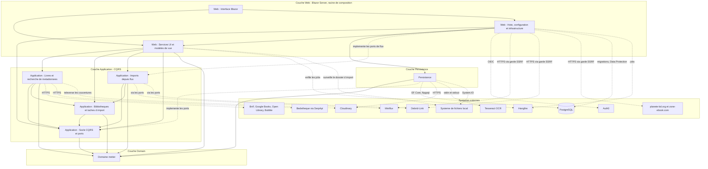
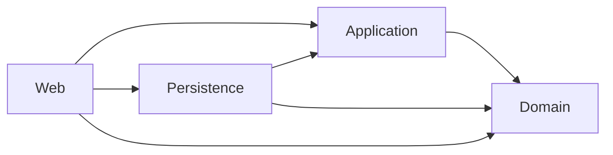

# Niveau C4 Composant : Vue d'ensemble du système

Ce document est l'index maître des composants de MyComicsManager (application .NET 10, Clean Architecture avec CQRS). Il regroupe les neuf fiches de composants, présente leurs relations avec les systèmes externes, puis rappelle les frontières de couches et la règle de dépendance.

## 1. Composants du système

| # | Composant | Couche | Description | Fiche |
|---|---|---|---|---|
| 1 | Domaine métier | Domain | Entités, agrégats, objets de valeur, catalogues d'erreurs et primitives (`Entity`, `Result`, `TError`) portant les règles métier, sans dépendance externe. | [c4-component-domaine.md](./c4-component-domaine.md) |
| 2 | Application : Socle CQRS et ports | Application | Contrat CQRS, ports d'infrastructure, utilitaires ISBN et dates, bascules de fonctionnalités, enregistrement `AddApplication` et cas d'usage transverses (bascule, statistiques, création d'utilisateur). | [c4-component-application-socle.md](./c4-component-application-socle.md) |
| 3 | Application : Livres et recherche de métadonnées | Application | Cas d'usage des livres (CRUD, lectures, déplacement, lecteur numérique, scan ISBN par OCR) et recherche de métadonnées par ISBN auprès des catalogues externes. | [c4-component-application-livres.md](./c4-component-application-livres.md) |
| 4 | Application : Bibliothèques et tâches d'import | Application | Cycle de vie des bibliothèques et des tâches d'import de fichiers (pipeline asynchrone vers `DigitalBook`). | [c4-component-application-bibliotheques.md](./c4-component-application-bibliotheques.md) |
| 5 | Application : Imports depuis flux | Application | Synchronisation Miniflux, analyse d'articles, arbitrage, téléchargement via Debrid-Link et dépôt dans le dossier d'import. | [c4-component-application-imports-flux.md](./c4-component-application-imports-flux.md) |
| 6 | Persistance | Persistence | PostgreSQL via EF Core, dépôts, services de lecture, stockage local, traitement de fichiers, OCR Tesseract et client Cloudinary. | [c4-component-persistance.md](./c4-component-persistance.md) |
| 7 | Web : Hôte, configuration et infrastructure | Web | Racine de composition, authentification Auth0, endpoints HTTP, Hangfire, garde SSRF, health checks, journalisation et clients HTTP Miniflux / Debrid-Link. | [c4-component-web-hote.md](./c4-component-web-hote.md) |
| 8 | Web : Services applicatifs UI et modèles de vue | Web | Services `I*Service` appelant les handlers CQRS, jobs Hangfire et services hébergés, modèles de vue prêts à afficher. | [c4-component-web-services-modeles.md](./c4-component-web-services-modeles.md) |
| 9 | Web : Interface utilisateur Blazor (MudBlazor) | Web | Coquille, routage, gabarits, pages, dialogues et composants partagés. | [c4-component-web-interface-blazor.md](./c4-component-web-interface-blazor.md) |

### Systèmes externes référencés

| Système | Rôle | Composants concernés |
|---|---|---|
| PostgreSQL | Base relationnelle, stockage Hangfire, clés Data Protection | Persistance, Web : Hôte |
| Auth0 | Authentification OIDC | Web : Hôte, Web : Services, Web : Interface |
| Cloudinary | Hébergement des couvertures | Persistance, Application : Livres, Application : Bibliothèques, Web : Hôte (health check) |
| Miniflux | Lecteur de flux RSS (articles étoilés) | Application : Imports de flux, Web : Hôte |
| Debrid-Link | Débridage de liens de téléchargement | Application : Imports de flux, Web : Hôte |
| planete-bd.org, zone-ebook.com | Sites d'articles analysés | Application : Imports de flux |
| BnF, Google Books, Open Library, Bubble, Bedetheque (via SerpApi) | Sources de métadonnées par ISBN | Application : Livres, Web : Hôte (liste blanche d'hôtes) |
| Tesseract | OCR local pour le scan d'ISBN | Persistance |
| Système de fichiers local | Bibliothèques, dossier d'import, dossier temporaire | Persistance, Web : Services (surveillance) |
| Hangfire | Jobs asynchrones et récurrents | Web : Hôte, Web : Services |

## 2. Diagramme des relations entre composants

Les flèches pleines indiquent une dépendance de code (« utilise »). Les flèches pointillées indiquent une implémentation de ports ou un appel vers un système externe.

Notes de lecture :

- Les composants Application n'accèdent aux systèmes externes que par des ports (interfaces) ; les implémentations sont dans Persistance (PostgreSQL, fichiers, OCR, Cloudinary) et dans Web : Hôte (Miniflux, Debrid-Link, pages d'articles).
- Les catalogues de métadonnées (BnF, Google Books, Open Library, Bubble, Bedetheque) sont implémentés dans le composant Application : Livres ; Web : Hôte tient à jour la liste blanche d'hôtes.
- Le composant Application : Imports depuis flux dépose ses fichiers dans le dossier d'import et crée un `ImportJob` via le composant Application : Bibliothèques et tâches d'import.

## 3. Frontières de couches et règle de dépendance

### Couches

| Couche | Projet | Composants | Responsabilité | Peut dépendre de |
|---|---|---|---|---|
| Domain | `Domain/` | Domaine métier | Entités, objets de valeur, erreurs, `Result` | Rien (aucune dépendance externe métier) |
| Application | `Application/` | Socle CQRS et ports, Livres, Bibliothèques et imports, Imports depuis flux | Handlers CQRS, ports (interfaces), règles applicatives | Domain uniquement |
| Persistence | `Persistence/` | Persistance | Implémentation des ports : EF Core, fichiers, OCR, Cloudinary | Application (interfaces) et Domain |
| Web | `Web/` | Hôte, Services UI et modèles de vue, Interface Blazor | Racine de composition, UI Blazor Server, adaptateurs d'infrastructure web | Application, Domain, Persistence (uniquement pour l'enregistrement) |

### Règle de dépendance

- Les dépendances de code pointent toujours vers l'intérieur : Domain ne dépend de rien, Application ne dépend que de Domain.
- Application définit des ports (`IRepository`, `IUnitOfWork`, `ILibraryLocalStorage`, `IMinifluxClient`, `IComicSearchService`, etc.) ; Persistence et Web les implémentent. C'est l'inversion de dépendance qui évite à Application de connaître EF Core, le disque ou HTTP.
- Persistence n'expose pas de types EF Core vers le haut : Application ne voit que des interfaces, des DTO et `IPagedList<T>`.
- Web est la racine de composition : `Program.cs` appelle `AddApplication` et `AddInfrastructure`. Les pages Razor n'appellent jamais directement les handlers CQRS : elles passent par les services `I*Service` qui portent la logique d'orchestration (la logique métier reste hors des composants Razor).
- Les erreurs connues sont renvoyées par `Result` / `Result<T>` définis dans Domain, jamais par exception.
- Ces règles sont vérifiées automatiquement par le projet `Architecture.Tests` (NetArchTest).

### Écarts relevés dans les fiches

- Le composant Application : Livres et recherche de métadonnées héberge les implémentations HTTP des catalogues (`HttpClient`, HtmlAgilityPack) dans la couche Application, ce qui relève d'un adaptateur d'infrastructure placé derrière des ports.
- Le composant Application : Socle CQRS signale que `CreateUserCommandHandler` renvoie toujours `UsersError.Duplicate` (anomalie documentée dans [c4-code-Application-Users-Create.md](./c4-code-Application-Users-Create.md)).
- Le composant Persistance liste plusieurs écarts aux règles du projet (tri paginé sans clé de départage, pagination non bornée, dépôt qui sauvegarde lui-même) ; voir la section 6 de [c4-component-persistance.md](./c4-component-persistance.md).
