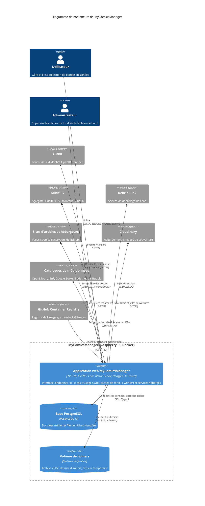

# Niveau C4 Conteneur : Déploiement de MyComicsManager

Ce document décrit les conteneurs (unités exécutables et stockages) de MyComicsManager, d'après ce que le CD fait réellement : une seule image Docker applicative (`ghcr.io/slucky31/mcm`, `linux/arm64`) est publiée. Aucun `docker-compose` ni manifeste Kubernetes n'existe dans le dépôt ; les fichiers de déploiement vivent en dehors (la documentation `docs/` y fait référence). Les composants logiques viennent de [c4-component.md](./c4-component.md).

## Conteneurs

### 1. Application web MyComicsManager (mcm-web)

- **Nom** : MyComicsManager Web
- **Description** : processus unique ASP.NET Core qui sert l'interface Blazor Server, les endpoints HTTP, les tâches de fond Hangfire et les services hébergés.
- **Type** : application web (Blazor Server) et API HTTP, avec exécution de tâches de fond en processus
- **Technologie** : .NET 10, ASP.NET Core, Blazor Server (MudBlazor), Hangfire (stockage PostgreSQL), Serilog, Auth0, Tesseract OCR (binaire système)
- **Déploiement** : image Docker `ghcr.io/slucky31/mcm` (étiquettes `latest`, `x.y.z`, `x.y`), plateforme `linux/arm64`, construite par le job `docker-web` de `cd.yml` sur un runner arm64 natif. Cible d'exécution : Raspberry Pi (commentaire `Sequential for RPi4` dans `Program.cs`).

### 2. Base de données PostgreSQL

- **Nom** : PostgreSQL (auto-hébergé)
- **Description** : stocke les données métier (livres, bibliothèques, utilisateurs, tâches d'import, imports de flux, paramètres) et l'état des tâches Hangfire.
- **Type** : base de données relationnelle
- **Technologie** : PostgreSQL 18 (version de production, alignée par la CI sur `postgres:18`)
- **Déploiement** : instance Docker auto-hébergée, unique et partagée par les bases staging et production (`mycomicsmanager_staging`, `mycomicsmanager_prod`, d'après `docs/MIGRATION-POSTGRESQL.md`). Son image et sa définition ne sont pas dans le dépôt.

### 3. Stockage de fichiers local (volume)

- **Nom** : Volume de fichiers (bibliothèques, import, temporaire)
- **Description** : système de fichiers monté dans le conteneur applicatif ; contient les archives CBZ des bibliothèques, le dossier d'import surveillé et le dossier temporaire.
- **Type** : système de fichiers (volume monté)
- **Technologie** : système de fichiers Linux ; chemins `LocalStorage:RootPath`, `Import:ImportDirectory` (`/data/import` par défaut), `Import:TempDirectory` (`/data/temp` par défaut)
- **Déploiement** : volume monté à l'exécution. Le code vérifie au démarrage que `LocalStorage:RootPath` existe (message « check the volume is mounted »). Le type de volume réel (bind mount, volume nommé) n'est pas défini dans le dépôt.

### Éléments volontairement non retenus comme conteneurs

- **Tableau de bord Hangfire** : servi sur `/hangfire` par le même processus que l'application web ; ce n'est pas un conteneur distinct.
- **Miniflux** : conteneur tiers, exploité hors de ce dépôt, sur le réseau Docker externe (`http://miniflux:8080`) ; il est représenté comme système externe.
- **Base de tests CI** : `postgres:18` éphémère sur le runner GitHub, hors déploiement.

## Objectif

L'application web concentre toute la logique : interface, cas d'usage CQRS, accès aux données et tâches de fond, selon une architecture en couches (Domain, Application, Persistence, Web) compilée en un seul exécutable `./Web`. Le worker Hangfire est configuré avec `WorkerCount = 1` et les files `import` puis `default`, pour un traitement séquentiel adapté au Raspberry Pi. Au démarrage, l'application applique les migrations EF Core (`MigrateAsync`), valide la configuration (`ValidateOnStart`) et exécute les health checks (un état `Unhealthy` interrompt le démarrage).

PostgreSQL est le seul stockage transactionnel : il sert à la fois EF Core et Hangfire. Le volume porte les fichiers volumineux, que la base ne contient pas.

## Composants

### Application web MyComicsManager

| Composant | Rôle dans le conteneur | Fiche |
|---|---|---|
| Domaine métier | entités, agrégats, erreurs, primitives `Result` | [c4-component-domaine.md](./c4-component-domaine.md) |
| Application : Socle CQRS et ports | contrat CQRS, ports, bascules, statistiques | [c4-component-application-socle.md](./c4-component-application-socle.md) |
| Application : Livres et recherche de métadonnées | cas d'usage des livres, scan ISBN | [c4-component-application-livres.md](./c4-component-application-livres.md) |
| Application : Bibliothèques et tâches d'import | bibliothèques, pipeline d'import | [c4-component-application-bibliotheques.md](./c4-component-application-bibliotheques.md) |
| Application : Imports depuis flux | Miniflux, Debrid-Link, arbitrage | [c4-component-application-imports-flux.md](./c4-component-application-imports-flux.md) |
| Persistance | EF Core, dépôts, stockage local, OCR, Cloudinary | [c4-component-persistance.md](./c4-component-persistance.md) |
| Web : Hôte, configuration et infrastructure | racine de composition, Auth0, endpoints, Hangfire, health checks | [c4-component-web-hote.md](./c4-component-web-hote.md) |
| Web : Services applicatifs UI et modèles de vue | services UI, jobs, services hébergés (`FileWatcherService`, `LibraryIconsWarmupService`) | [c4-component-web-services-modeles.md](./c4-component-web-services-modeles.md) |
| Web : Interface utilisateur Blazor | pages, dialogues, composants MudBlazor | [c4-component-web-interface-blazor.md](./c4-component-web-interface-blazor.md) |

Les neuf composants sont déployés dans ce seul conteneur.

### PostgreSQL et volume de fichiers

Ces deux conteneurs ne déploient aucun composant du système : ils sont accédés par le composant [Persistance](./c4-component-persistance.md) (schéma EF Core, Hangfire, `ImportDirectoryStorage` et stockage de bibliothèques) et par les services hébergés du composant [Web : Services applicatifs](./c4-component-web-services-modeles.md).

## Interfaces

### API HTTP de l'application web

- **Protocole** : HTTP/1.1 sur le port 8080 (TLS supposé terminé en amont, car le code force `Request.IsHttps = true` pour le déchargement SSL), plus SignalR/WebSocket pour le circuit Blazor Server
- **Description** : authentification Auth0, téléchargement de livres, pages d'images, supervision, tableau de bord des tâches
- **Spécification** : [apis/mycomicsmanager-web-api.yaml](./apis/mycomicsmanager-web-api.yaml) (OpenAPI 3.1)
- **Endpoints** :
  - `GET /Account/Login` : démarre la connexion Auth0 (paramètre `redirectUri`)
  - `GET /Account/Logout` : termine la session Auth0 et le cookie local
  - `GET /api/books/{bookId}/download` : télécharge l'archive CBZ (authentifié, plages d'octets prises en charge)
  - `GET /api/books/{bookId}/pages/{pageIndex}` : image d'une page (authentifié, cache 24 h, ETag)
  - `GET /health` : état agrégé (PostgreSQL, répertoire d'import, Cloudinary, Debrid-Link, Miniflux), non authentifié
  - `GET /hangfire` : tableau de bord, rôle `Admin` requis
- **Hors spécification** : le circuit SignalR Blazor et les pages Razor interactives (routes de pages, non décrites ici).

### Interface PostgreSQL (consommée)

- **Protocole** : protocole PostgreSQL (Npgsql), chaîne `ConnectionStrings:DefaultConnection` fournie par variable d'environnement
- **Description** : EF Core (données métier) et Hangfire (file de tâches) utilisent la même chaîne de connexion

### Interface du volume (consommée)

- **Protocole** : accès au système de fichiers local
- **Description** : lecture et écriture d'archives, surveillance du dossier d'import (`FileWatcherService`)

## Dépendances

### Conteneurs utilisés (depuis l'application web)

- **PostgreSQL** : SQL via Npgsql / EF Core, migrations appliquées au démarrage, stockage Hangfire (`UsePostgreSqlStorage`), health check Npgsql.
- **Volume de fichiers** : bibliothèques, dossier d'import et dossier temporaire ; health check `import-directory` (écriture d'un fichier `.healthcheck`).

### Systèmes externes

- **Auth0** : authentification OpenID Connect (HTTPS).
- **Miniflux** : API REST (`http://miniflux:8080`, réseau Docker interne, clé d'API ; hôte unique autorisé par la garde SSRF). Actif si `FeedImport:Enabled` vaut `true` (défaut `false`).
- **Debrid-Link** : API REST HTTPS pour débrider les liens ; téléchargement depuis les domaines Debrid-Link autorisés.
- **Pages d'articles et hébergeurs** : `planete-bd.org`, `zone-ebook.com` et hébergeurs listés dans `FeedImport:AllowedSourceHosts` / `AllowedDownloadHosts`.
- **Cloudinary** : hébergement d'images de couverture (health check dédié).
- **Catalogues de métadonnées** : OpenLibrary, BnF, Google Books, Bedetheque (via SerpApi), Bubble (via Algolia), tous activables par configuration.
- **GitHub Container Registry (ghcr.io)** : source de l'image au déploiement.

## Infrastructure

- **Image** : [Web/Dockerfile](../Web/Dockerfile). Construction multi-étapes (SDK .NET `10.0.402-noble`, exécution `aspnet:10.0.13-noble`), installation de `curl`, `tesseract-ocr` et `tesseract-ocr-eng`, `EXPOSE 8080`, exécution sous `USER $APP_UID`, `ENTRYPOINT ["./Web"]`.
- **Health check de l'image** : `curl -fsS http://localhost:8080/health` (intervalle 30 s, délai 5 s, démarrage 30 s, 3 essais).
- **Pipeline** : [.github/workflows/cd.yml](../.github/workflows/cd.yml) : sur `push` vers `main`, jobs `build` (tests, SonarCloud, PostgreSQL 18 éphémère), `release` (Versionize), `docker-web` (publication sur `ghcr.io/slucky31/mcm`, `linux/arm64`), `github-release`. Le CD ne déploie pas lui-même : il publie l'image ; les déploiements « suivent `latest` » (commentaire du workflow). L'étape de déploiement vers le Raspberry Pi n'apparaît pas dans le dépôt. CI : [.github/workflows/ci.yml](../.github/workflows/ci.yml).
- **Configuration** : [Web/appsettings.json](../Web/appsettings.json) (valeurs par défaut), `appsettings.Production.json` et `appsettings.Staging.json` (ne contiennent qu'une chaîne de connexion factice à surcharger). Les secrets et la chaîne de connexion se passent par variables d'environnement (`ConnectionStrings__DefaultConnection`, `Miniflux__ApiKey`, `DebridLink__ApiKey`, etc.) ; `ASPNETCORE_ENVIRONMENT` vaut `Production` ou `Staging`.
- **Mise à l'échelle** : instance unique. Le worker Hangfire (1 travailleur) et le `FileWatcherService` sont en processus ; plusieurs réplicas ne sont pas prévus ni documentés (risque de surveillance concurrente du dossier d'import, à valider).
- **Ressources** : non définies (aucune limite CPU/mémoire dans le dépôt) ; dimensionnement implicite pour un Raspberry Pi 4. Volume de fichiers : taille maximale d'import `Import:MaxFileSizeMb` = 1024 Mo.
- **Journalisation** : Serilog vers la console (sortie capturée par Docker).
- **Réseau** : le conteneur doit rejoindre le réseau Docker partagé avec Miniflux et PostgreSQL (`docs/FEED-IMPORT.md`).

## Diagramme de conteneurs

## Incertitudes

- **Déploiement réel** : aucun `docker-compose`, Kubernetes ni script de déploiement dans le dépôt ; le passage de l'image `latest` au Raspberry Pi, les volumes, les réseaux et le reverse proxy TLS sont supposés d'après `docs/` et le CD.
- **Volume** : la répartition exacte entre `LocalStorage:RootPath`, `/data/import` et `/data/temp` (un ou plusieurs volumes) n'est pas définie ; ils sont regroupés en un seul conteneur de stockage par simplification.
- **PostgreSQL** : décrit d'après la documentation et la CI ; sa définition d'exécution est externe.
- **Route de téléchargement** : `/api/books/{bookId}/download` n'a pas de contrainte `:guid`, contrairement à la route des pages ; le comportement exact pour un identifiant invalide est à confirmer.
- **Codes 401/403** : pour `/api/books/*` et `/hangfire`, le comportement sans cookie dépend du schéma de défi par défaut (redirection possible vers `/Account/Login` plutôt que 401) ; non vérifié par exécution.
- **Rôle `Admin`** : le filtre Hangfire exige `IsInRole("Admin")` ; la source de ce rôle (claim Auth0) n'a pas été retrouvée dans `Program.cs`.
- **Codes de `/health`** : 200/503 sont le comportement par défaut d'ASP.NET Core, non surchargé dans le code lu.
- **Mise à l'échelle** : la sûreté d'un déploiement à plusieurs réplicas n'est pas établie.
