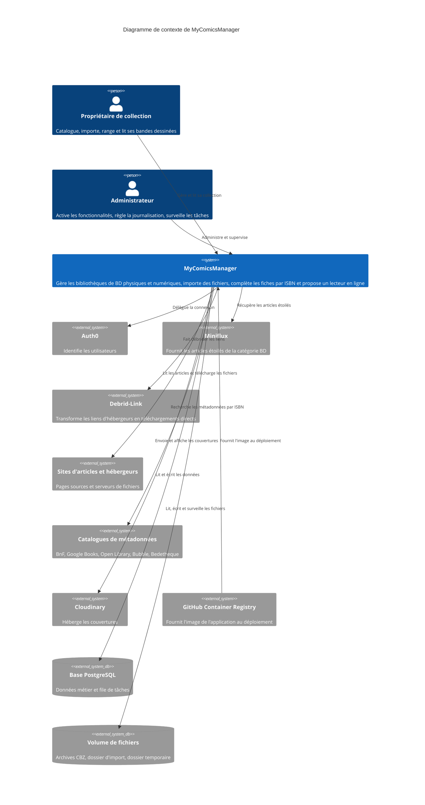

# Niveau C4 Contexte : Contexte système de MyComicsManager

Ce document donne la vue la plus haute de MyComicsManager : le système, les personnes qui l'utilisent et les systèmes externes dont il dépend. Il est écrit pour être compris sans connaissance technique. Il synthétise [c4-container.md](./c4-container.md), [c4-component.md](./c4-component.md), le `README.md`, `docs/FEED-IMPORT.md`, les ADR (`docs/adr`) et les tests (`tests/`).

## 1. Vue d'ensemble

### Description courte

MyComicsManager est une application web personnelle pour cataloguer, ranger, lire et suivre sa collection de bandes dessinées, physiques comme numériques.

### Description longue

MyComicsManager répond à un besoin simple : savoir ce que l'on possède, où cela se trouve et ce que l'on a lu, sans ressaisir les mêmes informations à la main.

- **Deux sortes de bibliothèques** : une bibliothèque « physique » recense des albums papier (série, titre, tome, ISBN, auteurs, éditeur, note) ; une bibliothèque « numérique » contient des fichiers de bandes dessinées (CBZ, CBR, ZIP, RAR, PDF) que l'on peut lire directement dans le navigateur. Un livre ne peut appartenir qu'à une bibliothèque du même type.
- **Remplissage automatique des fiches** : à partir d'un ISBN, le système interroge plusieurs catalogues en ligne pour retrouver titre, série, tome, auteurs, éditeur, date, pages et couverture. Pour un fichier numérique sans ISBN, il peut le lire sur les pages du fichier par reconnaissance de caractères (OCR).
- **Import de fichiers** : un fichier déposé par téléversement ou dans un dossier surveillé est converti, enrichi de ses métadonnées puis rangé dans la bibliothèque numérique choisie.
- **Import automatique depuis des flux** : les articles de sites de partage de BD que l'utilisateur marque d'une étoile dans Miniflux sont analysés, comparés à la collection pour éviter les doublons, téléchargés via Debrid-Link et déposés dans une bibliothèque « À trier ».
- **Lecture et suivi** : lecteur intégré avec mémorisation de la page courante, dates de lecture et notes, statistiques de collection et de lecture.
- **Exploitation** : un administrateur peut activer ou couper des fonctionnalités à chaud, régler les niveaux de journalisation et surveiller les tâches de fond.

Chaque utilisateur ne voit que ses propres bibliothèques et livres (une bibliothèque d'un autre utilisateur est traitée comme inexistante). Le système est auto-hébergé (Raspberry Pi, Docker) et l'identité des personnes est confiée à Auth0.

## 2. Personas

### Propriétaire de collection (lecteur)

- **Type** : utilisateur humain
- **Description** : personne qui possède des BD papier et/ou des fichiers numériques et se connecte avec son compte Auth0. Elle est à la fois celle qui catalogue et celle qui lit.
- **Objectifs** : retrouver rapidement un album, ne pas acheter ou télécharger deux fois le même tome, lire ses fichiers dans le navigateur, suivre ses lectures et ses statistiques, ranger ses nouveautés au bon endroit.
- **Fonctionnalités utilisées** : gestion des bibliothèques, ajout et modification de livres, recherche de métadonnées par ISBN, import de fichiers, import depuis flux (arbitrage et actions manuelles), lecture, déplacement, statistiques, réglages personnels.

### Administrateur

- **Type** : utilisateur humain (compte portant le rôle `Admin`)
- **Description** : exploitant de l'instance, qui dispose en plus des droits du propriétaire de collection d'une zone d'administration.
- **Objectifs** : activer ou désactiver des fonctionnalités sans redéploiement, changer le niveau de journalisation d'un composant en cours d'exécution, vérifier que les tâches de fond se déroulent bien.
- **Fonctionnalités utilisées** : section Administration des réglages (bascules de fonctionnalités), page des niveaux de journalisation (`/admin/log-levels`), tableau de bord des tâches (`/hangfire`).
- **Remarque** : la source exacte du rôle `Admin` côté Auth0 n'est pas établie dans le code lu (voir [c4-container.md](./c4-container.md), section Incertitudes).

### Tâches de fond planifiées (utilisateur programmatique)

- **Type** : utilisateur programmatique (tâches Hangfire dans l'application)
- **Description** : traitements exécutés sans personne devant l'écran, pour le compte du propriétaire de collection : synchronisation récurrente `feed-import-sync`, un téléchargement par décision de flux, traitement d'une tâche d'import de fichier, scan ISBN d'une bibliothèque.
- **Objectifs** : faire avancer les imports et scans longs sans bloquer l'interface, un seul à la fois (un seul travailleur, adapté au Raspberry Pi).
- **Fonctionnalités utilisées** : import depuis flux, import de fichiers, scan ISBN par OCR.

### Surveillance du dossier d'import (utilisateur programmatique)

- **Type** : service hébergé dans l'application (`FileWatcherService`)
- **Description** : détecte l'arrivée d'un fichier dans le dossier d'import d'une bibliothèque numérique et déclenche son import ; c'est aussi le point d'entrée du téléchargement issu des flux.
- **Objectifs** : importer sans intervention tout fichier déposé.
- **Fonctionnalités utilisées** : import de fichiers.

### Supervision de santé (utilisateur programmatique)

- **Type** : consommateur de `GET /health`
- **Description** : le contrôle de santé de l'image Docker interroge l'état agrégé (base, dossier d'import, Cloudinary, Debrid-Link, Miniflux), sans authentification.
- **Objectifs** : détecter un système défaillant.
- **Fonctionnalités utilisées** : supervision.

## 3. Fonctionnalités du système

### Gestion des bibliothèques

- **Description** : créer, lister (avec cartes, couleur, icône, nombre de livres, dernières couvertures), renommer, personnaliser (couleur, icône, tri par défaut) et supprimer des bibliothèques physiques ou numériques. Le renommage déplace aussi les dossiers associés.
- **Utilisateurs** : propriétaire de collection.
- **Parcours** : [Gérer ses bibliothèques](#gérer-ses-bibliothèques--propriétaire-de-collection).

### Catalogage des livres

- **Description** : ajouter un livre physique (saisie manuelle, formulaire ou scan), le modifier, le supprimer, parcourir une bibliothèque avec tri, recherche et pagination, et le déplacer vers une autre bibliothèque de même type (avec suggestion de la bibliothèque qui contient déjà le plus de tomes de la série).
- **Utilisateurs** : propriétaire de collection.
- **Parcours** : [Ajouter un livre et chercher ses métadonnées par ISBN](#rechercher-les-métadonnées-par-isbn--propriétaire-de-collection).

### Recherche de métadonnées par ISBN

- **Description** : retrouve les informations d'un album à partir de son ISBN auprès de plusieurs catalogues, dans l'ordre (BnF, Google Books, Open Library, Bubble, Bedetheque), garde le premier résultat et permet de comparer champ par champ avec les autres sources.
- **Utilisateurs** : propriétaire de collection ; tâches de fond (à l'import).
- **Parcours** : [Rechercher les métadonnées par ISBN](#rechercher-les-métadonnées-par-isbn--propriétaire-de-collection).

### Scan d'ISBN par OCR

- **Description** : lit l'ISBN imprimé dans les pages d'un livre numérique pour l'attribuer automatiquement ; si plusieurs ISBN sont trouvés, ils sont conservés comme candidats. Activable à chaud.
- **Utilisateurs** : propriétaire de collection ; tâches de fond.
- **Parcours** : [Import de fichiers](#importer-un-fichier--propriétaire-de-collection-et-tâches-de-fond) (étape de métadonnées).

### Import de fichiers

- **Description** : téléverser un fichier ou le déposer dans le dossier d'import ; contrôle de l'extension et de la taille, conversion, recherche de métadonnées, création du livre numérique, suivi de la progression sur la page Import (forcer l'échec d'une tâche bloquée, supprimer une tâche terminée).
- **Utilisateurs** : propriétaire de collection ; tâches de fond ; surveillance du dossier.
- **Parcours** : [Importer un fichier](#importer-un-fichier--propriétaire-de-collection-et-tâches-de-fond).

### Import automatique depuis des flux (Miniflux et Debrid-Link)

- **Description** : synchronise les articles étoilés d'une catégorie Miniflux, les analyse, détecte les doublons, propose un arbitrage lorsqu'un doute subsiste, télécharge via Debrid-Link et dépose les fichiers dans la bibliothèque « À trier ». Actions manuelles : forcer le téléchargement, réessayer, corriger série et tome, ignorer. Désactivée par défaut.
- **Utilisateurs** : propriétaire de collection ; tâches de fond ; administrateur (activation).
- **Parcours** : [Import depuis un flux](#importer-depuis-un-flux-miniflux-et-debrid-link--propriétaire-de-collection-et-tâches-de-fond).

### Lecture en ligne

- **Description** : lecteur intégré de livres numériques (pages affichées une à une ou en doubles pages, sens manga), avec mémorisation de la page courante et des réglages, et téléchargement de l'archive CBZ.
- **Utilisateurs** : propriétaire de collection.
- **Parcours** : [Lire un livre](#lire-un-livre--propriétaire-de-collection).

### Suivi des lectures et statistiques

- **Description** : ajouter ou supprimer des dates de lecture avec une note, et consulter des statistiques (par bibliothèque ou globales), dont un histogramme mensuel des lectures.
- **Utilisateurs** : propriétaire de collection.
- **Parcours** : [Lire un livre](#lire-un-livre--propriétaire-de-collection) (étape de fin de lecture).

### Administration et supervision

- **Description** : bascules de fonctionnalités à chaud (import depuis flux, scan OCR, sources de métadonnées), niveaux de journalisation modifiables à chaud, tableau de bord des tâches, contrôle de santé.
- **Utilisateurs** : administrateur ; supervision de santé.
- **Parcours** : [Administrer l'instance](#administrer-linstance--administrateur).

## 4. Parcours utilisateur

### Gérer ses bibliothèques : propriétaire de collection

1. **Se connecter** : l'utilisateur ouvre l'application et s'authentifie via Auth0 ; son compte est reconnu ou créé.
2. **Voir ses bibliothèques** : la page d'accueil affiche une carte par bibliothèque (nom, couleur, icône, nombre de livres, dernières couvertures).
3. **Créer une bibliothèque** : il saisit un nom unique, choisit le type (physique ou numérique), une couleur et une icône. Pour une bibliothèque numérique, les dossiers de stockage et d'import sont créés.
4. **Parcourir** : il ouvre une bibliothèque, cherche, trie et fait défiler ses livres.
5. **Modifier** : il change couleur, icône, tri par défaut ou nom ; un renommage déplace les dossiers, avec retour arrière en cas d'échec partiel.
6. **Supprimer** : il confirme ; les dossiers d'une bibliothèque numérique sont supprimés avant la bibliothèque elle-même.

### Rechercher les métadonnées par ISBN : propriétaire de collection

1. **Démarrer l'ajout** : l'utilisateur choisit d'ajouter un livre dans une bibliothèque physique (formulaire, saisie manuelle ou scan).
2. **Saisir l'ISBN** : le système le valide et le normalise.
3. **Interroger les catalogues** : le système cherche dans l'ordre BnF, Google Books, Open Library, Bubble puis Bedetheque, en sautant les sources désactivées, et garde le premier résultat.
4. **Compléter la couverture** : si besoin, une couverture complémentaire est cherchée puis envoyée à Cloudinary.
5. **Vérifier et corriger** : la fiche est préremplie (série, tome, titre, auteurs, éditeur, date, pages) ; l'utilisateur ajuste ce qui est faux.
6. **Enregistrer** : le système refuse un doublon (même ISBN) et crée le livre ; une note peut créer une première date de lecture.
7. **Comparer plus tard** : depuis la page « Find book details » d'un livre existant, il compare champ par champ les valeurs de chaque source et retient celles qu'il veut.

### Importer un fichier : propriétaire de collection et tâches de fond

1. **Fournir le fichier** : l'utilisateur téléverse un fichier depuis la page Import, ou le dépose dans le dossier d'import de la bibliothèque numérique.
2. **Contrôler** : le système vérifie l'extension (CBZ, CBR, ZIP, RAR, PDF) et la taille maximale (1 024 Mo par défaut).
3. **Créer la tâche** : une tâche d'import est enregistrée (une seule tâche active par fichier) et mise en file.
4. **Traiter en fond** : la tâche de fond vérifie l'espace disque, extrait les pages, les convertit au format WebP et fait avancer la progression visible dans l'interface.
5. **Trouver les métadonnées** : le système lit le fichier ComicInfo.xml, sinon l'ISBN du nom de fichier, sinon l'ISBN lu par OCR, puis interroge les catalogues.
6. **Finaliser** : la couverture est envoyée à Cloudinary (sans bloquer en cas d'échec), l'archive CBZ est construite, déplacée dans la bibliothèque, et le livre numérique est créé.
7. **Suivre** : l'utilisateur voit l'état dans la page Import ; il peut forcer l'échec d'une tâche bloquée ou supprimer une tâche terminée ou échouée.

### Importer depuis un flux (Miniflux et Debrid-Link) : propriétaire de collection et tâches de fond

1. **Marquer l'article** : dans Miniflux, l'utilisateur met une étoile sur un article de la catégorie « BD ».
2. **Synchroniser** : toutes les 30 minutes par défaut, ou à la demande avec « Sync now », la tâche récurrente récupère les articles étoilés, les enregistre comme décisions « en attente », puis retire l'étoile dans Miniflux.
3. **Analyser** : le système lit la page de l'article (sites autorisés seulement), relève l'ISBN s'il est indiqué, extrait les liens vers les hébergeurs autorisés et regroupe les miroirs d'un même fichier ; des fichiers différents deviennent des livres différents.
4. **Comparer à la collection** : doublon certain, il est ignoré ; doublon probable ou regroupement ambigu, il attend l'arbitrage ; sinon les liens sont retenus.
5. **Arbitrer** : sur la page Feeds, l'utilisateur déplie la décision, choisit le bon lien, fusionne des miroirs ou confirme/infirme le doublon. Un badge du menu indique les décisions à arbitrer.
6. **Télécharger** : si la clé Debrid-Link est configurée, une tâche de fond essaie les miroirs dans l'ordre de priorité, fait débrider le lien par Debrid-Link, télécharge le fichier (nom, extension et taille contrôlés) et le dépose dans le dossier d'import de la bibliothèque « À trier », créée au besoin.
7. **Importer** : le fichier suit ensuite le parcours « Importer un fichier » ; le bouton « Track import » ouvre la page Import sur « À trier ».
8. **Ranger** : l'utilisateur déplace le livre vers la bonne bibliothèque avec « Move to… ».
9. **En cas de problème** : il peut forcer le téléchargement malgré un doublon, réessayer, corriger série et tome, ou ignorer ; un fichier uniquement proposé sur un hébergeur non autorisé reste en échec avec ses liens pour un téléchargement manuel.

### Lire un livre : propriétaire de collection

1. **Ouvrir la fiche** : depuis une bibliothèque numérique, l'utilisateur ouvre un livre puis lance la lecture.
2. **Charger le lecteur** : le système donne les informations du livre, la dernière page lue et les réglages mémorisés.
3. **Lire** : les pages sont servies à la demande (image de chaque page, mise en cache) ; l'utilisateur lit en page simple ou en double page, avec ou sans sens manga.
4. **Reprendre plus tard** : la page courante et les réglages sont enregistrés au fil de la lecture.
5. **Terminer** : il ajoute une date de lecture avec une note ; les statistiques se mettent à jour.
6. **Télécharger** (facultatif) : il récupère l'archive CBZ du livre.

### Administrer l'instance : administrateur

1. **Se connecter** avec un compte portant le rôle `Admin`.
2. **Gérer les fonctionnalités** : dans Réglages, section Administration, il active ou coupe l'import depuis flux, le scan OCR ou une source de métadonnées ; l'activation de l'import est refusée si une configuration obligatoire manque, et la tâche récurrente est ajoutée ou retirée aussitôt.
3. **Régler la journalisation** : sur `/admin/log-levels`, il change le niveau d'un composant sans redémarrer.
4. **Surveiller les tâches** : sur `/hangfire`, il vérifie que `feed-import-sync` est présent et que les tâches aboutissent.

### Parcours des utilisateurs programmatiques

#### Tâches de fond (Hangfire)

1. **Déclenchement** : par un horaire (synchronisation des flux) ou par une action de l'utilisateur (import, scan ISBN, téléchargement).
2. **Exécution séquentielle** : un seul travailleur traite les files `import` puis `default` ; un scan ISBN ne s'exécute pas deux fois en parallèle pour une même bibliothèque.
3. **Résultat** : l'état est écrit en base et visible dans l'interface (Feeds, Import, scan).

#### Surveillance du dossier d'import

1. Un fichier apparaît dans le dossier d'import d'une bibliothèque numérique.
2. Le service crée la tâche d'import correspondante.
3. Le parcours « Importer un fichier » se poursuit.

#### Supervision de santé

1. L'image Docker interroge `GET /health` toutes les 30 secondes.
2. L'application contrôle la base, le dossier d'import, Cloudinary, Debrid-Link et Miniflux, puis répond avec l'état agrégé.

## 5. Systèmes externes et dépendances

### Auth0

- **Type** : fournisseur d'identité (service en ligne)
- **Description** : authentifie les personnes et fournit leur identité.
- **Type d'intégration** : OpenID Connect (connexion et déconnexion par redirection)
- **Finalité** : ne pas gérer de mots de passe dans l'application.

### PostgreSQL

- **Type** : base de données (auto-hébergée)
- **Description** : stocke livres, bibliothèques, utilisateurs, tâches d'import, décisions de flux, réglages et état des tâches de fond.
- **Type d'intégration** : accès SQL ; migrations appliquées au démarrage
- **Finalité** : conservation durable des données.

### Système de fichiers local (volume)

- **Type** : stockage de fichiers
- **Description** : archives CBZ des bibliothèques, dossier d'import surveillé, dossier temporaire.
- **Type d'intégration** : lecture, écriture et surveillance de dossiers
- **Finalité** : conserver les fichiers volumineux, hors base.

### Miniflux

- **Type** : agrégateur de flux RSS (service tiers sur le réseau Docker)
- **Description** : fournit les articles étoilés de la catégorie « BD ».
- **Type d'intégration** : API REST avec clé d'API ; l'étoile est retirée après enregistrement
- **Finalité** : source des imports automatiques. Optionnel (désactivé par défaut).

### Debrid-Link

- **Type** : service de débridage de liens (service en ligne)
- **Description** : transforme un lien d'hébergeur en lien de téléchargement direct.
- **Type d'intégration** : API REST en HTTPS avec clé d'API ; téléchargement depuis des domaines Debrid-Link autorisés
- **Finalité** : télécharger les fichiers des articles importés. Optionnel.

### Sites d'articles et hébergeurs de fichiers

- **Type** : sites web tiers (planete-bd.org, zone-ebook.com et hébergeurs autorisés par configuration)
- **Description** : pages d'articles contenant les liens de téléchargement, puis serveurs de fichiers.
- **Type d'intégration** : lecture de pages en HTTPS limitée à une liste de domaines autorisés
- **Finalité** : extraire série, tome, ISBN et liens.

### Catalogues de métadonnées

- **Type** : services en ligne (BnF, Google Books, Open Library, Bubble via Algolia, Bedetheque via SerpApi)
- **Description** : fournissent les informations d'un album à partir de son ISBN.
- **Type d'intégration** : appels HTTPS interrogés dans l'ordre, chaque source pouvant être désactivée ; Bedetheque est mis en pause après un blocage Cloudflare
- **Finalité** : préremplir les fiches.

### Cloudinary

- **Type** : hébergement d'images (service en ligne)
- **Description** : stocke les couvertures.
- **Type d'intégration** : API HTTPS (envoi, lecture, contrôle de santé)
- **Finalité** : afficher les couvertures sans les stocker sur le Raspberry Pi.

### Tesseract (OCR)

- **Type** : outil local installé avec l'application
- **Description** : lit le texte des pages d'images.
- **Type d'intégration** : programme local appelé par l'application
- **Finalité** : retrouver l'ISBN d'un livre numérique. Optionnel.

### GitHub Container Registry

- **Type** : registre d'images (service en ligne)
- **Description** : héberge l'image `ghcr.io/slucky31/mcm`.
- **Type d'intégration** : téléchargement de l'image au déploiement
- **Finalité** : distribuer l'application. Dépendance de déploiement, sans échange à l'exécution.

## 6. Diagramme de contexte

Les tâches de fond, la surveillance du dossier d'import et Tesseract s'exécutent dans l'application elle-même : ils ne sont donc pas représentés comme systèmes distincts.

## 7. Documentation associée

- [Documentation des conteneurs](./c4-container.md)
- [Documentation des composants](./c4-component.md)
- [Spécification de l'API HTTP (OpenAPI)](./apis/mycomicsmanager-web-api.yaml)
- [Import automatique depuis Miniflux](../docs/FEED-IMPORT.md)
- [Décisions d'architecture (ADR)](../docs/adr/README.md)
