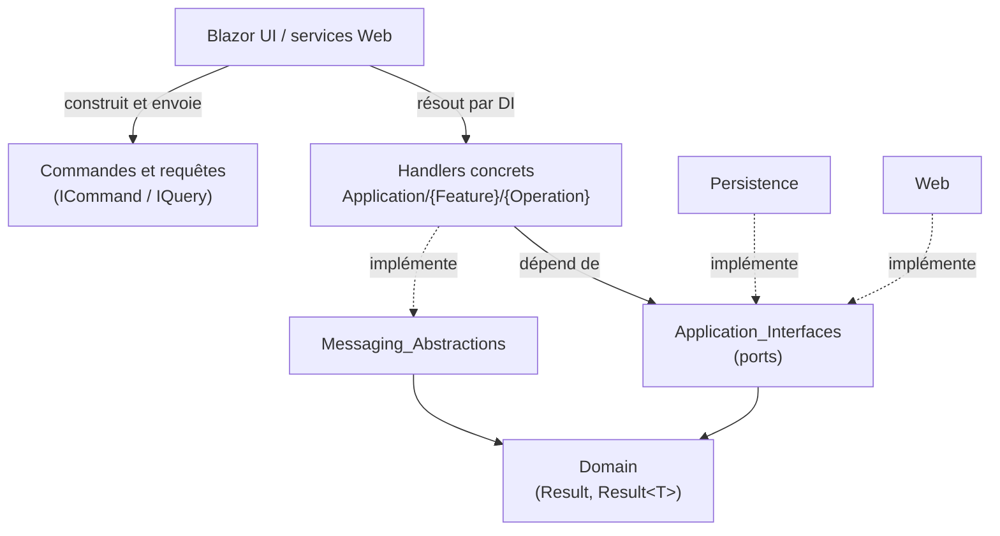
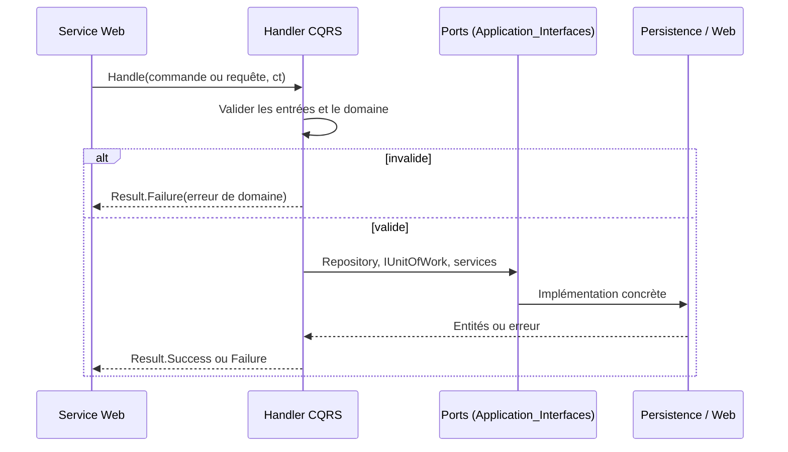

# Contrats Application et fondation CQRS

## Objectif

Le module `Application_Contracts___CQRS_Foundation` (dossier `Application/`) est le socle contractuel de la couche Application, dans une Clean Architecture .NET 10. Il ne contient que des contrats et aucune logique métier. Il réunit deux ensembles :

- **Les abstractions de messagerie CQRS** (`Application/Abstractions/Messaging`). Ce sont les marqueurs `ICommand` et `IQuery`, ainsi que les contrats des handlers qui les traitent.
- **Les ports applicatifs** (`Application/Interfaces`). Ce sont les interfaces dont les handlers ont besoin : persistance, lecture, fichiers et médias, catalogues bibliographiques, orchestration et services transverses.

La couche Application ne dépend que de `Domain`, dont elle reprend le pattern `Result` / `Result<T>` pour signaler les erreurs métier sans exception. `Persistence` et `Web` fournissent les implémentations. `Architecture.Tests` vérifie cette règle de dépendance.

## Architecture

Les handlers sont enregistrés automatiquement par Scrutor dans `ApplicationDependencyInjection.cs`. Ils ne connaissent que les interfaces, et la composition root (`Web`) relie les implémentations.

## Flux d'exécution type

## Sous-modules

| Sous-module | Contenu | Documentation |
|---|---|---|
| `Messaging_Abstractions` | `IBaseCommand`, `ICommand`, `ICommand<TResponse>`, `IQuery<TResponse>`, `ICommandHandler<…>`, `IQueryHandler<…>`. Tous les handlers sont asynchrones et retournent `Result` ou `Result<T>`. | [Messaging_Abstractions](Application_Contracts___CQRS_Foundation/Messaging_Abstractions.md) |
| `Application_Interfaces` | Ports regroupés en six familles : persistance (`IRepository`, `IUnitOfWork`…), lecture (`IBookReadService`, `IPagedList`…), fichiers et médias, catalogues (`IComicSearchService`…), orchestration (`IImportOrchestrator`…) et transverse (`ICurrentUserService`, `IFeatureToggles`). | [Application_Interfaces](Application_Contracts___CQRS_Foundation/Application_Interfaces.md) |

## Principes communs

- Les erreurs connues passent par `Result` et `Result<T>`, jamais par des exceptions.
- Chaque opération asynchrone accepte un `CancellationToken`.
- Un handler valide ses entrées avant tout appel à un repository ou à un service externe. Dans une commande, les validations de domaine précèdent aussi les effets de bord sur les fichiers.
- Aucun type EF Core n'apparaît dans les contrats. `IPagedList<T>` masque la pagination.
- Les requêtes paginées se terminent par une clé de tri unique, pour garder un ordre stable.

## Modules liés

Les implémentations des handlers et des ports se trouvent dans d'autres modules :

- [Book___Library_Use_Cases](Book___Library_Use_Cases.md), [Comic_Info_Search](Comic_Info_Search.md), [Feed_Import_Pipeline](Feed_Import_Pipeline.md) et [File_Import_Pipeline](File_Import_Pipeline.md) : les cas d'usage qui implémentent les contrats CQRS.
- [Data_Persistence___Queries](Data_Persistence___Queries.md) et [File_Storage___Media_Processing](File_Storage___Media_Processing.md) : les implémentations des ports de persistance, de lecture, de fichiers et de médias.
- [Web_Application_Services](Web_Application_Services.md) : les services Web qui invoquent les handlers.
- [Domain_Model](Domain_Model.md) : le modèle de domaine et les primitives `Result`.